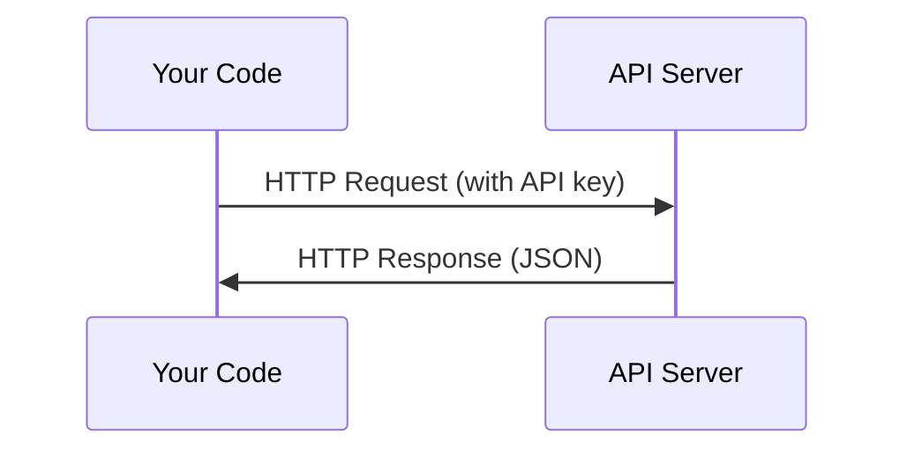

# API 与密钥

> 每个 AI API 的工作方式都一样：发送请求，拿到响应。细节会变，模式不变。

**Type:** Build
**Languages:** Python, TypeScript
**Prerequisites:** Phase 0, Lesson 01
**Time:** ~30 minutes

## 学习目标

- 使用 environment variables 和 `.env` files 安全存储 API keys
- 分别用 Anthropic Python SDK 和 raw HTTP 发起一次 LLM API call
- 对比基于 SDK 和 raw HTTP 的 request/response formats，以便调试
- 识别并处理常见 API errors，包括 authentication 和 rate limits

## 问题

从 Phase 11 开始，你会调用 LLM APIs（Anthropic、OpenAI、Google）。在 Phase 13-16，你会构建循环使用这些 APIs 的 agents。你需要知道 API keys 如何工作、如何安全存放它们，以及如何完成第一次 API call。

## 概念



每个 API call 都包含：

1. 一个 endpoint（URL）
2. 一个 API key（authentication）
3. 一个 request body（你想要什么）
4. 一个 response body（你拿回什么）

## Build It

### Step 1: 安全存储 API keys

永远不要把 API keys 写进代码。使用 environment variables。

```bash
export ANTHROPIC_API_KEY="sk-ant-..."
export OPENAI_API_KEY="sk-..."
```

或者使用 `.env` file（把它加入 `.gitignore`）：

```text
ANTHROPIC_API_KEY=sk-ant-...
OPENAI_API_KEY=sk-...
```

### Step 2: 第一次 API call（Python）

```python
import anthropic

client = anthropic.Anthropic()

response = client.messages.create(
    model="claude-sonnet-4-20250514",
    max_tokens=256,
    messages=[{"role": "user", "content": "What is a neural network in one sentence?"}]
)

print(response.content[0].text)
```

### Step 3: 第一次 API call（TypeScript）

```typescript
import Anthropic from "@anthropic-ai/sdk";

const client = new Anthropic();

const response = await client.messages.create({
  model: "claude-sonnet-4-20250514",
  max_tokens: 256,
  messages: [{ role: "user", content: "What is a neural network in one sentence?" }],
});

console.log(response.content[0].text);
```

### Step 4: Raw HTTP（不使用 SDK）

```python
import os
import urllib.request
import json

url = "https://api.anthropic.com/v1/messages"
headers = {
    "Content-Type": "application/json",
    "x-api-key": os.environ["ANTHROPIC_API_KEY"],
    "anthropic-version": "2023-06-01",
}
body = json.dumps({
    "model": "claude-sonnet-4-20250514",
    "max_tokens": 256,
    "messages": [{"role": "user", "content": "What is a neural network in one sentence?"}],
}).encode()

req = urllib.request.Request(url, data=body, headers=headers, method="POST")
with urllib.request.urlopen(req) as resp:
    result = json.loads(resp.read())
    print(result["content"][0]["text"])
```

这就是 SDKs 在底层替你做的事情。理解 raw HTTP call，会让调试更容易。

## Use It

在这门课程中：

| API | When you need it | Free tier |
|-----|-----------------|-----------|
| Anthropic (Claude) | Phases 11-16 (agents, tools) | $5 credit on signup |
| OpenAI | Phase 11 (comparison) | $5 credit on signup |
| Hugging Face | Phases 4-10 (models, datasets) | Free |

你现在不需要把它们全部配置好。等 lesson 需要时再配置。

## Ship It

本课产出：

- `outputs/prompt-api-troubleshooter.md` - 诊断常见 API errors

## 练习

1. 获取一个 Anthropic API key，并完成你的第一次 API call。
2. 尝试 raw HTTP 版本，并把 response format 与 SDK 版本对比。
3. 故意使用错误的 API key，并阅读错误消息。

## 关键术语

| Term | 常见说法 | 实际含义 |
|------|----------|----------|
| API key | “API 的密码” | 标识你的账户并授权请求的唯一字符串 |
| Rate limit | “它们在限流我” | 为防止滥用并确保公平使用而设置的每分钟/每小时最大请求数 |
| Token | “一个词”（在 API context 中） | 计费单位：input tokens 和 output tokens 会分别计数并计费 |
| Streaming | “实时响应” | 逐词接收响应，而不是等待完整响应生成后一次性返回 |
