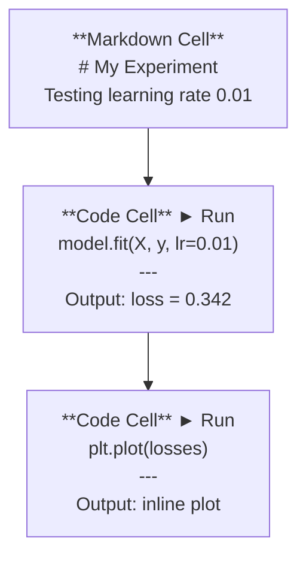
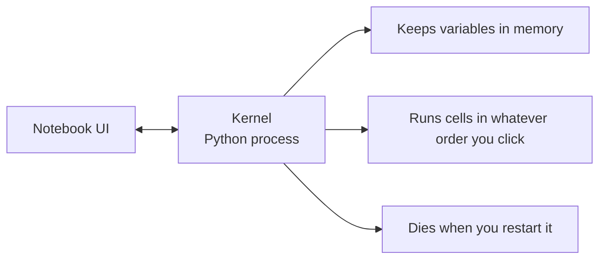

# Jupyter Notebooks

> Notebooks 是 AI engineering 的实验台。你在这里 prototype，然后把有效的部分移进 production。

**Type:** Build
**Languages:** Python
**Prerequisites:** Phase 0, Lesson 01
**Time:** ~30 minutes

## 学习目标

- 安装并启动 JupyterLab、Jupyter Notebook，或带 Jupyter extension 的 VS Code
- 使用 magic commands（`%timeit`、`%%time`、`%matplotlib inline`）做 benchmark 和 inline visualization
- 区分什么时候用 notebooks、什么时候用 scripts，并应用 “explore in notebooks, ship in scripts” workflow
- 识别并避免常见 notebook traps：out-of-order execution、hidden state 和 memory leaks

## 问题

每篇 AI paper、tutorial 和 Kaggle competition 都在用 Jupyter notebooks。它们让你分块运行代码、直接看到 inline outputs、把代码和解释混在一起，并快速迭代。如果你试图不用 notebooks 学 AI，那就像做数学作业却没有草稿纸。

但 notebooks 也有真实陷阱。很多人把它们用于一切，包括那些 notebooks 很不擅长的事情。知道什么时候该用 notebook、什么时候该用 script，会帮你避开后面的 debugging nightmares。

## 概念

Notebook 是一组 cells。每个 cell 要么是 code，要么是 text。



Kernel 是一个在后台运行的 Python process。当你运行一个 cell，它会把代码发送给 kernel；kernel 执行代码并把结果返回。所有 cells 共享同一个 kernel，所以变量会在 cells 之间保留。



这个 “whatever order you click” 同时是 superpower 和 foot-gun。

## Build It

### Step 1：选择你的 interface

三种选择，一种格式：

| Interface | Install | Best for |
|-----------|---------|----------|
| JupyterLab | `pip install jupyterlab` then `jupyter lab` | 完整 IDE experience、multiple tabs、file browser、terminal |
| Jupyter Notebook | `pip install notebook` then `jupyter notebook` | 简单、轻量、一次打开一个 notebook |
| VS Code | Install "Jupyter" extension | 已经在你的 editor 中，带 git integration 和 debugging |

三者都读写同一种 `.ipynb` 文件。选你喜欢的即可。JupyterLab 是 AI work 中最常见的选择。

```bash
pip install jupyterlab
jupyter lab
```

### Step 2：重要的 keyboard shortcuts

你会在两种 modes 中操作。按 `Escape` 进入 command mode（左侧蓝色条），按 `Enter` 进入 edit mode（绿色条）。

**Command mode（最常用）：**

| Key | Action |
|-----|--------|
| `Shift+Enter` | 运行 cell，并移动到下一个 |
| `A` | 在上方插入 cell |
| `B` | 在下方插入 cell |
| `DD` | 删除 cell |
| `M` | 转换为 markdown |
| `Y` | 转换为 code |
| `Z` | 撤销 cell operation |
| `Ctrl+Shift+H` | 显示所有 shortcuts |

**Edit mode：**

| Key | Action |
|-----|--------|
| `Tab` | Autocomplete |
| `Shift+Tab` | 显示 function signature |
| `Ctrl+/` | Toggle comment |

`Shift+Enter` 是你每天会用上千次的那个。先学它。

### Step 3：Cell types

**Code cells** 运行 Python 并显示 output：

```python
import numpy as np
data = np.random.randn(1000)
data.mean(), data.std()
```

Output: `(0.0032, 0.9987)`

**Markdown cells** 渲染 formatted text。用它们记录你在做什么，以及为什么这样做。支持 headers、bold、italic、LaTeX math（`$E = mc^2$`）、tables 和 images。

### Step 4：Magic commands

这些不是 Python。它们是 Jupyter-specific commands，以 `%`（line magic）或 `%%`（cell magic）开头。

**测量代码耗时：**

```python
%timeit np.random.randn(10000)
```

Output: `45.2 us +/- 1.3 us per loop`

```python
%%time
model.fit(X_train, y_train, epochs=10)
```

Output: `Wall time: 2.34 s`

`%timeit` 会多次运行代码并取平均。`%%time` 只运行一次。Microbenchmarks 用 `%timeit`，training runs 用 `%%time`。

**启用 inline plots：**

```python
%matplotlib inline
```

之后每个 `plt.plot()` 或 `plt.show()` 都会直接在 notebook 里渲染。

**不离开 notebook 安装 packages：**

```python
!pip install scikit-learn
```

`!` prefix 会运行任意 shell command。

**检查 environment variables：**

```python
%env CUDA_VISIBLE_DEVICES
```

### Step 5：Inline 显示 rich output

Notebooks 会自动显示 cell 中最后一个 expression。但你也可以控制它：

```python
import pandas as pd

df = pd.DataFrame({
    "model": ["Linear", "Random Forest", "Neural Net"],
    "accuracy": [0.72, 0.89, 0.94],
    "training_time": [0.1, 2.3, 45.6]
})
df
```

这会渲染成 formatted HTML table，而不是 text dump。Plots 也是一样：

```python
import matplotlib.pyplot as plt

plt.figure(figsize=(8, 4))
plt.plot([1, 2, 3, 4], [1, 4, 2, 3])
plt.title("Inline Plot")
plt.show()
```

Plot 会出现在 cell 正下方。这就是 notebooks 主导 AI work 的原因。你能把 data、plot 和 code 放在一起看。

Images：

```python
from IPython.display import Image, display
display(Image(filename="architecture.png"))
```

### Step 6：Google Colab

Colab 是云端的免费 Jupyter notebook。它提供 GPU、预装 libraries 和 Google Drive integration。不需要本地 setup。

1. 打开 [colab.research.google.com](https://colab.research.google.com)
2. 上传本课程中的任意 `.ipynb` 文件
3. Runtime > Change runtime type > T4 GPU (free)

Colab 和本地 Jupyter 的区别：

- Files 不会在 sessions 之间持久保存（保存到 Drive 或 download）
- 预装：numpy、pandas、matplotlib、torch、tensorflow、sklearn
- 用 `from google.colab import files` upload/download files
- 用 `from google.colab import drive; drive.mount('/content/drive')` 做 persistent storage
- Free tier 在 90 分钟 inactivity 后会 session timeout

## Use It

### Notebooks vs Scripts：什么时候用哪个

| Use notebooks for | Use scripts for |
|-------------------|-----------------|
| 探索 dataset | Training pipelines |
| Prototype model | Reusable utilities |
| Visualizing results | 任何带 `if __name__` 的东西 |
| 解释你的工作 | 定时运行的 code |
| Quick experiments | Production code |
| Course exercises | Packages and libraries |

规则是：**explore in notebooks, ship in scripts**。

AI 中常见的 workflow：

1. 在 notebook 中探索 data
2. 在 notebook 中 prototype model
3. 一旦可行，把 code 移到 `.py` 文件
4. 再把这些 `.py` 文件 import 回 notebook，继续实验

### 常见陷阱

**Out-of-order execution。** 你先运行 cell 5，再运行 cell 2，然后运行 cell 7。这个 notebook 在你机器上可用，但别人从头到尾运行时会坏掉。修复：分享前执行 Kernel > Restart & Run All。

**Hidden state。** 你删除了一个 cell，但它创建的变量仍在内存里。Notebook 看起来很干净，却依赖一个 ghost cell。修复：定期 restart kernel。

**Memory leaks。** 加载一个 4GB dataset，训练一个 model，再加载另一个 dataset。什么都没有被释放。修复：`del variable_name` 和 `gc.collect()`，或 restart kernel。

## Ship It

本课产出：

- `outputs/prompt-notebook-helper.md`，用于 debugging notebook issues

## Exercises

1. 打开 JupyterLab，创建一个 notebook，并用 `%timeit` 比较 list comprehension 与 numpy 创建 100,000 个 random numbers array 的速度
2. 创建一个同时包含 markdown 和 code cells 的 notebook：加载 CSV、显示 dataframe、绘制 chart。然后运行 Kernel > Restart & Run All，验证它可以从头到尾运行
3. 把 `code/notebook_tips.py` 里的代码复制进一个 Colab notebook，并用免费 GPU 运行

## Key Terms

| Term | What people say | What it actually means |
|------|----------------|----------------------|
| Kernel | “The thing running my code” | 执行 cells 并在内存中保存变量的独立 Python process |
| Cell | “A code block” | Notebook 中可独立运行的 unit，可以是 code 或 markdown |
| Magic command | “Jupyter tricks” | 以 `%` 或 `%%` 为 prefix、控制 notebook environment 的特殊 commands |
| `.ipynb` | “Notebook file” | 包含 cells、outputs 和 metadata 的 JSON file。代表 IPython Notebook |

## Further Reading

- [JupyterLab Docs](https://jupyterlab.readthedocs.io/) for the full feature set
- [Google Colab FAQ](https://research.google.com/colaboratory/faq.html) for Colab-specific limits and features
- [28 Jupyter Notebook Tips](https://www.dataquest.io/blog/jupyter-notebook-tips-tricks-shortcuts/) for power-user shortcuts
