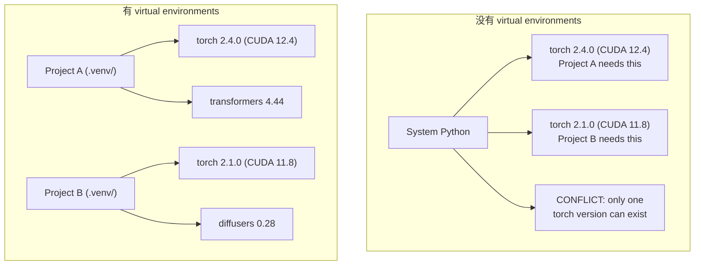

# Python 环境

> Dependency hell 真的存在。Virtual environment 是解药。

**Type:** Build
**Languages:** Shell
**Prerequisites:** Phase 0, Lesson 01
**Time:** ~30 minutes

## 学习目标

- 使用 `uv`、`venv` 或 `conda` 创建隔离的 virtual environment。
- 编写带 optional dependency groups 的 `pyproject.toml`，并生成 lockfile 保证可复现。
- 诊断并修复常见坑：全局安装、pip/conda 混用、CUDA version mismatch。
- 为依赖冲突的项目实现按 phase 划分的环境策略。

## 问题

你为一个 fine-tuning 项目安装了 PyTorch 2.4。下周，另一个项目需要 PyTorch 2.1，因为它的 CUDA build 被 pin 住了。你在全局环境里升级，于是第一个项目坏了。你降级，于是第二个项目坏了。

这就是 dependency hell。它在 AI/ML 工作中经常出现，因为：

- PyTorch、JAX 和 TensorFlow 各自发布自己的 CUDA bindings。
- Model library 会 pin 特定 framework version。
- 全局 `pip install` 会覆盖原来的包。
- CUDA 11.8 build 不能和 CUDA 12.x driver 正常搭配（反过来也一样）。

解决办法：每个项目都拥有自己的隔离环境，以及自己的 packages。

## 概念



## Build It

### 选项 1：uv venv（推荐）

`uv` 是最快的 Python package manager（比 pip 快 10-100 倍）。它把 virtual environment、Python version 和 dependency resolution 放在一个工具里处理。

```bash
curl -LsSf https://astral.sh/uv/install.sh | sh

uv python install 3.12

cd your-project
uv venv
source .venv/bin/activate
```

安装 packages：

```bash
uv pip install torch numpy
```

一步创建带 `pyproject.toml` 的项目：

```bash
uv init my-ai-project
cd my-ai-project
uv add torch numpy matplotlib
```

### 选项 2：venv（内置）

如果不能安装 `uv`，Python 自带 `venv`：

```bash
python3 -m venv .venv
source .venv/bin/activate  # Linux/macOS
.venv\Scripts\activate     # Windows

pip install torch numpy
```

它比 `uv` 慢，但只要安装了 Python，就到处可用。

### 选项 3：conda（需要时使用）

Conda 管理 CUDA toolkit、cuDNN 和 C library 这类非 Python 依赖。在这些情况下使用它：

- 你需要特定 CUDA toolkit version，但不想系统级安装。
- 你在共享 cluster 上，不能安装 system packages。
- 某个 library 的安装说明写着“use conda”。

```bash
# Install miniconda (not the full Anaconda)
curl -LsSf https://repo.anaconda.com/miniconda/Miniconda3-latest-Linux-x86_64.sh -o miniconda.sh
bash miniconda.sh -b

conda create -n myproject python=3.12
conda activate myproject

conda install pytorch torchvision torchaudio pytorch-cuda=12.4 -c pytorch -c nvidia
```

一条规则：如果某个环境使用 conda，就在这个环境里全部使用 conda 管理 package。往 conda env 里混用 `pip install` 会造成依赖冲突，而且很难 debug。

### 本课程：按 phase 管理环境

你可以为整门课创建一个环境。不要这样做。不同 phase 需要不同的、甚至相互冲突的依赖。

策略：

```text
ai-engineering-from-scratch/
├── .venv/                    <-- phases 0-3 共用的轻量环境
├── phases/
│   ├── 04-neural-networks/
│   │   └── .venv/            <-- PyTorch env
│   ├── 05-cnns/
│   │   └── .venv/            <-- 同一个 PyTorch env（symlink 或 shared）
│   ├── 08-transformers/
│   │   └── .venv/            <-- 可能需要不同 transformer versions
│   └── 11-llm-apis/
│       └── .venv/            <-- API SDKs，不需要 torch
```

`code/env_setup.sh` 中的脚本会为本课程创建 base environment。

## pyproject.toml 基础

每个 Python project 都应该有一个 `pyproject.toml`。它用一个文件取代 `setup.py`、`setup.cfg` 和 `requirements.txt`。

```toml
[project]
name = "ai-engineering-from-scratch"
version = "0.1.0"
requires-python = ">=3.11"
dependencies = [
    "numpy>=1.26",
    "matplotlib>=3.8",
    "jupyter>=1.0",
    "scikit-learn>=1.4",
]

[project.optional-dependencies]
torch = ["torch>=2.3", "torchvision>=0.18"]
llm = ["anthropic>=0.39", "openai>=1.50"]
```

然后安装：

```bash
uv pip install -e ".[torch]"    # base + PyTorch
uv pip install -e ".[llm]"     # base + LLM SDKs
uv pip install -e ".[torch,llm]" # everything
```

## Lockfiles

Lockfile 会把每个 dependency（包括 transitive dependency）pin 到精确版本。这保证可复现性：任何人从 lockfile 安装，都会得到完全相同的 packages。

```bash
# uv generates uv.lock automatically when using uv add
uv add numpy

# pip-tools approach
uv pip compile pyproject.toml -o requirements.lock
uv pip install -r requirements.lock
```

把 lockfile commit 到 git。别人 clone repo 后，从 lockfile 安装，就会得到一致版本。

## 常见错误

### 1. 全局安装

```bash
pip install torch  # BAD: installs to system Python

source .venv/bin/activate
pip install torch  # GOOD: installs to virtual environment
```

检查 package 会装到哪里：

```bash
which python       # should show .venv/bin/python, not /usr/bin/python
which pip          # should show .venv/bin/pip
```

### 2. 混用 pip 和 conda

```bash
conda create -n myenv python=3.12
conda activate myenv
conda install pytorch -c pytorch
pip install some-other-package   # BAD: can break conda's dependency tracking
conda install some-other-package # GOOD: let conda manage everything
```

如果必须在 conda 里使用 pip（有些 package 只有 pip 版），先安装所有 conda packages，再最后安装 pip packages。

### 3. 忘记 activate

```bash
python train.py           # uses system Python, missing packages
source .venv/bin/activate
python train.py           # uses project Python, packages found
```

你的 shell prompt 应该显示环境名：

```text
(.venv) $ python train.py
```

### 4. 把 .venv commit 到 git

```bash
echo ".venv/" >> .gitignore
```

Virtual environment 通常有 200MB-2GB。它们是本地的，不能跨机器移植。应该 commit `pyproject.toml` 和 lockfile。

### 5. CUDA version mismatch

```bash
nvidia-smi                # shows driver CUDA version (e.g., 12.4)
python -c "import torch; print(torch.version.cuda)"  # shows PyTorch CUDA version

# These must be compatible.
# PyTorch CUDA version must be <= driver CUDA version.
```

## Use It

运行 setup script 创建课程环境：

```bash
bash phases/00-setup-and-tooling/06-python-environments/code/env_setup.sh
```

这会在 repo root 创建一个 `.venv`，安装并验证核心依赖。

## 练习

1. 运行 `env_setup.sh`，确认所有检查通过。
2. 创建第二个 virtual environment，在里面安装不同版本的 numpy，并确认两个环境相互隔离。
3. 为一个同时需要 PyTorch 和 Anthropic SDK 的项目编写 `pyproject.toml`。
4. 故意在不 activate venv 的情况下全局安装一个 package，观察它去了哪里，然后卸载它。

## 关键术语

| Term | 常见说法 | 实际含义 |
|------|----------|----------|
| Virtual environment | “A venv” | 一个隔离目录，包含 Python interpreter 和 packages，与 system Python 分离 |
| Lockfile | “Pinned dependencies” | 列出每个 package 及其精确版本的文件，保证不同机器安装一致 |
| pyproject.toml | “The new setup.py” | 标准 Python project configuration file，取代 setup.py/setup.cfg/requirements.txt |
| Transitive dependency | “A dependency of a dependency” | Package B 依赖 C；如果你安装依赖 B 的 A，C 就是 A 的 transitive dependency |
| CUDA mismatch | “My GPU isn't working” | PyTorch 编译所用 CUDA version 与 GPU driver 支持的 version 不一致 |
