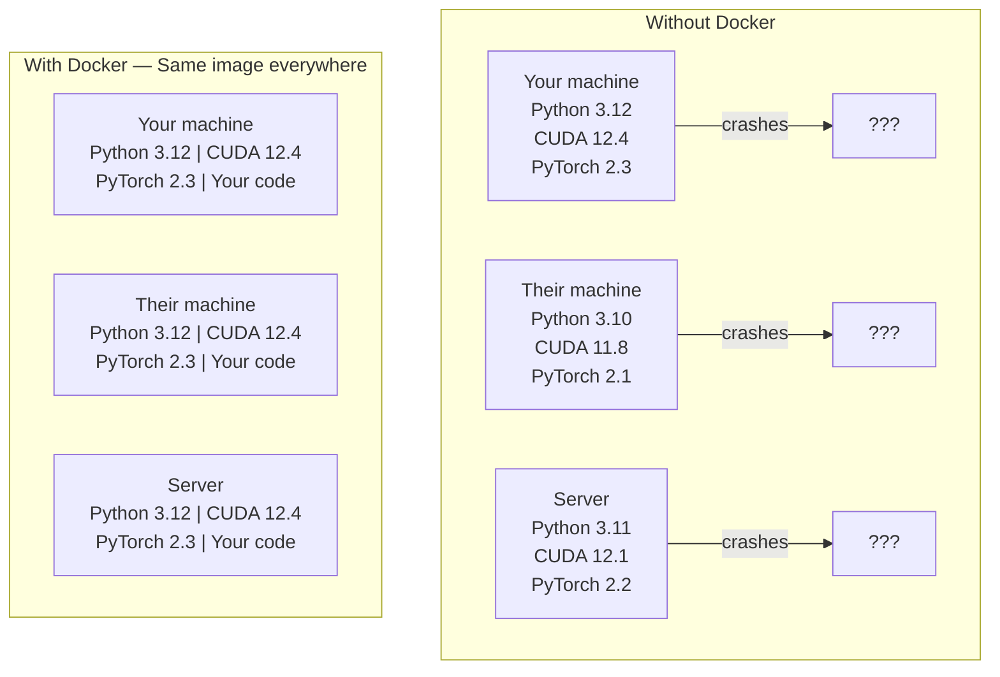

# 面向 AI 的 Docker

> Containers 会让“在我机器上能跑”成为过去式。

**Type:** Build
**Languages:** Docker
**Prerequisites:** Phase 0, Lessons 01 and 03
**Time:** ~60 minutes

## 学习目标

- 从 Dockerfile 构建一个启用 GPU、包含 CUDA、PyTorch 和 AI libraries 的 Docker image
- 把 host directories 作为 volumes 挂载，让 models、datasets 和 code 在 container rebuild 之间持久保存
- 配置 NVIDIA Container Toolkit，让 containers 能访问 GPU
- 使用 Docker Compose 编排多服务 AI applications（inference server + vector database）

## 问题

你在自己的笔记本上用 PyTorch 2.3、CUDA 12.4 和 Python 3.12 训练了一个模型。你的同事有 PyTorch 2.1、CUDA 11.8 和 Python 3.10。你的模型在他们机器上崩了。你的 Dockerfile 可以在两边都跑。

AI projects 是 dependency nightmare。一个典型 stack 包含 Python、PyTorch、CUDA drivers、cuDNN、system-level C libraries，以及像 flash-attn 这种需要精确 compiler versions 的专用 packages。Docker 会把这一切打包进一个 image，让它在任何地方都以相同方式运行。

## 概念

Docker 会把你的 code、runtime、libraries 和 system tools 包进一个隔离单元，叫做 container。你可以把它想成一个轻量 virtual machine，只不过它共享 host OS kernel，而不是运行自己的 kernel，所以它用秒级启动，而不是分钟级。



### 为什么 AI projects 比多数项目更需要 Docker

1. **GPU drivers 很脆弱。** CUDA 12.4 code 不能在 CUDA 11.8 上运行。Docker 会把 CUDA toolkit 隔离在 container 内，同时通过 NVIDIA Container Toolkit 共享 host GPU driver。

2. **Model weights 很大。** 一个 7B parameter model 在 fp16 下是 14 GB。你不想每次 rebuild 都重新下载它。Docker volumes 让你可以从 host 挂载 models directory。

3. **Multi-service architectures 很常见。** 一个真实 AI application 不只是一个 Python script。它是 inference server、用于 RAG 的 vector database，也许还有 web frontend。Docker Compose 可以用一条命令编排这一切。

### Key vocabulary

| Term | What it means |
|------|---------------|
| Image | 只读模板。你的 recipe。由 Dockerfile 构建。 |
| Container | Image 的运行实例。你的 kitchen。 |
| Dockerfile | 构建 image 的指令。逐层构建。 |
| Volume | Container restarts 后仍然存在的持久 storage。 |
| docker-compose | 用 YAML 定义 multi-container applications 的工具。 |

### AI 中常见的 container patterns

```text
Dev Container
  Full toolkit. Editor support. Jupyter. Debugging tools.
  Used during development and experimentation.

Training Container
  Minimal. Just the training script and dependencies.
  Runs on GPU clusters. No editor, no Jupyter.

Inference Container
  Optimized for serving. Small image. Fast cold start.
  Runs behind a load balancer in production.
```

## Build It

### Step 1: 安装 Docker

```bash
# macOS
brew install --cask docker
open /Applications/Docker.app

# Ubuntu
curl -fsSL https://get.docker.com | sh
sudo usermod -aG docker $USER
# Log out and back in for group change to take effect
```

验证：

```bash
docker --version
docker run hello-world
```

### Step 2: 安装 NVIDIA Container Toolkit（Linux with NVIDIA GPU）

这会让 Docker containers 访问你的 GPU。macOS 和 Windows（WSL2）用户可以跳过这一步；Docker Desktop 在这些平台上用不同方式处理 GPU passthrough。

```bash
distribution=$(. /etc/os-release;echo $ID$VERSION_ID)
curl -fsSL https://nvidia.github.io/libnvidia-container/gpgkey | sudo gpg --dearmor -o /usr/share/keyrings/nvidia-container-toolkit-keyring.gpg
curl -s -L https://nvidia.github.io/libnvidia-container/$distribution/libnvidia-container.list | \
    sed 's#deb https://#deb [signed-by=/usr/share/keyrings/nvidia-container-toolkit-keyring.gpg] https://#g' | \
    sudo tee /etc/apt/sources.list.d/nvidia-container-toolkit.list

sudo apt-get update
sudo apt-get install -y nvidia-container-toolkit
sudo nvidia-ctk runtime configure --runtime=docker
sudo systemctl restart docker
```

在 container 内测试 GPU access：

```bash
docker run --rm --gpus all nvidia/cuda:12.4.1-base-ubuntu22.04 nvidia-smi
```

如果你看到 GPU info，说明 toolkit 正常工作。

### Step 3: 理解 base images

选对 base image 可以省下几个小时的调试时间。

```text
nvidia/cuda:12.4.1-devel-ubuntu22.04
  Full CUDA toolkit. Compilers included.
  Use for: building packages that need nvcc (flash-attn, bitsandbytes)
  Size: ~4 GB

nvidia/cuda:12.4.1-runtime-ubuntu22.04
  CUDA runtime only. No compilers.
  Use for: running pre-built code
  Size: ~1.5 GB

pytorch/pytorch:2.3.1-cuda12.4-cudnn9-runtime
  PyTorch pre-installed on top of CUDA.
  Use for: skipping the PyTorch install step
  Size: ~6 GB

python:3.12-slim
  No CUDA. CPU only.
  Use for: inference on CPU, lightweight tools
  Size: ~150 MB
```

### Step 4: 为 AI development 编写 Dockerfile

这里是 `code/Dockerfile` 中的 Dockerfile。逐段看它：

```dockerfile
FROM nvidia/cuda:12.4.1-devel-ubuntu22.04

ENV DEBIAN_FRONTEND=noninteractive
ENV PYTHONUNBUFFERED=1

RUN apt-get update && apt-get install -y --no-install-recommends \
    python3.12 \
    python3.12-venv \
    python3.12-dev \
    python3-pip \
    git \
    curl \
    build-essential \
    && rm -rf /var/lib/apt/lists/*

RUN update-alternatives --install /usr/bin/python python /usr/bin/python3.12 1

RUN python -m pip install --no-cache-dir --upgrade pip setuptools wheel

RUN python -m pip install --no-cache-dir \
    torch==2.3.1 \
    torchvision==0.18.1 \
    torchaudio==2.3.1 \
    --index-url https://download.pytorch.org/whl/cu124

RUN python -m pip install --no-cache-dir \
    numpy \
    pandas \
    scikit-learn \
    matplotlib \
    jupyter \
    transformers \
    datasets \
    accelerate \
    safetensors

WORKDIR /workspace

VOLUME ["/workspace", "/models"]

EXPOSE 8888

CMD ["python"]
```

构建它：

```bash
docker build -t ai-dev -f phases/00-setup-and-tooling/07-docker-for-ai/code/Dockerfile .
```

第一次会花一些时间（下载 CUDA base image + PyTorch）。后续 builds 会使用 cached layers。

运行它：

```bash
docker run --rm -it --gpus all \
    -v $(pwd):/workspace \
    -v ~/models:/models \
    ai-dev python -c "import torch; print(f'PyTorch {torch.__version__}, CUDA: {torch.cuda.is_available()}')"
```

在 container 中运行 Jupyter：

```bash
docker run --rm -it --gpus all \
    -v $(pwd):/workspace \
    -v ~/models:/models \
    -p 8888:8888 \
    ai-dev jupyter notebook --ip=0.0.0.0 --port=8888 --no-browser --allow-root
```

### Step 5: 用于 data 和 models 的 volume mounts

Volume mounts 对 AI work 很关键。没有它们，你的 14 GB model downloads 会在 container 停止后消失。

```bash
# Mount your code
-v $(pwd):/workspace

# Mount a shared models directory
-v ~/models:/models

# Mount datasets
-v ~/datasets:/data
```

在你的 training script 中，从挂载路径加载：

```python
from transformers import AutoModel

model = AutoModel.from_pretrained("/models/llama-7b")
```

模型位于你的 host filesystem 上。你可以随意 rebuild container，不必重新下载。

### Step 6: 用 Docker Compose 编排 multi-service AI apps

一个真实的 RAG application 需要 inference server 和 vector database。Docker Compose 可以用一条命令运行两者。

查看 `code/docker-compose.yml`：

```yaml
services:
  ai-dev:
    build:
      context: .
      dockerfile: Dockerfile
    deploy:
      resources:
        reservations:
          devices:
            - driver: nvidia
              count: all
              capabilities: [gpu]
    volumes:
      - ../../../:/workspace
      - ~/models:/models
      - ~/datasets:/data
    ports:
      - "8888:8888"
    stdin_open: true
    tty: true
    command: jupyter notebook --ip=0.0.0.0 --port=8888 --no-browser --allow-root

  qdrant:
    image: qdrant/qdrant:v1.12.5
    ports:
      - "6333:6333"
      - "6334:6334"
    volumes:
      - qdrant_data:/qdrant/storage

volumes:
  qdrant_data:
```

启动所有服务：

```bash
cd phases/00-setup-and-tooling/07-docker-for-ai/code
docker compose up -d
```

现在你的 AI dev container 可以通过 service name 访问 vector database：`http://qdrant:6333`。Docker Compose 会自动创建共享 network。

从 AI container 内测试连接：

```python
from qdrant_client import QdrantClient

client = QdrantClient(host="qdrant", port=6333)
print(client.get_collections())
```

停止所有服务：

```bash
docker compose down
```

加上 `-v` 会同时删除 qdrant volume：

```bash
docker compose down -v
```

### Step 7: AI work 中常用 Docker commands

```bash
# List running containers
docker ps

# List all images and their sizes
docker images

# Remove unused images (reclaim disk space)
docker system prune -a

# Check GPU usage inside a running container
docker exec -it <container_id> nvidia-smi

# Copy a file from container to host
docker cp <container_id>:/workspace/results.csv ./results.csv

# View container logs
docker logs -f <container_id>
```

## Use It

你现在拥有了一个可复现的 AI development environment。在课程剩余部分：

- 使用 `docker compose up` 同时启动 dev environment 和 vector database
- 把 code、models 和 data 作为 volumes 挂载，确保 rebuild 之间不会丢失内容
- 当某一课需要新的 Python package 时，把它加进 Dockerfile 并 rebuild
- 把你的 Dockerfile 分享给 teammates。他们会得到完全相同的 environment。

### 没有 GPU？

移除 `--gpus all` flag 和 NVIDIA deploy block。Container 仍然可以用于 CPU-based lessons。PyTorch 会自动检测 CUDA 缺失，并 fallback 到 CPU。

## 练习

1. 构建 Dockerfile，并在 container 内运行 `python -c "import torch; print(torch.__version__)"`。
2. 启动 docker-compose stack，并确认 AI container 可以访问 `http://qdrant:6333/collections` 上的 Qdrant。
3. 向 Dockerfile 添加 `flask`，rebuild，并在 port 5000 上运行一个简单 API server。用 `-p 5000:5000` 映射端口。
4. 用 `docker images` 测量 image size。尝试把 base image 从 `devel` 切换到 `runtime`，并比较大小。

## 关键术语

| Term | 常见说法 | 实际含义 |
|------|----------|----------|
| Container | “轻量 VM” | 使用 host kernel 的隔离进程，拥有自己的 filesystem 和 network |
| Image layer | “缓存步骤” | 每条 Dockerfile 指令都会创建一个 layer。未变化的 layers 会被缓存，因此 rebuild 很快。 |
| NVIDIA Container Toolkit | “Docker 里的 GPU” | Runtime hook，通过 `--gpus` flag 把 host GPUs 暴露给 containers |
| Volume mount | “共享文件夹” | Host 上的目录被映射进 container。Container 停止后，changes 仍然保留。 |
| Base image | “起点” | Dockerfile 基于的 `FROM` image。它决定了哪些东西已经预装。 |
