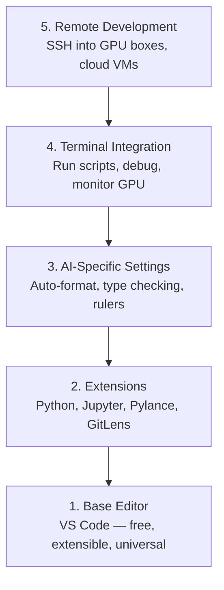

# 编辑器设置

> 你的编辑器就是你的 co-pilot。一次性配置好它，让它不再挡路，并开始真正帮你承担工作。

**Type:** Build
**Languages:** --
**Prerequisites:** Phase 0, Lesson 01
**Time:** ~20 minutes

## 学习目标

- 安装 VS Code，以及 Python、Jupyter、linting 和 Remote SSH 所需的核心扩展。
- 为 AI 工作流配置 format-on-save、type checking 和 notebook output scrolling。
- 设置 Remote SSH，让你像编辑本地代码一样编辑和调试远程 GPU 机器上的代码。
- 评估其它编辑器选择（Cursor、Windsurf、Neovim），理解它们对 AI 工作的取舍。

## 问题

你会在编辑器里花几千小时写 Python、运行 notebook、调试训练 loop，并 SSH 到 GPU 机器。配置不当的编辑器会让每个 session 都充满摩擦：没有 autocomplete，没有 type hints，没有 inline errors，需要手动格式化，terminal 工作流也很笨重。

正确设置只需要 20 分钟。跳过它，会让你每天损失 20 分钟。

## 概念

一个 AI engineering editor setup 需要五样东西：



## Build It

### 第 1 步：安装 VS Code

推荐编辑器是 VS Code。它免费，支持所有主流 OS，对 Jupyter notebook 有一流支持，并且扩展生态覆盖 AI 工作所需的一切。

从 [code.visualstudio.com](https://code.visualstudio.com/) 下载。

在 terminal 中验证：

```bash
code --version
```

如果 macOS 上找不到 `code`，打开 VS Code，按 `Cmd+Shift+P`，输入 “Shell Command”，选择 “Install 'code' command in PATH”。

### 第 2 步：安装核心扩展

在 VS Code 中打开 integrated terminal（`Ctrl+`` ` 或 `` Cmd+` ``），安装 AI 工作所需的扩展：

```bash
code --install-extension ms-python.python
code --install-extension ms-python.vscode-pylance
code --install-extension ms-toolsai.jupyter
code --install-extension eamodio.gitlens
code --install-extension ms-vscode-remote.remote-ssh
code --install-extension ms-python.debugpy
code --install-extension ms-python.black-formatter
code --install-extension charliermarsh.ruff
```

每个扩展的作用：

| Extension | Why |
|-----------|-----|
| Python | 语言支持、virtual env detection、run/debug |
| Pylance | 快速 type checking、autocomplete、import resolution |
| Jupyter | 在 VS Code 内运行 notebooks，提供 variable explorer |
| GitLens | 查看谁改了什么，提供 inline git blame |
| Remote SSH | 像本地一样打开远程 GPU 机器上的 folder |
| Debugpy | Python step-through debugging |
| Black Formatter | 保存时自动格式化，保持风格一致 |
| Ruff | 快速 linting，捕获常见错误 |

本课的 `code/.vscode/extensions.json` 文件包含完整推荐列表。打开项目文件夹时，VS Code 会提示你安装它们。

### 第 3 步：配置 Settings

复制本课 `code/.vscode/settings.json` 中的 settings，或者通过 `Settings > Open Settings (JSON)` 手动应用。

AI 工作的关键 settings：

```jsonc
{
    "python.analysis.typeCheckingMode": "basic",
    "editor.formatOnSave": true,
    "editor.rulers": [88, 120],
    "notebook.output.scrolling": true,
    "files.autoSave": "afterDelay"
}
```

为什么这些很重要：

- **Type checking on basic**：运行前捕获错误参数类型。对 tensor shape mismatch 和 API 参数错误很省调试时间。
- **Format on save**：再也不需要想着格式化。Black 会处理。
- **Rulers at 88 and 120**：Black 在 88 列换行。120 标记会提示 docstring 和 comment 是否太长。
- **Notebook output scrolling**：训练 loop 会打印成千上万行。没有 scrolling，output panel 会膨胀到失控。
- **Auto-save**：你会忘记保存。训练脚本会运行旧代码。Auto-save 可以防止这种事。

### 第 4 步：Terminal Integration

VS Code 的 integrated terminal 是你运行训练脚本、监控 GPU 和管理环境的地方。

正确设置它：

```jsonc
{
    "terminal.integrated.defaultProfile.osx": "zsh",
    "terminal.integrated.defaultProfile.linux": "bash",
    "terminal.integrated.fontSize": 13,
    "terminal.integrated.scrollback": 10000
}
```

有用快捷键：

| Action | macOS | Linux/Windows |
|--------|-------|---------------|
| Toggle terminal | `` Ctrl+` `` | `` Ctrl+` `` |
| New terminal | `Ctrl+Shift+`` ` | `Ctrl+Shift+`` ` |
| Split terminal | `Cmd+\` | `Ctrl+\` |

Split terminal 很有用：一个运行脚本，另一个用 `nvidia-smi -l 1` 或 `watch -n 1 nvidia-smi` 监控 GPU。

### 第 5 步：Remote Development（SSH 到 GPU 机器）

这是 AI 工作中最重要的扩展。你会在远程机器上训练模型（cloud VM、lab server、Lambda、Vast.ai）。Remote SSH 让你打开远程 filesystem、编辑文件、运行 terminal 和 debug，就像一切都在本地一样。

设置步骤：

1. 安装 Remote SSH 扩展（第 2 步已经完成）。
2. 按 `Ctrl+Shift+P`（或 `Cmd+Shift+P`），输入 “Remote-SSH: Connect to Host”。
3. 输入 `user@your-gpu-box-ip`。
4. VS Code 会自动在远程机器上安装 server component。

为了免密码访问，设置 SSH keys：

```bash
ssh-keygen -t ed25519 -C "your-email@example.com"
ssh-copy-id user@your-gpu-box-ip
```

把 host 加到 `~/.ssh/config`，方便连接：

```text
Host gpu-box
    HostName 203.0.113.50
    User ubuntu
    IdentityFile ~/.ssh/id_ed25519
    ForwardAgent yes
```

现在 `Remote-SSH: Connect to Host > gpu-box` 可以立刻连接。

## Alternatives

### Cursor

[cursor.com](https://cursor.com) 是一个带内置 AI code generation 的 VS Code fork。它使用同样的 extension ecosystem 和 settings format。如果你使用 Cursor，本课所有内容仍然适用。导入同一份 `settings.json` 和 `extensions.json` 即可。

### Windsurf

[windsurf.com](https://windsurf.com) 是另一个 AI-first VS Code fork。情况一样：同样的 extensions、同样的 settings format、同样支持 Remote SSH。

### Vim/Neovim

如果你已经使用 Vim 或 Neovim，并且效率很高，那就继续用。AI Python 工作所需的最低配置：

- **pyright** 或 **pylsp** 用于 type checking（通过 Mason 或手动安装）
- **nvim-lspconfig** 用于 language server integration
- **jupyter-vim** 或 **molten-nvim** 用于 notebook-like execution
- **telescope.nvim** 用于 file/symbol search
- **none-ls.nvim** 搭配 black 和 ruff 做 formatting/linting

如果你还不会 Vim，不要现在开始学。学习曲线会和 AI engineering 的学习竞争。用 VS Code。

## Use It

完成这些设置后，你的日常工作流会是：

1. 在 VS Code 中打开项目文件夹（或通过 Remote SSH 连接 GPU 机器）。
2. 在编辑器里写 Python，获得 autocomplete、type hints 和 inline errors。
3. 用 Jupyter 扩展在编辑器内运行 notebook。
4. 用 integrated terminal 运行训练脚本、`uv pip install` 和 GPU monitoring。
5. 提交前用 GitLens review changes。

## 练习

1. 安装 VS Code 和第 2 步列出的所有扩展。
2. 把本课的 `settings.json` 复制到你的 VS Code config。
3. 打开一个 Python 文件，确认 Pylance 显示 type hints，Black 会在保存时格式化。
4. 如果你有远程机器可用，设置 Remote SSH 并打开它上面的一个 folder。

## 关键术语

| Term | 常见说法 | 实际含义 |
|------|----------|----------|
| LSP | “Autocomplete engine” | Language Server Protocol：编辑器向特定语言 server 获取 type info、completion 和 diagnostics 的标准 |
| Pylance | “The Python plugin” | Microsoft 的 Python language server，使用 Pyright 做 type checking 和 IntelliSense |
| Remote SSH | “Working on the server” | VS Code extension，在远程机器上运行轻量 server，并把 UI stream 到本地编辑器 |
| Format on save | “Auto-prettier” | 每次保存时编辑器运行 formatter（Black、Ruff），让 code style 始终一致 |
