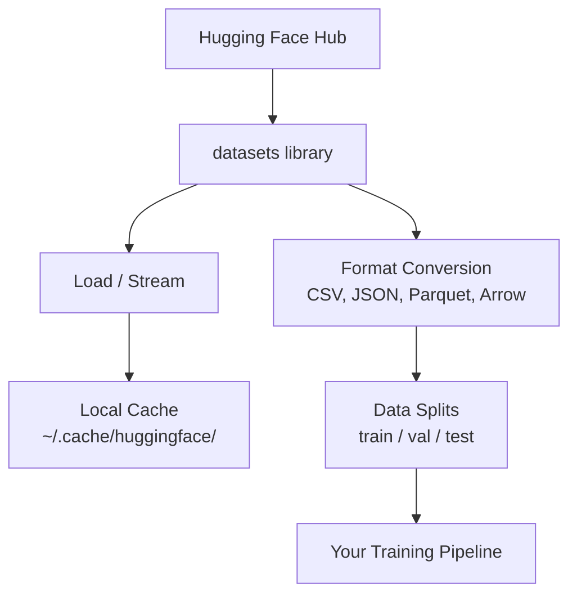

# 数据管理

> 数据是燃料。你管理数据的方式，决定了你能跑多快。

**Type:** Build
**Language:** Python
**Prerequisites:** Phase 0, Lesson 01
**Time:** ~45 minutes

## 学习目标

- 使用 Hugging Face `datasets` library 加载、stream 和 cache datasets。
- 在 CSV、JSON、Parquet 和 Arrow 格式之间转换，并解释它们的取舍。
- 使用固定 random seeds 创建可复现的 train/validation/test splits。
- 使用 `.gitignore`、Git LFS 或 DVC 管理大型 model 和 dataset files。

## 问题

每个 AI 项目都从数据开始。你需要找到 datasets、下载它们、在不同格式之间转换、切分出训练和评估用的数据，并对它们做版本管理，让实验可以复现。每次都手动做这些事情会很慢，也容易出错。你需要一个可重复的 workflow。

## 概念



Hugging Face `datasets` library 是 AI 工作中加载数据的标准方式。它开箱即用地处理 downloading、caching、format conversion 和 streaming。

## Build It

### Step 1: 安装 datasets library

```bash
pip install datasets huggingface_hub
```

### Step 2: 加载 dataset

```python
from datasets import load_dataset

dataset = load_dataset("imdb")
print(dataset)
print(dataset["train"][0])
```

这会下载 IMDB movie review dataset。第一次下载之后，它会从 `~/.cache/huggingface/datasets/` cache 中加载。

### Step 3: Stream 大型 datasets

有些 datasets 太大，放不进磁盘。Streaming 会逐行加载数据，而不是下载完整 dataset。

```python
dataset = load_dataset("wikimedia/wikipedia", "20220301.en", split="train", streaming=True)

for i, example in enumerate(dataset):
    print(example["title"])
    if i >= 4:
        break
```

Streaming 会给你一个 `IterableDataset`。你会在 rows 到达时处理它们。无论 dataset 多大，memory usage 都保持常量。

### Step 4: Dataset formats

`datasets` library 底层使用 Apache Arrow。你可以根据 pipeline 需要转换成其他格式。

```python
dataset = load_dataset("imdb", split="train")

dataset.to_csv("imdb_train.csv")
dataset.to_json("imdb_train.json")
dataset.to_parquet("imdb_train.parquet")
```

格式比较：

| Format | Size | Read Speed | Best For |
|--------|------|-----------|----------|
| CSV | Large | Slow | Human readability, spreadsheets |
| JSON | Large | Slow | APIs, nested data |
| Parquet | Small | Fast | Analytics, columnar queries |
| Arrow | Small | Fastest | In-memory processing（`datasets` 内部使用） |

对 AI 工作来说，Parquet 是最好的存储格式。Arrow 是你在内存中工作的格式。CSV 和 JSON 主要用于 interchange。

### Step 5: Data splits

每个 ML 项目都需要三个 splits：

- **Train**：模型从这里学习（通常 80%）
- **Validation**：训练期间检查进展（通常 10%）
- **Test**：训练完成后的最终评估（通常 10%）

有些 datasets 已经预先切分。如果没有，就自己切分：

```python
dataset = load_dataset("imdb", split="train")

split = dataset.train_test_split(test_size=0.2, seed=42)
train_val = split["train"].train_test_split(test_size=0.125, seed=42)

train_ds = train_val["train"]
val_ds = train_val["test"]
test_ds = split["test"]

print(f"Train: {len(train_ds)}, Val: {len(val_ds)}, Test: {len(test_ds)}")
```

一定要设置 seed 来保证 reproducibility。同一个 seed 每次都会产生相同的 split。

### Step 6: 下载并 cache models

Models 是大型文件。`huggingface_hub` library 会处理下载和 caching。

```python
from huggingface_hub import hf_hub_download, snapshot_download

model_path = hf_hub_download(
    repo_id="sentence-transformers/all-MiniLM-L6-v2",
    filename="config.json"
)
print(f"Cached at: {model_path}")

model_dir = snapshot_download("sentence-transformers/all-MiniLM-L6-v2")
print(f"Full model at: {model_dir}")
```

Models 会 cache 到 `~/.cache/huggingface/hub/`。下载一次后，后续运行会立即加载。

### Step 7: 处理大型文件

Model weights 和大型 datasets 不应该进入 git。有三个选择：

**Option A: .gitignore（最简单）**

```text
*.bin
*.safetensors
*.pt
*.onnx
data/*.parquet
data/*.csv
models/
```

**Option B: Git LFS（在 git 中追踪大型文件）**

```bash
git lfs install
git lfs track "*.bin"
git lfs track "*.safetensors"
git add .gitattributes
```

Git LFS 会把 pointers 存在 repo 中，真正的文件放在单独的 server 上。GitHub 免费提供 1 GB。

**Option C: DVC（data version control）**

```bash
pip install dvc
dvc init
dvc add data/training_set.parquet
git add data/training_set.parquet.dvc data/.gitignore
git commit -m "Track training data with DVC"
```

DVC 会创建小型 `.dvc` files，指向你的数据。数据本身存在 S3、GCS 或其他 remote storage backend。

| Approach | Complexity | Best For |
|----------|-----------|----------|
| .gitignore | Low | Personal projects, downloaded data you can re-fetch |
| Git LFS | Medium | Teams sharing model weights via git |
| DVC | High | Reproducible experiments, large datasets, teams |

对这门课程来说，`.gitignore` 就够了。当你需要跨机器复现实验时，再使用 DVC。

### Step 8: Storage patterns

**Local storage** 适合 ~10 GB 以下的 datasets。HF cache 会自动处理。

**Cloud storage** 适合更大的数据，或需要在多台机器之间共享的数据：

```python
import os

local_path = os.path.expanduser("~/.cache/huggingface/datasets/")

# s3_path = "s3://my-bucket/datasets/"
# gcs_path = "gs://my-bucket/datasets/"
```

DVC 可以直接集成 S3 和 GCS：

```bash
dvc remote add -d myremote s3://my-bucket/dvc-store
dvc push
```

对这门课程来说，local storage 已经足够。Cloud storage 会在你用 remote GPU instances 做 fine-tuning 时变得相关。

## 本课程使用的 Datasets

| Dataset | Lessons | Size | What It Teaches |
|---------|---------|------|----------------|
| IMDB | Tokenization, classification | 84 MB | Text classification basics |
| WikiText | Language modeling | 181 MB | Next-token prediction |
| SQuAD | QA systems | 35 MB | Question answering, spans |
| Common Crawl (subset) | Embeddings | Varies | Large-scale text processing |
| MNIST | Vision basics | 21 MB | Image classification fundamentals |
| COCO (subset) | Multimodal | Varies | Image-text pairs |

你现在不需要下载所有这些数据。每一课都会说明它需要什么。

## Use It

运行 utility script 来验证一切正常：

```bash
python code/data_utils.py
```

它会下载一个小 dataset、转换格式、切分数据，并打印 summary。

## Ship It

本课产出：

- `code/data_utils.py` - 可复用的数据加载和 caching utility
- `outputs/prompt-data-helper.md` - 帮助为任务找到合适 dataset 的 prompt

## 练习

1. 加载带 `mrpc` config 的 `glue` dataset，并检查前 5 个 examples。
2. Stream `c4` dataset，并统计 10 秒内能处理多少 examples。
3. 把一个 dataset 转换成 Parquet，并和 CSV 比较 file size。
4. 使用固定 seed 创建 70/15/15 的 train/val/test split，并验证 sizes。

## 关键术语

| Term | 常见说法 | 实际含义 |
|------|----------|----------|
| Dataset split | “Training data” | ML lifecycle 不同阶段使用的命名 subset（train/val/test） |
| Streaming | “Load it lazily” | 不下载完整 dataset，而是从 remote source 逐行处理数据 |
| Parquet | “Compressed CSV” | 为 analytical queries 和 storage efficiency 优化的 columnar file format |
| Arrow | “Fast dataframe” | `datasets` library 内部用于 zero-copy reads 的 in-memory columnar format |
| Git LFS | “Git for big files” | 把大型文件存在 git repo 外，同时在 version control 中保留 pointers 的扩展 |
| DVC | “Git for data” | 与 cloud storage 集成的 datasets 和 models version control system |
| Cache | “Already downloaded” | 之前获取过的数据的 local copy，默认存储在 `~/.cache/huggingface/` |
