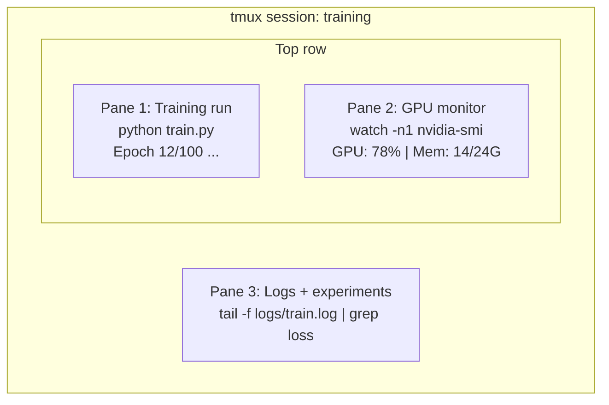

# Terminal 与 Shell

> Terminal 是 AI engineers 长期驻扎的地方。先在这里变得顺手。

**Type:** Learn
**Languages:** --
**Prerequisites:** Phase 0, Lesson 01
**Time:** ~35 minutes

## 学习目标

- 使用 piping、redirects 和 `grep`，从 command line 过滤并处理 training logs
- 创建带多个 panes 的持久 tmux sessions，用于并发 training 和 GPU monitoring
- 使用 `htop`、`nvtop` 和 `nvidia-smi` 监控 system 与 GPU resources
- 使用 SSH、`scp` 和 `rsync` 在 local 与 remote machines 之间传输 files

## 问题

你在 terminal 里花的时间，会比在任何 editor 里都多。Training runs、GPU monitoring、log tailing、remote SSH sessions、environment management。每一个 AI workflow 都会碰到 shell。如果你在这里慢，你到处都会慢。

本课覆盖 AI 工作真正需要的 terminal skills。不讲 Unix 历史。不深挖 Bash scripting。只讲你需要的东西。

## 概念



三件事同时运行。一个 terminal。你可以 detach、回家、再 SSH 回来并 reattach。Training 会继续运行。

## Build It

### Step 1: Know your shell

检查你正在运行哪个 shell：

```bash
echo $SHELL
```

大多数系统使用 `bash` 或 `zsh`。两者都可以。本课程中的命令在二者中都能工作。

需要知道的关键操作：

```bash
# Move around
cd ~/projects/ai-engineering-from-scratch
pwd
ls -la

# History search (most useful shortcut you'll learn)
# Ctrl+R then type part of a previous command
# Press Ctrl+R again to cycle through matches

# Clear terminal
clear   # or Ctrl+L

# Cancel a running command
# Ctrl+C

# Suspend a running command (resume with fg)
# Ctrl+Z
```

### Step 2: Piping and redirects

Piping 会把 commands 连接在一起。这就是你处理 logs、过滤 output、串联 tools 的方式。你会一直用它。

```bash
# Count how many times "loss" appears in a log
cat train.log | grep "loss" | wc -l

# Extract just the loss values from training output
grep "loss:" train.log | awk '{print $NF}' > losses.txt

# Watch a log file update in real time, filtering for errors
tail -f train.log | grep --line-buffered "ERROR"

# Sort experiments by final accuracy
grep "final_accuracy" results/*.log | sort -t= -k2 -n -r

# Redirect stdout and stderr to separate files
python train.py > output.log 2> errors.log

# Redirect both to the same file
python train.py > train_full.log 2>&1
```

你需要记住的三类 redirects：

| Symbol | What it does |
|--------|-------------|
| `>` | 把 stdout 写入 file（overwrite） |
| `>>` | 把 stdout 追加到 file |
| `2>` | 把 stderr 写入 file |
| `2>&1` | 把 stderr 发送到 stdout 所在位置 |
| `\|` | 把一个 command 的 stdout 作为下一个 command 的 stdin |

### Step 3: Background processes

Training runs 可能要跑几个小时。你不希望整个过程都保持 terminal 打开。

```bash
# Run in background (output still goes to terminal)
python train.py &

# Run in background, immune to hangup (closing terminal won't kill it)
nohup python train.py > train.log 2>&1 &

# Check what's running in background
jobs
ps aux | grep train.py

# Bring a background job to foreground
fg %1

# Kill a background process
kill %1
# or find its PID and kill that
kill $(pgrep -f "train.py")
```

`&`、`nohup` 和 `screen`/`tmux` 的区别：

| Method | Survives terminal close? | Can reattach? |
|--------|-------------------------|---------------|
| `command &` | No | No |
| `nohup command &` | Yes | No (check log file) |
| `screen` / `tmux` | Yes | Yes |

任何超过几分钟的事情，都用 tmux。

### Step 4: tmux

tmux 让你创建带多个 panes 的持久 terminal sessions。这是管理 training runs 时最有用的单个工具。

```bash
# Install
# macOS
brew install tmux
# Ubuntu
sudo apt install tmux

# Start a named session
tmux new -s training

# Split horizontally
# Ctrl+B then "

# Split vertically
# Ctrl+B then %

# Navigate between panes
# Ctrl+B then arrow keys

# Detach (session keeps running)
# Ctrl+B then d

# Reattach
tmux attach -t training

# List sessions
tmux ls

# Kill a session
tmux kill-session -t training
```

一个典型的 AI workflow session：

```bash
tmux new -s train

# Pane 1: start training
python train.py --epochs 100 --lr 1e-4

# Ctrl+B, " to split, then run GPU monitor
watch -n1 nvidia-smi

# Ctrl+B, % to split vertically, tail the logs
tail -f logs/experiment.log

# Now detach with Ctrl+B, d
# SSH out, go get coffee, come back
# tmux attach -t train
```

### Step 5: Monitoring with htop and nvtop

```bash
# System processes (better than top)
htop

# GPU processes (if you have NVIDIA GPU)
# Install: sudo apt install nvtop (Ubuntu) or brew install nvtop (macOS)
nvtop

# Quick GPU check without nvtop
nvidia-smi

# Watch GPU usage update every second
watch -n1 nvidia-smi

# See which processes are using the GPU
nvidia-smi --query-compute-apps=pid,name,used_memory --format=csv
```

你会用到的 `htop` keybindings：

- `F6` 或 `>` 按 column 排序（按 memory 排序可查 memory leaks）
- `F5` 切换 tree view（查看 child processes）
- `F9` kill process
- `/` 搜索 process name

### Step 6: SSH for remote GPU boxes

当你租用 cloud GPU（Lambda、RunPod、Vast.ai）时，会通过 SSH 连接。

```bash
# Basic connection
ssh user@gpu-box-ip

# With a specific key
ssh -i ~/.ssh/my_gpu_key user@gpu-box-ip

# Copy files to remote
scp model.pt user@gpu-box-ip:~/models/

# Copy files from remote
scp user@gpu-box-ip:~/results/metrics.json ./

# Sync a whole directory (faster for many files)
rsync -avz ./data/ user@gpu-box-ip:~/data/

# Port forward (access remote Jupyter/TensorBoard locally)
ssh -L 8888:localhost:8888 user@gpu-box-ip
# Now open localhost:8888 in your browser

# SSH config for convenience
# Add to ~/.ssh/config:
# Host gpu
#     HostName 192.168.1.100
#     User ubuntu
#     IdentityFile ~/.ssh/gpu_key
#
# Then just:
# ssh gpu
```

### Step 7: Useful aliases for AI work

把这些加入你的 `~/.bashrc` 或 `~/.zshrc`：

```bash
source phases/00-setup-and-tooling/10-terminal-and-shell/code/shell_aliases.sh
```

或者复制你想要的 aliases。关键 aliases：

```bash
# GPU status at a glance
alias gpu='nvidia-smi --query-gpu=index,name,utilization.gpu,memory.used,memory.total,temperature.gpu --format=csv,noheader'

# Kill all Python training processes
alias killtraining='pkill -f "python.*train"'

# Quick virtual environment activate
alias ae='source .venv/bin/activate'

# Watch training loss
alias watchloss='tail -f logs/*.log | grep --line-buffered "loss"'
```

完整集合见 `code/shell_aliases.sh`。

### Step 8: Common AI terminal patterns

这些 patterns 会在实践中反复出现：

```bash
# Run training, log everything, notify when done
python train.py 2>&1 | tee train.log; echo "DONE" | mail -s "Training complete" you@email.com

# Compare two experiment logs side by side
diff <(grep "accuracy" exp1.log) <(grep "accuracy" exp2.log)

# Find the largest model files (clean up disk space)
find . -name "*.pt" -o -name "*.safetensors" | xargs du -h | sort -rh | head -20

# Download a model from Hugging Face
wget https://huggingface.co/model/resolve/main/model.safetensors

# Untar a dataset
tar xzf dataset.tar.gz -C ./data/

# Count lines in all Python files (see how big your project is)
find . -name "*.py" | xargs wc -l | tail -1

# Check disk space (training data fills disks fast)
df -h
du -sh ./data/*

# Environment variable check before training
env | grep -i cuda
env | grep -i torch
```

## Use It

下面是本课程中每个 tool 会在什么时候派上用场：

| Tool | When you use it |
|------|----------------|
| tmux | 每次 training run（Phases 3+） |
| `tail -f` + `grep` | Monitoring training logs |
| `nohup` / `&` | 快速 background tasks |
| `htop` / `nvtop` | Debugging slow training、OOM errors |
| SSH + `rsync` | Working on cloud GPUs |
| Piping + redirects | Processing experiment results |
| Aliases | 节省重复命令时间 |

## 练习

1. 安装 tmux，创建一个带三个 panes 的 session：一个运行 `htop`，一个运行 `watch -n1 date`，第三个运行一个 Python script。Detach 再 reattach。
2. 把 `code/shell_aliases.sh` 中的 aliases 加到你的 shell config，并用 `source ~/.zshrc`（或 `~/.bashrc`）重新加载。
3. 用 `for i in $(seq 1 100); do echo "epoch $i loss: $(echo "scale=4; 1/$i" | bc)"; sleep 0.1; done > fake_train.log` 创建一个 fake training log，然后使用 `grep`、`tail` 和 `awk` 只提取 loss values。
4. 为你有权限访问的 server 设置一个 SSH config entry（也可以用 `localhost` 练习语法）。

## 关键术语

| Term | What people say | What it actually means |
|------|----------------|----------------------|
| Shell | “The terminal” | 解释 commands 的 program（bash、zsh、fish） |
| tmux | “Terminal multiplexer” | 让你在一个 window 内运行多个 terminal sessions，并 detach/reattach 的 program |
| Pipe | “The bar thing” | `\|` operator，把一个 command 的 output 作为另一个 command 的 input |
| PID | “Process ID” | 分配给每个 running process 的唯一编号，用于 monitor 或 kill |
| nohup | “No hangup” | 让 command 不受 hangup signal 影响运行，因此关闭 terminal 不会 kill 它 |
| SSH | “Connecting to the server” | Secure Shell，一种用于在 remote machine 上运行 commands 的 encrypted protocol |
