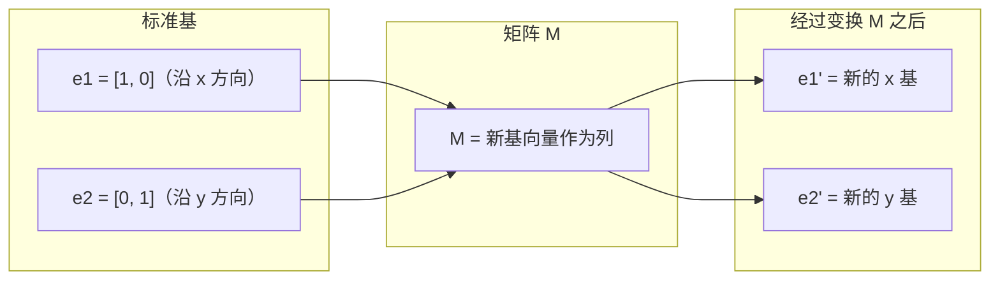
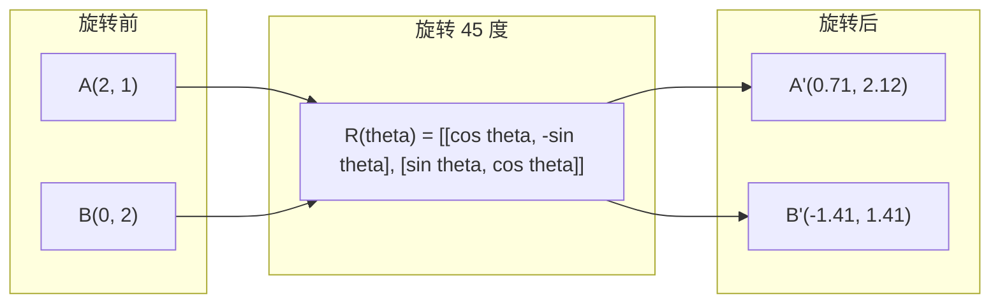
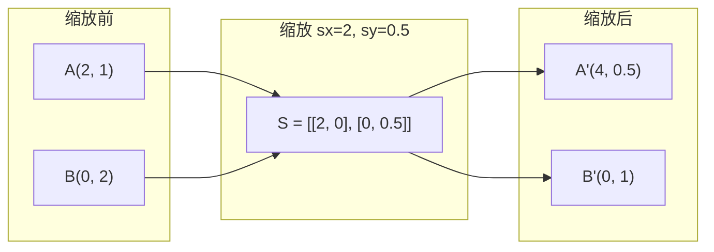
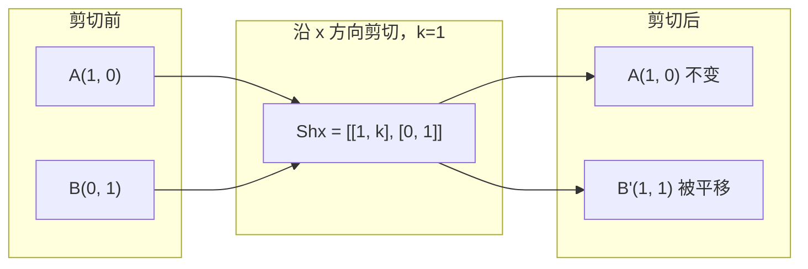
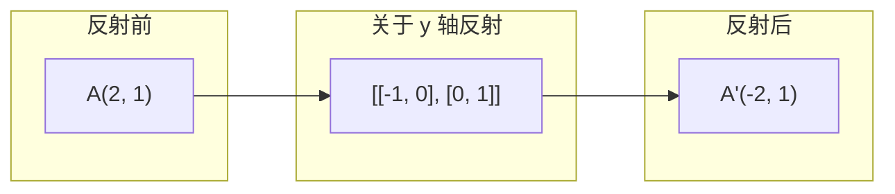
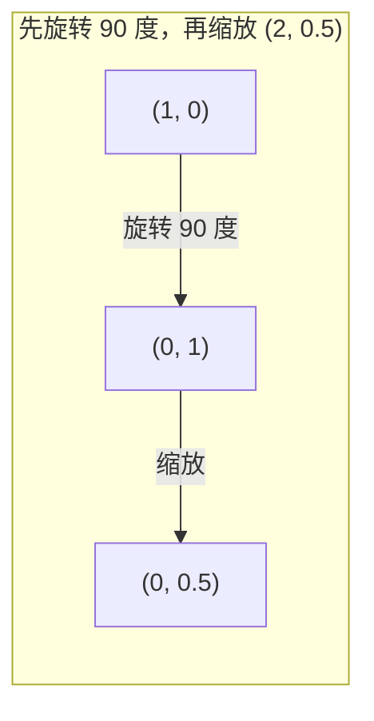
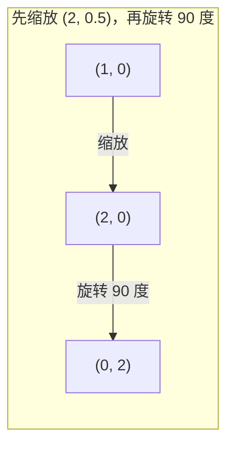

# 矩阵变换

> 矩阵是一台重塑空间的机器。理解它对每个点做了什么，你就理解了整个变换。

**Type:** Build
**Languages:** Python, Julia
**Prerequisites:** Phase 1, Lessons 01-02 (Linear Algebra Intuition, Vectors & Matrices Operations)
**Time:** ~75 minutes

## 学习目标

- 构造旋转、缩放、剪切和反射矩阵，并把它们应用到 2D 和 3D 点上
- 通过矩阵乘法组合多个变换，并验证顺序很重要
- 从特征方程出发，计算 2x2 矩阵的特征值和特征向量
- 解释为什么特征值决定 PCA 方向、RNN 稳定性和谱聚类行为

## 问题

你阅读 PCA 时会看到“求协方差矩阵的特征向量”。你阅读模型稳定性时会看到“检查所有特征值的模是否小于 1”。你阅读数据增强时会看到“应用随机旋转”。在你从几何上理解矩阵对空间做什么之前，这些说法都很难真正说通。

矩阵不只是数字网格。它们是空间机器。旋转矩阵会转动点。缩放矩阵会拉伸点。剪切矩阵会倾斜点。神经网络对数据施加的每个变换，都是这些操作之一，或者是它们的组合。本课会把这些操作变得具体。

## 概念

### 作为矩阵的变换

每个 2D 线性变换都可以写成一个 2x2 矩阵。矩阵会准确告诉你基向量 [1, 0] 和 [0, 1] 最终去了哪里。其余所有点都会随之确定。



### 旋转

2D 中旋转角度 theta 会保持距离和角度不变。它会让每个点沿着圆弧移动。



在 3D 中，你会围绕某个轴旋转。每个轴都有自己的旋转矩阵：

```text
Rz(theta) = | cos  -sin  0 |     围绕 z 轴旋转
            | sin   cos  0 |     （x-y 平面旋转，z 保持不变）
            |  0     0   1 |

Rx(theta) = | 1   0     0    |   围绕 x 轴旋转
            | 0  cos  -sin   |   （y-z 平面旋转，x 保持不变）
            | 0  sin   cos   |

Ry(theta) = |  cos  0  sin |     围绕 y 轴旋转
            |   0   1   0  |     （x-z 平面旋转，y 保持不变）
            | -sin  0  cos |
```

### 缩放

缩放会沿每个轴独立拉伸或压缩。



### 剪切

剪切会让一个轴倾斜，同时保持另一个轴固定。它会把矩形变成平行四边形。



剪切矩阵：

- `Shx = [[1, k], [0, 1]]` 会让 x 按 k * y 偏移
- `Shy = [[1, 0], [k, 1]]` 会让 y 按 k * x 偏移

### 反射

反射会把点沿某个轴或某条线镜像过去。



反射矩阵：

- 关于 y 轴反射：`[[-1, 0], [0, 1]]`
- 关于 x 轴反射：`[[1, 0], [0, -1]]`

### 组合：串联变换

先应用变换 A，再应用变换 B，等价于把它们的矩阵相乘：`result = B @ A @ point`。顺序很重要。先旋转再缩放，与先缩放再旋转，会得到不同结果。



组合后：`S @ R = [[0, -2], [0.5, 0]]`



组合后：`R @ S = [[0, -0.5], [2, 0]]`

结果不同。矩阵乘法不满足交换律。

### 特征值与特征向量

大多数向量被矩阵作用后都会改变方向。特征向量很特殊：矩阵只会缩放它们，不会旋转它们。缩放因子就是特征值。

```text
A @ v = lambda * v

v 是特征向量（保留下来的方向）
lambda 是特征值（它被拉伸多少）

示例：A = | 2  1 |
          | 1  2 |

特征向量 [1, 1]，特征值为 3：
  A @ [1,1] = [3, 3] = 3 * [1, 1]     （方向相同，放大 3 倍）

特征向量 [1, -1]，特征值为 1：
  A @ [1,-1] = [1, -1] = 1 * [1, -1]  （方向相同，保持不变）
```

这个矩阵会沿 [1, 1] 方向把空间拉伸 3 倍，并让 [1, -1] 保持不变。其他每个方向都是这两个方向的混合。

### 特征分解

如果一个矩阵有 n 个线性无关的特征向量，它就可以被分解为：

```text
A = V @ D @ V^(-1)

V = 以特征向量为列的矩阵
D = 由特征值组成的对角矩阵
V^(-1) = V 的逆矩阵

这句话的意思是：先旋转到特征向量坐标系，沿每个轴缩放，再旋转回来。
```

### 为什么特征值重要

**PCA。** 协方差矩阵的特征向量就是主成分。特征值告诉你每个主成分捕获了多少方差。按特征值排序，保留前 k 个，就得到了降维。

**稳定性。** 在循环网络和动力系统中，模大于 1 的特征值会导致输出爆炸。模小于 1 的特征值会导致输出消失。这就是梯度消失/爆炸问题的一句话版本。

**谱方法。** 图神经网络使用邻接矩阵的特征值。谱聚类使用拉普拉斯矩阵的特征值。特征向量会揭示图的结构。

### 行列式作为体积缩放因子

变换矩阵的行列式告诉你它会把面积（2D）或体积（3D）缩放多少。

```text
det = 1:   面积保持不变（旋转）
det = 2:   面积翻倍
det = 0:   空间被压扁到更低维度（奇异）
det = -1:  面积保持不变，但方向被翻转（反射）

| det(Rotation) | = 1        （总是如此）
| det(Scale sx, sy) | = sx * sy
| det(Shear) | = 1           （面积保持不变）
| det(Reflection) | = -1     （方向翻转）
```

```figure
matrix-transform
```

## Build It

### 第 1 步：从零实现变换矩阵（Python）

```python
import math

def rotation_2d(theta):
    c, s = math.cos(theta), math.sin(theta)
    return [[c, -s], [s, c]]

def scaling_2d(sx, sy):
    return [[sx, 0], [0, sy]]

def shearing_2d(kx, ky):
    return [[1, kx], [ky, 1]]

def reflection_x():
    return [[1, 0], [0, -1]]

def reflection_y():
    return [[-1, 0], [0, 1]]

def mat_vec_mul(matrix, vector):
    return [
        sum(matrix[i][j] * vector[j] for j in range(len(vector)))
        for i in range(len(matrix))
    ]

def mat_mul(a, b):
    rows_a, cols_b = len(a), len(b[0])
    cols_a = len(a[0])
    return [
        [sum(a[i][k] * b[k][j] for k in range(cols_a)) for j in range(cols_b)]
        for i in range(rows_a)
    ]

point = [1.0, 0.0]
angle = math.pi / 4

rotated = mat_vec_mul(rotation_2d(angle), point)
print(f"Rotate (1,0) by 45 deg: ({rotated[0]:.4f}, {rotated[1]:.4f})")

scaled = mat_vec_mul(scaling_2d(2, 3), [1.0, 1.0])
print(f"Scale (1,1) by (2,3): ({scaled[0]:.1f}, {scaled[1]:.1f})")

sheared = mat_vec_mul(shearing_2d(1, 0), [1.0, 1.0])
print(f"Shear (1,1) kx=1: ({sheared[0]:.1f}, {sheared[1]:.1f})")

reflected = mat_vec_mul(reflection_y(), [2.0, 1.0])
print(f"Reflect (2,1) across y: ({reflected[0]:.1f}, {reflected[1]:.1f})")
```

### 第 2 步：组合变换

```python
R = rotation_2d(math.pi / 2)
S = scaling_2d(2, 0.5)

rotate_then_scale = mat_mul(S, R)
scale_then_rotate = mat_mul(R, S)

point = [1.0, 0.0]
result1 = mat_vec_mul(rotate_then_scale, point)
result2 = mat_vec_mul(scale_then_rotate, point)

print(f"Rotate 90 then scale: ({result1[0]:.2f}, {result1[1]:.2f})")
print(f"Scale then rotate 90: ({result2[0]:.2f}, {result2[1]:.2f})")
print(f"Same? {result1 == result2}")
```

### 第 3 步：从零计算特征值（2x2）

对于一个 2x2 矩阵 `[[a, b], [c, d]]`，特征值来自特征方程：`lambda^2 - (a+d)*lambda + (ad - bc) = 0`。

```python
def eigenvalues_2x2(matrix):
    a, b = matrix[0]
    c, d = matrix[1]
    trace = a + d
    det = a * d - b * c
    discriminant = trace ** 2 - 4 * det
    if discriminant < 0:
        real = trace / 2
        imag = (-discriminant) ** 0.5 / 2
        return (complex(real, imag), complex(real, -imag))
    sqrt_disc = discriminant ** 0.5
    return ((trace + sqrt_disc) / 2, (trace - sqrt_disc) / 2)

def eigenvector_2x2(matrix, eigenvalue):
    a, b = matrix[0]
    c, d = matrix[1]
    if abs(b) > 1e-10:
        v = [b, eigenvalue - a]
    elif abs(c) > 1e-10:
        v = [eigenvalue - d, c]
    else:
        if abs(a - eigenvalue) < 1e-10:
            v = [1, 0]
        else:
            v = [0, 1]
    mag = (v[0] ** 2 + v[1] ** 2) ** 0.5
    return [v[0] / mag, v[1] / mag]

A = [[2, 1], [1, 2]]
vals = eigenvalues_2x2(A)
print(f"Matrix: {A}")
print(f"Eigenvalues: {vals[0]:.4f}, {vals[1]:.4f}")

for val in vals:
    vec = eigenvector_2x2(A, val)
    result = mat_vec_mul(A, vec)
    scaled = [val * vec[0], val * vec[1]]
    print(f"  lambda={val:.1f}, v={[round(x,4) for x in vec]}")
    print(f"    A@v = {[round(x,4) for x in result]}")
    print(f"    l*v = {[round(x,4) for x in scaled]}")
```

### 第 4 步：把行列式理解为体积缩放因子

```python
def det_2x2(matrix):
    return matrix[0][0] * matrix[1][1] - matrix[0][1] * matrix[1][0]

print(f"det(rotation 45) = {det_2x2(rotation_2d(math.pi/4)):.4f}")
print(f"det(scale 2,3)   = {det_2x2(scaling_2d(2, 3)):.1f}")
print(f"det(shear kx=1)  = {det_2x2(shearing_2d(1, 0)):.1f}")
print(f"det(reflect y)   = {det_2x2(reflection_y()):.1f}")

singular = [[1, 2], [2, 4]]
print(f"det(singular)     = {det_2x2(singular):.1f}")
print("Singular: columns are proportional, space collapses to a line.")
```

## Use It

NumPy 会用优化后的例程处理所有这些操作。

```python
import numpy as np

theta = np.pi / 4
R = np.array([[np.cos(theta), -np.sin(theta)],
              [np.sin(theta),  np.cos(theta)]])

point = np.array([1.0, 0.0])
print(f"Rotate (1,0) by 45 deg: {R @ point}")

S = np.diag([2.0, 3.0])
composed = S @ R
print(f"Scale(2,3) after Rotate(45): {composed @ point}")

A = np.array([[2, 1], [1, 2]], dtype=float)
eigenvalues, eigenvectors = np.linalg.eig(A)
print(f"\nEigenvalues: {eigenvalues}")
print(f"Eigenvectors (columns):\n{eigenvectors}")

for i in range(len(eigenvalues)):
    v = eigenvectors[:, i]
    lam = eigenvalues[i]
    print(f"  A @ v{i} = {A @ v}, lambda * v{i} = {lam * v}")

print(f"\ndet(R) = {np.linalg.det(R):.4f}")
print(f"det(S) = {np.linalg.det(S):.1f}")

B = np.array([[3, 1], [0, 2]], dtype=float)
vals, vecs = np.linalg.eig(B)
D = np.diag(vals)
V = vecs
reconstructed = V @ D @ np.linalg.inv(V)
print(f"\nEigendecomposition A = V @ D @ V^-1:")
print(f"Original:\n{B}")
print(f"Reconstructed:\n{reconstructed}")
```

### 使用 NumPy 做 3D 旋转

```python
def rotation_3d_z(theta):
    c, s = np.cos(theta), np.sin(theta)
    return np.array([[c, -s, 0], [s, c, 0], [0, 0, 1]])

def rotation_3d_x(theta):
    c, s = np.cos(theta), np.sin(theta)
    return np.array([[1, 0, 0], [0, c, -s], [0, s, c]])

point_3d = np.array([1.0, 0.0, 0.0])
rotated_z = rotation_3d_z(np.pi / 2) @ point_3d
rotated_x = rotation_3d_x(np.pi / 2) @ point_3d

print(f"\n3D point: {point_3d}")
print(f"Rotate 90 around z: {np.round(rotated_z, 4)}")
print(f"Rotate 90 around x: {np.round(rotated_x, 4)}")
```

## Ship It

本课会为 PCA（Phase 2）和神经网络权重分析建立几何基础。这里构建的特征值/特征向量代码，和生产 ML 系统中用于降维、谱聚类和稳定性分析的算法是同一种思想。

## 练习

1. 对单位正方形（角点为 [0,0]、[1,0]、[1,1]、[0,1]）应用旋转、缩放和剪切。分别打印变换后的角点。验证旋转会保持角点之间的距离。

2. 手算矩阵 [[4, 2], [1, 3]] 的特征值，使用特征方程求解。然后用你的从零实现函数和 NumPy 验证。

3. 创建三个变换的组合（旋转 30 度、按 [1.5, 0.8] 缩放、使用 kx=0.3 剪切），并把它应用到圆周上排列的 8 个点。打印变换前后的坐标。计算组合矩阵的行列式，并验证它等于各个单独变换行列式的乘积。

## 关键术语

| 术语 | 人们常说 | 它实际表示 |
|------|----------|------------|
| 旋转矩阵 | “把东西转起来” | 一种正交矩阵，会让点沿圆弧移动，同时保持距离和角度不变。行列式总是 1。 |
| 缩放矩阵 | “把东西变大” | 一种对角矩阵，会沿每个轴独立拉伸或压缩。行列式是各个缩放因子的乘积。 |
| 剪切矩阵 | “把东西斜过去” | 一种让一个坐标按另一个坐标成比例偏移的矩阵，会把矩形变成平行四边形。行列式为 1。 |
| 反射 | “镜像东西” | 一种沿某个轴或平面翻转空间的矩阵。行列式为 -1。 |
| 组合 | “做两件事” | 通过乘以变换矩阵来串联操作。顺序很重要：B @ A 表示先应用 A，再应用 B。 |
| 特征向量 | “特殊方向” | 矩阵只会缩放、不会旋转的方向。它是这个变换的指纹。 |
| 特征值 | “它拉伸了多少” | 矩阵缩放其特征向量的标量因子。可以是负数（翻转），也可以是复数（旋转）。 |
| 特征分解 | “把矩阵拆开” | 把矩阵写成 V @ D @ V^(-1)，从而分离出它的基本缩放方向和幅度。 |
| 行列式 | “矩阵里的一个数字” | 变换缩放面积（2D）或体积（3D）的因子。为零表示变换不可逆。 |
| 特征方程 | “特征值从哪里来” | det(A - lambda * I) = 0。它的根就是特征值。 |

## 延伸阅读

- [3Blue1Brown: Linear Transformations](https://www.3blue1brown.com/lessons/linear-transformations) -- 关于矩阵如何重塑空间的视觉直觉
- [3Blue1Brown: Eigenvectors and Eigenvalues](https://www.3blue1brown.com/lessons/eigenvalues) -- 对特征向量几何意义的优秀视觉解释
- [MIT 18.06 Lecture 21: Eigenvalues and Eigenvectors](https://ocw.mit.edu/courses/18-06-linear-algebra-spring-2010/) -- Gilbert Strang 的经典讲解
