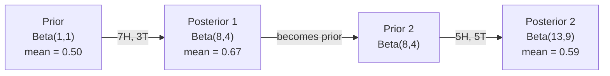

# 贝叶斯定理

> 概率关心你预期会发生什么。贝叶斯定理关心你学到了什么。

**Type:** Build
**Language:** Python
**Prerequisites:** Phase 1, Lesson 06 (Probability Fundamentals)
**Time:** ~75 minutes

## 学习目标

- 应用贝叶斯定理，根据先验、似然和证据计算后验概率
- 从零构建一个 Naive Bayes 文本分类器，包含 Laplace smoothing 和 log-space 计算
- 比较 MLE 与 MAP 估计，并解释 MAP 如何对应 L2 正则化
- 使用 Beta-Binomial 共轭先验，实现 A/B 测试中的序贯贝叶斯更新

## 问题

一个医学检测有 99% 的准确率。你的检测结果是阳性。你真正患病的概率是多少？

大多数人会说 99%。真实答案取决于这种病有多罕见。如果 10,000 个人中只有 1 个人患病，那么阳性结果只会让你有大约 1% 的概率真正患病。其他 99% 的阳性结果都来自健康人的误报。

这不是脑筋急转弯。这就是贝叶斯定理。每个垃圾邮件过滤器、每个医学诊断系统、每个会量化不确定性的机器学习模型，都在使用同一种推理方式。你从一个信念开始。你看到证据。你更新信念。

如果你在构建机器学习系统时不理解这一点，就会误读模型输出、设置糟糕的阈值，并交付过度自信的预测。

## 概念

### 从联合概率到贝叶斯

你已经在 Lesson 06 中学过，条件概率是：

```text
P(A|B) = P(A and B) / P(B)
```

对称地：

```text
P(B|A) = P(A and B) / P(A)
```

这两个表达式共享同一个分子：P(A and B)。把它们设为相等并重新整理：

```text
P(A and B) = P(A|B) * P(B) = P(B|A) * P(A)

Therefore:

P(A|B) = P(B|A) * P(A) / P(B)
```

这就是贝叶斯定理。四个量，一个方程。

### 四个部分

| 部分 | 名称 | 含义 |
|------|------|------|
| P(A\|B) | Posterior | 看到证据 B 后，你对 A 的更新后信念 |
| P(B\|A) | Likelihood | 如果 A 为真，证据 B 出现的概率 |
| P(A) | Prior | 看到任何证据之前，你对 A 的信念 |
| P(B) | Evidence | 在所有可能情况下看到 B 的总概率 |

证据项 P(B) 起到归一化作用。你可以用全概率公式展开它：

```text
P(B) = P(B|A) * P(A) + P(B|not A) * P(not A)
```

### 医学检测示例

某种疾病影响 10,000 人中的 1 人。检测准确率为 99%，也就是能检出 99% 的患病者，同时有 1% 的假阳性率。

```text
P(sick)          = 0.0001     （先验：疾病很罕见）
P(positive|sick) = 0.99       （似然：检测能发现它）
P(positive|healthy) = 0.01    （假阳性率）

P(positive) = P(positive|sick) * P(sick) + P(positive|healthy) * P(healthy)
            = 0.99 * 0.0001 + 0.01 * 0.9999
            = 0.000099 + 0.009999
            = 0.010098

P(sick|positive) = P(positive|sick) * P(sick) / P(positive)
                 = 0.99 * 0.0001 / 0.010098
                 = 0.0098
                 = 0.98%
```

不到 1%。先验占主导。当某种状况很罕见时，即使测试很准确，阳性结果也大多可能是假阳性。这就是为什么医生会安排确认性检测。

### 垃圾邮件过滤示例

你收到一封包含单词 "lottery" 的邮件。它是垃圾邮件吗？

```text
P(spam)                = 0.3      （30% 的邮件是垃圾邮件）
P("lottery"|spam)      = 0.05     （5% 的垃圾邮件包含 "lottery"）
P("lottery"|not spam)  = 0.001    （0.1% 的正常邮件包含 "lottery"）

P("lottery") = 0.05 * 0.3 + 0.001 * 0.7
             = 0.015 + 0.0007
             = 0.0157

P(spam|"lottery") = 0.05 * 0.3 / 0.0157
                  = 0.955
                  = 95.5%
```

一个词就把概率从 30% 推到了 95.5%。真实的垃圾邮件过滤器会同时对数百个词应用贝叶斯推理。

### Naive Bayes：独立性假设

Naive Bayes 把这种推理扩展到多个特征，做法是假设所有特征在给定类别后都是条件独立的：

```text
P(class | feature_1, feature_2, ..., feature_n)
  = P(class) * P(feature_1|class) * P(feature_2|class) * ... * P(feature_n|class)
    / P(feature_1, feature_2, ..., feature_n)
```

"naive" 指的就是这个独立性假设。在文本中，词的出现并不独立，例如 "New" 和 "York" 是相关的。但这个假设在实践中出人意料地有效，因为分类器只需要给类别排序，不一定要产生校准良好的概率。

由于分母对所有类别都相同，你可以跳过它，只比较分子：

```text
score(class) = P(class) * product of P(feature_i | class)
```

选择分数最高的类别。

### 最大似然估计（MLE）

如何从训练数据中得到 P(feature|class)？计数。

```text
P("free"|spam) = (number of spam emails containing "free") / (total spam emails)
```

这就是 MLE：选择让观测数据最可能出现的参数值。你在最大化似然函数。对于离散计数，它会简化为相对频率。

问题是：如果某个词在训练期间从未出现在垃圾邮件中，MLE 会给它概率 0。一个没见过的词会让整个乘积归零。用 Laplace smoothing 修复这个问题：

```text
P(word|class) = (count(word, class) + 1) / (total_words_in_class + vocabulary_size)
```

给每个计数都加 1，确保概率永远不会是 0。

### 最大后验估计（MAP）

MLE 问的是：哪些参数能最大化 P(data|parameters)？

MAP 问的是：哪些参数能最大化 P(parameters|data)？

根据贝叶斯定理：

```text
P(parameters|data) proportional to P(data|parameters) * P(parameters)
```

MAP 会给参数本身添加一个先验。如果你相信参数应该比较小，就可以把这种信念编码成一个惩罚大参数值的先验。这和机器学习中的 L2 正则化完全一致。岭回归里的 "ridge" 惩罚，本质上就是权重上的 Gaussian 先验。

| 估计方法 | 优化目标 | 机器学习中的等价物 |
|----------|----------|--------------------|
| MLE | P(data\|params) | 无正则化训练 |
| MAP | P(data\|params) * P(params) | L2 / L1 正则化 |

### 贝叶斯派 vs 频率派：实践差异

频率派把参数看作固定但未知的量。他们问的是：“如果我重复这个实验很多次，会发生什么？”

贝叶斯派把参数看作分布。他们问的是：“基于我已经观察到的东西，我现在对参数相信什么？”

对构建机器学习系统来说，实践差异是：

| 方面 | 频率派 | 贝叶斯派 |
|------|--------|----------|
| 输出 | 点估计 | 值上的分布 |
| 不确定性 | 置信区间（关于过程） | 可信区间（关于参数） |
| 小数据 | 可能过拟合 | 先验起到正则化作用 |
| 计算 | 通常更快 | 经常需要采样（MCMC） |

大多数生产机器学习是频率派的，例如 SGD 和点估计。当你需要校准良好的不确定性，例如医学决策、安全关键系统，或者数据很少，例如 few-shot learning、cold start，贝叶斯方法就特别有价值。

### 为什么贝叶斯思维对机器学习重要

它们之间的联系不只是类比，而是更深。

**先验就是正则化。** 权重上的 Gaussian 先验就是 L2 正则化。Laplace 先验就是 L1。每次添加正则化项，你都在对期望的参数值做一个贝叶斯声明。

**后验就是不确定性。** 单个预测概率并不能告诉你模型对这个估计有多有把握。贝叶斯方法会给出一个分布：“我认为 P(spam) 在 0.8 到 0.95 之间。”

**贝叶斯更新就是在线学习。** 今天的后验会变成明天的先验。当模型看到新数据时，它会增量更新信念，而不是从零重新训练。

**模型比较也是贝叶斯的。** 贝叶斯信息准则（BIC）、边缘似然和贝叶斯因子都使用贝叶斯推理，在不过拟合的情况下选择模型。

```figure
bayes-update
```

## Build It

### 第 1 步：贝叶斯定理函数

```python
def bayes(prior, likelihood, false_positive_rate):
    evidence = likelihood * prior + false_positive_rate * (1 - prior)
    posterior = likelihood * prior / evidence
    return posterior

result = bayes(prior=0.0001, likelihood=0.99, false_positive_rate=0.01)
print(f"P(sick|positive) = {result:.4f}")
```

### 第 2 步：Naive Bayes 分类器

```python
import math
from collections import defaultdict

class NaiveBayes:
    def __init__(self, smoothing=1.0):
        self.smoothing = smoothing
        self.class_counts = defaultdict(int)
        self.word_counts = defaultdict(lambda: defaultdict(int))
        self.class_word_totals = defaultdict(int)
        self.vocab = set()

    def train(self, documents, labels):
        for doc, label in zip(documents, labels):
            self.class_counts[label] += 1
            words = doc.lower().split()
            for word in words:
                self.word_counts[label][word] += 1
                self.class_word_totals[label] += 1
                self.vocab.add(word)

    def predict(self, document):
        words = document.lower().split()
        total_docs = sum(self.class_counts.values())
        vocab_size = len(self.vocab)
        best_class = None
        best_score = float("-inf")
        for cls in self.class_counts:
            score = math.log(self.class_counts[cls] / total_docs)
            for word in words:
                count = self.word_counts[cls].get(word, 0)
                total = self.class_word_totals[cls]
                score += math.log((count + self.smoothing) / (total + self.smoothing * vocab_size))
            if score > best_score:
                best_score = score
                best_class = cls
        return best_class
```

对数概率可以避免下溢。把很多很小的概率相乘，会得到对浮点数来说太小的数字。对 log-probabilities 求和在数值上稳定，并且在数学上等价。

### 第 3 步：用垃圾邮件数据训练

```python
train_docs = [
    "win free money now",
    "free lottery ticket winner",
    "claim your prize today free",
    "urgent offer free cash",
    "congratulations you won free",
    "meeting tomorrow at noon",
    "project update attached",
    "can we schedule a call",
    "quarterly report review",
    "lunch on thursday sounds good",
    "team standup notes attached",
    "please review the pull request",
]

train_labels = [
    "spam", "spam", "spam", "spam", "spam",
    "ham", "ham", "ham", "ham", "ham", "ham", "ham",
]

classifier = NaiveBayes()
classifier.train(train_docs, train_labels)

test_messages = [
    "free money waiting for you",
    "meeting rescheduled to friday",
    "you won a free prize",
    "please review the attached report",
]

for msg in test_messages:
    print(f"  '{msg}' -> {classifier.predict(msg)}")
```

### 第 4 步：检查学到的概率

```python
def show_top_words(classifier, cls, n=5):
    vocab_size = len(classifier.vocab)
    total = classifier.class_word_totals[cls]
    probs = {}
    for word in classifier.vocab:
        count = classifier.word_counts[cls].get(word, 0)
        probs[word] = (count + classifier.smoothing) / (total + classifier.smoothing * vocab_size)
    sorted_words = sorted(probs.items(), key=lambda x: x[1], reverse=True)
    for word, prob in sorted_words[:n]:
        print(f"    {word}: {prob:.4f}")

print("\nTop spam words:")
show_top_words(classifier, "spam")
print("\nTop ham words:")
show_top_words(classifier, "ham")
```

## Use It

Scikit-learn 提供了可用于生产的 naive Bayes 实现：

```python
from sklearn.feature_extraction.text import CountVectorizer
from sklearn.naive_bayes import MultinomialNB
from sklearn.metrics import classification_report

vectorizer = CountVectorizer()
X_train = vectorizer.fit_transform(train_docs)
clf = MultinomialNB()
clf.fit(X_train, train_labels)

X_test = vectorizer.transform(test_messages)
predictions = clf.predict(X_test)
for msg, pred in zip(test_messages, predictions):
    print(f"  '{msg}' -> {pred}")
```

同一个算法。CountVectorizer 处理分词和词表构建。MultinomialNB 在内部处理 smoothing 和对数概率。你从零实现的版本用 40 行代码做了同样的事情。

## Ship It

这里构建的 NaiveBayes 类展示了完整流程：分词、使用 Laplace smoothing 估计概率、在 log-space 中预测。`code/bayes.py` 中的代码可以端到端运行，除了 Python 标准库以外没有任何依赖。

### 共轭先验

当先验和后验属于同一个分布族时，这个先验就叫“共轭”。这会让贝叶斯更新在代数上非常干净：你可以得到闭式后验，不需要数值积分。

| 似然 | 共轭先验 | 后验 | 示例 |
|------|----------|------|------|
| Bernoulli | Beta(a, b) | Beta(a + successes, b + failures) | 估计硬币偏置 |
| Normal（已知方差） | Normal(mu_0, sigma_0) | Normal(weighted mean, smaller variance) | 传感器校准 |
| Poisson | Gamma(a, b) | Gamma(a + sum of counts, b + n) | 建模到达率 |
| Multinomial | Dirichlet(alpha) | Dirichlet(alpha + counts) | 主题建模、语言模型 |

为什么这很重要：没有共轭先验时，你需要用 Monte Carlo 采样或变分推断来近似后验。有了共轭先验，你只需要更新两个数字。

Beta 分布是实践中最常见的共轭先验。Beta(a, b) 表示你对一个概率参数的信念。均值是 a/(a+b)。a+b 越大，分布越集中，也就是越有把握。

Beta 先验的特殊情况：

- Beta(1, 1) = uniform。你对参数没有偏好。
- Beta(10, 10) = 在 0.5 附近有峰值。你强烈相信参数接近 0.5。
- Beta(1, 10) = 偏向 0。你相信参数很小。

更新规则非常简单：

```text
Prior:     Beta(a, b)
Data:      s successes, f failures
Posterior: Beta(a + s, b + f)
```

没有积分。没有采样。只是加法。

### 序贯贝叶斯更新

贝叶斯推断天然是序贯的。今天的后验会变成明天的先验。真实系统就是这样增量学习，而不必重新处理所有历史数据。

具体例子：估计一枚硬币是否公平。

**第 1 天：还没有数据。**
从 Beta(1, 1) 开始，也就是均匀先验。你没有先入为主的看法。

- 先验均值：0.5
- 先验在 [0, 1] 上是平的

**第 2 天：观察到 7 次正面，3 次反面。**
Posterior = Beta(1 + 7, 1 + 3) = Beta(8, 4)

- 后验均值：8/12 = 0.667
- 证据暗示这枚硬币偏向正面

**第 3 天：又观察到 5 次正面，5 次反面。**
把昨天的后验作为今天的先验。
Posterior = Beta(8 + 5, 4 + 5) = Beta(13, 9)

- 后验均值：13/22 = 0.591
- 新的平衡数据把估计拉回了 0.5



观察顺序并不重要。用全部 12 次正面和 8 次反面一次性更新 Beta(1,1)，也会得到 Beta(13, 9)，结果相同。序贯更新和批量更新在数学上等价。但序贯更新让你可以在每一步做决策，而不必存储原始数据。

这是生产机器学习系统中在线学习的基础。Bandit 中的 Thompson sampling、增量推荐系统、流式异常检测器都使用这种模式。

### 与 A/B 测试的连接

A/B 测试本质上是伪装成实验的贝叶斯推断。

设定：你正在测试两种按钮颜色。变体 A 是蓝色，变体 B 是绿色。你想知道哪一种获得更多点击。

贝叶斯 A/B 测试：

1. **先验。** 为两个变体都从 Beta(1, 1) 开始。没有先验偏好。
2. **数据。** 变体 A：1000 次展示中 50 次点击。变体 B：1000 次展示中 65 次点击。
3. **后验。**
   - A: Beta(1 + 50, 1 + 950) = Beta(51, 951)。Mean = 0.051
   - B: Beta(1 + 65, 1 + 935) = Beta(66, 936)。Mean = 0.066
4. **决策。** 计算 P(B > A)，也就是 B 的真实转化率高于 A 的概率。

解析计算 P(B > A) 很难。但 Monte Carlo 会让它变得很简单：

```text
1. Draw 100,000 samples from Beta(51, 951)  -> samples_A
2. Draw 100,000 samples from Beta(66, 936)  -> samples_B
3. P(B > A) = fraction of samples where B > A
```

如果 P(B > A) > 0.95，就发布变体 B。如果它在 0.05 和 0.95 之间，就继续收集数据。如果 P(B > A) < 0.05，就发布变体 A。

相比频率派 A/B 测试，它的优势是：

- 你得到的是直接概率陈述：“B 有 97% 的概率更好”
- 没有 p-value 混乱。没有“未能拒绝原假设”这种含糊表述。
- 你可以随时查看结果，而不会提高假阳性率，也就是没有 "peeking problem"
- 你可以纳入先验知识，例如过去的测试显示转化率通常在 3-8% 之间

| 方面 | 频率派 A/B | 贝叶斯 A/B |
|------|------------|------------|
| 输出 | p-value | P(B > A) |
| 解释 | “如果 A=B，这份数据有多意外？” | “B 比 A 更好的概率是多少？” |
| 提前停止 | 会提高假阳性 | 在任何时刻都安全（前提是先验选择合理，模型设定正确） |
| 先验知识 | 不使用 | 编码成 Beta 先验 |
| 决策规则 | p < 0.05 | P(B > A) > threshold |

## 练习

1. **多次检测。** 一个患者在两次独立检测中都呈阳性（两次检测都 99% 准确，疾病患病率为 1/10,000）。两次检测后 P(sick) 是多少？把第一次检测得到的后验作为第二次检测的先验。

2. **Smoothing 的影响。** 使用 0.01、0.1、1.0 和 10.0 作为 smoothing 值运行垃圾邮件分类器。高频词概率如何变化？当 smoothing=0，并且某个词只出现在 ham 中时，会发生什么？

3. **添加特征。** 扩展 NaiveBayes 类，除了词计数之外，也把消息长度（short/long）作为特征。根据训练数据估计 P(short|spam) 和 P(short|ham)，并把它加入预测分数。

4. **手算 MAP。** 给定观测数据：10 次抛硬币中有 7 次正面。使用 Beta(2,2) 先验计算硬币偏置的 MAP 估计。将它与 MLE 估计（7/10）比较。

## 关键术语

| 术语 | 人们常说 | 它真正的含义 |
|------|----------|--------------|
| Prior | “我的初始猜测” | 观察证据前的 P(hypothesis)。在机器学习中，就是正则化项。 |
| Likelihood | “数据拟合得有多好” | P(evidence\|hypothesis)。在某个具体假设下，观测数据有多可能出现。 |
| Posterior | “我更新后的信念” | P(hypothesis\|evidence)。先验乘以似然，再归一化。 |
| Evidence | “归一化常数” | 所有假设下的 P(data)。确保后验总和为 1。 |
| Naive Bayes | “那个简单文本分类器” | 一个假设特征在给定类别后相互独立的分类器。尽管假设不真实，效果常常不错。 |
| Laplace smoothing | “加一平滑” | 给每个特征加一个小计数，防止未见数据导致零概率。 |
| MLE | “直接用频率” | 选择最大化 P(data\|parameters) 的参数。没有先验。小数据时可能过拟合。 |
| MAP | “带先验的 MLE” | 选择最大化 P(data\|parameters) * P(parameters) 的参数。等价于正则化 MLE。 |
| Log-probability | “在 log 空间里工作” | 使用 log(P) 而不是 P，避免许多小数字相乘时发生浮点下溢。 |
| False positive | “错误警报” | 测试说阳性，但真实状态是阴性。它会驱动基础率谬误。 |

## 延伸阅读

- [3Blue1Brown: Bayes' theorem](https://www.youtube.com/watch?v=HZGCoVF3YvM) - 使用医学检测例子的可视化解释
- [Stanford CS229: Generative Learning Algorithms](https://cs229.stanford.edu/notes2022fall/cs229-notes2.pdf) - naive Bayes 及其与判别式模型的连接
- [Think Bayes](https://greenteapress.com/wp/think-bayes/) - 免费书籍，用 Python 代码讲解贝叶斯统计
- [scikit-learn Naive Bayes](https://scikit-learn.org/stable/modules/naive_bayes.html) - 生产实现，以及何时使用每个变体
