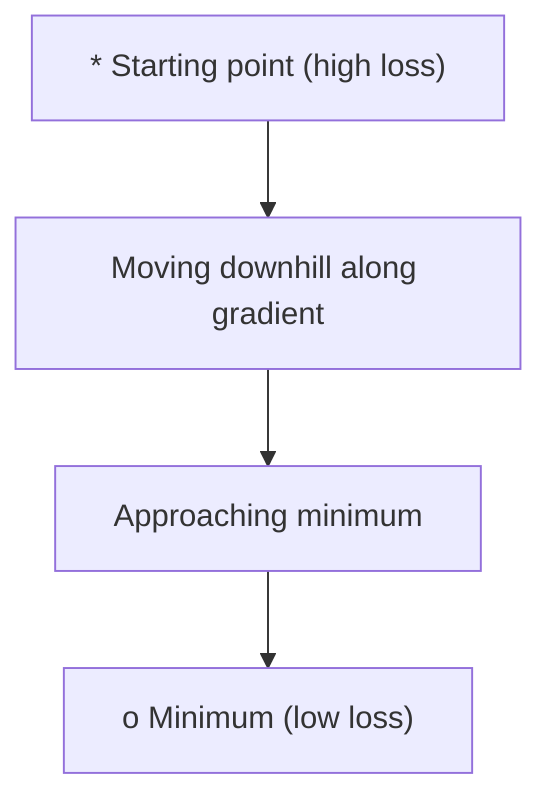
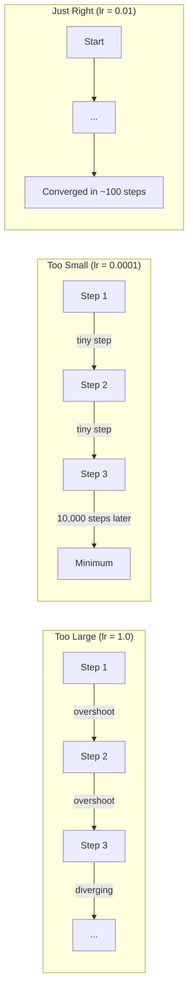
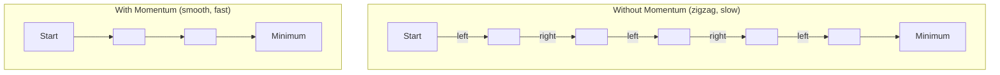
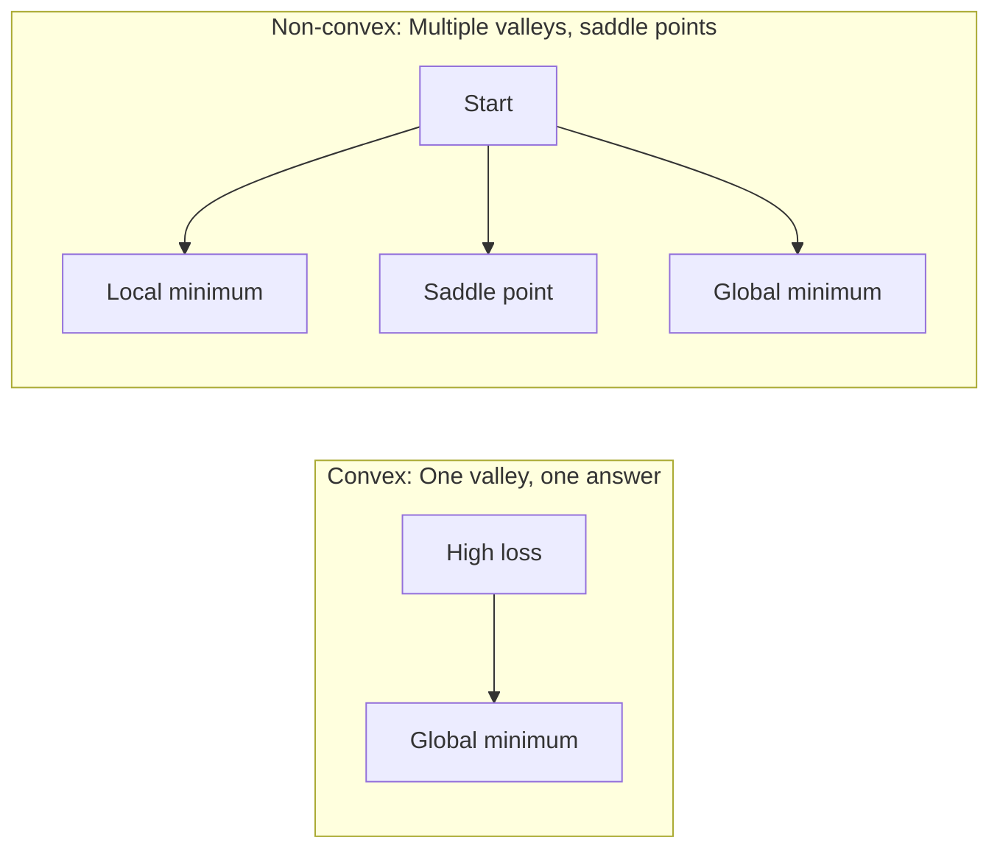
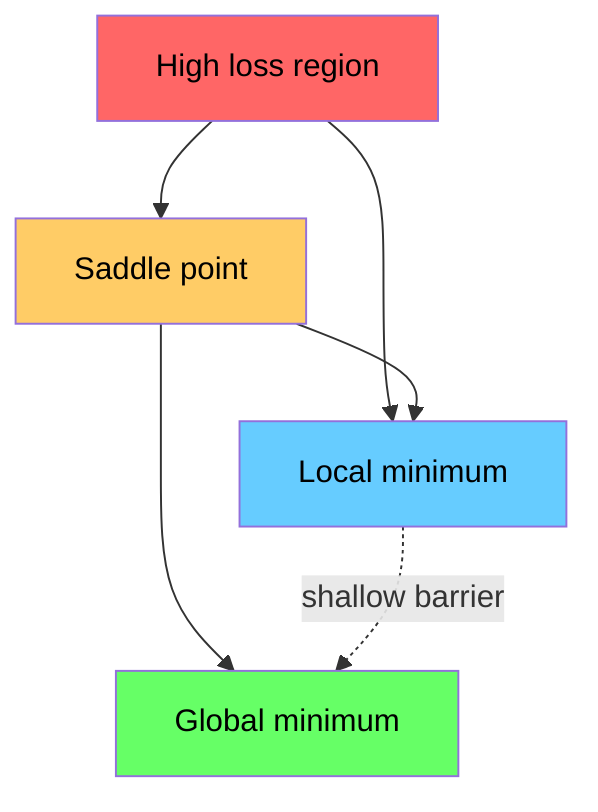

# 优化

> 训练神经网络，不过是在寻找山谷的最低点。

**Type:** Build
**Language:** Python
**Prerequisites:** Phase 1, Lessons 04-05 (Derivatives, Gradients)
**Time:** ~75 minutes

## 学习目标

- 从零实现 vanilla gradient descent、带 momentum 的 SGD 和 Adam
- 比较不同优化器在 Rosenbrock 函数上的收敛情况，并解释为什么 Adam 会为每个权重自适应学习率
- 区分凸损失地形与非凸损失地形，并解释鞍点在高维空间中的作用
- 配置学习率调度，包括 step decay、cosine annealing 和 warmup，以提升训练稳定性

## 问题

你有一个损失函数。它告诉你模型错得有多离谱。你有梯度。它告诉你哪个方向会让损失变得更糟。现在你需要一种向下走的策略。

最朴素的方法很简单：朝梯度的反方向移动。用一个叫学习率的数字缩放步长。重复。这就是梯度下降，而且它确实有效。但“有效”有很多附加条件。学习率太大，你会直接越过山谷，在两边来回弹跳。学习率太小，你会用数千个不必要的步骤慢慢爬向答案。遇到鞍点时，即使还没找到最小值，也可能停下来不动。

深度学习中的每个优化器都在回答同一个问题：怎样更快、更可靠地到达山谷底部？

## 概念

### 优化是什么意思

优化就是寻找能最小化（或最大化）某个函数的输入值。在机器学习中，这个函数是损失。输入是模型的权重。训练就是优化。

```text
minimize L(w) where:
  L = loss function
  w = model weights (could be millions of parameters)
```

### 梯度下降（vanilla）

最简单的优化器。计算损失对每个权重的梯度。让每个权重沿着梯度的反方向移动。用学习率缩放这一步。

```text
w = w - lr * gradient
```

这就是整个算法。一行。



### 学习率：最重要的超参数

学习率控制步长。它决定了收敛过程中的几乎一切。



没有公式能直接给出正确学习率。你要通过实验寻找。常见起点：Adam 用 0.001，带 momentum 的 SGD 用 0.01。

### SGD vs batch vs mini-batch

Vanilla gradient descent 会在整个数据集上计算梯度，然后才走一步。这叫 batch gradient descent。它稳定，但很慢。

Stochastic gradient descent（SGD）在单个随机样本上计算梯度，并立刻走一步。它噪声很大，但速度快。

Mini-batch gradient descent 折中两者。它在一个小批量上计算梯度，例如 32、64、128 或 256 个样本，然后走一步。这才是实际训练中最常用的方法。

| 变体 | Batch size | 梯度质量 | 每步速度 | 噪声 |
|------|------------|----------|----------|------|
| Batch GD | 整个数据集 | 精确 | 慢 | 无 |
| SGD | 1 个样本 | 非常嘈杂 | 快 | 高 |
| Mini-batch | 32-256 | 良好估计 | 均衡 | 中等 |

SGD 和 mini-batch 中的噪声不是 bug。它有助于逃离浅层局部最小值和鞍点。

### Momentum：向下滚动的小球

Vanilla gradient descent 只看当前梯度。如果梯度来回摆动，在狭窄山谷中很常见，前进就会很慢。Momentum 通过把过去的梯度累积成速度项来解决这个问题。

```text
v = beta * v + gradient
w = w - lr * v
```

类比是一颗向下滚动的小球。它不会在每个小凸起处停下并重新开始。它会在一致方向上积累速度，同时抑制振荡。



`beta` 通常是 0.9，它控制保留多少历史。更高的 beta 意味着更强的 momentum，路径更平滑，但对方向变化的响应更慢。

### Adam：自适应学习率

不同权重需要不同学习率。很少得到大梯度的权重，一旦真的得到梯度时应该迈大步。经常得到巨大梯度的权重应该迈小步。

Adam（Adaptive Moment Estimation）会为每个权重跟踪两件事：

1. 一阶矩（m）：梯度的运行平均，类似 momentum
2. 二阶矩（v）：平方梯度的运行平均，也就是梯度幅度

```text
m = beta1 * m + (1 - beta1) * gradient
v = beta2 * v + (1 - beta2) * gradient^2

m_hat = m / (1 - beta1^t)    bias correction
v_hat = v / (1 - beta2^t)    bias correction

w = w - lr * m_hat / (sqrt(v_hat) + epsilon)
```

除以 `sqrt(v_hat)` 是关键洞见。梯度很大的权重会除以一个大数，因此有效步长变小。梯度很小的权重会除以一个小数，因此有效步长变大。每个权重都有自己的自适应学习率。

默认超参数是：`lr=0.001, beta1=0.9, beta2=0.999, epsilon=1e-8`。这些默认值对大多数问题都很管用。

### 学习率调度

固定学习率是一种妥协。训练早期，你希望步子大一些，以便快速推进。训练后期，你希望步子小一些，在最小值附近精细调整。

常见调度：

| 调度 | 公式 | 使用场景 |
|------|------|----------|
| Step decay | lr = lr * factor every N epochs | 简单，手动控制 |
| Exponential decay | lr = lr_0 * decay^t | 平滑下降 |
| Cosine annealing | lr = lr_min + 0.5 * (lr_max - lr_min) * (1 + cos(pi * t / T)) | Transformer、现代训练 |
| Warmup + decay | 先线性升高，再下降 | 大模型，防止早期不稳定 |

### 凸 vs 非凸

凸函数只有一个最小值。梯度下降总能找到它。像 `f(x) = x^2` 这样的二次函数就是凸函数。

神经网络损失函数是非凸的。它们有许多局部最小值、鞍点和平坦区域。



在实践中，高维神经网络中的局部最小值很少是真正的问题。大多数局部最小值的损失都接近全局最小值。真正的障碍是鞍点，也就是某些方向平坦、某些方向弯曲的点。Momentum 和 mini-batch 带来的噪声有助于逃离鞍点。

### 损失地形可视化

损失是所有权重的函数。对于一个拥有 100 万个权重的模型，损失地形存在于 1,000,001 维空间中。我们通常通过在权重空间中选择两个随机方向，并沿这些方向绘制损失，来得到一个二维表面。



尖锐最小值通常泛化较差。平坦最小值通常泛化较好。这也是为什么带 momentum 的 SGD 往往在最终测试准确率上超过 Adam：它的噪声会防止模型停在尖锐最小值中。

```figure
gradient-descent
```

## Build It

### 第 1 步：定义测试函数

Rosenbrock 函数是经典优化基准。它的最小值在 (1, 1)，位于一个狭窄弯曲的山谷里。这个山谷容易找到，但很难沿着它走到最低点。

```text
f(x, y) = (1 - x)^2 + 100 * (y - x^2)^2
```

```python
def rosenbrock(params):
    x, y = params
    return (1 - x) ** 2 + 100 * (y - x ** 2) ** 2

def rosenbrock_gradient(params):
    x, y = params
    df_dx = -2 * (1 - x) + 200 * (y - x ** 2) * (-2 * x)
    df_dy = 200 * (y - x ** 2)
    return [df_dx, df_dy]
```

### 第 2 步：Vanilla gradient descent

```python
class GradientDescent:
    def __init__(self, lr=0.001):
        self.lr = lr

    def step(self, params, grads):
        return [p - self.lr * g for p, g in zip(params, grads)]
```

### 第 3 步：带 momentum 的 SGD

```python
class SGDMomentum:
    def __init__(self, lr=0.001, momentum=0.9):
        self.lr = lr
        self.momentum = momentum
        self.velocity = None

    def step(self, params, grads):
        if self.velocity is None:
            self.velocity = [0.0] * len(params)
        self.velocity = [
            self.momentum * v + g
            for v, g in zip(self.velocity, grads)
        ]
        return [p - self.lr * v for p, v in zip(params, self.velocity)]
```

### 第 4 步：Adam

```python
class Adam:
    def __init__(self, lr=0.001, beta1=0.9, beta2=0.999, epsilon=1e-8):
        self.lr = lr
        self.beta1 = beta1
        self.beta2 = beta2
        self.epsilon = epsilon
        self.m = None
        self.v = None
        self.t = 0

    def step(self, params, grads):
        if self.m is None:
            self.m = [0.0] * len(params)
            self.v = [0.0] * len(params)

        self.t += 1

        self.m = [
            self.beta1 * m + (1 - self.beta1) * g
            for m, g in zip(self.m, grads)
        ]
        self.v = [
            self.beta2 * v + (1 - self.beta2) * g ** 2
            for v, g in zip(self.v, grads)
        ]

        m_hat = [m / (1 - self.beta1 ** self.t) for m in self.m]
        v_hat = [v / (1 - self.beta2 ** self.t) for v in self.v]

        return [
            p - self.lr * mh / (vh ** 0.5 + self.epsilon)
            for p, mh, vh in zip(params, m_hat, v_hat)
        ]
```

### 第 5 步：运行并比较

```python
def optimize(optimizer, func, grad_func, start, steps=5000):
    params = list(start)
    history = [params[:]]
    for _ in range(steps):
        grads = grad_func(params)
        params = optimizer.step(params, grads)
        history.append(params[:])
    return history

start = [-1.0, 1.0]

gd_history = optimize(GradientDescent(lr=0.0005), rosenbrock, rosenbrock_gradient, start)
sgd_history = optimize(SGDMomentum(lr=0.0001, momentum=0.9), rosenbrock, rosenbrock_gradient, start)
adam_history = optimize(Adam(lr=0.01), rosenbrock, rosenbrock_gradient, start)

for name, history in [("GD", gd_history), ("SGD+M", sgd_history), ("Adam", adam_history)]:
    final = history[-1]
    loss = rosenbrock(final)
    print(f"{name:6s} -> x={final[0]:.6f}, y={final[1]:.6f}, loss={loss:.8f}")
```

预期输出：Adam 收敛最快。带 momentum 的 SGD 路径更平滑。Vanilla GD 会沿着狭窄山谷缓慢前进。

## Use It

实践中请使用 PyTorch 或 JAX 优化器。它们会处理参数组、weight decay、梯度裁剪和 GPU 加速。

```python
import torch

model = torch.nn.Linear(784, 10)

sgd = torch.optim.SGD(model.parameters(), lr=0.01, momentum=0.9)
adam = torch.optim.Adam(model.parameters(), lr=0.001)
adamw = torch.optim.AdamW(model.parameters(), lr=0.001, weight_decay=0.01)

scheduler = torch.optim.lr_scheduler.CosineAnnealingLR(adam, T_max=100)
```

经验法则：

- 从 Adam（lr=0.001）开始。它在大多数问题上无需太多调参就能工作。
- 当你需要最好的最终准确率，并且可以投入更多调参时，切换到带 momentum 的 SGD（lr=0.01, momentum=0.9）。
- 对 Transformer 使用 AdamW，也就是带解耦 weight decay 的 Adam。
- 对训练超过几个 epoch 的任务，总是使用学习率调度。
- 如果训练不稳定，降低学习率。如果训练太慢，提高学习率。

## Ship It

这一课会产出一个用于选择合适优化器的提示词。见 `outputs/prompt-optimizer-guide.md`。

这里构建的优化器类会在 Phase 3 中再次出现，那时我们会从零训练一个神经网络。

## 练习

1. **学习率扫描。** 在 Rosenbrock 函数上运行 vanilla gradient descent，学习率取 [0.0001, 0.0005, 0.001, 0.005, 0.01]。画出或打印每个学习率在 5000 步后的最终损失。找出仍能收敛的最大学习率。

2. **Momentum 比较。** 在 Rosenbrock 函数上运行 momentum 值为 [0.0, 0.5, 0.9, 0.99] 的 SGD。跟踪每一步的损失。哪个 momentum 值收敛最快？哪个会越过目标？

3. **逃离鞍点。** 定义函数 `f(x, y) = x^2 - y^2`，它在原点有一个鞍点。从 (0.01, 0.01) 开始。比较 vanilla GD、带 momentum 的 SGD 和 Adam 的行为。哪个能逃离鞍点？

4. **实现学习率衰减。** 给 GradientDescent 类添加指数衰减调度：`lr = lr_0 * 0.999^step`。比较 Rosenbrock 函数上有无衰减时的收敛情况。

## 关键术语

| 术语 | 人们常说 | 它真正的含义 |
|------|----------|--------------|
| Gradient descent | “往下走” | 用学习率缩放梯度，然后从权重中减去它。最基础的优化器。 |
| Learning rate | “步长” | 控制每次更新让权重移动多远的标量。太大会发散，太小会浪费计算。 |
| Momentum | “保持滚动” | 把过去梯度累积进速度向量。抑制振荡，并加速沿一致方向的移动。 |
| SGD | “随机采样” | Stochastic gradient descent。不在全数据集上计算梯度，而是在随机子集上计算。实践中几乎总是指 mini-batch SGD。 |
| Mini-batch | “一小块数据” | 用于估计梯度的一小部分训练数据，通常是 32-256 个样本。平衡速度和梯度准确性。 |
| Adam | “默认优化器” | Adaptive Moment Estimation。跟踪每个权重的梯度运行平均和平方梯度运行平均，让每个权重拥有自己的学习率。 |
| Bias correction | “修正冷启动” | Adam 的一阶矩和二阶矩初始化为零。Bias correction 通过除以 (1 - beta^t) 补偿早期步骤。 |
| Learning rate schedule | “随时间改变 lr” | 训练期间调整学习率的函数。早期大步，后期小步。 |
| Convex function | “一个山谷” | 任意局部最小值都是全局最小值的函数。梯度下降总能找到它。神经网络损失不是凸的。 |
| Saddle point | “平坦但不是最小值” | 梯度为零，但某些方向是最小值、另一些方向是最大值的点。在高维空间中很常见。 |
| Loss landscape | “地形” | 在权重空间中绘制出来的损失函数。通常通过沿两个随机方向切片来可视化。 |
| Convergence | “到达那里” | 优化器到达某个点，进一步更新不再明显降低损失。 |

## 延伸阅读

- [Sebastian Ruder: An overview of gradient descent optimization algorithms](https://ruder.io/optimizing-gradient-descent/) - 对主要优化器的综合综述
- [Why Momentum Really Works (Distill)](https://distill.pub/2017/momentum/) - momentum 动态的交互式可视化
- [Adam: A Method for Stochastic Optimization (Kingma & Ba, 2014)](https://arxiv.org/abs/1412.6980) - Adam 原始论文，短小且可读
- [Visualizing the Loss Landscape of Neural Nets (Li et al., 2018)](https://arxiv.org/abs/1712.09913) - 展示尖锐最小值与平坦最小值的论文
