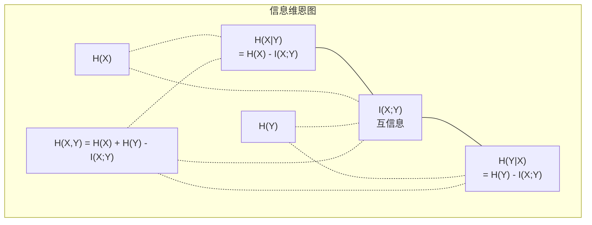

# 信息论

> 信息论衡量“惊讶”。损失函数正是建立在它之上。

**Type:** Learn
**Language:** Python
**Prerequisites:** Phase 1, Lesson 06 (Probability)
**Time:** ~60 minutes

## 学习目标

- 从零计算熵、交叉熵和 KL 散度，并解释它们之间的关系
- 推导为什么最小化交叉熵损失等价于最大化对数似然
- 计算特征与目标之间的互信息，用它来排序特征重要性
- 解释困惑度如何表示语言模型实际在多少个词表选项之间选择

## 问题

你训练的每个分类模型里都会调用 `CrossEntropyLoss()`。你在每篇语言模型论文里都会看到“困惑度”。你会在 VAE、蒸馏和 RLHF 中读到 KL 散度。这些概念并不是彼此孤立的。它们都是同一个思想戴上了不同的帽子。

信息论给了你一套语言，用来推理不确定性、压缩和预测。Claude Shannon 在 1948 年发明它，是为了解决通信问题。结果发现，训练神经网络也是一个通信问题：模型试图通过学到的权重这个带噪声的信道，传递正确标签。

这一课会从零构建每个公式，让你看清它们从哪里来，以及为什么有效。

## 概念

### 信息量（惊讶）

当一件不太可能发生的事发生时，它携带的信息更多。硬币正面朝上？不太惊讶。中彩票？非常惊讶。

概率为 p 的事件的信息量是：

```text
I(x) = -log(p(x))
```

使用以 2 为底的对数，单位是 bits。使用自然对数，单位是 nats。同一个思想，不同单位。

```text
事件               概率        惊讶程度（bits）
公平硬币正面        0.5         1.0
掷出 6 点           0.167       2.58
千分之一事件         0.001       9.97
确定事件            1.0         0.0
```

确定事件携带 0 信息。你本来就知道它会发生。

### 熵（平均惊讶）

熵是一个分布所有可能结果的期望惊讶程度。

```text
H(P) = -sum( p(x) * log(p(x)) )  for all x
```

对于二元变量，公平硬币拥有最大熵：1 bit。偏置硬币（99% 正面）的熵很低：0.08 bits。你几乎已经知道会发生什么，所以每次抛硬币几乎不会告诉你新东西。

```text
公平硬币： H = -(0.5 * log2(0.5) + 0.5 * log2(0.5)) = 1.0 bit
偏置硬币： H = -(0.99 * log2(0.99) + 0.01 * log2(0.01)) = 0.08 bits
```

熵衡量一个分布中不可约的不确定性。你无法把信息压缩到低于它。

### 交叉熵（你每天都在用的损失函数）

交叉熵衡量的是：真实事件来自分布 P，但你用分布 Q 去编码它们时，平均会有多惊讶。

```text
H(P, Q) = -sum( p(x) * log(q(x)) )  for all x
```

P 是真实分布（标签）。Q 是模型预测。如果 Q 和 P 完全匹配，交叉熵就等于熵。任何不匹配都会让它变大。

在分类任务中，P 是 one-hot 向量（真实类别概率为 1，其余为 0）。这会把交叉熵简化为：

```text
H(P, Q) = -log(q(true_class))
```

这就是分类任务中完整的交叉熵损失公式。最大化正确类别的预测概率。

### KL 散度（分布之间的距离）

KL 散度衡量的是：使用 Q 而不是 P 会带来多少额外惊讶。

```text
D_KL(P || Q) = sum( p(x) * log(p(x) / q(x)) )  for all x
             = H(P, Q) - H(P)
```

交叉熵等于熵加上 KL 散度。由于真实分布的熵在训练期间是常数，最小化交叉熵就等价于最小化 KL 散度。你正在把模型分布推向真实分布。

KL 散度不是对称的：D_KL(P || Q) != D_KL(Q || P)。它不是真正的距离度量。

### 互信息

互信息衡量的是：知道一个变量后，能告诉你另一个变量多少信息。

```text
I(X; Y) = H(X) - H(X|Y)
        = H(X) + H(Y) - H(X, Y)
```

如果 X 和 Y 独立，互信息为 0。知道其中一个不会告诉你另一个的任何信息。如果它们完全相关，互信息就等于任意一个变量的熵。

在特征选择中，某个特征和目标之间的互信息越高，说明这个特征越有用。互信息越低，说明它越像噪声。

### 条件熵

H(Y|X) 衡量的是：观察到 X 之后，关于 Y 还剩多少不确定性。

```text
H(Y|X) = H(X,Y) - H(X)
```

两个极端情况：

- 如果 X 完全决定 Y，那么 H(Y|X) = 0。知道 X 会消除关于 Y 的全部不确定性。例如：X = 摄氏温度，Y = 华氏温度。
- 如果 X 对 Y 没有任何帮助，那么 H(Y|X) = H(Y)。知道 X 不会降低你的不确定性。例如：X = 抛硬币结果，Y = 明天的天气。

条件熵永远非负，并且永远不会超过 H(Y)：

```text
0 <= H(Y|X) <= H(Y)
```

在机器学习中，条件熵会出现在决策树里。在每个划分点，算法会选择让 H(Y|X) 最小的特征 X，也就是最能消除标签 Y 不确定性的特征。

### 联合熵

H(X,Y) 是 X 和 Y 的联合分布的熵。

```text
H(X,Y) = -sum sum p(x,y) * log(p(x,y))   for all x, y
```

关键性质：

```text
H(X,Y) <= H(X) + H(Y)
```

当 X 和 Y 独立时，等号成立。如果它们共享信息，联合熵就会小于各自熵的总和。这个“少掉的”熵正好就是互信息。



这些关系是：

- H(X,Y) = H(X) + H(Y|X) = H(Y) + H(X|Y)
- I(X;Y) = H(X) - H(X|Y) = H(Y) - H(Y|X)
- H(X,Y) = H(X) + H(Y) - I(X;Y)

### 互信息（深入）

互信息 I(X;Y) 量化的是：知道一个变量后，会让你对另一个变量的不确定性减少多少。

```text
I(X;Y) = H(X) - H(X|Y)
       = H(Y) - H(Y|X)
       = H(X) + H(Y) - H(X,Y)
       = sum sum p(x,y) * log(p(x,y) / (p(x) * p(y)))
```

性质：

- I(X;Y) >= 0 始终成立。观察某件事不会让你损失信息。
- I(X;Y) = 0 当且仅当 X 和 Y 独立。
- I(X;Y) = I(Y;X)。它是对称的，不像 KL 散度。
- I(X;X) = H(X)。一个变量与自身共享全部信息。

**用于特征选择的互信息。** 在机器学习中，你希望特征能提供关于目标的信息。互信息给了你一种有原则的特征排序方式：

1. 对每个特征 X_i，计算 I(X_i; Y)，其中 Y 是目标变量。
2. 按 MI 分数排序特征。
3. 保留前 k 个特征。

这适用于特征和目标之间的任何关系：线性、非线性、单调或非单调。相关系数只能捕捉线性关系。MI 能捕捉一切统计依赖。

| 方法 | 能检测什么 | 计算成本 | 能处理类别变量？ |
|------|------------|----------|------------------|
| Pearson correlation | 线性关系 | O(n) | 否 |
| Spearman correlation | 单调关系 | O(n log n) | 否 |
| Mutual information | 任意统计依赖 | 分箱时 O(n log n) | 是 |

### Label Smoothing 与交叉熵

标准分类使用硬目标：[0, 0, 1, 0]。真实类别得到概率 1，其他类别得到 0。Label smoothing 会把它替换成软目标：

```text
soft_target = (1 - epsilon) * hard_target + epsilon / num_classes
```

当 epsilon = 0.1 且类别数为 4 时：

- 硬目标： [0, 0, 1, 0]
- 软目标： [0.025, 0.025, 0.925, 0.025]

从信息论角度看，label smoothing 会增加目标分布的熵。硬 one-hot 目标的熵为 0，因为没有不确定性。软目标有正熵。

它为什么有用：

- 防止模型把 logits 推到极端值（要在交叉熵下完美匹配 one-hot 目标，需要无限大的 logits）
- 起到正则化作用：模型不能 100% 确信
- 改善校准：预测概率能更好反映真实不确定性
- 缩小训练行为与推理行为之间的差距

带 label smoothing 的交叉熵损失变为：

```text
L = (1 - epsilon) * CE(hard_target, prediction) + epsilon * H_uniform(prediction)
```

第二项会惩罚远离均匀分布的预测，也就是直接对置信度施加正则化。

### 为什么交叉熵是分类损失的核心

三个视角，同一个结论。

**信息论视角。** 交叉熵衡量的是：你使用模型分布而不是真实分布时，浪费了多少 bits。最小化它会让你的模型成为对现实最有效的编码器。

**最大似然视角。** 对 N 个训练样本，真实类别为 y_i：

```text
Likelihood     = product( q(y_i) )
Log-likelihood = sum( log(q(y_i)) )
Negative log-likelihood = -sum( log(q(y_i)) )
```

最后一行就是交叉熵损失。最小化交叉熵 = 最大化模型下训练数据的似然。

**梯度视角。** 交叉熵对 logits 的梯度就是 (predicted - true)。干净、稳定、计算快。这就是它和 softmax 完美搭配的原因。

### Bits vs Nats

唯一差别是对数底数。

```text
log base 2   -> bits      （信息论传统）
log base e   -> nats      （机器学习惯例）
log base 10  -> hartleys  （很少使用）
```

1 nat = 1/ln(2) bits = 1.4427 bits。PyTorch 和 TensorFlow 默认使用自然对数（nats）。

### 困惑度

困惑度是交叉熵的指数。它告诉你：模型等效上在多少个同等可能的选项之间感到不确定。

```text
Perplexity = 2^H(P,Q)   （如果使用 bits）
Perplexity = e^H(P,Q)   （如果使用 nats）
```

困惑度为 50 的语言模型，平均来看就像是在 50 个可能的下一个 token 中均匀选择一样困惑。越低越好。

GPT-2 在常见基准上达到约 30 的困惑度。现代模型在覆盖充分的领域里通常能达到个位数。

```figure
entropy-kl
```

## Build It

### 第 1 步：信息量与熵

```python
import math

def information_content(p, base=2):
    if p <= 0 or p > 1:
        return float('inf') if p <= 0 else 0.0
    return -math.log(p) / math.log(base)

def entropy(probs, base=2):
    return sum(
        p * information_content(p, base)
        for p in probs if p > 0
    )

fair_coin = [0.5, 0.5]
biased_coin = [0.99, 0.01]
fair_die = [1/6] * 6

print(f"Fair coin entropy:   {entropy(fair_coin):.4f} bits")
print(f"Biased coin entropy: {entropy(biased_coin):.4f} bits")
print(f"Fair die entropy:    {entropy(fair_die):.4f} bits")
```

### 第 2 步：交叉熵与 KL 散度

```python
def cross_entropy(p, q, base=2):
    total = 0.0
    for pi, qi in zip(p, q):
        if pi > 0:
            if qi <= 0:
                return float('inf')
            total += pi * (-math.log(qi) / math.log(base))
    return total

def kl_divergence(p, q, base=2):
    return cross_entropy(p, q, base) - entropy(p, base)

true_dist = [0.7, 0.2, 0.1]
good_model = [0.6, 0.25, 0.15]
bad_model = [0.1, 0.1, 0.8]

print(f"Entropy of true dist:     {entropy(true_dist):.4f} bits")
print(f"CE (good model):          {cross_entropy(true_dist, good_model):.4f} bits")
print(f"CE (bad model):           {cross_entropy(true_dist, bad_model):.4f} bits")
print(f"KL divergence (good):     {kl_divergence(true_dist, good_model):.4f} bits")
print(f"KL divergence (bad):      {kl_divergence(true_dist, bad_model):.4f} bits")
```

### 第 3 步：把交叉熵当作分类损失

```python
def softmax(logits):
    max_logit = max(logits)
    exps = [math.exp(z - max_logit) for z in logits]
    total = sum(exps)
    return [e / total for e in exps]

def cross_entropy_loss(true_class, logits):
    probs = softmax(logits)
    return -math.log(probs[true_class])

logits = [2.0, 1.0, 0.1]
true_class = 0

probs = softmax(logits)
loss = cross_entropy_loss(true_class, logits)

print(f"Logits:      {logits}")
print(f"Softmax:     {[f'{p:.4f}' for p in probs]}")
print(f"True class:  {true_class}")
print(f"Loss:        {loss:.4f} nats")
print(f"Perplexity:  {math.exp(loss):.2f}")
```

### 第 4 步：交叉熵等于负对数似然

```python
import random

random.seed(42)

n_samples = 1000
n_classes = 3
true_labels = [random.randint(0, n_classes - 1) for _ in range(n_samples)]
model_logits = [[random.gauss(0, 1) for _ in range(n_classes)] for _ in range(n_samples)]

ce_loss = sum(
    cross_entropy_loss(label, logits)
    for label, logits in zip(true_labels, model_logits)
) / n_samples

nll = -sum(
    math.log(softmax(logits)[label])
    for label, logits in zip(true_labels, model_logits)
) / n_samples

print(f"Cross-entropy loss:      {ce_loss:.6f}")
print(f"Negative log-likelihood: {nll:.6f}")
print(f"Difference:              {abs(ce_loss - nll):.2e}")
```

### 第 5 步：互信息

```python
def mutual_information(joint_probs, base=2):
    rows = len(joint_probs)
    cols = len(joint_probs[0])

    margin_x = [sum(joint_probs[i][j] for j in range(cols)) for i in range(rows)]
    margin_y = [sum(joint_probs[i][j] for i in range(rows)) for j in range(cols)]

    mi = 0.0
    for i in range(rows):
        for j in range(cols):
            pxy = joint_probs[i][j]
            if pxy > 0:
                mi += pxy * math.log(pxy / (margin_x[i] * margin_y[j])) / math.log(base)
    return mi

independent = [[0.25, 0.25], [0.25, 0.25]]
dependent = [[0.45, 0.05], [0.05, 0.45]]

print(f"MI (independent): {mutual_information(independent):.4f} bits")
print(f"MI (dependent):   {mutual_information(dependent):.4f} bits")
```

## Use It

下面用 NumPy 实现同样的概念，也就是你在实践中会使用的方式：

```python
import numpy as np

def np_entropy(p):
    p = np.asarray(p, dtype=float)
    mask = p > 0
    result = np.zeros_like(p)
    result[mask] = p[mask] * np.log(p[mask])
    return -result.sum()

def np_cross_entropy(p, q):
    p, q = np.asarray(p, dtype=float), np.asarray(q, dtype=float)
    mask = p > 0
    return -(p[mask] * np.log(q[mask])).sum()

def np_kl_divergence(p, q):
    return np_cross_entropy(p, q) - np_entropy(p)

true = np.array([0.7, 0.2, 0.1])
pred = np.array([0.6, 0.25, 0.15])
print(f"Entropy:    {np_entropy(true):.4f} nats")
print(f"Cross-ent:  {np_cross_entropy(true, pred):.4f} nats")
print(f"KL div:     {np_kl_divergence(true, pred):.4f} nats")
```

你已经从零构建了 `torch.nn.CrossEntropyLoss()` 在内部所做的事。现在你知道为什么训练时损失会下降：模型预测分布正在靠近真实分布，而这个距离用浪费掉的信息量（nats）来衡量。

## 练习

1. 假设英文字母均匀分布，计算 26 个字母的熵。然后使用真实字母频率估计熵。哪一个更高？为什么？

2. 某个样本的真实类别是 1，模型输出 logits [5.0, 2.0, 0.5]。手算交叉熵损失，然后用你的 `cross_entropy_loss` 函数验证。什么样的 logits 会得到 0 损失？

3. 说明 KL 散度不是对称的。选择两个分布 P 和 Q，计算 D_KL(P || Q) 和 D_KL(Q || P)。解释它们为什么不同。

4. 构建一个函数，为一串 token 预测计算困惑度。给定一个由 (true_token_index, predicted_logits) 组成的列表，返回整个序列的困惑度。

## 关键术语

| 术语 | 人们常说 | 实际含义 |
|------|----------|----------|
| Information content | “惊讶” | 编码一个事件所需的 bits（或 nats）数量：-log(p) |
| Entropy | “随机性” | 一个分布所有结果的平均惊讶程度。衡量不可约的不确定性。 |
| Cross-entropy | “损失函数” | 使用模型分布 Q 去编码来自真实分布 P 的事件时的平均惊讶程度。 |
| KL divergence | “分布之间的距离” | 使用 Q 而不是 P 浪费的额外 bits。等于交叉熵减熵。不是对称的。 |
| Mutual information | “X 和 Y 有多相关” | 知道 Y 后，关于 X 的不确定性减少了多少。为 0 表示独立。 |
| Softmax | “把 logits 变成概率” | 指数化并归一化。把任意实值向量映射成合法概率分布。 |
| Perplexity | “模型有多困惑” | 交叉熵的指数。表示模型在每一步等效选择的词表大小。 |
| Bits | “Shannon 的单位” | 使用以 2 为底的对数衡量信息。一个 bit 解决一次公平硬币抛掷。 |
| Nats | “机器学习的单位” | 使用自然对数衡量信息。PyTorch 和 TensorFlow 默认使用它。 |
| Negative log-likelihood | “NLL loss” | 对 one-hot 标签来说，它等同于交叉熵损失。最小化它就是最大化正确预测概率。 |

## 延伸阅读

- [Shannon 1948: A Mathematical Theory of Communication](https://people.math.harvard.edu/~ctm/home/text/others/shannon/entropy/entropy.pdf) - 原始论文，至今仍然可读
- [Visual Information Theory (Chris Olah)](https://colah.github.io/posts/2015-09-Visual-Information/) - 关于熵和 KL 散度的最佳可视化解释
- [PyTorch CrossEntropyLoss docs](https://pytorch.org/docs/stable/generated/torch.nn.CrossEntropyLoss.html) - 框架如何实现你刚刚从零构建的内容
