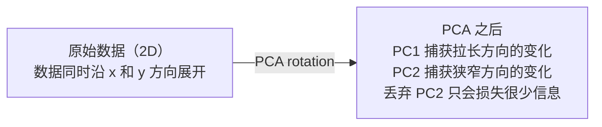

# 降维

> 高维数据有结构。你需要从正确角度观察它。

**Type:** Build
**Language:** Python
**Prerequisites:** Phase 1, Lessons 01 (Linear Algebra Intuition), 02 (Vectors, Matrices & Operations), 03 (Eigenvalues & Eigenvectors), 06 (Probability & Distributions)
**Time:** ~90 minutes

## 学习目标

- 从零实现 PCA：中心化数据、计算协方差矩阵、做特征分解并完成投影
- 使用解释方差比和 elbow method 选择主成分数量
- 比较 PCA、t-SNE 和 UMAP 在 MNIST 数字二维可视化上的表现，并解释它们的权衡
- 使用带 RBF 核的 kernel PCA 分离标准 PCA 无法处理的非线性数据结构

## 问题

你有一个数据集，每个样本有 784 个特征。也许它是手写数字的像素值。也许它是基因表达水平。也许它是用户行为信号。你无法可视化 784 维。你不能把它们画出来。你甚至无法真正思考它们。

但这 784 个特征中，大多数都是冗余的。真正的信息存在于一个小得多的表面上。一个手写的 “7” 并不需要 784 个独立数字来描述。它只需要几个因素：笔画角度、横杠长度、倾斜程度。剩下的大多是噪声。

降维就是寻找这个更小的表面。它把 784 维数据压缩到 2、10 或 50 维，同时保留真正重要的结构。

## 概念

### 维度灾难

高维空间不符合直觉。随着维度增长，有三件事会坏掉。

**距离变得没有意义。** 在高维中，任意两个随机点之间的距离会收敛到相近的值。如果每个点到其他每个点的距离都差不多，nearest-neighbor search 就会失效。

```text
维度      随机点之间平均距离比（max/min）
2         ~5.0
10        ~1.8
100       ~1.2
1000      ~1.02
```

**体积集中在角落。** d 维单位超立方体有 2^d 个角。在 100 维中，几乎所有体积都在角落里，远离中心。数据点会散到边缘，模型在内部区域没有足够数据可学。

**你需要指数级更多数据。** 为了在空间中维持相同的样本密度，从 2D 到 20D 意味着你需要 10^18 倍的数据。你永远没有那么多。降低维度会把数据密度带回可工作的范围。

### PCA：寻找重要方向

Principal Component Analysis（PCA）会找到数据变化最大的轴。它旋转坐标系，让第一条轴捕获最多方差，第二条轴捕获次多方差，以此类推。

算法：

```text
1. Center the data        （从每个特征中减去均值）
2. Compute covariance     （计算特征如何共同变化）
3. Eigendecomposition     （找到主方向）
4. Sort by eigenvalue     （方差最大的排在前面）
5. Project                （保留前 k 个特征向量，丢弃其余方向）
```

为什么是特征分解？协方差矩阵是对称且半正定的。它的特征向量是特征空间中的正交方向。特征值告诉你每个方向捕获了多少方差。最大特征值对应的特征向量，指向最大方差方向。



- **PCA 之前：** 数据云沿对角线分布，同时跨越 x 轴和 y 轴
- **PCA 之后：** 坐标系被旋转，PC1 对齐最大方差方向（拉长方向），PC2 对齐最小方差方向（狭窄方向）
- **降维：** 丢弃 PC2 会把数据投影到 PC1 上，只损失很少信息

### 解释方差比

每个主成分都会捕获总方差的一部分。解释方差比告诉你具体有多少。

```text
Component    Eigenvalue    Explained ratio    Cumulative
PC1          4.73          0.473              0.473
PC2          2.51          0.251              0.724
PC3          1.12          0.112              0.836
PC4          0.89          0.089              0.925
...
```

当累计解释方差达到 0.95 时，你就知道这些主成分捕获了 95% 的信息。后面的部分大多是噪声。

### 选择主成分数量

三种策略：

1. **阈值。** 保留足够多的主成分，以解释 90-95% 的方差。
2. **Elbow method。** 绘制每个主成分的解释方差。寻找陡降后的拐点。
3. **下游性能。** 把 PCA 当作预处理。扫描 k，测量模型准确率。最好的 k 通常在准确率进入平台期的位置。

### t-SNE：保留邻域

t-Distributed Stochastic Neighbor Embedding（t-SNE）是为可视化设计的。它把高维数据映射到 2D（或 3D），同时尽量保留哪些点彼此相近。

直觉是：在原始空间中，根据点之间的距离，为点对计算一个概率分布。近的点得到高概率。远的点得到低概率。然后寻找一个二维排列，让同样的概率分布尽可能成立。784 维中的邻居，在 2D 中仍然是邻居。

t-SNE 的关键性质：

- 非线性。它能展开 PCA 无法处理的复杂流形。
- 随机。不同运行会产生不同布局。
- perplexity 参数控制考虑多少邻居（典型范围：5-50）。
- 输出中簇与簇之间的距离没有语义。只有簇本身有意义。
- 在大数据集上很慢。默认是 O(n^2)。

### UMAP：更快，也保留更好的全局结构

Uniform Manifold Approximation and Projection（UMAP）的工作方式类似 t-SNE，但有两个优势：

- 更快。它使用近似 nearest-neighbor 图，而不是计算所有成对距离。
- 更好的全局结构。输出中簇之间的相对位置通常比 t-SNE 更有意义。

UMAP 会在高维空间中构建一个加权图（“fuzzy topological representation”），然后寻找一个低维布局，尽可能保留这个图。

关键参数：

- `n_neighbors`：定义局部结构时考虑多少邻居（类似 perplexity）。值越高，保留的全局结构越多。
- `min_dist`：输出中点可以挤得多紧。值越低，簇越密。

### 什么时候用哪个

| 方法 | 使用场景 | 保留什么 | 速度 |
|------|----------|----------|------|
| PCA | 训练前预处理 | 全局方差 | 快（精确），可处理百万级样本 |
| PCA | 快速探索性可视化 | 线性结构 | 快 |
| t-SNE | 论文级二维图 | 局部邻域 | 慢（理想情况下 < 10k 样本） |
| UMAP | 大规模二维可视化 | 局部 + 部分全局结构 | 中等（可处理百万级） |
| PCA | 为模型做特征缩减 | 按方差排序的特征 | 快 |
| t-SNE / UMAP | 理解簇结构 | 簇分离 | 中等到慢 |

经验法则：使用 PCA 做预处理和数据压缩。需要在 2D 中可视化结构时，使用 t-SNE 或 UMAP。

### Kernel PCA

标准 PCA 寻找线性子空间。它旋转坐标系并丢弃一些轴。但如果数据位于非线性流形上怎么办？2D 中的圆无法被任何直线分开。标准 PCA 帮不上忙。

Kernel PCA 会在由核函数诱导出的高维特征空间中执行 PCA，但不显式计算那个空间中的坐标。这就是 kernel trick，也是 SVM 背后的同一个思想。

算法：

1. 计算核矩阵 K，其中 K_ij = k(x_i, x_j)
2. 在特征空间中中心化核矩阵
3. 对中心化后的核矩阵做特征分解
4. 顶部特征向量（按 1/sqrt(eigenvalue) 缩放）就是投影

常见核函数：

| Kernel | Formula | Good for |
|--------|---------|----------|
| RBF (Gaussian) | exp(-gamma * \|\|x - y\|\|^2) | 大多数非线性数据、平滑流形 |
| Polynomial | (x . y + c)^d | 多项式关系 |
| Sigmoid | tanh(alpha * x . y + c) | 类神经网络映射 |

什么时候使用 kernel PCA，什么时候使用标准 PCA：

| 判断标准 | Standard PCA | Kernel PCA |
|----------|--------------|------------|
| 数据结构 | 线性子空间 | 非线性流形 |
| 速度 | O(min(n^2 d, d^2 n)) | O(n^2 d + n^3) |
| 可解释性 | 主成分是特征的线性组合 | 主成分缺少直接的特征解释 |
| 可扩展性 | 可处理百万级样本 | 核矩阵是 n x n，受内存限制 |
| 重建 | 可直接 inverse transform | 需要 pre-image 近似 |

经典示例：2D 中的同心圆。两圈点，一个在内，一个在外。标准 PCA 会把两圈都投影到同一条线上，对分类毫无帮助。带 RBF 核的 kernel PCA 会把内圈和外圈映射到不同区域，让它们线性可分。

### 重建误差

你的降维效果有多好？你把 784 维压缩到 50 维。你损失了什么？

测量重建误差：

1. 把数据投影到 k 维：X_reduced = X @ W_k
2. 重建：X_hat = X_reduced @ W_k^T
3. 计算 MSE：mean((X - X_hat)^2)

对于 PCA，重建误差和解释方差之间有清晰关系：

```text
Reconstruction error = sum of eigenvalues NOT included
Total variance = sum of ALL eigenvalues
Fraction lost = (sum of dropped eigenvalues) / (sum of all eigenvalues)
```

每个主成分的解释方差比是：

```text
explained_ratio_k = eigenvalue_k / sum(all eigenvalues)
```

把累计解释方差画成主成分数量的函数，你会得到 “elbow” 曲线。合适的主成分数量通常在这里：

- 曲线变平（收益递减）
- 累计方差越过你的阈值（通常是 0.90 或 0.95）
- 下游任务性能进入平台期

重建误差不只用于选择 k。你还可以把它用于异常检测：重建误差很高的样本是离群点，它们不符合学到的子空间。这就是生产系统中基于 PCA 的异常检测基础。

```figure
pca-axes
```

## Build It

### 第 1 步：从零实现 PCA

```python
import numpy as np

class PCA:
    def __init__(self, n_components):
        self.n_components = n_components
        self.components = None
        self.mean = None
        self.eigenvalues = None
        self.explained_variance_ratio_ = None

    def fit(self, X):
        self.mean = np.mean(X, axis=0)
        X_centered = X - self.mean

        cov_matrix = np.cov(X_centered, rowvar=False)

        eigenvalues, eigenvectors = np.linalg.eigh(cov_matrix)

        sorted_idx = np.argsort(eigenvalues)[::-1]
        eigenvalues = eigenvalues[sorted_idx]
        eigenvectors = eigenvectors[:, sorted_idx]

        self.components = eigenvectors[:, :self.n_components].T
        self.eigenvalues = eigenvalues[:self.n_components]
        total_var = np.sum(eigenvalues)
        self.explained_variance_ratio_ = self.eigenvalues / total_var

        return self

    def transform(self, X):
        X_centered = X - self.mean
        return X_centered @ self.components.T

    def fit_transform(self, X):
        self.fit(X)
        return self.transform(X)
```

### 第 2 步：在合成数据上测试

```python
np.random.seed(42)
n_samples = 500

t = np.random.uniform(0, 2 * np.pi, n_samples)
x1 = 3 * np.cos(t) + np.random.normal(0, 0.2, n_samples)
x2 = 3 * np.sin(t) + np.random.normal(0, 0.2, n_samples)
x3 = 0.5 * x1 + 0.3 * x2 + np.random.normal(0, 0.1, n_samples)

X_synthetic = np.column_stack([x1, x2, x3])

pca = PCA(n_components=2)
X_reduced = pca.fit_transform(X_synthetic)

print(f"Original shape: {X_synthetic.shape}")
print(f"Reduced shape:  {X_reduced.shape}")
print(f"Explained variance ratios: {pca.explained_variance_ratio_}")
print(f"Total variance captured: {sum(pca.explained_variance_ratio_):.4f}")
```

### 第 3 步：MNIST 数字的二维表示

```python
from sklearn.datasets import fetch_openml

mnist = fetch_openml("mnist_784", version=1, as_frame=False, parser="auto")
X_mnist = mnist.data[:5000].astype(float)
y_mnist = mnist.target[:5000].astype(int)

pca_mnist = PCA(n_components=50)
X_pca50 = pca_mnist.fit_transform(X_mnist)
print(f"50 components capture {sum(pca_mnist.explained_variance_ratio_):.2%} of variance")

pca_2d = PCA(n_components=2)
X_pca2d = pca_2d.fit_transform(X_mnist)
print(f"2 components capture {sum(pca_2d.explained_variance_ratio_):.2%} of variance")
```

### 第 4 步：与 sklearn 比较

```python
from sklearn.decomposition import PCA as SklearnPCA
from sklearn.manifold import TSNE

sklearn_pca = SklearnPCA(n_components=2)
X_sklearn_pca = sklearn_pca.fit_transform(X_mnist)

print(f"\nOur PCA explained variance:     {pca_2d.explained_variance_ratio_}")
print(f"Sklearn PCA explained variance: {sklearn_pca.explained_variance_ratio_}")

diff = np.abs(np.abs(X_pca2d) - np.abs(X_sklearn_pca))
print(f"Max absolute difference: {diff.max():.10f}")

tsne = TSNE(n_components=2, perplexity=30, random_state=42)
X_tsne = tsne.fit_transform(X_mnist)
print(f"\nt-SNE output shape: {X_tsne.shape}")
```

### 第 5 步：UMAP 比较

```python
try:
    from umap import UMAP

    reducer = UMAP(n_components=2, n_neighbors=15, min_dist=0.1, random_state=42)
    X_umap = reducer.fit_transform(X_mnist)
    print(f"UMAP output shape: {X_umap.shape}")
except ImportError:
    print("Install umap-learn: pip install umap-learn")
```

## Use It

把 PCA 作为分类器之前的预处理：

```python
from sklearn.decomposition import PCA as SklearnPCA
from sklearn.linear_model import LogisticRegression
from sklearn.model_selection import train_test_split
from sklearn.metrics import accuracy_score

X_train, X_test, y_train, y_test = train_test_split(
    X_mnist, y_mnist, test_size=0.2, random_state=42
)

results = {}
for k in [10, 30, 50, 100, 200]:
    pca_k = SklearnPCA(n_components=k)
    X_tr = pca_k.fit_transform(X_train)
    X_te = pca_k.transform(X_test)

    clf = LogisticRegression(max_iter=1000, random_state=42)
    clf.fit(X_tr, y_train)
    acc = accuracy_score(y_test, clf.predict(X_te))
    var_captured = sum(pca_k.explained_variance_ratio_)
    results[k] = (acc, var_captured)
    print(f"k={k:>3d}  accuracy={acc:.4f}  variance={var_captured:.4f}")
```

性能会远早于 784 维进入平台期。那个平台期就是你的运行点。

## Ship It

这一课产出：

- `outputs/skill-dimensionality-reduction.md` - 一个用于为给定任务选择合适降维技术的 skill

## 练习

1. 修改 PCA 类，让它支持 `inverse_transform`。用 10、50 和 200 个主成分重建 MNIST 数字。分别打印每种情况的重建误差（与原始数据的均方差）。

2. 在同一个 MNIST 子集上运行 t-SNE，分别使用 perplexity 5、30 和 100。描述输出如何变化。为什么 perplexity 会影响簇的紧密程度？

3. 使用 `sklearn.datasets.make_classification` 生成一个有 50 个特征、其中只有 5 个有信息量的数据集。应用 PCA，检查解释方差曲线是否能正确识别出数据实际上是 5 维的。

## 关键术语

| 术语 | 人们常说 | 实际含义 |
|------|----------|----------|
| Curse of dimensionality | “特征太多” | 随着维度增长，距离、体积和数据密度都会以反直觉方式变化。模型需要指数级更多数据来补偿。 |
| PCA | “降低维度” | 旋转坐标系，让坐标轴对齐最大方差方向，然后丢弃低方差轴。 |
| Principal component | “重要方向” | 协方差矩阵的一个特征向量。它是特征空间中数据变化最大的方向。 |
| Explained variance ratio | “这个成分有多少信息” | 一个主成分捕获的总方差比例。把前 k 个比例相加，就能看出 k 个主成分保留了多少信息。 |
| Covariance matrix | “特征如何相关” | 一个对称矩阵，其中 (i,j) 项衡量特征 i 和特征 j 如何共同变化。对角线项是各自方差。 |
| t-SNE | “那个聚类图” | 一种非线性方法，通过保留成对邻域概率，把高维数据映射到 2D。适合可视化，不适合作为预处理。 |
| UMAP | “更快的 t-SNE” | 一种基于拓扑数据分析的非线性方法。既保留局部结构，也保留部分全局结构。比 t-SNE 更易扩展。 |
| Perplexity | “t-SNE 的一个旋钮” | 控制每个点考虑的有效邻居数量。低 perplexity 关注非常局部的结构。高 perplexity 捕获更宽的模式。 |
| Manifold | “数据所在的表面” | 嵌入在高维空间中的低维表面。一张纸揉皱在 3D 中，仍然是一个 2D 流形。 |

## 延伸阅读

- [A Tutorial on Principal Component Analysis](https://arxiv.org/abs/1404.1100) (Shlens) - 从零清晰推导 PCA
- [How to Use t-SNE Effectively](https://distill.pub/2016/misread-tsne/) (Wattenberg et al.) - 关于 t-SNE 陷阱和参数选择的交互式指南
- [UMAP documentation](https://umap-learn.readthedocs.io/) - UMAP 作者提供的理论和实践指南
