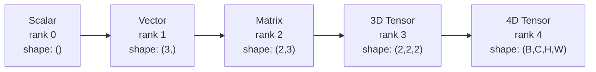
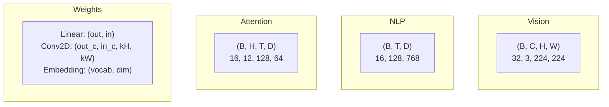
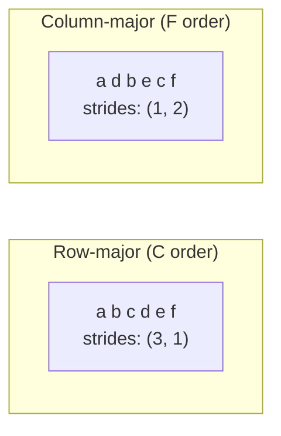
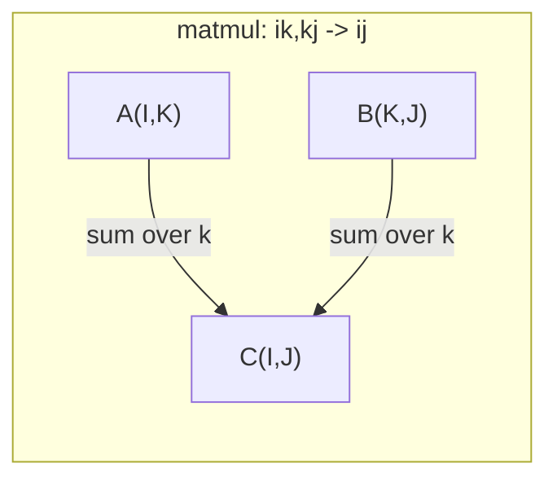

# 张量操作

> 张量是数据与深度学习之间的共同语言。每张图像、每个句子、每个梯度都会流经它们。

**Type:** Build
**Language:** Python
**Prerequisites:** Phase 1, Lessons 01 (Linear Algebra Intuition), 02 (Vectors, Matrices & Operations)
**Time:** ~90 minutes

## 学习目标

- 从零实现一个 tensor 类，支持 shape、strides、reshape、transpose 和逐元素操作
- 应用 broadcasting 规则，在不复制数据的情况下对不同形状的张量执行操作
- 为点积、矩阵乘法、外积和 batch 操作编写 einsum 表达式
- 追踪 multi-head attention 每一步的精确 tensor shape

## 问题

你构建了一个 transformer。forward pass 看起来很干净。运行之后你看到：`RuntimeError: mat1 and mat2 shapes cannot be multiplied (32x768 and 512x768)`。你盯着 shape 看。试着加一个 transpose。现在错误变成 `Expected 4D input (got 3D input)`。你加了一个 unsqueeze。又有别的东西坏掉。

Shape 错误是深度学习代码中最常见的 bug。它们在概念上并不难，因为每个操作都有 shape contract，但它们扩散得很快。一个 transformer 会把几十个 reshape、transpose 和 broadcast 串起来。一个轴错了，错误就会层层传递。更糟的是，有些 shape 错误根本不会报错。它们会沿着错误维度 broadcast，或在错误轴上求和，然后悄悄产出垃圾结果。

矩阵能处理两组对象之间的成对关系。真实数据并不适合塞进二维。一批 32 张 224x224 RGB 图像是一个 4D tensor：`(32, 3, 224, 224)`。有 12 个 heads 的 self-attention 也是 4D：`(batch, heads, seq_len, head_dim)`。你需要一种数据结构，能推广到任意维度，并且让操作在所有维度上干净组合。这个结构就是 tensor。掌握它的操作之后，shape 错误会变得很好调试。

## 概念

### 什么是 tensor

Tensor 是一个具有统一数据类型的多维数值数组。维度数量叫 **rank**（或 **order**）。每个维度叫一个 **axis**。**shape** 是一个 tuple，列出每个 axis 上的大小。



总元素数 = 所有 size 的乘积。shape `(2, 3, 4)` 包含 `2 * 3 * 4 = 24` 个元素。

### 深度学习中的 tensor shapes

不同数据类型会按惯例映射到特定 tensor shape。



PyTorch 使用 NCHW（channels-first）。TensorFlow 默认使用 NHWC（channels-last）。布局不匹配会导致静默变慢或直接报错。

### 内存布局如何工作

一个 2D 数组在内存中是一维字节序列。**Strides** 告诉你沿每个 axis 前进一步时，需要跳过多少个元素。



Transpose 不会移动数据。它会交换 strides，让 tensor 变成 **non-contiguous**，也就是一行里的元素在内存中不再相邻。

### Broadcasting 规则

Broadcasting 允许你在不复制数据的情况下，对不同 shape 的 tensor 执行操作。从右侧对齐 shape。当两个维度相等，或其中一个为 1 时，它们兼容。维度更少的 tensor 会在左侧补 1。

```text
Tensor A:     (8, 1, 6, 1)
Tensor B:        (7, 1, 5)
Padded B:     (1, 7, 1, 5)
Result:       (8, 7, 6, 5)
```

### Einsum：通用 tensor 操作

Einstein summation 会用一个字母标记每个 axis。输入中出现但输出中没有的 axis 会被求和。输入和输出中都出现的 axis 会被保留。



关键模式：`i,i->`（点积）、`i,j->ij`（外积）、`ii->`（trace）、`ij->ji`（transpose）、`bij,bjk->bik`（batch matmul）、`bhtd,bhsd->bhts`（attention scores）。

```figure
tensor-broadcast
```

## Build It

代码位于 `code/tensors.py`。下面每一步都对应那里的实现。

### 第 1 步：Tensor storage 与 strides

一个 tensor 存储一份扁平数字列表，再加上 shape 元数据。Strides 告诉索引逻辑如何把多维索引映射到扁平位置。

```python
class Tensor:
    def __init__(self, data, shape=None):
        if isinstance(data, (list, tuple)):
            self._data, self._shape = self._flatten_nested(data)
        elif isinstance(data, np.ndarray):
            self._data = data.flatten().tolist()
            self._shape = tuple(data.shape)
        else:
            self._data = [data]
            self._shape = ()

        if shape is not None:
            total = reduce(lambda a, b: a * b, shape, 1)
            if total != len(self._data):
                raise ValueError(
                    f"Cannot reshape {len(self._data)} elements into shape {shape}"
                )
            self._shape = tuple(shape)

        self._strides = self._compute_strides(self._shape)

    @staticmethod
    def _compute_strides(shape):
        if len(shape) == 0:
            return ()
        strides = [1] * len(shape)
        for i in range(len(shape) - 2, -1, -1):
            strides[i] = strides[i + 1] * shape[i + 1]
        return tuple(strides)
```

对于 shape `(3, 4)`，strides 是 `(4, 1)`，也就是前进一行跳过 4 个元素，前进一列跳过 1 个元素。

### 第 2 步：Reshape、squeeze、unsqueeze

Reshape 会改变 shape，但不改变元素顺序。总元素数必须保持不变。用 `-1` 可以让某一个维度自动推断大小。

```python
t = Tensor(list(range(12)), shape=(2, 6))
r = t.reshape((3, 4))
r = t.reshape((-1, 3))
```

Squeeze 会移除 size 为 1 的轴。Unsqueeze 会插入一个 size 为 1 的轴。Unsqueeze 对 broadcasting 很关键：一个 bias vector `(D,)` 要加到 batch `(B, T, D)` 上，需要先 unsqueeze 成 `(1, 1, D)`。

```python
t = Tensor(list(range(6)), shape=(1, 3, 1, 2))
s = t.squeeze()
v = Tensor([1, 2, 3])
u = v.unsqueeze(0)
```

### 第 3 步：Transpose 与 permute

Transpose 交换两个轴。Permute 重新排列所有轴。这就是你在 NCHW 与 NHWC 之间转换的方式。

```python
mat = Tensor(list(range(6)), shape=(2, 3))
tr = mat.transpose(0, 1)

t4d = Tensor(list(range(24)), shape=(1, 2, 3, 4))
perm = t4d.permute((0, 2, 3, 1))
```

Transpose 或 permute 之后，tensor 在内存中是 non-contiguous。在 PyTorch 中，`view` 会在 non-contiguous tensor 上失败；请使用 `reshape`，或者先调用 `.contiguous()`。

### 第 4 步：逐元素操作与 reductions

逐元素操作（add、multiply、subtract）会独立应用到每个元素，并保持 shape 不变。Reductions（sum、mean、max）会折叠一个或多个轴。

```python
a = Tensor([[1, 2], [3, 4]])
b = Tensor([[10, 20], [30, 40]])
c = a + b
d = a * 2
s = a.sum(axis=0)
```

CNN 中的 global average pooling：`(B, C, H, W).mean(axis=[2, 3])` 产生 `(B, C)`。NLP 中的 sequence mean pooling：`(B, T, D).mean(axis=1)` 产生 `(B, D)`。

### 第 5 步：用 NumPy 做 broadcasting

`tensors.py` 中的 `demo_broadcasting_numpy()` 函数展示了核心模式。

```python
activations = np.random.randn(4, 3)
bias = np.array([0.1, 0.2, 0.3])
result = activations + bias

images = np.random.randn(2, 3, 4, 4)
scale = np.array([0.5, 1.0, 1.5]).reshape(1, 3, 1, 1)
result = images * scale

a = np.array([1, 2, 3]).reshape(-1, 1)
b = np.array([10, 20, 30, 40]).reshape(1, -1)
outer = a * b
```

通过 broadcasting 计算成对距离：把 `(M, 2)` reshape 成 `(M, 1, 2)`，把 `(N, 2)` reshape 成 `(1, N, 2)`，相减、平方、沿最后一个 axis 求和，再开平方。结果是 `(M, N)`。

### 第 6 步：Einsum 操作

`demo_einsum()` 和 `demo_einsum_gallery()` 函数会走过每个常见模式。

```python
a = np.array([1.0, 2.0, 3.0])
b = np.array([4.0, 5.0, 6.0])
dot = np.einsum("i,i->", a, b)

A = np.array([[1, 2], [3, 4], [5, 6]], dtype=float)
B = np.array([[7, 8, 9], [10, 11, 12]], dtype=float)
matmul = np.einsum("ik,kj->ij", A, B)

batch_A = np.random.randn(4, 3, 5)
batch_B = np.random.randn(4, 5, 2)
batch_mm = np.einsum("bij,bjk->bik", batch_A, batch_B)
```

一次 contraction 的计算成本是所有 index size（保留和被求和的 index 都算）的乘积。对于 B=32、I=128、J=64、K=128 的 `bij,bjk->bik`：`32 * 128 * 64 * 128 = 33,554,432` 次 multiply-add。

### 第 7 步：通过 einsum 实现 attention mechanism

`demo_attention_einsum()` 函数端到端实现 multi-head attention。

```python
B, H, T, D = 2, 4, 8, 16
E = H * D

X = np.random.randn(B, T, E)
W_q = np.random.randn(E, E) * 0.02

Q = np.einsum("bte,ek->btk", X, W_q)
Q = Q.reshape(B, T, H, D).transpose(0, 2, 1, 3)

scores = np.einsum("bhtd,bhsd->bhts", Q, K) / np.sqrt(D)
weights = softmax(scores, axis=-1)
attn_output = np.einsum("bhts,bhsd->bhtd", weights, V)

concat = attn_output.transpose(0, 2, 1, 3).reshape(B, T, E)
output = np.einsum("bte,ek->btk", concat, W_o)
```

每一步都是一个 tensor 操作：projection（通过 einsum 做 matmul）、head splitting（reshape + transpose）、attention scores（通过 einsum 做 batch matmul）、weighted sum（通过 einsum 做 batch matmul）、head merging（transpose + reshape）、output projection（通过 einsum 做 matmul）。

## Use It

### Scratch vs NumPy

| Operation | Scratch (Tensor class) | NumPy |
|---|---|---|
| Create | `Tensor([[1,2],[3,4]])` | `np.array([[1,2],[3,4]])` |
| Reshape | `t.reshape((3,4))` | `a.reshape(3,4)` |
| Transpose | `t.transpose(0,1)` | `a.T` or `a.transpose(0,1)` |
| Squeeze | `t.squeeze(0)` | `np.squeeze(a, 0)` |
| Sum | `t.sum(axis=0)` | `a.sum(axis=0)` |
| Einsum | N/A | `np.einsum("ij,jk->ik", a, b)` |

### Scratch vs PyTorch

```python
import torch

t = torch.tensor([[1, 2, 3], [4, 5, 6]], dtype=torch.float32)
t.shape
t.stride()
t.is_contiguous()

t.reshape(3, 2)
t.unsqueeze(0)
t.transpose(0, 1)
t.transpose(0, 1).contiguous()

torch.einsum("ik,kj->ij", A, B)
```

PyTorch 增加了 autograd、GPU 支持和优化过的 BLAS kernels。Shape 语义是一样的。如果你理解 scratch 版本，PyTorch 的 shape 错误就会变得可读。

### 每个神经网络层都是 tensor 操作

| Operation | Tensor Form | Einsum |
|---|---|---|
| Linear layer | `Y = X @ W.T + b` | `"bd,od->bo"` + bias |
| Attention QKV | `Q = X @ W_q` | `"btd,dh->bth"` |
| Attention scores | `Q @ K.T / sqrt(d)` | `"bhtd,bhsd->bhts"` |
| Attention output | `softmax(scores) @ V` | `"bhts,bhsd->bhtd"` |
| Batch norm | `(X - mu) / sigma * gamma` | element-wise + broadcast |
| Softmax | `exp(x) / sum(exp(x))` | element-wise + reduction |

## Ship It

这一课产出两个可复用 prompt：

1. **`outputs/prompt-tensor-shapes.md`** -- 一个用于系统调试 tensor shape mismatch 的 prompt。包含每个常见操作（matmul、broadcast、cat、Linear、Conv2d、BatchNorm、softmax）的决策表，以及 fix lookup table。

2. **`outputs/prompt-tensor-debugger.md`** -- 一个逐步调试 prompt。当 shape 错误挡住你时，可以把它贴进任何 AI assistant。给它错误信息和 tensor shapes，它会返回精确修复方法。

## 练习

1. **Easy -- Reshape round-trip。** 取一个 shape 为 `(2, 3, 4)` 的 tensor。把它 reshape 成 `(6, 4)`，再 reshape 成 `(24,)`，最后变回 `(2, 3, 4)`。通过打印 flat data，验证每一步都保留了元素顺序。

2. **Medium -- 实现 broadcasting。** 为 `Tensor` 类扩展一个 `broadcast_to(shape)` 方法，把 size 为 1 的维度扩展到目标 shape。然后修改 `_elementwise_op`，让它在操作前自动 broadcast。用 `(3, 1)` 和 `(1, 4)` 测试，结果应为 `(3, 4)`。

3. **Hard -- 从零构建 einsum。** 实现一个基础版 `einsum(subscripts, *tensors)` 函数，至少支持：点积（`i,i->`）、矩阵乘法（`ij,jk->ik`）、外积（`i,j->ij`）和 transpose（`ij->ji`）。解析 subscript 字符串，识别 contracted indices，并遍历所有 index 组合。把结果和 `np.einsum` 比较。

4. **Hard -- Attention shape tracker。** 写一个函数，输入 `batch_size`、`seq_len`、`embed_dim` 和 `num_heads`，打印 multi-head attention 每一步的精确 shape：input、Q/K/V projection、head split、attention scores、softmax weights、weighted sum、head merge、output projection。对照 `demo_attention_einsum()` 的输出验证。

## 关键术语

| 术语 | 人们常说 | 实际含义 |
|---|---|---|
| Tensor | “维度更多的矩阵” | 一个具有统一类型、明确 shape、strides 和操作的多维数组 |
| Rank | “维度数量” | 轴的数量。矩阵的 tensor rank 是 2，不等于矩阵秩 |
| Shape | “tensor 的大小” | 一个 tuple，列出每个 axis 上的大小。`(2, 3)` 表示 2 行 3 列 |
| Stride | “内存如何排布” | 沿某个 axis 前进一步时，需要跳过的元素数量 |
| Broadcasting | “shape 不同也能工作” | 一套严格规则：从右对齐，维度必须相等或其中一个为 1 |
| Contiguous | “tensor 是正常的” | 元素按逻辑布局连续存储在内存中，没有空隙或重排 |
| Einsum | “写 matmul 的花哨方式” | 一种通用记号，可以一行表达任意 tensor contraction、外积、trace 或 transpose |
| View | “和 reshape 一样” | 与原 tensor 共享同一内存 buffer，但 shape/stride 元数据不同。会在 non-contiguous 数据上失败 |
| Contraction | “沿某个 index 求和” | tensor 之间共享 index 被相乘并求和，产生更低 rank 结果的通用操作 |
| NCHW / NHWC | “PyTorch vs TensorFlow 格式” | 图像 tensor 的内存布局惯例。NCHW 把 channels 放在空间维度前，NHWC 放在空间维度后 |

## 延伸阅读

- [NumPy Broadcasting](https://numpy.org/doc/stable/user/basics.broadcasting.html) -- 带可视化示例的 canonical broadcasting 规则
- [PyTorch Tensor Views](https://pytorch.org/docs/stable/tensor_view.html) -- 什么时候 view 可用，什么时候会复制
- [einops](https://github.com/arogozhnikov/einops) -- 让 tensor reshape 更可读、更安全的库
- [The Illustrated Transformer](https://jalammar.github.io/illustrated-transformer/) -- 可视化 attention 中流动的 tensor shapes
- [Einstein Summation in NumPy](https://numpy.org/doc/stable/reference/generated/numpy.einsum.html) -- 完整 einsum 文档和示例
