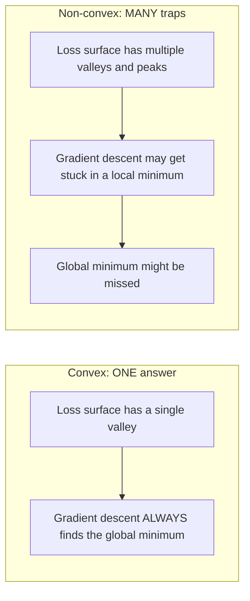
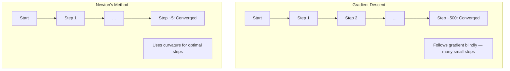
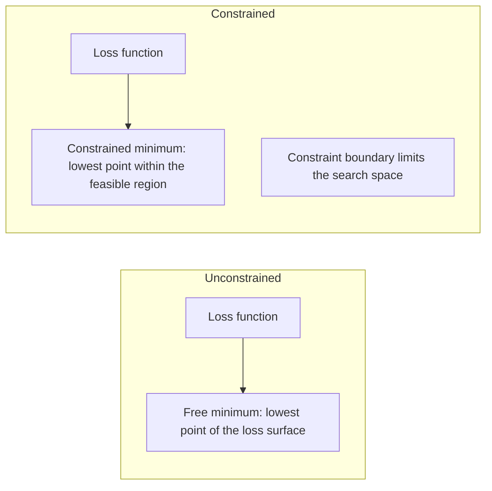
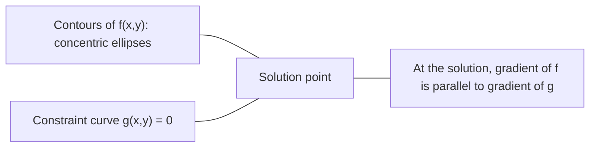

# 凸优化

> Convex problems 只有一个山谷。Neural networks 有数百万个。知道差别很重要。

**Type:** Build
**Language:** Python
**Prerequisites:** Phase 1, Lessons 04 (Calculus for ML), 08 (Optimization)
**Time:** ~90 minutes

## 学习目标

- 使用定义、second derivative 和 Hessian criteria 测试一个 function 是否 convex
- 实现 Newton's method，并把它的 quadratic convergence 与 gradient descent 对比
- 使用 Lagrange multipliers 求解 constrained optimization problems，并解释 KKT conditions
- 解释为什么 neural network loss landscapes 是 non-convex，但 SGD 仍然能找到 good solutions

## 问题

Lesson 08 教了 gradient descent、momentum 和 Adam。这些 optimizers 会在任何 surface 上往下走。但它们没有 guarantee。Gradient descent 在 non-convex landscape 上可能落入糟糕的 local minimum，卡在 saddle point，或者永远 oscillate。你还是会用它，因为 neural networks 是 non-convex，而且没有替代方案。

但机器学习中很多问题是 convex。Linear regression、logistic regression、SVMs、LASSO、ridge regression。对这些问题，有更强的东西：带数学保证的 optimization。Convex problem 只有一个山谷。任何往下走的 algorithm 都会到达 global minimum。不需要 restarts。不需要 learning rate schedules。不需要玄学。

理解 convexity 有三件事。第一，它告诉你问题什么时候简单（convex），什么时候困难（non-convex）。第二，它给你 Newton's method 这类更快的工具，用来处理 convex problems。第三，它解释了贯穿 ML 的概念：regularization as a constraint、SVMs 中的 duality，以及为什么 deep learning 明明违反了 convexity 提供的所有好性质，却依然能工作。

## 概念

### Convex sets

如果对 set S 中任意两个 points，连接它们的 line segment 也完全位于 S 中，那么 S 就是 convex。

| Convex sets | Not convex |
|---|---|
| **Rectangle**：内部任意两点都能用仍留在内部的 line segment 连接 | **Star/crescent shape**：两个 interior points 之间的 line 可能穿出 set |
| **Triangle**：对所有 interior points 都满足同样性质 | **Donut/annulus**：中间的 hole 会让一些 line segments 离开 set |
| 任意两点之间的 line segment 都留在 set 内 | 某些 pairs of points 之间的 line segment 会离开 set |

Formal test：对 S 中任意 points x, y，以及任意 t in [0, 1]，point tx + (1-t)y 也在 S 中。

Convex sets 的例子：
- 一条 line、一个 plane、整个 R^n
- 一个 ball（circle、sphere、hypersphere）
- 一个 halfspace：{x : a^T x <= b}
- 任意数量 convex sets 的 intersection

Non-convex sets 的例子：
- 一个 donut（annulus）
- 两个 disjoint circles 的 union
- 任何带有 "dent" 或 "hole" 的 set

### Convex functions

如果 function f 的 domain 是 convex set，并且对 domain 中任意两点 x, y，以及任意 t in [0, 1]：

```text
f(tx + (1-t)y) <= t*f(x) + (1-t)*f(y)
```

那么 f 就是 convex。

几何上看：graph 上任意两点之间的 line segment 位于 graph 上方或贴着 graph。

| Property | Convex function | Non-convex function |
|---|---|---|
| **Line segment test** | graph 上任意两点之间的 line 位于 curve **above or on** | graph 上某些点之间的 line 会 dips **below** curve |
| **Shape** | 单个向上弯曲的 bowl/valley | 多个 peaks 和 valleys，curvature 混杂 |
| **Local minima** | 每个 local minimum 都是 global minimum | 可能存在多个不同高度的 local minima |

常见 convex functions：
- f(x) = x^2（parabola）
- f(x) = |x|（absolute value）
- f(x) = e^x（exponential）
- f(x) = max(0, x)（ReLU，虽然是 piecewise linear）
- f(x) = -log(x) for x > 0（negative log）
- 任意 linear function f(x) = a^T x + b（既 convex 又 concave）

### Testing for convexity

三个 practical tests，从最容易到最严谨。

**Test 1：Second derivative test（1D）。** 如果对所有 x 都有 f''(x) >= 0，那么 f is convex。

- f(x) = x^2：f''(x) = 2 >= 0。Convex。
- f(x) = x^3：f''(x) = 6x。x < 0 时为负。Not convex。
- f(x) = e^x：f''(x) = e^x > 0。Convex。

**Test 2：Hessian test（multivariate）。** 如果 Hessian matrix H(x) 对所有 x 都是 positive semidefinite，那么 f is convex。Hessian 是 second partial derivatives 的 matrix。

**Test 3：Definition test。** 直接检查 inequality f(tx + (1-t)y) <= t*f(x) + (1-t)*f(y)。当 derivatives 难以计算时很有用。

### 为什么 Convexity 重要

Convex optimization 的核心定理：

**对 convex function，每个 local minimum 都是 global minimum。**

这意味着 gradient descent 不会被困住。任何 downhill path 都会通向同一个答案。Algorithm 保证会收敛到 optimal solution。



后果：
- 不需要 random restarts
- 不需要 sophisticated learning rate schedules
- Convergence proofs 成为可能（rate 取决于 function properties）
- Solution 是 unique 的（flat regions 除外）

### ML 中的 Convex vs non-convex

| Problem | Convex? | Why |
|---------|---------|-----|
| Linear regression (MSE) | Yes | Loss is quadratic in weights |
| Logistic regression | Yes | Log-loss is convex in weights |
| SVM (hinge loss) | Yes | Maximum of linear functions |
| LASSO (L1 regression) | Yes | Sum of convex functions is convex |
| Ridge regression (L2) | Yes | Quadratic + quadratic = convex |
| Neural network (any loss) | No | Nonlinear activations create non-convex landscape |
| k-means clustering | No | Discrete assignment step |
| Matrix factorization | No | Product of unknowns |

带 convex losses 的 linear models 是 convex。一旦你加入带 nonlinear activations 的 hidden layers，convexity 就会被破坏。

### Hessian matrix

Function f: R^n -> R 的 Hessian H，是 second partial derivatives 构成的 n x n matrix。

```text
H[i][j] = d^2 f / (dx_i dx_j)
```

对 f(x, y) = x^2 + 3xy + y^2：

```text
df/dx = 2x + 3y       d^2f/dx^2 = 2      d^2f/dxdy = 3
df/dy = 3x + 2y       d^2f/dydx = 3      d^2f/dy^2 = 2

H = [ 2  3 ]
    [ 3  2 ]
```

Hessian 告诉你 curvature：
- Eigenvalues 全为正：function 在每个方向上都向上弯曲（该点 convex）
- Eigenvalues 全为负：在每个方向上都向下弯曲（concave，local max）
- Mixed signs：saddle point（某些方向向上，某些方向向下）
- Zero eigenvalue：该方向 flat（degenerate）

对 convexity 来说，Hessian 必须 everywhere positive semidefinite（所有 eigenvalues >= 0），不能只在某一点成立。

### Newton's method

Gradient descent 使用 first-order information（gradient）。Newton's method 使用 second-order information（Hessian）。它会在当前点拟合一个 quadratic approximation，然后直接跳到这个 quadratic 的 minimum。

```text
Update rule:
  x_new = x - H^(-1) * gradient

Compare to gradient descent:
  x_new = x - lr * gradient
```

Newton's method 用 inverse Hessian 替代 scalar learning rate。它会根据 local curvature 自动调整 step size 和 direction。



Advantages：
- 接近 minimum 时 quadratic convergence（每一步都会让 error 平方级下降）
- 不需要 tuning learning rate
- Scale-invariant（无论你如何 parameterize problem 都能工作）

Disadvantages：
- 计算 Hessian 需要 O(n^2) memory，invert 需要 O(n^3)
- 对一个有 1 million weights 的 neural network，这意味着 10^12 entries 和 10^18 operations
- 对 deep learning 不现实

### Constrained optimization

Unconstrained optimization：在所有 x 上 minimize f(x)。
Constrained optimization：在满足 constraints 的条件下 minimize f(x)。

真实问题都有 constraints。你想 minimize cost，但 budget 有限。你想 minimize error，但 model complexity 有界。



### Lagrange multipliers

Lagrange multipliers 方法会把 constrained problem 转换成 unconstrained problem。

Problem：minimize f(x) subject to g(x) = 0。

Solution：引入一个新变量（Lagrange multiplier lambda），并求解 unconstrained problem：

```text
L(x, lambda) = f(x) + lambda * g(x)
```

在 solution 处，L 的 gradient 为 0：

```text
dL/dx = df/dx + lambda * dg/dx = 0
dL/dlambda = g(x) = 0
```

几何直觉：在 constrained minimum 处，f 的 gradient 必须与 constraint g 的 gradient 平行。如果它们不平行，你就可以沿着 constraint surface 移动并进一步降低 f。



Example：minimize f(x,y) = x^2 + y^2 subject to x + y = 1。

```text
L = x^2 + y^2 + lambda(x + y - 1)

dL/dx = 2x + lambda = 0  =>  x = -lambda/2
dL/dy = 2y + lambda = 0  =>  y = -lambda/2
dL/dlambda = x + y - 1 = 0

From first two: x = y
Substituting: 2x = 1, so x = y = 0.5, lambda = -1
```

Line x + y = 1 上离 origin 最近的 point 是 (0.5, 0.5)。

### KKT conditions

Karush-Kuhn-Tucker conditions 会把 Lagrange multipliers 扩展到 inequality constraints。

Problem：minimize f(x) subject to g_i(x) <= 0 for i = 1, ..., m。

KKT conditions（optimality 的 necessary conditions）：

```text
1. Stationarity:    df/dx + sum(lambda_i * dg_i/dx) = 0
2. Primal feasibility:  g_i(x) <= 0  for all i
3. Dual feasibility:    lambda_i >= 0  for all i
4. Complementary slackness:  lambda_i * g_i(x) = 0  for all i
```

Complementary slackness 是关键洞察：constraint 要么 active（g_i = 0，solution 位于 boundary 上），要么 multiplier 为 zero（constraint 不重要）。不影响 solution 的 constraint，其 lambda = 0。

KKT conditions 是 SVMs 的核心。Support vectors 是 constraint active 的 data points（lambda > 0）。其他所有 data points 的 lambda = 0，不会影响 decision boundary。

### Regularization as constrained optimization

L1 和 L2 regularization 不是随意的技巧。它们其实是 disguised constrained optimization problems。

**L2 regularization（Ridge）：**

```text
minimize  Loss(w)  subject to  ||w||^2 <= t

Equivalent unconstrained form:
minimize  Loss(w) + lambda * ||w||^2
```

Constraint ||w||^2 <= t 定义一个 ball（2D 中是 circle，3D 中是 sphere）。Solution 是 loss contours 第一次接触这个 ball 的地方。

**L1 regularization（LASSO）：**

```text
minimize  Loss(w)  subject to  ||w||_1 <= t

Equivalent unconstrained form:
minimize  Loss(w) + lambda * ||w||_1
```

Constraint ||w||_1 <= t 定义一个 diamond（2D 中的 rotated square）。

| Property | L2 constraint (circle) | L1 constraint (diamond) |
|---|---|---|
| **Constraint shape** | Circle（higher dims 中是 sphere） | Diamond（2D 中的 rotated square） |
| **Where loss contour touches** | Smooth boundary：circle 上任意 point | Corner：与 axis 对齐 |
| **Solution behavior** | Weights 很小但 nonzero | 某些 weights exactly zero（sparse） |
| **Result** | Weight shrinkage | Feature selection |

这解释了为什么 L1 会产生 sparse models（feature selection），而 L2 只会 shrink weights。Diamond 有与 axes 对齐的 corners。Loss contours 更可能接触到 corner，从而让一个或多个 weights exactly zero。

### Duality

每个 constrained optimization problem（primal）都有一个 companion problem（dual）。对 convex problems，primal 和 dual 有相同 optimal value。这叫 strong duality。

Lagrangian dual function：

```text
Primal: minimize f(x) subject to g(x) <= 0
Lagrangian: L(x, lambda) = f(x) + lambda * g(x)
Dual function: d(lambda) = min_x L(x, lambda)
Dual problem: maximize d(lambda) subject to lambda >= 0
```

为什么 duality 重要：
- Dual problem 有时比 primal 更容易求解
- SVMs 用 dual form 求解，此时 problem 依赖 data points 之间的 dot products（从而启用 kernel trick）
- Dual 提供 primal optimum 的 lower bound，可用于检查 solution quality

对 SVMs 来说：

```text
Primal: find w, b that maximize the margin 2/||w|| subject to
        y_i(w^T x_i + b) >= 1 for all i

Dual:   maximize sum(alpha_i) - 0.5 * sum_ij(alpha_i * alpha_j * y_i * y_j * x_i^T x_j)
        subject to alpha_i >= 0 and sum(alpha_i * y_i) = 0

The dual only involves dot products x_i^T x_j.
Replace x_i^T x_j with K(x_i, x_j) to get the kernel trick.
```

### 为什么 Deep Learning 尽管 Non-convex 仍然有效

Neural network loss functions 极其 non-convex。按 classical measures 来看，优化它们本应失败。但 stochastic gradient descent 能可靠地找到 good solutions。几个因素解释了这一点。

**大多数 local minima 已经足够好。** 在 high-dimensional spaces 中，random critical points（gradient 为 zero 的点）绝大多数是 saddle points，而不是 local minima。少数存在的 local minima 往往 loss value 接近 global minimum。当 parameter space 有数百万维时，卡在 terrible local minimum 的概率极低。

**Saddle points，而不是 local minima，才是真正障碍。** 在一个有 n 个 parameters 的 function 中，saddle point 混合了 positive 和 negative curvature directions。对 high dimensions 中的 random critical point，所有 n 个 eigenvalues 都为正（local minimum）的概率大约是 2^(-n)。几乎所有 critical points 都是 saddle points。SGD 的 noise 会帮助逃离它们。

**Overparameterization 会 smooth landscape。** 参数数量多于 training examples 的 networks 有更 smooth、更 connected 的 loss surfaces。Wider networks 有更少 bad local minima。这听起来反直觉，但与经验观察一致。

**Loss landscape structure：**

| Property | Low-dimensional space | High-dimensional space |
|---|---|---|
| **Landscape** | Many isolated peaks and valleys | Smoothly connected valleys |
| **Minima** | Many isolated local minima | Few bad local minima; most are near-optimal |
| **Navigation** | Hard to find global minimum | Many paths lead to good solutions |
| **Critical points** | Mix of local minima and saddle points | Overwhelmingly saddle points, not local minima |

**Stochastic noise acts as implicit regularization。** Mini-batch SGD 添加的 noise 会阻止模型停在 sharp minima。Sharp minima 容易 overfit；flat minima 更容易 generalize。Noise 会把 optimization bias 到 loss landscape 的 flat regions。

### 实践中的 Second-order methods

Pure Newton's method 对 large models 不现实。几种 approximations 会让 second-order information 可用。

**L-BFGS（Limited-memory BFGS）：** 使用最近 m 个 gradient differences 近似 inverse Hessian。Memory 从 O(n^2) 降为 O(mn)。适合最多约 10,000 parameters 的 problems。用于 classical ML（logistic regression、CRFs），但不用于 deep learning。

**Natural gradient：** 使用 Fisher information matrix（log-likelihood 的 expected Hessian）而不是 standard Hessian。这会考虑 probability distributions 的 geometry。K-FAC（Kronecker-Factored Approximate Curvature）把 Fisher matrix 近似为 Kronecker product，使它能用于 neural networks。

**Hessian-free optimization：** 使用 conjugate gradient 求解 Hx = g，但从不显式构造 H。只需要 Hessian-vector products，而这可以通过 automatic differentiation 在 O(n) 时间内计算。

**Diagonal approximations：** Adam 的 second moment 是 Hessian diagonal 的 diagonal approximation。AdaHessian 通过 Hutchinson's estimator 使用实际 Hessian diagonal elements 来扩展这个想法。

| Method | Memory | Per-step cost | When to use |
|--------|--------|--------------|-------------|
| Gradient descent | O(n) | O(n) | Baseline, large models |
| Newton's method | O(n^2) | O(n^3) | Small convex problems |
| L-BFGS | O(mn) | O(mn) | Medium convex problems |
| Adam | O(n) | O(n) | Deep learning default |
| K-FAC | O(n) | O(n) per layer | Research, large-batch training |

```figure
convex-vs-nonconvex
```

## Build It

### Step 1：Convexity checker

构建一个 function，通过 sampling points 并检查 definition 来 empirically test convexity。

```python
import random
import math

def check_convexity(f, dim, bounds=(-5, 5), samples=1000):
    violations = 0
    for _ in range(samples):
        x = [random.uniform(*bounds) for _ in range(dim)]
        y = [random.uniform(*bounds) for _ in range(dim)]
        t = random.uniform(0, 1)
        mid = [t * xi + (1 - t) * yi for xi, yi in zip(x, y)]
        lhs = f(mid)
        rhs = t * f(x) + (1 - t) * f(y)
        if lhs > rhs + 1e-10:
            violations += 1
    return violations == 0, violations
```

### Step 2：Newton's method for 2D

使用 explicit Hessian 实现 Newton's method。把 convergence speed 与 gradient descent 对比。

```python
def newtons_method(f, grad_f, hessian_f, x0, steps=50, tol=1e-12):
    x = list(x0)
    history = [x[:]]
    for _ in range(steps):
        g = grad_f(x)
        H = hessian_f(x)
        det = H[0][0] * H[1][1] - H[0][1] * H[1][0]
        if abs(det) < 1e-15:
            break
        H_inv = [
            [H[1][1] / det, -H[0][1] / det],
            [-H[1][0] / det, H[0][0] / det],
        ]
        dx = [
            H_inv[0][0] * g[0] + H_inv[0][1] * g[1],
            H_inv[1][0] * g[0] + H_inv[1][1] * g[1],
        ]
        x = [x[0] - dx[0], x[1] - dx[1]]
        history.append(x[:])
        if sum(gi ** 2 for gi in g) < tol:
            break
    return history
```

### Step 3：Lagrange multiplier solver

使用 Lagrangian 上的 gradient descent 求解 constrained optimization。

```python
def lagrange_solve(f_grad, g_val, g_grad, x0, lr=0.01,
                   lr_lambda=0.01, steps=5000):
    x = list(x0)
    lam = 0.0
    history = []
    for _ in range(steps):
        fg = f_grad(x)
        gv = g_val(x)
        gg = g_grad(x)
        x = [
            xi - lr * (fgi + lam * ggi)
            for xi, fgi, ggi in zip(x, fg, gg)
        ]
        lam = lam + lr_lambda * gv
        history.append((x[:], lam, gv))
    return history
```

### Step 4：Compare first-order vs second-order

在同一个 quadratic function 上运行 gradient descent 和 Newton's method。统计 convergence 需要多少 steps。

```python
def quadratic(x):
    return 5 * x[0] ** 2 + x[1] ** 2

def quadratic_grad(x):
    return [10 * x[0], 2 * x[1]]

def quadratic_hessian(x):
    return [[10, 0], [0, 2]]
```

Newton's method 会在 1 step 中 converge（它对 quadratics 是 exact 的）。Gradient descent 会需要数百步，因为 Hessian 的 eigenvalues 相差 5 倍，形成了 elongated valley。

## Use It

Convexity analysis 会直接用于选择 ML models 和 solvers。

对 convex problems（logistic regression、SVMs、LASSO）：
- 使用 dedicated solvers（liblinear、CVXPY、`scipy.optimize.minimize` with method='L-BFGS-B'）
- 期待 unique global solution
- Second-order methods practical 且快速

对 non-convex problems（neural networks）：
- 使用 first-order methods（SGD、Adam）
- 接受 solution 取决于 initialization 和 randomness
- 使用 overparameterization、noise 和 learning rate schedules 作为 implicit regularization
- 不要浪费时间寻找 global minimum。Good local minimum 就足够。

```python
from scipy.optimize import minimize

result = minimize(
    fun=lambda w: sum((y - X @ w) ** 2) + 0.1 * sum(w ** 2),
    x0=np.zeros(d),
    method='L-BFGS-B',
    jac=lambda w: -2 * X.T @ (y - X @ w) + 0.2 * w,
)
```

对 SVMs，dual formulation 能让你使用 kernel trick：

```python
from sklearn.svm import SVC

svm = SVC(kernel='rbf', C=1.0)
svm.fit(X_train, y_train)
print(f"Support vectors: {svm.n_support_}")
```

## 练习

1. **Convexity gallery。** 使用 checker 测试这些 functions 的 convexity：f(x) = x^4、f(x) = sin(x)、f(x,y) = x^2 + y^2、f(x,y) = x*y、f(x) = max(x, 0)。解释为什么每个结果都合理。

2. **Newton vs gradient descent race。** 从 starting point (10, 10) 出发，在 f(x,y) = 50*x^2 + y^2 上运行两种方法。各自需要多少 steps 才能达到 loss < 1e-10？当 condition number（largest 和 smallest Hessian eigenvalue 的 ratio）增大时，gradient descent 会发生什么？

3. **Lagrange multiplier geometry。** Minimize f(x,y) = (x-3)^2 + (y-3)^2 subject to x + 2y = 4。通过检查 solution 处 f 的 gradient 与 g 的 gradient 平行来验证 solution。

4. **Regularization constraint。** 实现 L1-constrained optimization：minimize (x-3)^2 + (y-2)^2 subject to |x| + |y| <= 1。展示 solution 有一个 coordinate 等于 zero（来自 diamond constraint 的 sparsity）。

5. **Hessian eigenvalue analysis。** 计算 Rosenbrock function 在 (1,1) 和 (-1,1) 处的 Hessian，并计算两个点的 eigenvalues。Eigenvalues 告诉你 minimum 处和远离 minimum 处的 curvature 有什么不同？

## 关键术语

| Term | What it means |
|------|---------------|
| Convex set | 一个 set 中任意两点之间的 line segment 都留在 set 内 |
| Convex function | graph 上任意两点之间的 line 都位于 graph 上方或贴着 graph。等价地，Hessian everywhere positive semidefinite |
| Local minimum | 比所有 nearby points 都低的 point。对 convex functions，每个 local minimum 都是 global minimum |
| Global minimum | 一个 function 在整个 domain 上的最低点 |
| Hessian matrix | 所有 second partial derivatives 构成的 matrix。编码 curvature information |
| Positive semidefinite | 所有 eigenvalues 都 non-negative 的 matrix。是 “second derivative >= 0” 的 multidimensional analogue |
| Condition number | Hessian 的 largest eigenvalue 与 smallest eigenvalue 的 ratio。High condition number 意味着 elongated valleys 和 slow gradient descent |
| Newton's method | 使用 inverse Hessian 决定 step direction 和 size 的 second-order optimizer。接近 minimum 时 quadratic convergence |
| Lagrange multiplier | 为了把 constrained optimization problem 转换成 unconstrained problem 而引入的变量 |
| KKT conditions | 带 inequality constraints 的 optimality necessary conditions。推广了 Lagrange multipliers |
| Complementary slackness | 在 solution 处，constraint 要么 active，要么它的 multiplier 为 zero。两者不会同时 nonzero |
| Duality | 每个 constrained problem 都有 companion dual problem。对 convex problems，两者有相同 optimal value |
| Strong duality | Primal 和 dual optimal values 相等。对满足 Slater's condition 的 convex problems 成立 |
| L-BFGS | Approximate second-order method，不存 full Hessian，而是存最近 m 个 gradient differences |
| Saddle point | Gradient 为 zero，但某些方向是 minimum、另一些方向是 maximum 的 point |
| Overparameterization | 使用比 training examples 更多的 parameters。它会 smooth loss landscape，并减少 bad local minima |

## 延伸阅读

- [Boyd & Vandenberghe: Convex Optimization](https://web.stanford.edu/~boyd/cvxbook/) - 标准教材，可在线免费阅读
- [Bottou, Curtis, Nocedal: Optimization Methods for Large-Scale Machine Learning (2018)](https://arxiv.org/abs/1606.04838) - 连接 convex optimization theory 和 deep learning practice
- [Choromanska et al.: The Loss Surfaces of Multilayer Networks (2015)](https://arxiv.org/abs/1412.0233) - 解释为什么 non-convex neural network landscapes 没有看起来那么糟
- [Nocedal & Wright: Numerical Optimization](https://link.springer.com/book/10.1007/978-0-387-40065-5) - Newton's method、L-BFGS 和 constrained optimization 的综合参考
