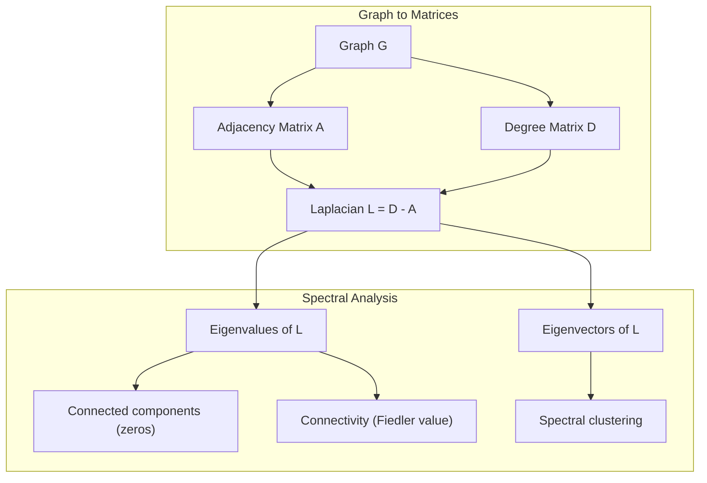
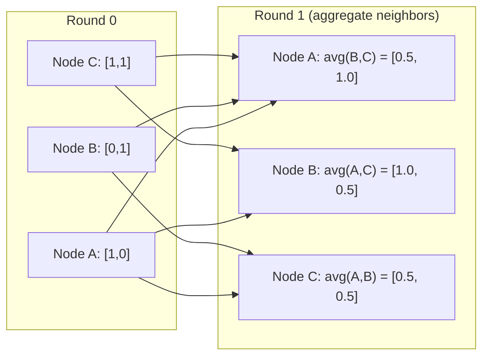

# 面向机器学习的图论

> 图是关系的数据结构。只要数据里有连接，就需要图论。

**Type:** Build
**Language:** Python
**Prerequisites:** Phase 1, Lessons 01-03 (linear algebra, matrices)
**Time:** ~90 minutes

## 学习目标

- 构建一个 graph class，支持 adjacency matrix/list 表示，并实现 BFS 与 DFS 遍历
- 计算 graph Laplacian，并用它的 eigenvalues 检测 connected components 和聚类节点
- 将一轮 GNN 风格的 message passing 实现为 normalized adjacency matrix multiplication
- 使用 Fiedler vector 应用 spectral clustering，把图划分成不同分区

## 问题

社交网络、分子、知识库、引用网络、道路地图——它们都是图。传统 ML 会把数据当作扁平表格。每一行彼此独立，每个特征是一列。但当连接结构本身很重要时，表格就不够用了。

想象一个社交网络。你想预测某个用户会购买什么产品。这个用户自己的购买历史当然重要，但朋友的购买历史可能更重要。连接本身携带信号。

再想象一个分子。你想预测它是否会与某种蛋白结合。原子很重要，但真正关键的是原子之间如何成键。结构就是数据。

Graph Neural Networks（GNNs）是 deep learning 中增长最快的方向之一。它们驱动 drug discovery、social recommendation、fraud detection 和 knowledge graph reasoning。每个 GNN 都建立在同一个基础之上：基础图论。

你需要四样东西：

1. 一种把 graph 表示为 matrix 的方法（这样就能做 matrix multiplication）
2. 用来探索 graph structure 的 traversal algorithms
3. Laplacian——spectral graph theory 中最重要的 matrix
4. Message passing——让 GNN 真正工作的 operation

## 概念

### 图：节点和边

一个 graph G = (V, E) 由 vertices（nodes）V 和 edges E 组成。每条 edge 连接两个 nodes。

**Directed vs undirected。** 在 undirected graph 中，edge (u, v) 表示 u 连接到 v，同时 v 也连接到 u。在 directed graph（digraph）中，edge (u, v) 表示 u 指向 v，但反向不一定存在。

**Weighted vs unweighted。** 在 unweighted graph 中，edges 要么存在，要么不存在。在 weighted graph 中，每条 edge 有一个 numerical weight——可以是距离、成本或强度。

| Graph type | Example |
|-----------|---------|
| Undirected, unweighted | Facebook friendship network |
| Directed, unweighted | Twitter follow network |
| Undirected, weighted | Road map (distances) |
| Directed, weighted | Web page links (PageRank scores) |

### Adjacency Matrix

Adjacency matrix A 是核心表示。对于一个有 n 个 nodes 的 graph：

```text
A[i][j] = 1    if there is an edge from node i to node j
A[i][j] = 0    otherwise
```

对于 undirected graphs，A 是 symmetric：A[i][j] = A[j][i]。对于 weighted graphs，A[i][j] = edge (i, j) 的 weight。

**例子——一个 triangle：**

```text
Nodes: 0, 1, 2
Edges: (0,1), (1,2), (0,2)

A = [[0, 1, 1],
     [1, 0, 1],
     [1, 1, 0]]
```

Adjacency matrix 是每个 GNN 的输入。对 A 的 matrix operations 对应着 graph 上的 operations。

### Degree

一个 node 的 degree 是连接到它的 edges 数量。对于 directed graphs，会区分 in-degree（进入的 edges）和 out-degree（出去的 edges）。

Degree matrix D 是 diagonal matrix：

```text
D[i][i] = degree of node i
D[i][j] = 0    for i != j
```

在 triangle 例子中：D = diag(2, 2, 2)，因为每个 node 都连接到另外两个 nodes。

Degree 告诉你 node importance。High degree = hub node。一个 network 的 degree distribution 会揭示它的结构。Social networks 遵循 power law（少量 hubs，大量 leaf nodes）。Random graphs 的 degrees 服从 Poisson distribution。

### BFS 和 DFS

这是两个基础 graph traversal algorithms。你两者都需要。

**Breadth-First Search（BFS）：** 先探索所有 neighbors，再探索 neighbors 的 neighbors。使用 queue（FIFO）。

```text
BFS from node 0:
  Visit 0
  Queue: [1, 2]        (neighbors of 0)
  Visit 1
  Queue: [2, 3]        (add neighbors of 1)
  Visit 2
  Queue: [3]           (neighbors of 2 already visited)
  Visit 3
  Queue: []            (done)
```

BFS 会在 unweighted graphs 中找到 shortest paths。从起点到任意 node 的距离，等于该 node 第一次被发现时所在的 BFS level。这就是为什么 BFS 会用于 social networks 中的 hop-count distances。

**Depth-First Search（DFS）：** 尽可能深入，直到需要 backtracking。使用 stack（LIFO）或 recursion。

```text
DFS from node 0:
  Visit 0
  Stack: [1, 2]        (neighbors of 0)
  Visit 2               (pop from stack)
  Stack: [1, 3]         (add neighbors of 2)
  Visit 3               (pop from stack)
  Stack: [1]
  Visit 1               (pop from stack)
  Stack: []             (done)
```

DFS 适合：

- 寻找 connected components（从 unvisited nodes 运行 DFS）
- Cycle detection（DFS tree 中的 back edges）
- Topological sorting（reverse DFS finish order）

| Algorithm | Data structure | Finds | Use case |
|-----------|---------------|-------|----------|
| BFS | Queue | Shortest paths | Social network distance, knowledge graph traversal |
| DFS | Stack | Components, cycles | Connectivity, topological sort |

### Graph Laplacian

L = D - A。这是 spectral graph theory 中最重要的 matrix。

对于 triangle：

```text
D = [[2, 0, 0],    A = [[0, 1, 1],    L = [[2, -1, -1],
     [0, 2, 0],         [1, 0, 1],         [-1, 2, -1],
     [0, 0, 2]]         [1, 1, 0]]         [-1, -1,  2]]
```

Laplacian 有一些很强的性质：

1. **L 是 positive semi-definite。** 所有 eigenvalues 都 >= 0。

2. **zero eigenvalues 的数量等于 connected components 的数量。** 一个 connected graph 正好有一个 zero eigenvalue。一个有 3 个 disconnected components 的 graph 会有三个 zero eigenvalues。

3. **最小的 non-zero eigenvalue（Fiedler value）衡量 connectivity。** 大的 Fiedler value 表示 graph 连接良好。小的 Fiedler value 表示 graph 有薄弱点——也就是 bottleneck。

4. **Fiedler value 对应的 eigenvector（Fiedler vector）揭示最佳划分。** 取值为正的 nodes 放入一组，取值为负的 nodes 放入另一组。这就是 spectral clustering。



### Spectral Properties

Adjacency matrix 和 Laplacian 的 eigenvalues 可以在不做 traversal 的情况下揭示结构性质。

**Spectral clustering** 的流程如下：

1. 计算 Laplacian L
2. 找到 L 的 k 个最小 eigenvectors（跳过第一个；对于 connected graphs，它是 all-ones）
3. 把这些 eigenvectors 当作每个 node 的新 coordinates
4. 在这些 coordinates 上运行 k-means

为什么这有效？L 的 eigenvectors 编码了 graph 上“最平滑”的函数。连接紧密的 nodes 会得到相近的 eigenvector values。被 bottleneck 分开的 nodes 会得到不同的 values。Eigenvectors 会自然分离 clusters。

**Random walk connection。** Normalized Laplacian 与 graph 上的 random walks 有关。Random walk 的 stationary distribution 与 node degree 成正比。Mixing time（walk 收敛速度）取决于 spectral gap。

### Message Passing

这是 Graph Neural Networks 的核心 operation。每个 node 从 neighbors 收集 messages，aggregate 它们，然后更新自己的 state。

```text
h_v^(k+1) = UPDATE(h_v^(k), AGGREGATE({h_u^(k) : u in neighbors(v)}))
```

最简单的形式中，AGGREGATE = mean，UPDATE = linear transform + activation：

```text
h_v^(k+1) = sigma(W * mean({h_u^(k) : u in neighbors(v)}))
```

这其实是伪装成公式的 matrix multiplication。如果 H 是所有 node features 组成的 matrix，A 是 adjacency matrix：

```text
H^(k+1) = sigma(A_norm * H^(k) * W)
```

其中 A_norm 是 normalized adjacency matrix（每一行 sum 为 1）。

一轮 message passing 让每个 node “看到”它的 immediate neighbors。两轮让它看到 neighbors of neighbors。K 轮让每个 node 获得来自 K-hop neighborhood 的信息。



### Concepts and ML Applications

| Concept | ML Application |
|---------|---------------|
| Adjacency matrix | GNN input representation |
| Graph Laplacian | Spectral clustering, community detection |
| BFS/DFS | Knowledge graph traversal, path finding |
| Degree distribution | Node importance, feature engineering |
| Message passing | GNN layers (GCN, GAT, GraphSAGE) |
| Eigenvalues of L | Community detection, graph partitioning |
| Spectral clustering | Unsupervised node grouping |
| PageRank | Node importance, web search |

```figure
graph-degree-distribution
```

## Build It

### Step 1: 从零构建 Graph class

```python
class Graph:
    def __init__(self, n_nodes, directed=False):
        self.n = n_nodes
        self.directed = directed
        self.adj = {i: {} for i in range(n_nodes)}

    def add_edge(self, u, v, weight=1.0):
        self.adj[u][v] = weight
        if not self.directed:
            self.adj[v][u] = weight

    def neighbors(self, node):
        return list(self.adj[node].keys())

    def degree(self, node):
        return len(self.adj[node])

    def adjacency_matrix(self):
        import numpy as np
        A = np.zeros((self.n, self.n))
        for u in range(self.n):
            for v, w in self.adj[u].items():
                A[u][v] = w
        return A

    def degree_matrix(self):
        import numpy as np
        D = np.zeros((self.n, self.n))
        for i in range(self.n):
            D[i][i] = self.degree(i)
        return D

    def laplacian(self):
        return self.degree_matrix() - self.adjacency_matrix()
```

Adjacency list（`self.adj`）能高效存储 neighbors。Adjacency matrix conversion 使用 numpy，因为所有 spectral operations 都需要它。

### Step 2: BFS 和 DFS

```python
from collections import deque

def bfs(graph, start):
    visited = set()
    order = []
    distances = {}
    queue = deque([(start, 0)])
    visited.add(start)
    while queue:
        node, dist = queue.popleft()
        order.append(node)
        distances[node] = dist
        for neighbor in graph.neighbors(node):
            if neighbor not in visited:
                visited.add(neighbor)
                queue.append((neighbor, dist + 1))
    return order, distances


def dfs(graph, start):
    visited = set()
    order = []
    stack = [start]
    while stack:
        node = stack.pop()
        if node in visited:
            continue
        visited.add(node)
        order.append(node)
        for neighbor in reversed(graph.neighbors(node)):
            if neighbor not in visited:
                stack.append(neighbor)
    return order
```

BFS 使用 deque（double-ended queue），这样 `popleft` 是 O(1)。DFS 使用 list 作为 stack。两者都会把每个 node 正好访问一次——时间复杂度 O(V + E)。

### Step 3: Connected components 和 Laplacian eigenvalues

```python
def connected_components(graph):
    visited = set()
    components = []
    for node in range(graph.n):
        if node not in visited:
            order, _ = bfs(graph, node)
            visited.update(order)
            components.append(order)
    return components


def laplacian_eigenvalues(graph):
    import numpy as np
    L = graph.laplacian()
    eigenvalues = np.linalg.eigvalsh(L)
    return eigenvalues
```

`eigvalsh` 用于 symmetric matrices——对于 undirected graphs，Laplacian 总是 symmetric。它会按升序返回 eigenvalues。数一数 zero eigenvalues，就能得到 connected components 的数量。

### Step 4: Spectral clustering

```python
def spectral_clustering(graph, k=2):
    import numpy as np
    L = graph.laplacian()
    eigenvalues, eigenvectors = np.linalg.eigh(L)
    features = eigenvectors[:, 1:k+1]

    labels = np.zeros(graph.n, dtype=int)
    for i in range(graph.n):
        if features[i, 0] >= 0:
            labels[i] = 0
        else:
            labels[i] = 1
    return labels
```

当 k=2 时，Fiedler vector 的符号会把 graph 分成两个 clusters。当 k>2 时，你会在前 k 个 eigenvectors 上运行 k-means（排除 trivial all-ones eigenvector）。

### Step 5: Message passing

```python
def message_passing(graph, features, weight_matrix):
    import numpy as np
    A = graph.adjacency_matrix()
    row_sums = A.sum(axis=1, keepdims=True)
    row_sums[row_sums == 0] = 1
    A_norm = A / row_sums
    aggregated = A_norm @ features
    output = aggregated @ weight_matrix
    return output
```

这是一轮 GNN message passing。每个 node 的新 features 是它 neighbors 的 weighted average，再经过 weight matrix 变换。堆叠多轮就能把信息传播到更远处。

## Use It

使用 networkx 和 numpy，同样的 operations 可以写成一行：

```python
import networkx as nx
import numpy as np

G = nx.karate_club_graph()

A = nx.adjacency_matrix(G).toarray()
L = nx.laplacian_matrix(G).toarray()

eigenvalues = np.linalg.eigvalsh(L.astype(float))
print(f"Smallest eigenvalues: {eigenvalues[:5]}")
print(f"Connected components: {nx.number_connected_components(G)}")

communities = nx.community.greedy_modularity_communities(G)
print(f"Communities found: {len(communities)}")

pr = nx.pagerank(G)
top_nodes = sorted(pr.items(), key=lambda x: x[1], reverse=True)[:5]
print(f"Top 5 PageRank nodes: {top_nodes}")
```

networkx 可以用 optimized C backends 处理任意规模的 graphs。生产中用它。从零实现用来理解它到底在做什么。

### numpy spectral analysis

```python
import numpy as np

A = np.array([
    [0, 1, 1, 0, 0],
    [1, 0, 1, 0, 0],
    [1, 1, 0, 1, 0],
    [0, 0, 1, 0, 1],
    [0, 0, 0, 1, 0]
])

D = np.diag(A.sum(axis=1))
L = D - A

eigenvalues, eigenvectors = np.linalg.eigh(L)
print(f"Eigenvalues: {np.round(eigenvalues, 4)}")
print(f"Fiedler value: {eigenvalues[1]:.4f}")
print(f"Fiedler vector: {np.round(eigenvectors[:, 1], 4)}")

fiedler = eigenvectors[:, 1]
group_a = np.where(fiedler >= 0)[0]
group_b = np.where(fiedler < 0)[0]
print(f"Cluster A: {group_a}")
print(f"Cluster B: {group_b}")
```

Fiedler vector 做了主要工作。正值 entries 位于一个 cluster，负值 entries 位于另一个 cluster。不需要 iterative optimization——只要一次 eigendecomposition。

## Ship It

本课产出：

- `outputs/skill-graph-analysis.md`——一个用于分析 graph-structured data 的 skill reference

## Connections

| Concept | Where it shows up |
|---------|------------------|
| Adjacency matrix | GCN, GAT, GraphSAGE input |
| Laplacian | Spectral clustering, ChebNet filters |
| BFS | Knowledge graph traversal, shortest path queries |
| Message passing | Every GNN layer, neural message passing |
| Spectral gap | Graph connectivity, mixing time of random walks |
| Degree distribution | Power-law networks, node feature engineering |
| Connected components | Preprocessing, handling disconnected graphs |
| PageRank | Node importance ranking, attention initialization |

GNNs 值得特别说明。GCN（Kipf & Welling, 2017）中的 graph convolution operation 会使用加上 self-loops 的 adjacency matrix，A_hat = A + I：

```text
H^(l+1) = sigma(D_hat^(-1/2) * A_hat * D_hat^(-1/2) * H^(l) * W^(l))
```

其中 A_hat = A + I（adjacency plus self-loops），D_hat 是 A_hat 的 degree matrix。Self-loops 确保每个 node 在 aggregation 时包含自己的 features。这正是带 symmetric normalization 的 message passing。D_hat^(-1/2) * A_hat * D_hat^(-1/2) 是 normalized adjacency matrix。Laplacian 会出现，是因为这个 normalization 与 L_sym = I - D^(-1/2) * A * D^(-1/2) 有关。理解 Laplacian，就等于理解 GCN 为什么有效。

## 练习

1. **从零实现 PageRank。** 从 uniform scores 开始。每一步：score(v) = (1-d)/n + d * sum(score(u)/out_degree(u))，其中 u 是所有指向 v 的 nodes。使用 d=0.85。运行直到收敛（change < 1e-6）。在一个小 web graph 上测试。

2. **使用 spectral clustering 寻找 communities。** 创建一个有两个明显分离 clusters 的 graph（例如两个 cliques 由一条 edge 连接）。运行 spectral clustering，并验证它找到了正确划分。当你加入更多 cross-cluster edges 时会发生什么？

3. **为 weighted graphs 实现 Dijkstra's algorithm** 来求 shortest paths。在同一个 uniform weights graph 上，把结果与 BFS 比较。

4. **构建一个 2-layer message passing network。** 使用不同 weight matrices 应用两次 message passing。展示两轮之后，每个 node 都拥有来自 2-hop neighborhood 的信息。

5. **分析一个 real-world graph。** 使用 Karate Club graph（34 nodes，78 edges）。计算 degree distribution、Laplacian eigenvalues 和 spectral clustering。把 spectral clustering 结果与已知 ground truth split 比较。

## 关键术语

| Term | What people say | What it actually means |
|------|----------------|----------------------|
| Graph | “Nodes and edges” | 编码 pairwise relationships 的数学结构 G=(V,E) |
| Adjacency matrix | “The connection table” | 一个 n x n matrix；如果 nodes i 和 j 相连，则 A[i][j] = 1 |
| Degree | “How connected a node is” | 接触某个 node 的 edges 数量 |
| Laplacian | “D minus A” | L = D - A；其 eigenvalues 揭示 graph structure 的 matrix |
| Fiedler value | “The algebraic connectivity” | L 的最小 non-zero eigenvalue，用来衡量 graph 连接得有多好 |
| BFS | “Level-by-level search” | 先访问所有 neighbors 再深入的 traversal，可找到 shortest paths |
| DFS | “Go deep first” | 沿一条 path 走到底再 backtracking 的 traversal |
| Message passing | “Nodes talk to neighbors” | 每个 node 聚合 neighbors 的信息，是 GNNs 的核心 |
| Spectral clustering | “Cluster by eigenvectors” | 使用 Laplacian 的 eigenvectors 划分 graph |
| Connected component | “A separate piece” | 一个 maximal subgraph，其中任意两个 nodes 都能互相到达 |

## 延伸阅读

- **Kipf & Welling (2017)**——“Semi-Supervised Classification with Graph Convolutional Networks.” 开启现代 GNNs 的论文，展示 spectral graph convolutions 如何简化为 message passing。
- **Spielman (2012)**——“Spectral Graph Theory” lecture notes。关于 Laplacians、spectral gaps 和 graph partitioning 的权威入门。
- **Hamilton (2020)**——“Graph Representation Learning.” 从基础到应用覆盖 GNNs 的书。
- **Bronstein et al. (2021)**——“Geometric Deep Learning: Grids, Groups, Graphs, Geodesics, and Gauges.” 统一框架论文。
- **Veličković et al. (2018)**——“Graph Attention Networks.” 使用 attention mechanisms 扩展 message passing。
