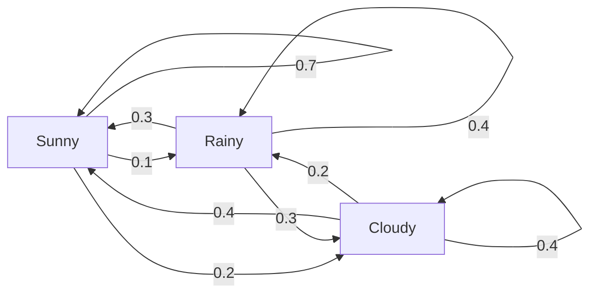
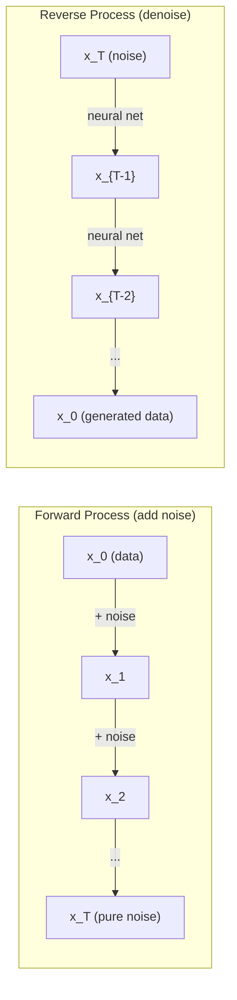

# 随机过程

> 有结构的随机性。它是 random walks、Markov chains 和 diffusion models 背后的数学。

**Type:** Learn
**Language:** Python
**Prerequisites:** Phase 1, Lessons 06-07 (probability, Bayes)
**Time:** ~75 minutes

## 学习目标

- 模拟 1D 和 2D random walks，并验证 displacement 的 sqrt(n) scaling
- 构建 Markov chain simulator，并通过 eigendecomposition 计算 stationary distribution
- 实现 Metropolis-Hastings MCMC 和 Langevin dynamics，从 target distributions 中采样
- 将 forward diffusion process 连接到 Brownian motion，并解释 reverse process 如何生成数据

## 问题

许多 AI 系统都包含随时间演化的随机性。它不是静态随机性，而是有结构的 sequential randomness, 每一步都依赖之前发生的事情。

Language models 一次生成一个 token。每个 token 都依赖前面的 context。模型输出一个 probability distribution，从中 sample，然后继续下一步。这就是一个 stochastic process。

Diffusion models 会一步一步给 image 加噪声，直到它变成纯 static。然后它们反向运行这个过程，一步一步 denoise，直到新 image 出现。Forward process 是一个 Markov chain。Reverse process 是一个 learned Markov chain，只是方向反过来。

Reinforcement learning agents 在 environment 中采取 actions。每个 action 都以某种 probability 导向一个 new state。Agent 在随机世界中遵循随机 policy。整个系统就是一个 Markov decision process。

MCMC sampling 是 Bayesian inference 的支柱。它构造一个 Markov chain，让它的 stationary distribution 成为你想采样的 posterior。

所有这些都建立在四个基础想法之上：

1. Random walks: 最简单的 stochastic process
2. Markov chains: 带 transition matrix 的结构化随机性
3. Langevin dynamics: 带 noise 的 gradient descent
4. Metropolis-Hastings: 从任意 distribution 中采样

## 概念

### Random Walks

从 position 0 开始。每一步抛一枚 fair coin。Heads: 向右移动（+1）。Tails: 向左移动（-1）。

n 步之后，你的位置是 n 个 random +/-1 values 的和。Expected position 是 0（walk 是 unbiased）。但离 origin 的 expected distance 会按 sqrt(n) 增长。

这很反直觉。Walk 是公平的，没有向任意方向 drift。但随着时间推移，它会离起点越来越远。n 步之后的 standard deviation 是 sqrt(n)。

```text
Step 0:  Position = 0
Step 1:  Position = +1 or -1
Step 2:  Position = +2, 0, or -2
...
Step 100: Expected distance from origin ~ 10 (sqrt(100))
Step 10000: Expected distance from origin ~ 100 (sqrt(10000))
```

**在 2D 中**，walk 以相同 probability 向上、下、左、右移动。离 origin 的距离仍然遵循同样的 sqrt(n) scaling。路径会画出类似 fractal 的 pattern。

**为什么是 sqrt(n)?** 每一步都是 +1 或 -1，且 probability 相同。n 步之后，position S_n = X_1 + X_2 + ... + X_n，其中每个 X_i 都是 +/-1。每一步的 variance 是 1，并且 steps 彼此 independent，所以 Var(S_n) = n。Standard deviation = sqrt(n)。根据 central limit theorem，S_n / sqrt(n) 会收敛到 standard normal distribution。

这种 sqrt(n) scaling 在 ML 中到处出现。SGD noise 按 1/sqrt(batch_size) 缩放。Embedding dimensions 按 sqrt(d) 缩放。Square root 是 independent random additions 的标志。

**与 Brownian motion 的联系。** 取一个 random walk，让 step size 为 1/sqrt(n)，每单位时间走 n 步。当 n 趋近无穷大时，这个 walk 会收敛到 Brownian motion B(t)，也就是一个 continuous-time process，其中 B(t) 服从 mean 0、variance t 的 normal distribution。

Brownian motion 是 diffusion 的数学基础。它建模 fluid 中 particles 的随机抖动、stock prices 的波动，以及最关键的，diffusion models 中的 noise process。

**Gambler's ruin。** 一个 random walker 从 position k 出发，两端有 absorbing barriers: 0 和 N。它先到达 N 而不是 0 的 probability 是多少？对于 fair walk: P(reach N) = k/N。这个结果出奇简单而优雅。它连接到 martingales 理论，也就是 fair random walk 是一个 martingale（expected future value = current value）。

### Markov Chains

Markov chain 是一个系统，它根据固定 probabilities 在 states 之间 transition。关键性质是：next state 只依赖 current state，不依赖 history。

```text
P(X_{t+1} = j | X_t = i, X_{t-1} = ...) = P(X_{t+1} = j | X_t = i)
```

这就是 Markov property。它意味着你可以用一个 transition matrix P 描述完整 dynamics：

```text
P[i][j] = probability of going from state i to state j
```

P 的每一行都 sum to 1（你必须去某个地方）。

**例子: Weather**

```text
States: Sunny (0), Rainy (1), Cloudy (2)

P = [[0.7, 0.1, 0.2],    (if sunny: 70% sunny, 10% rainy, 20% cloudy)
     [0.3, 0.4, 0.3],    (if rainy: 30% sunny, 40% rainy, 30% cloudy)
     [0.4, 0.2, 0.4]]    (if cloudy: 40% sunny, 20% rainy, 40% cloudy)
```

从任意 state 开始。经过许多 transitions 后，states 的 distribution 会收敛到 stationary distribution pi，其中 pi * P = pi。这是 P 的 left eigenvector，对应 eigenvalue 1。

对于 weather chain，stationary distribution 可能是 [0.53, 0.18, 0.29]。长期来看，无论从哪个 state 开始，53% 的时间都会是 sunny。



**计算 stationary distribution。** 有两种方法：

1. **Power method**: 用 P 反复乘任意 initial distribution。迭代足够多次后，它会收敛。
2. **Eigenvalue method**: 找到 P 的 left eigenvector，对应 eigenvalue 1。这等价于找 P^T 的 eigenvalue 1 对应的 eigenvector。

两种方法都要求 chain 满足 convergence conditions。

**Convergence conditions。** 如果一个 Markov chain 满足下面条件，它会收敛到唯一的 stationary distribution：

- **Irreducible**: 每个 state 都能从任意其他 state 到达
- **Aperiodic**: chain 不会以固定周期循环

你在 ML 中遇到的大多数 chains 都满足这两个条件。

**Absorbing states。** 如果进入某个 state 后永远不会离开（P[i][i] = 1），这个 state 就是 absorbing。Absorbing Markov chains 用来建模带 terminal states 的 processes，比如结束的 game、流失的 customer，或者 token sequence 命中 end-of-text token。

**Mixing time。** Chain 需要多少 steps 才会“接近”stationary distribution？形式化地说，就是 total variation distance from stationarity 降到某个 threshold 以下所需的 steps 数。Fast mixing = 需要的 steps 少。P 的 spectral gap（1 减去 second-largest eigenvalue）控制 mixing time。Gap 越大，mixing 越快。

### 与 Language Models 的联系

Language model 中的 token generation 近似是一个 Markov process。给定 current context，模型会输出 next token 的 distribution。Temperature 控制这个 distribution 的 sharpness：

```text
P(token_i) = exp(logit_i / temperature) / sum(exp(logit_j / temperature))
```

- Temperature = 1.0: standard distribution
- Temperature < 1.0: sharper（更 deterministic）
- Temperature > 1.0: flatter（更 random）
- Temperature -> 0: argmax（greedy）

Top-k sampling 截断到 probability 最高的 k 个 tokens。Top-p（nucleus）sampling 截断到 cumulative probability 超过 p 的最小 token set。两者都会修改 Markov transition probabilities。

### Brownian Motion

Brownian motion 是 random walk 的 continuous-time limit。Position B(t) 有三个性质：

1. B(0) = 0
2. B(t) - B(s) 服从 mean 0、variance t - s 的 normal distribution（当 t > s）
3. Non-overlapping intervals 上的 increments 彼此 independent

Brownian motion 是 continuous 的，但 nowhere differentiable。它在每个 scale 上都会抖动。在 plane 中，它的 path 有 fractal dimension 2。

在 discrete simulation 中，可以这样近似 Brownian motion：

```text
B(t + dt) = B(t) + sqrt(dt) * z,    where z ~ N(0, 1)
```

sqrt(dt) scaling 很重要。它来自 central limit theorem 对 random walks 的应用。

### Langevin Dynamics

Gradient descent 寻找函数的 minimum。Langevin dynamics 寻找一个 probability distribution，它与 exp(-U(x)/T) 成正比，其中 U 是 energy function，T 是 temperature。

```text
x_{t+1} = x_t - dt * gradient(U(x_t)) + sqrt(2 * T * dt) * z_t
```

两个 forces 作用在 particle 上：

1. **Gradient force** (-dt * gradient(U)): 推向 low energy（像 gradient descent）
2. **Random force** (sqrt(2*T*dt) * z): 推向 random directions（exploration）

当 temperature T = 0 时，这就是 pure gradient descent。当 temperature 很高时，它几乎就是 random walk。在合适 temperature 下，particle 会探索 energy landscape，并在 low-energy regions 中停留更久。

**与 diffusion models 的联系。** Diffusion model 的 forward process 是：

```text
x_t = sqrt(alpha_t) * x_{t-1} + sqrt(1 - alpha_t) * noise
```

这是一个 Markov chain，会逐步把 data 与 noise 混合。经过足够多 steps 后，x_T 会变成 pure Gaussian noise。

Reverse process，也就是从 noise 回到 data，也是一个 Markov chain，但它的 transition probabilities 由 neural network 学习得到。Network 学会预测每一步加入的 noise，然后把它减掉。



### MCMC: Markov Chain Monte Carlo

有时你需要从一个 distribution p(x) 中 sample。你可以计算它的值（最多差一个 constant），但不能直接采样。Bayesian posteriors 是经典例子。你知道 likelihood times prior，但 normalizing constant 很难算。

**Metropolis-Hastings** 会构造一个 Markov chain，让它的 stationary distribution 是 p(x)：

1. 从某个 position x 开始
2. 从 proposal distribution Q(x'|x) 中提出一个 new position x'
3. 计算 acceptance ratio: a = p(x') * Q(x|x') / (p(x) * Q(x'|x))
4. 以 probability min(1, a) 接受 x'。否则留在 x。
5. 重复。

如果 Q 是 symmetric（例如 Q(x'|x) = Q(x|x') = N(x, sigma^2)），ratio 会简化为 a = p(x') / p(x)。你只需要 probabilities 的 ratio，因为 normalizing constant 会抵消。

在温和条件下，这条 chain 保证收敛到 p(x)。但如果 proposal 太小（random walk）或太大（high rejection），convergence 会很慢。调 proposal 是 MCMC 的艺术。

**为什么它有效。** Acceptance ratio 确保 detailed balance：在 x 并移动到 x' 的 probability，等于在 x' 并移动到 x 的 probability。Detailed balance 蕴含 p(x) 是 chain 的 stationary distribution。所以经过足够多 steps 后，samples 会来自 p(x)。

**实践注意事项：**

- **Burn-in**: 丢弃最开始的 N 个 samples。Chain 需要时间从起点到达 stationary distribution。
- **Thinning**: 每 k 个 sample 保留一个，以减少 autocorrelation。
- **Multiple chains**: 从不同 starting points 运行多条 chains。如果它们收敛到同一个 distribution，就有 convergence 的证据。
- **Acceptance rate**: 对 d dimensions 中的 Gaussian proposals，optimal acceptance rate 大约是 23%（Roberts & Rosenthal, 2001）。太高说明 chain 几乎不移动。太低说明几乎全部被 reject。

### AI 中的 Stochastic Processes

| Process | AI Application |
|---------|---------------|
| Random walk | Exploration in RL, Node2Vec embeddings |
| Markov chain | Text generation, MCMC sampling |
| Brownian motion | Diffusion models (forward process) |
| Langevin dynamics | Score-based generative models, SGLD |
| Markov decision process | Reinforcement learning |
| Metropolis-Hastings | Bayesian inference, posterior sampling |

```figure
random-walk-diffusion
```

## Build It

### Step 1: Random walk simulator

```python
import numpy as np

def random_walk_1d(n_steps, seed=None):
    rng = np.random.RandomState(seed)
    steps = rng.choice([-1, 1], size=n_steps)
    positions = np.concatenate([[0], np.cumsum(steps)])
    return positions


def random_walk_2d(n_steps, seed=None):
    rng = np.random.RandomState(seed)
    directions = rng.choice(4, size=n_steps)
    dx = np.zeros(n_steps)
    dy = np.zeros(n_steps)
    dx[directions == 0] = 1   # right
    dx[directions == 1] = -1  # left
    dy[directions == 2] = 1   # up
    dy[directions == 3] = -1  # down
    x = np.concatenate([[0], np.cumsum(dx)])
    y = np.concatenate([[0], np.cumsum(dy)])
    return x, y
```

1D walk 存储 cumulative sums。每一步都是 +1 或 -1。n 步之后，position 就是这些 steps 的和。Variance 会随 n 线性增长，所以 standard deviation 会按 sqrt(n) 增长。

### Step 2: Markov chain

```python
class MarkovChain:
    def __init__(self, transition_matrix, state_names=None):
        self.P = np.array(transition_matrix, dtype=float)
        self.n_states = len(self.P)
        self.state_names = state_names or [str(i) for i in range(self.n_states)]

    def step(self, current_state, rng=None):
        if rng is None:
            rng = np.random.RandomState()
        probs = self.P[current_state]
        return rng.choice(self.n_states, p=probs)

    def simulate(self, start_state, n_steps, seed=None):
        rng = np.random.RandomState(seed)
        states = [start_state]
        current = start_state
        for _ in range(n_steps):
            current = self.step(current, rng)
            states.append(current)
        return states

    def stationary_distribution(self):
        eigenvalues, eigenvectors = np.linalg.eig(self.P.T)
        idx = np.argmin(np.abs(eigenvalues - 1.0))
        stationary = np.real(eigenvectors[:, idx])
        stationary = stationary / stationary.sum()
        return np.abs(stationary)
```

Stationary distribution 是 P 的 left eigenvector，对应 eigenvalue 1。我们通过计算 P^T 的 eigenvectors 找到它（transpose 会把 left eigenvectors 变成 right eigenvectors）。

### Step 3: Langevin dynamics

```python
def langevin_dynamics(grad_U, x0, dt, temperature, n_steps, seed=None):
    rng = np.random.RandomState(seed)
    x = np.array(x0, dtype=float)
    trajectory = [x.copy()]
    for _ in range(n_steps):
        noise = rng.randn(*x.shape)
        x = x - dt * grad_U(x) + np.sqrt(2 * temperature * dt) * noise
        trajectory.append(x.copy())
    return np.array(trajectory)
```

Gradient 会把 x 推向 low energy。Noise 防止它卡住。在 equilibrium 时，samples 的 distribution 与 exp(-U(x)/temperature) 成正比。

### Step 4: Metropolis-Hastings

```python
def metropolis_hastings(target_log_prob, proposal_std, x0, n_samples, seed=None):
    rng = np.random.RandomState(seed)
    x = np.array(x0, dtype=float)
    samples = [x.copy()]
    accepted = 0
    for _ in range(n_samples - 1):
        x_proposed = x + rng.randn(*x.shape) * proposal_std
        log_ratio = target_log_prob(x_proposed) - target_log_prob(x)
        if np.log(rng.rand()) < log_ratio:
            x = x_proposed
            accepted += 1
        samples.append(x.copy())
    acceptance_rate = accepted / (n_samples - 1)
    return np.array(samples), acceptance_rate
```

算法提出一个 new point，检查它是否有更高 probability（或者按 ratio 对应的 probability 接受），然后重复。为了 good mixing，acceptance rate 通常应在 23-50% 左右。

## Use It

实践中，你会使用成熟 libraries 来运行这些 algorithms。但理解 mechanics 对 debugging 和 tuning 很重要。

```python
import numpy as np

rng = np.random.RandomState(42)
walk = np.cumsum(rng.choice([-1, 1], size=10000))
print(f"Final position: {walk[-1]}")
print(f"Expected distance: {np.sqrt(10000):.1f}")
print(f"Actual distance: {abs(walk[-1])}")
```

### numpy for transition matrices

```python
import numpy as np

P = np.array([[0.7, 0.1, 0.2],
              [0.3, 0.4, 0.3],
              [0.4, 0.2, 0.4]])

distribution = np.array([1.0, 0.0, 0.0])
for _ in range(100):
    distribution = distribution @ P

print(f"Stationary distribution: {np.round(distribution, 4)}")
```

用 P 反复乘 initial distribution。经过足够多 iterations 后，无论从哪里开始，它都会收敛到 stationary distribution。这就是寻找 dominant left eigenvector 的 power method。

### Connections to real frameworks

- **PyTorch diffusion:** Hugging Face `diffusers` 中的 `DDPMScheduler` 实现 forward 和 reverse Markov chains
- **NumPyro / PyMC:** 使用 MCMC（NUTS sampler，它改进了 Metropolis-Hastings）做 Bayesian inference
- **Gymnasium (RL):** Environment step function 定义 Markov decision process

### Verifying Markov chain convergence

```python
import numpy as np

P = np.array([[0.9, 0.1], [0.3, 0.7]])

eigenvalues = np.linalg.eigvals(P)
spectral_gap = 1 - sorted(np.abs(eigenvalues))[-2]
print(f"Eigenvalues: {eigenvalues}")
print(f"Spectral gap: {spectral_gap:.4f}")
print(f"Approximate mixing time: {1/spectral_gap:.1f} steps")
```

Spectral gap 告诉你 chain 多快忘记 initial state。Gap 为 0.2 意味着大约 5 steps 完成 mixing。Gap 为 0.01 意味着大约 100 steps。运行 long simulations 前一定检查它，slowly mixing chain 会浪费 compute。

## Ship It

本课产出：

- `outputs/prompt-stochastic-process-advisor.md`: 一个 prompt，用来帮助判断给定问题适合哪种 stochastic process framework

## Connections

| Concept | Where it shows up |
|---------|------------------|
| Random walk | Node2Vec graph embeddings, exploration in RL |
| Markov chain | Token generation in LLMs, MCMC sampling |
| Brownian motion | Forward diffusion process in DDPM, SDE-based models |
| Langevin dynamics | Score-based generative models, stochastic gradient Langevin dynamics (SGLD) |
| Stationary distribution | MCMC convergence target, PageRank |
| Metropolis-Hastings | Bayesian posterior sampling, simulated annealing |
| Temperature | LLM sampling, Boltzmann exploration in RL, simulated annealing |
| Mixing time | Convergence speed of MCMC, spectral gap analysis |
| Absorbing state | End-of-sequence token, terminal states in RL |
| Detailed balance | Correctness guarantee for MCMC samplers |

Diffusion models 值得特别关注。DDPM（Ho et al., 2020）定义了一个 forward Markov chain：

```text
q(x_t | x_{t-1}) = N(x_t; sqrt(1-beta_t) * x_{t-1}, beta_t * I)
```

其中 beta_t 是 noise schedule。经过 T steps 后，x_T 近似为 N(0, I)。Reverse process 由一个 neural network 参数化，负责预测 noise：

```text
p_theta(x_{t-1} | x_t) = N(x_{t-1}; mu_theta(x_t, t), sigma_t^2 * I)
```

Generation 的每一步都是 learned Markov chain 中的一步。理解 Markov chains，就等于理解 diffusion models 如何以及为什么能生成 data。

SGLD（Stochastic Gradient Langevin Dynamics）把 mini-batch gradient descent 与 Langevin noise 结合起来。你不计算 full gradient，而是使用 stochastic estimate，并加入校准后的 noise。随着 learning rate 衰减，SGLD 会从 optimization 过渡到 sampling。你几乎免费得到 approximate Bayesian posterior samples。这是从 neural network 获得 uncertainty estimates 的最简单方法之一。

所有这些联系背后的关键洞察是：stochastic processes 不只是理论工具。它们是现代 AI systems 内部的 computational mechanisms。当你调整 LLM 的 temperature 时，你在调整一个 Markov chain。当你训练 diffusion model 时，你在学习反转一个类似 Brownian motion 的 process。当你运行 Bayesian inference 时，你在构造一条会收敛到 posterior 的 chain。

## 练习

1. **模拟 1000 条各 10000 步的 random walks。** 绘制 final positions 的 distribution。验证它近似 Gaussian，mean 为 0，standard deviation 为 sqrt(10000) = 100。

2. **使用 Markov chain 构建 text generator。** 在小 corpus 上训练：对每个 word，统计它到 next word 的 transitions。构建 transition matrix。通过从 chain 中 sampling 来生成新 sentences。

3. **使用 Metropolis-Hastings 实现 simulated annealing。** 从 high temperature 开始（几乎接受所有 proposal），然后逐渐 cool down（只接受 improvements）。用它寻找一个有许多 local minima 的 function 的 minimum。

4. **比较不同 temperatures 下的 Langevin dynamics。** 从 double-well potential U(x) = (x^2 - 1)^2 中采样。Low temperature 下，samples 聚集在一个 well 中。High temperature 下，它们分布到两个 wells。找出 chain 在 wells 之间 mixing 的 critical temperature。

5. **实现 forward diffusion process。** 从一个 1D signal 开始（例如 sine wave）。使用 linear noise schedule，在 100 steps 中逐步加入 noise。展示 signal 如何退化成 pure noise。然后实现一个简单 denoiser 来反转这个过程（哪怕是一个 naive denoiser，只是减去 estimated noise）。

## 关键术语

| Term | What people say | What it actually means |
|------|----------------|----------------------|
| Random walk | “Coin-flip movement” | 每一步 position 都按 random increments 改变的 process |
| Markov property | “Memoryless” | Future 只依赖 present state，不依赖 history |
| Transition matrix | “The probability table” | P[i][j] = 从 state i 移动到 state j 的 probability |
| Stationary distribution | “The long-run average” | 满足 pi*P = pi 的 distribution，也就是 chain 的 equilibrium |
| Brownian motion | “Random jiggling” | Random walk 的 continuous-time limit，B(t) ~ N(0, t) |
| Langevin dynamics | “Gradient descent with noise” | 结合 deterministic gradient 和 random perturbation 的 update rule |
| MCMC | “Walking toward the target” | 构造一个 Markov chain，让它的 stationary distribution 成为你想要的 distribution |
| Metropolis-Hastings | “Propose and accept/reject” | 使用 acceptance ratios 保证 convergence 的 MCMC algorithm |
| Temperature | “The randomness knob” | 控制 exploration 与 exploitation 取舍的 parameter |
| Diffusion process | “Noise in, noise out” | Forward: 逐步加 noise。Reverse: 逐步去除 noise。用于生成 data。 |

## 延伸阅读

- **Ho, Jain, Abbeel (2020)**: “Denoising Diffusion Probabilistic Models.” 开启 diffusion model 革命的 DDPM paper。清晰推导了 forward 和 reverse Markov chains。
- **Song & Ermon (2019)**: “Generative Modeling by Estimating Gradients of the Data Distribution.” 使用 Langevin dynamics 采样的 score-based approach。
- **Roberts & Rosenthal (2004)**: “General state space Markov chains and MCMC algorithms.” 关于 MCMC 何时以及为什么有效的理论。
- **Norris (1997)**: “Markov Chains.” 标准教材，覆盖 convergence、stationary distributions 和 hitting times。
- **Welling & Teh (2011)**: “Bayesian Learning via Stochastic Gradient Langevin Dynamics.” 将 SGD 与 Langevin dynamics 结合，用于 scalable Bayesian inference。
