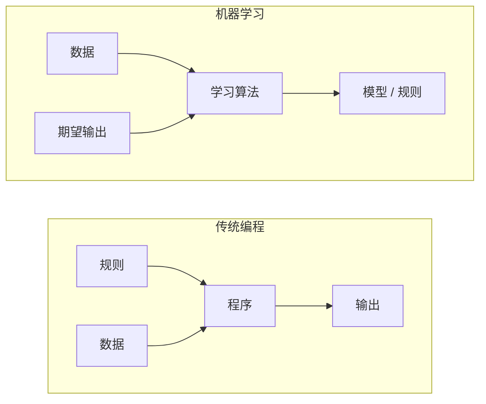
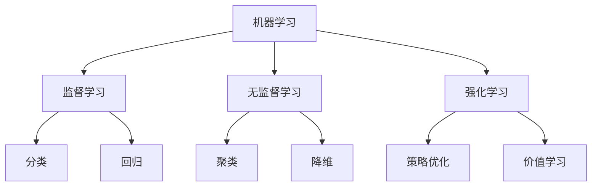
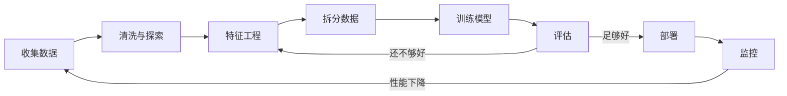
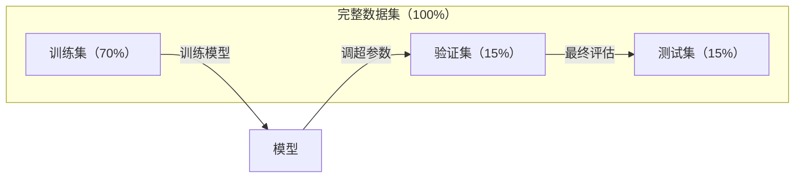
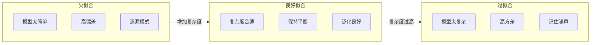
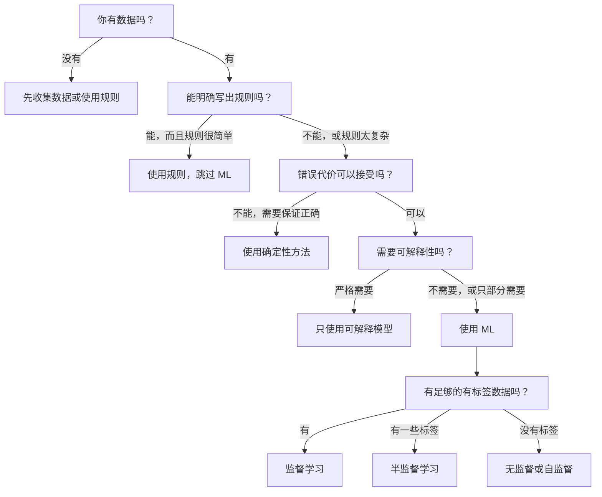

# 什么是机器学习

> 机器学习是教计算机从数据中发现模式，而不是手写规则。

**Type:** Learn
**Languages:** Python
**Prerequisites:** Phase 1 (Math Foundations)
**Time:** ~45 minutes

## 学习目标

- 解释监督学习、无监督学习和强化学习的区别，并判断给定问题适合哪一种类型
- 从零实现最近质心分类器，并用随机基线评估它
- 区分分类任务和回归任务，并为每类任务选择合适的损失函数
- 判断一个业务问题是否适合使用机器学习，还是更适合用确定性规则解决

## 问题

你想构建一个垃圾邮件过滤器。传统做法是坐下来手写几百条规则。“如果邮件里包含 FREE MONEY，就标记为垃圾邮件。如果邮件里有 3 个以上感叹号，就标记为垃圾邮件。”你花几周写规则。然后垃圾邮件发送者换了一种说法。你的规则失效了。你继续写更多规则。这个循环永远不会结束。

机器学习把这个过程反过来。你不再手写规则，而是给计算机成千上万封已标注邮件，比如“垃圾邮件”或“非垃圾邮件”，让它自己找出规则。计算机会发现一些你原本想不到的模式。当垃圾邮件发送者改变策略时，你用新数据重新训练模型，而不是重写代码。

这种从“编写规则”到“从数据中学习”的转变，就是机器学习的核心。推荐引擎、语音助手、自动驾驶汽车和语言模型都以这种方式工作。

## 概念

### 从数据中学习，而不是从规则中执行

传统编程和机器学习解决问题的方向相反。



传统编程：你写出规则。程序把规则应用到数据上，然后产生输出。

机器学习：你提供数据和期望输出。算法发现规则。

训练得到的“模型”就是规则本身，只不过规则被编码成数字，也就是权重和参数。模型会从见过的样本中归纳规律，并对从未见过的数据做预测。

### 机器学习的三种类型



**监督学习**：你有输入和输出的配对数据。模型学习如何把输入映射到输出。

- “这里有 10,000 张标注为猫或狗的照片。学会区分它们。”
- “这里有房屋特征和价格。学会预测价格。”

**无监督学习**：你只有输入，没有标签。模型自己发现结构。

- “这里有 10,000 个客户的购买历史。找出自然分组。”
- “这里有 1,000 维的数据点。在保留结构的同时降到 2 维。”

**强化学习**：智能体在环境中采取动作，并收到奖励或惩罚。它学习一种策略，让总奖励最大化。

- “玩这个游戏。赢了 +1，输了 -1。自己找出策略。”
- “控制这个机械臂。拿起物体 +1，每浪费一秒 -0.01。”

实践中你构建的大多数系统都会使用监督学习。无监督学习常用于预处理和探索。强化学习驱动游戏 AI、机器人，以及语言模型中的 RLHF。

### 三大类型之外

上面的三类很清晰，但现实中的机器学习经常会模糊边界。

**半监督学习**使用少量有标签数据和大量无标签数据。你可能有 100 张已标注医学图像，以及 100,000 张未标注图像。常见技术包括：

- **标签传播**：构建一张图，把相似的数据点连接起来。标签会从有标签节点沿着图传播到无标签邻居。
- **伪标签**：先用有标签数据训练模型，再让模型为无标签数据预测标签，然后用全部数据重新训练。模型会引导出自己的训练集。
- **一致性正则化**：模型应该对一个输入及其轻微扰动版本给出相同预测。即使没有标签，这个约束也能工作。

**自监督学习**从数据本身构造监督信号。完全不需要人工标签。模型根据数据结构为自己创建预测任务。

- **掩码语言建模（BERT）**：遮住一句话中 15% 的词，训练模型预测缺失词。“标签”来自原始文本。
- **对比学习（SimCLR）**：取一张图像，生成两个增强版本。训练模型识别它们来自同一张图，同时把它们和其他图像的增强版本区分开。
- **下一个词元预测（GPT）**：根据前面的所有词预测下一个词。每个文本文档都能变成训练样本。

这些并不是独立于三大类型之外的新类别，而是结合监督和无监督思想的策略。自监督学习从技术上说仍然是监督学习，因为模型在预测某个东西，只是标签由系统自动生成，而不是由人标注。

### 分类与回归

这是监督学习中的两类主要任务。

| 方面 | 分类 | 回归 |
|------|------|------|
| 输出 | 离散类别 | 连续数字 |
| 示例 | “这封邮件是垃圾邮件吗？” | “这套房子会卖多少钱？” |
| 输出空间 | {猫, 狗, 鸟} | 任意实数 |
| 损失函数 | 交叉熵、准确率 | 均方误差、MAE |
| 决策 | 类别之间的边界 | 拟合数据的曲线 |

分类回答“属于哪一类？”回归回答“数值是多少？”

有些问题可以用两种方式表述。预测股票上涨还是下跌是分类。预测准确价格是回归。

### 机器学习工作流

无论使用哪种算法，每个机器学习项目都会遵循相同的流水线。



**收集数据**：收集原始数据。更多数据通常更好，但质量比数量更重要。

**清洗与探索**：处理缺失值、删除重复项、可视化分布、发现异常。这个步骤常常占项目总时间的 60-80%。

**特征工程**：把原始数据转换成模型可用的特征。把日期转换成星期几。归一化数值列。编码类别变量。好的特征比复杂算法更重要。

**拆分数据**：把数据分成训练集、验证集和测试集。模型在训练集上学习，你在验证集上调超参数，最后在测试集上报告性能。

**训练模型**：把训练数据输入算法。算法调整内部参数，让损失函数最小化。

**评估**：在验证集或测试集上衡量性能。如果性能不可接受，就回头尝试不同特征、算法或超参数。

**部署**：把模型放到生产环境，让它对新数据做预测。

**监控**：持续跟踪性能。数据分布会变化，也就是数据漂移，模型会退化。当性能下降时，需要重新训练。

### 训练集、验证集和测试集

这是初学者最容易弄错的关键概念。你必须在模型训练期间从未见过的数据上评估模型。否则你衡量的是记忆能力，而不是学习能力。



| 拆分 | 用途 | 何时使用 | 典型比例 |
|------|------|----------|----------|
| 训练集 | 模型从这些数据中学习 | 训练期间 | 60-80% |
| 验证集 | 调超参数、比较模型 | 每次训练之后 | 10-20% |
| 测试集 | 最终的无偏性能估计 | 最后只用一次 | 10-20% |

测试集是神圣的。你只看它一次。如果你不断根据测试集性能调整模型，实际上就是在测试集上训练模型，你报告的数字就没有意义。

对于小数据集，可以使用 k 折交叉验证：把数据分成 k 份，在 k-1 份上训练，在剩下 1 份上验证，轮换后取平均结果。

### 过拟合与欠拟合



**欠拟合**：模型太简单，无法捕捉数据中的模式。就像用一条直线去拟合弯曲关系。训练误差高，测试误差也高。

**过拟合**：模型太复杂，把训练数据以及其中的噪声都记住了。就像一条弯弯曲曲的曲线穿过每个训练点，却无法处理新数据。训练误差低，测试误差高。

**良好拟合**：模型捕捉真实模式，但没有记住噪声。训练误差和测试误差都相对较低。

过拟合的迹象：

- 训练准确率远高于验证准确率
- 模型在训练数据上表现很好，但在新数据上表现很差
- 增加更多训练数据会提升性能，这说明模型之前是在记忆，而不是学习

修复过拟合的方法：

- 获取更多训练数据
- 降低模型复杂度，比如减少参数、使用更简单的架构
- 正则化，给较大的权重增加惩罚
- Dropout，在训练期间随机把神经元置零
- 早停，当验证误差开始升高时停止训练

修复欠拟合的方法：

- 使用更复杂的模型
- 增加更多特征
- 减少正则化
- 训练更久

### 偏差-方差权衡

这是过拟合和欠拟合背后的数学框架。

**偏差**：来自模型错误假设的误差。当真实关系是非线性的，而模型是线性模型时，模型就有高偏差。高偏差会导致欠拟合。

**方差**：来自模型对训练数据中小波动过于敏感的误差。高方差模型在不同数据子集上训练时，会给出差异很大的预测。高方差会导致过拟合。

| 模型复杂度 | 偏差 | 方差 | 结果 |
|------------|------|------|------|
| 过低，比如用线性模型拟合曲线数据 | 高 | 低 | 欠拟合 |
| 刚刚好 | 中 | 中 | 泛化良好 |
| 过高，比如用 20 阶多项式拟合 10 个点 | 低 | 高 | 过拟合 |

总误差 = 偏差^2 + 方差 + 不可约噪声

你无法减少不可约噪声，因为它来自数据本身的随机性。你要找到让偏差^2 + 方差最小的甜点。

### 没有免费午餐定理

不存在一种对所有问题都最好的算法。一个算法在某类问题上表现好，就会在另一类问题上表现差。这也是数据科学家会尝试多种算法并比较结果的原因。

实践中，算法选择取决于：

- 你有多少数据
- 有多少特征
- 关系是线性的还是非线性的
- 是否需要可解释性
- 你能承担多少计算成本

### 什么时候不要使用机器学习

机器学习很强大，但并不总是正确工具。在拿起模型之前，先问问自己是否真的需要它。

**不要在以下情况使用机器学习：**

- **规则简单且定义明确。** 税务计算、排序算法、单位换算。如果逻辑可以用几条 if 语句写出来，模型只会增加复杂度，不会带来收益。
- **你没有数据，或数据极少。** 机器学习需要从样本中学习。只有 10 个数据点时，你无法训练出有意义的东西。先收集数据。
- **错误代价是灾难性的，而且你需要保证正确。** 医疗剂量计算、核反应堆控制、密码学验证。机器学习模型是概率性的，偶尔会错。如果“偶尔出错”不可接受，就使用确定性方法。
- **查找表或启发式规则已经能解决问题。** 如果一个简单阈值或表格能覆盖 99% 的情况，加入机器学习只会增加维护成本，而不会带来有意义的提升。
- **你无法解释决策，而业务要求可解释。** 受监管行业，比如贷款、保险、刑事司法，有时要求每个决策都能被完整解释。有些机器学习模型可解释，比如线性回归、小决策树。但大多数模型并不可解释。
- **问题变化速度快于你重新训练的速度。** 如果规则每天变化，而重新训练需要一周，模型永远都是过时的。

使用这个决策流程图：



## Build It

`code/ml_intro.py` 中的代码从零实现了一个最近质心分类器，这是最简单的机器学习算法之一。它展示了核心思想：先从数据中学习，再对新数据做预测。

### 第 1 步：从零实现最近质心分类器

最近质心分类器会计算训练数据中每个类别的中心，也就是均值。预测时，它把每个新点分配给距离最近的类别中心。

```python
class NearestCentroid:
    def fit(self, X, y):
        self.classes = np.unique(y)
        self.centroids = np.array([
            X[y == c].mean(axis=0) for c in self.classes
        ])

    def predict(self, X):
        distances = np.array([
            np.sqrt(((X - c) ** 2).sum(axis=1))
            for c in self.centroids
        ])
        return self.classes[distances.argmin(axis=0)]
```

这就是完整算法。`fit` 计算两个均值。`predict` 计算距离。没有梯度下降，没有迭代，也没有超参数。

### 第 2 步：在合成数据上训练

我们生成一个二维分类数据集，其中两个类别略有重叠。质心分类器会在类别中心之间画出一条线性决策边界。

```python
rng = np.random.RandomState(42)
X_class0 = rng.randn(100, 2) + np.array([1.0, 1.0])
X_class1 = rng.randn(100, 2) + np.array([-1.0, -1.0])
X = np.vstack([X_class0, X_class1])
y = np.array([0] * 100 + [1] * 100)
```

### 第 3 步：和基线比较

每个机器学习模型都应该和一个简单基线比较。这里的基线是随机预测类别。如果你的机器学习模型不能超过随机猜测，那一定有地方出了问题。

```python
baseline_preds = rng.choice([0, 1], size=len(y_test))
baseline_acc = np.mean(baseline_preds == y_test)
```

在这个干净数据集上，质心分类器应该能达到约 90% 以上的准确率。随机基线约为 50%。

### 为什么这很重要

最近质心分类器非常简单。它没有超参数，没有迭代，也没有梯度下降。但它捕捉了机器学习最基本的模式：

1. **学习**训练数据中的表示，也就是质心
2. **使用**这个表示对新数据做预测，也就是最近距离
3. **评估**模型相对于基线的表现，也就是随机猜测

从逻辑回归到 Transformer，每个机器学习算法都遵循同样的三步模式。表示会变得更复杂，但工作流保持不变。

### 第 4 步：质心分类器做不到什么

最近质心分类器假设每个类别都形成一个单一团块。它会画出线性决策边界。它会在以下情况下失败：

- 类别有多个聚类，比如数字“1”可以有多种写法
- 决策边界是非线性的，比如一个类别包围另一个类别
- 特征尺度差异很大，距离会被尺度最大的特征主导

这些局限性会引出你接下来要学习的其他算法。K 最近邻可以处理多个聚类。决策树可以处理非线性边界。特征缩放可以修复尺度问题。每一课都会建立在上一课的局限之上。

## Use It

sklearn 提供了 `NearestCentroid` 和合成数据生成器：

```python
from sklearn.neighbors import NearestCentroid
from sklearn.datasets import make_classification
from sklearn.model_selection import train_test_split

X, y = make_classification(
    n_samples=500, n_features=2, n_redundant=0,
    n_clusters_per_class=1, random_state=42
)
X_train, X_test, y_train, y_test = train_test_split(X, y, test_size=0.3)

clf = NearestCentroid()
clf.fit(X_train, y_train)
print(f"Accuracy: {clf.score(X_test, y_test):.3f}")
```

## Ship It

本课产出 `outputs/prompt-ml-problem-framer.md`，这是一个把模糊业务问题转换成具体机器学习任务的提示词。给它一段问题描述，比如“我们想降低流失率”或“预测下一季度需求”，它会识别学习类型、定义预测目标、列出候选特征、选择成功指标、建立基线，并标记数据泄漏或类别不平衡等陷阱。在任何机器学习项目开始时使用它，可以避免构建错误的东西。

## 关键术语

| 术语 | 人们常说 | 实际含义 |
|------|----------|----------|
| 模型 | “这个 AI” | 一个带有可学习参数的数学函数，把输入映射到输出 |
| 训练 | “教 AI” | 运行优化算法，调整模型参数，让预测匹配已知输出 |
| 特征 | “一个输入列” | 数据中可测量的属性，模型用它做预测 |
| 标签 | “答案” | 训练样本的已知输出，用来计算误差信号 |
| 超参数 | “你要调的设置” | 训练前设定的参数，用来控制学习过程，比如学习率、层数 |
| 损失函数 | “模型错得有多离谱” | 衡量预测输出和真实输出之间差距的函数，训练会尝试最小化它 |
| 过拟合 | “它把测试记住了” | 模型学习了训练集特有的噪声，而不是一般模式，所以在新数据上失败 |
| 欠拟合 | “它什么都没学到” | 模型太简单，无法捕捉数据中的真实模式 |
| 泛化 | “它能处理新数据” | 模型对训练期间没见过的数据做出准确预测的能力 |
| 交叉验证 | “在不同数据块上测试” | 反复把数据拆成训练折和测试折并平均结果，从而获得更稳健的性能估计 |
| 正则化 | “让权重保持小一点” | 在损失函数中加入惩罚项，抑制过于复杂的模型 |
| 数据漂移 | “世界变了” | 新进入数据的统计分布随时间变化，导致模型性能下降 |

## 练习

1. 任选一个数据集，比如 Iris 或 Titanic。把它按 70/15/15 分成训练集、验证集和测试集。解释为什么不应该在测试集上调超参数。
2. 列出三个真实世界问题。对每个问题，判断它是分类、回归还是聚类，以及它是监督学习还是无监督学习。
3. 一个模型在训练数据上达到 99% 准确率，但在测试数据上只有 60%。诊断问题，并列出三种你会尝试的修复方法。

## 延伸阅读

- [An Introduction to Statistical Learning](https://www.statlearning.com/)：免费教材，涵盖所有经典机器学习方法，并提供实践示例
- [Google's Machine Learning Crash Course](https://developers.google.com/machine-learning/crash-course)：简洁、可视化的机器学习概念介绍
- [Scikit-learn User Guide](https://scikit-learn.org/stable/user_guide.html)：在 Python 中实现机器学习的实用参考
