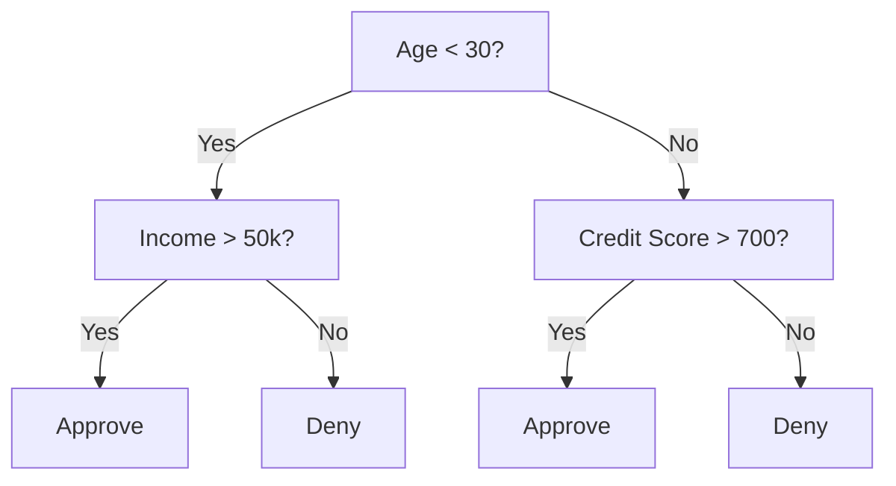
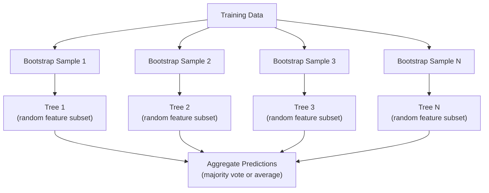

# 决策树与随机森林

> Decision tree 本质上就是一张 flowchart。但一整片 forest 会成为 ML 中最强大的工具之一。

**Type:** Build
**Language:** Python
**Prerequisites:** Phase 1 (Lessons 09 Information Theory, 06 Probability)
**Time:** ~90 minutes

## 学习目标

- 实现 Gini impurity、entropy 和 information gain 的计算，用来寻找最优 decision tree splits
- 从零构建 decision tree classifier，并加入 pre-pruning controls（max depth、min samples）
- 使用 bootstrap sampling 和 feature randomization 构建 random forest，并解释它为什么能降低 variance
- 比较 MDI feature importance 与 permutation importance，并识别 MDI 何时会产生 bias

## 问题

你有 tabular data。Rows 是 samples，columns 是 features，还有一个 target column 是你想预测的内容。你当然可以直接上 neural network。但对于 tabular data，tree-based models（decision trees、random forests、gradient boosted trees）持续压过 deep learning。在 structured data 的 Kaggle competitions 中，主导者是 XGBoost 和 LightGBM，而不是 transformers。

为什么？Trees 可以不用复杂 preprocessing 就处理 mixed feature types（numeric 和 categorical）。它们不用 feature engineering 就能处理 nonlinear relationships。它们是 interpretable 的：你可以看着 tree，准确知道某个 prediction 为什么会产生。而 random forests 会平均许多 trees，在中等规模 datasets 上非常抗 overfitting。

本课会用 recursive splitting 从零构建 decision trees，然后在其上构建 random forest。你会实现 split criteria 背后的数学（Gini impurity、entropy、information gain），并理解为什么一组 weak learners 的 ensemble 会变成 strong learner。

## 概念

### Decision tree 做什么

Decision tree 会通过一连串 yes/no questions，把 feature space 切分成 rectangular regions。



每个 internal node 会用某个 threshold 测试一个 feature。每个 leaf node 会给出一个 prediction。要 classify 一个新的 data point，你从 root 开始，沿 branches 一直走到 leaf。

Tree 会 top-down 构建：在每个 node，选择最能分离数据的 feature 和 threshold。“最能分离”由 split criterion 定义。

### Split criteria: 衡量 impurity

在每个 node，我们有一组 samples。我们希望 split 之后得到的 child nodes 尽可能 “pure”，也就是每个 child 主要包含一个 class。

**Gini impurity** 衡量：如果按照该 node 中的 class distribution 随机给一个 sample 贴 label，它被误分类的 probability。

```text
Gini(S) = 1 - sum(p_k^2)

where p_k is the proportion of class k in set S.
```

对于 pure node（全部是同一个 class），Gini = 0。对于 50/50 classes 的 binary split，Gini = 0.5。越低越好。

```text
Example: 6 cats, 4 dogs

Gini = 1 - (0.6^2 + 0.4^2) = 1 - (0.36 + 0.16) = 0.48
```

**Entropy** 衡量 node 中的信息量（disorder）。它在 Phase 1 Lesson 09 中讲过。

```text
Entropy(S) = -sum(p_k * log2(p_k))
```

对于 pure node，entropy = 0。对于 50/50 的 binary split，entropy = 1.0。越低越好。

```text
Example: 6 cats, 4 dogs

Entropy = -(0.6 * log2(0.6) + 0.4 * log2(0.4))
        = -(0.6 * -0.737 + 0.4 * -1.322)
        = 0.442 + 0.529
        = 0.971 bits
```

**Information gain** 是 split 后 impurity（entropy 或 Gini）的减少量。

```text
IG(S, feature, threshold) = Impurity(S) - weighted_avg(Impurity(S_left), Impurity(S_right))

where the weights are the proportions of samples in each child.
```

每个 node 上的 greedy algorithm 是：尝试每个 feature 和每个可能 threshold。选择让 information gain 最大的 (feature, threshold) pair。

### Splitting 如何工作

对于当前 node 中有 n 个 features、m 个 samples 的 dataset：

1. 对每个 feature j（j = 1 到 n）：
   - 按 feature j 对 samples 排序
   - 尝试连续不同 values 之间的每个 midpoint 作为 threshold
   - 计算每个 threshold 的 information gain
2. 选择 information gain 最高的 feature 和 threshold
3. 把 data 分成 left（feature <= threshold）和 right（feature > threshold）
4. 对每个 child 递归执行

这种 greedy approach 不保证得到 globally optimal tree。寻找 optimal tree 是 NP-hard。但 greedy splitting 在实践中效果很好。

### Stopping conditions

如果没有 stopping conditions，tree 会一直增长，直到每个 leaf 都 pure（每个 leaf 一个 sample）。这会完美记住 training data，但泛化非常糟糕。

**Pre-pruning** 会在 tree 完全长成之前停止：

- Maximum depth: 当 tree 达到指定 depth 时停止 splitting
- Minimum samples per leaf: 如果某个 node 的 samples 少于 k，就停止
- Minimum information gain: 如果 best split 对 impurity 的改善低于 threshold，就停止
- Maximum leaf nodes: 限制 leaves 总数

**Post-pruning** 先让完整 tree 长出来，然后再剪回去：

- Cost-complexity pruning（scikit-learn 使用）：加入一个与 leaves 数量成正比的 penalty。Penalty 越大，tree 越小
- Reduced error pruning：如果移除 subtree 不会增加 validation error，就移除它

Pre-pruning 更简单、更快。Post-pruning 通常能产生更好的 trees，因为它不会过早阻止那些后续可能有用的 splits。

### 用于 regression 的 decision trees

对于 regression，leaf prediction 是该 leaf 中 target values 的 mean。Split criterion 也会改变。

**Variance reduction** 替代 information gain：

```text
VR(S, feature, threshold) = Var(S) - weighted_avg(Var(S_left), Var(S_right))
```

选择让 variance 降得最多的 split。Tree 会把 input space 分成不同 regions，并在每个 region 中预测一个 constant（mean）。

### Random forests: ensembles 的力量

单棵 decision tree 是 high variance 的。Data 的微小变化可能产生完全不同的 trees。Random forests 通过平均许多 trees 解决这个问题。



两种 randomness 让 trees 变得 diverse：

**Bagging（bootstrap aggregating）：** 每棵 tree 都在一个 bootstrap sample 上训练，也就是从 training data 中有放回地随机采样。每个 bootstrap 中大约会出现原始 samples 的 63%（剩下的是 out-of-bag samples，可用于 validation）。

**Feature randomization：** 在每次 split 时，只考虑随机 subset of features。对于 classification，默认是 sqrt(n_features)。对于 regression，是 n_features/3。这能防止所有 trees 都在同一个 dominant feature 上 split。

关键洞察是：平均许多 decorrelated trees 可以降低 variance，而不增加 bias。每棵单独的 tree 可能平平无奇，但 ensemble 很强。

### Feature importance

Random forests 天然提供 feature importance scores。最常见的方法是：

**Mean Decrease in Impurity（MDI）：** 对于每个 feature，把所有 trees 中、所有使用该 feature 的 nodes 上的 impurity reduction 加总。越早 split 且带来越大 impurity reduction 的 features 越重要。

```text
importance(feature_j) = sum over all nodes where feature_j is used:
    (n_samples_at_node / n_total_samples) * impurity_decrease
```

这很快（training 时就能算出来），但会偏向 high-cardinality features 和有许多 possible split points 的 features。

**Permutation importance** 是替代方案：shuffle 某个 feature 的 values，然后测量 model accuracy 下降多少。它更可靠，但更慢。

### Trees 什么时候胜过 neural networks

在 tabular data 上，trees 和 forests 通常压过 neural networks。原因有几个：

| Factor | Trees | Neural networks |
|--------|-------|----------------|
| Mixed types (numeric + categorical) | Native support | Need encoding |
| Small datasets (< 10k rows) | Work well | Overfit |
| Feature interactions | Found by splitting | Need architecture design |
| Interpretability | Full transparency | Black box |
| Training time | Minutes | Hours |
| Hyperparameter sensitivity | Low | High |

当 data 有 spatial 或 sequential structure（images、text、audio）时，neural networks 会赢。对于 flat feature tables，trees 是默认选择。

```figure
decision-tree-depth
```

## Build It

### Step 1: Gini impurity 和 entropy

从零构建两种 split criteria，并验证它们对哪些 splits 是好 splits 的判断一致。

```python
import math

def gini_impurity(labels):
    n = len(labels)
    if n == 0:
        return 0.0
    counts = {}
    for label in labels:
        counts[label] = counts.get(label, 0) + 1
    return 1.0 - sum((c / n) ** 2 for c in counts.values())

def entropy(labels):
    n = len(labels)
    if n == 0:
        return 0.0
    counts = {}
    for label in labels:
        counts[label] = counts.get(label, 0) + 1
    return -sum(
        (c / n) * math.log2(c / n) for c in counts.values() if c > 0
    )
```

### Step 2: 寻找 best split

尝试每个 feature 和每个 threshold。返回 information gain 最高的那个。

```python
def information_gain(parent_labels, left_labels, right_labels, criterion="gini"):
    measure = gini_impurity if criterion == "gini" else entropy
    n = len(parent_labels)
    n_left = len(left_labels)
    n_right = len(right_labels)
    if n_left == 0 or n_right == 0:
        return 0.0
    parent_impurity = measure(parent_labels)
    child_impurity = (
        (n_left / n) * measure(left_labels) +
        (n_right / n) * measure(right_labels)
    )
    return parent_impurity - child_impurity
```

### Step 3: 构建 DecisionTree class

Recursive splitting、prediction 和 feature importance tracking。

```python
class DecisionTree:
    def __init__(self, max_depth=None, min_samples_split=2,
                 min_samples_leaf=1, criterion="gini",
                 max_features=None):
        self.max_depth = max_depth
        self.min_samples_split = min_samples_split
        self.min_samples_leaf = min_samples_leaf
        self.criterion = criterion
        self.max_features = max_features
        self.tree = None
        self.feature_importances_ = None

    def fit(self, X, y):
        self.n_features = len(X[0])
        self.feature_importances_ = [0.0] * self.n_features
        self.n_samples = len(X)
        self.tree = self._build(X, y, depth=0)
        total = sum(self.feature_importances_)
        if total > 0:
            self.feature_importances_ = [
                fi / total for fi in self.feature_importances_
            ]

    def predict(self, X):
        return [self._predict_one(x, self.tree) for x in X]
```

### Step 4: 构建 RandomForest class

Bootstrap sampling、feature randomization 和 majority voting。

```python
class RandomForest:
    def __init__(self, n_trees=100, max_depth=None,
                 min_samples_split=2, max_features="sqrt",
                 criterion="gini"):
        self.n_trees = n_trees
        self.max_depth = max_depth
        self.min_samples_split = min_samples_split
        self.max_features = max_features
        self.criterion = criterion
        self.trees = []

    def fit(self, X, y):
        n = len(X)
        for _ in range(self.n_trees):
            indices = [random.randint(0, n - 1) for _ in range(n)]
            X_boot = [X[i] for i in indices]
            y_boot = [y[i] for i in indices]
            tree = DecisionTree(
                max_depth=self.max_depth,
                min_samples_split=self.min_samples_split,
                max_features=self.max_features,
                criterion=self.criterion,
            )
            tree.fit(X_boot, y_boot)
            self.trees.append(tree)

    def predict(self, X):
        all_preds = [tree.predict(X) for tree in self.trees]
        predictions = []
        for i in range(len(X)):
            votes = {}
            for preds in all_preds:
                v = preds[i]
                votes[v] = votes.get(v, 0) + 1
            predictions.append(max(votes, key=votes.get))
        return predictions
```

完整实现和所有 helper methods 见 `code/trees.py`。

## Use It

使用 scikit-learn，训练 random forest 只需要三行：

```python
from sklearn.ensemble import RandomForestClassifier
from sklearn.datasets import load_iris
from sklearn.model_selection import train_test_split

X, y = load_iris(return_X_y=True)
X_train, X_test, y_train, y_test = train_test_split(X, y, random_state=42)

rf = RandomForestClassifier(n_estimators=100, random_state=42)
rf.fit(X_train, y_train)
print(f"Accuracy: {rf.score(X_test, y_test):.4f}")
print(f"Feature importances: {rf.feature_importances_}")
```

实践中，gradient boosted trees（XGBoost、LightGBM、CatBoost）通常比 random forests 更强，因为它们 sequentially 构建 trees，每棵 tree 都修正前面 trees 的 errors。但 random forests 更不容易配置错，几乎不需要 hyperparameter tuning。

## Ship It

本课产出 `outputs/prompt-tree-interpreter.md`，这是一个 prompt，用来为 business stakeholders 解释 decision tree splits。把 trained tree 的 structure（depth、features、split thresholds、accuracy）喂给它，它会把 model 翻译成 plain-language rules，排序 feature importance，标记 overfitting 或 leakage，并推荐 next steps。任何时候你需要向不读代码的人解释 tree-based model，都可以用它。

## 练习

1. 在一个有 3 个 classes 的 2D dataset 上训练单棵 decision tree。手动追踪 splits，并画出 rectangular decision boundaries。比较 max_depth=2 和 max_depth=10 时的 boundaries。

2. 为 regression trees 实现 variance reduction splitting。生成 200 个点：y = sin(x) + noise，并拟合 regression tree。把 tree 的 piecewise-constant predictions 与真实曲线画在一起。

3. 构建包含 1、5、10、50、200 棵 trees 的 random forest。画出 training accuracy 和 test accuracy 随 trees 数量变化的曲线。观察 test accuracy 会 plateau，但不会下降（forests 抗 overfitting）。

4. 在 5 个不同 datasets 上比较 Gini impurity 和 entropy 作为 split criteria 的效果。衡量 accuracy 和 tree depth。多数情况下，它们会产生几乎相同的结果。解释原因。

5. 实现 permutation importance。在一个 dataset 上把它与 MDI importance 比较，其中一个 feature 是 random noise 但有 high cardinality。MDI 会把 noise feature 排得很高。Permutation importance 不会。

## 关键术语

| Term | What people say | What it actually means |
|------|----------------|----------------------|
| Decision tree | “A flowchart for predictions” | 通过学习一系列 if/else splits，把 feature space 切分成 rectangular regions 的 model |
| Gini impurity | “How mixed the node is” | 某个 node 上随机 sample 被误分类的 probability。0 = pure，0.5 = binary 情况下最大 impurity |
| Entropy | “The disorder in a node” | 某个 node 的 information content。0 = pure，1.0 = binary 情况下最大 uncertainty。来自 information theory |
| Information gain | “How good a split is” | Split 后 impurity 的降低量。Greedy 选择 splits 的 criterion |
| Pre-pruning | “Stop the tree early” | 通过设置 max depth、min samples 或 min gain thresholds，提前停止 tree growth |
| Post-pruning | “Trim the tree after” | 先长出 full tree，再移除不会改善 validation performance 的 subtrees |
| Bagging | “Train on random subsets” | Bootstrap aggregating。每个 model 在一个不同的有放回 random sample 上训练 |
| Random forest | “A bunch of trees” | Decision trees 的 ensemble；每棵 tree 用 bootstrap sample 训练，并在每次 split 使用 random feature subsets |
| Feature importance (MDI) | “Which features matter” | 每个 feature 贡献的 total impurity decrease，跨所有 trees 和 nodes 加总 |
| Permutation importance | “Shuffle and check” | 随机 shuffle 某个 feature values 后 accuracy 的下降量。对 noisy features 比 MDI 更可靠 |
| Variance reduction | “The regression version of info gain” | Regression tree 中对应 information gain 的概念。选择让 target variance 降得最多的 split |
| Bootstrap sample | “Random sample with repeats” | 从原始 dataset 中有放回抽取的 random sample。大小相同，但包含 duplicates |

## 延伸阅读

- [Breiman: Random Forests (2001)](https://link.springer.com/article/10.1023/A:1010933404324) - 原始 random forest paper
- [Grinsztajn et al.: Why do tree-based models still outperform deep learning on tabular data? (2022)](https://arxiv.org/abs/2207.08815) - 对 trees 和 neural networks 在 tabular tasks 上的严谨比较
- [scikit-learn Decision Trees documentation](https://scikit-learn.org/stable/modules/tree.html) - 带 visualization tools 的实用指南
- [XGBoost: A Scalable Tree Boosting System (Chen & Guestrin, 2016)](https://arxiv.org/abs/1603.02754) - 主导 Kaggle 的 gradient boosting paper
