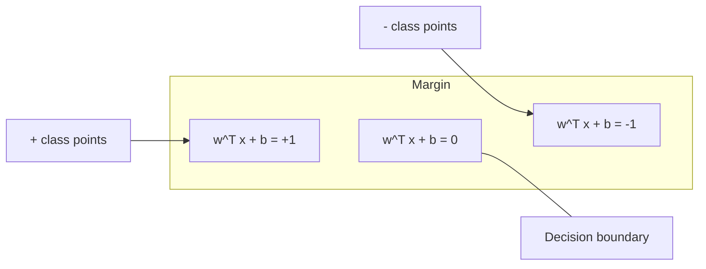
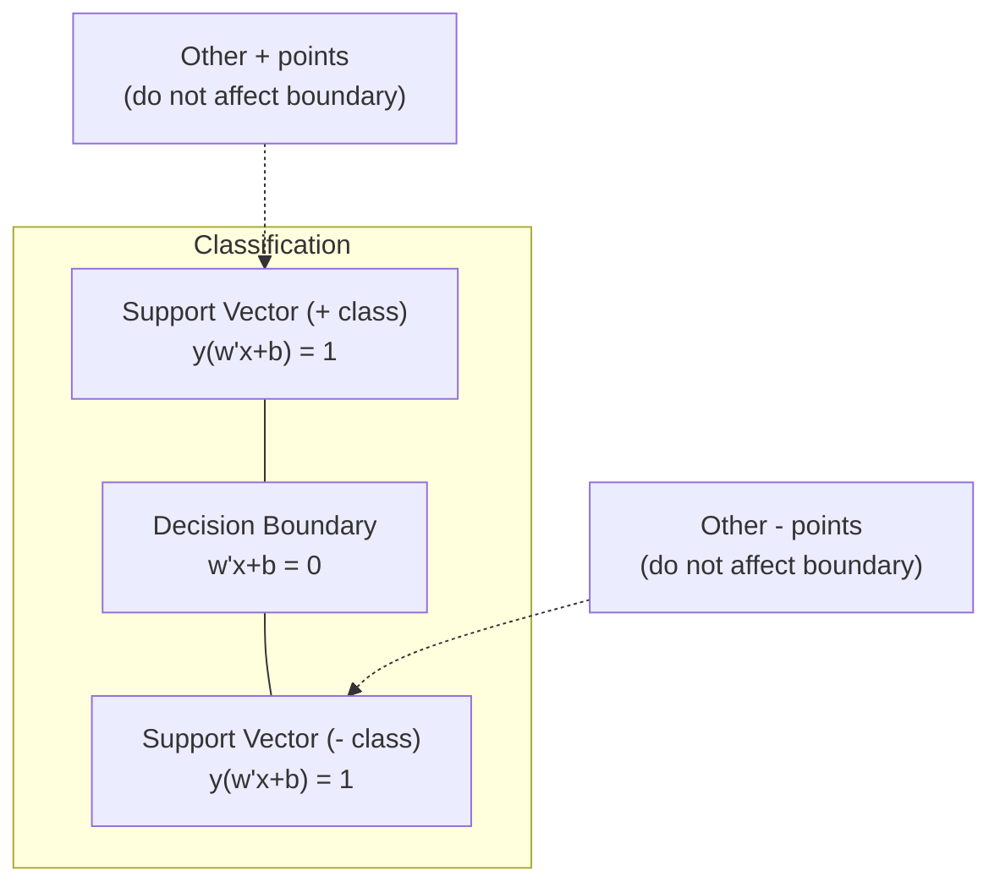
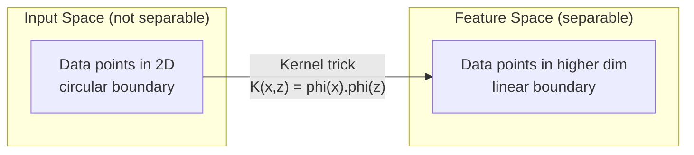

# 支持向量机

> 在两个类别之间找到最宽的街道。这就是全部思想。

**Type:** Build
**Language:** Python
**Prerequisites:** Phase 1 (Lessons 08 Optimization, 14 Norms and Distances, 18 Convex Optimization)
**Time:** ~90 minutes

## 学习目标

- 使用 hinge loss 和 primal formulation 上的 gradient descent，从零实现 linear SVM
- 解释 maximum margin principle，并从 trained model 中识别 support vectors
- 比较 linear、polynomial 和 RBF kernels，并解释 kernel trick 如何避免显式 high-dimensional mapping
- 评估 C parameter 控制的 margin width 与 classification errors 之间的取舍

## 问题

你有两类 data points，需要画一条 line（或 hyperplane）把它们分开。能做到这件事的 lines 有无穷多条。你该选哪一条？

选择 margin 最大的那条。Margin 是 decision boundary 与两侧最近 data points 之间的距离。更宽的 margin 意味着 classifier 更有信心，并且对 unseen data 泛化更好。

这个直觉导向了 Support Vector Machines，也就是 ML 中数学上最优雅的 algorithms 之一。在 deep learning 之前，SVMs 是主导性的 classification 方法；在 small datasets、high-dimensional data，以及需要 principled、well-understood model 和 theoretical guarantees 的问题上，它们今天仍然是很好的选择。

SVMs 与 Phase 1 直接相连：optimization 是 convex 的（Lesson 18），margin 用 norms 衡量（Lesson 14），kernel trick 利用 dot products 来处理 nonlinear boundaries，而不需要真的在 high-dimensional space 中计算。

## 概念

### Maximum margin classifier

给定 linearly separable data，labels y_i 属于 {-1, +1}，feature vectors 为 x_i，我们想要一个 hyperplane w^T x + b = 0 来分离类别。

点 x_i 到 hyperplane 的距离是：

```text
distance = |w^T x_i + b| / ||w||
```

对于 correctly classified point：y_i * (w^T x_i + b) > 0。Margin 是从 hyperplane 到两侧最近点距离的两倍。



Optimization problem:

```text
maximize    2 / ||w||     (the margin width)
subject to  y_i * (w^T x_i + b) >= 1  for all i
```

等价地说（minimizing ||w||^2 更容易优化）：

```text
minimize    (1/2) ||w||^2
subject to  y_i * (w^T x_i + b) >= 1  for all i
```

这是一个 convex quadratic program。它有唯一的 global solution。那些刚好落在 margin boundaries 上的 data points（也就是 y_i * (w^T x_i + b) = 1 的点）就是 support vectors。它们是唯一决定 decision boundary 的点。移动或移除任何 non-support-vector point，boundary 都不会改变。

### Support vectors: 少数关键点



大多数 training points 都无关紧要。只有 support vectors 重要。这就是为什么 SVMs 在 prediction time 很 memory-efficient：你只需要存储 support vectors，而不是整个 training set。

Support vectors 的数量也给出了 generalization error 的一个 bound。Support vectors 相对于 dataset size 越少，generalization 越好。

### Soft margin: 用 C parameter 处理 noise

真实数据很少完全 separable。有些 points 可能落在 boundary 的错误一侧，或者落在 margin 内部。Soft margin formulation 通过引入 slack variables 来允许 violations。

```text
minimize    (1/2) ||w||^2 + C * sum(xi_i)
subject to  y_i * (w^T x_i + b) >= 1 - xi_i
            xi_i >= 0  for all i
```

Slack variable xi_i 衡量 point i 对 margin 的 violation 程度。C 控制 trade-off：

| C value | Behavior |
|---------|----------|
| Large C | 严重惩罚 violations。Narrow margin，misclassifications 更少。容易 overfit |
| Small C | 允许更多 violations。Wide margin，misclassifications 更多。容易 underfit |

C 是 regularization strength 的倒数。Large C = less regularization。Small C = more regularization。

### Hinge loss: SVM 的 loss function

Soft margin SVM 可以改写为 unconstrained optimization：

```text
minimize    (1/2) ||w||^2 + C * sum(max(0, 1 - y_i * (w^T x_i + b)))
```

其中 max(0, 1 - y_i * f(x_i)) 就是 hinge loss。当 point 被 correctly classified 并且在 margin 外侧时，它为 zero。当 point 位于 margin 内部或被 misclassified 时，它是 linear penalty。

```text
Hinge loss for a single point:

loss
  |
  | \
  |  \
  |   \
  |    \
  |     \_______________
  |
  +-----|-----|-------->  y * f(x)
       0     1

Zero loss when y*f(x) >= 1 (correctly classified, outside margin).
Linear penalty when y*f(x) < 1.
```

与 logistic loss（logistic regression）比较：

```text
Hinge:     max(0, 1 - y*f(x))          Hard cutoff at margin
Logistic:  log(1 + exp(-y*f(x)))        Smooth, never exactly zero
```

Hinge loss 会产生 sparse solutions（只有 support vectors 有 nonzero contribution）。Logistic loss 会使用所有 data points。这让 SVMs 在 prediction time 更 memory-efficient。

### 使用 gradient descent 训练 linear SVM

你可以直接在 hinge loss 加 L2 regularization 上使用 gradient descent 训练 linear SVM，不需要求解 constrained QP：

```text
L(w, b) = (lambda/2) * ||w||^2 + (1/n) * sum(max(0, 1 - y_i * (w^T x_i + b)))

Gradient with respect to w:
  If y_i * (w^T x_i + b) >= 1:  dL/dw = lambda * w
  If y_i * (w^T x_i + b) < 1:   dL/dw = lambda * w - y_i * x_i

Gradient with respect to b:
  If y_i * (w^T x_i + b) >= 1:  dL/db = 0
  If y_i * (w^T x_i + b) < 1:   dL/db = -y_i
```

这叫 primal formulation。每个 epoch 的复杂度是 O(n * d)，其中 n 是 samples 数量，d 是 features 数量。对于 large、sparse、high-dimensional data（例如 text classification），它很快。

### Dual formulation 和 kernel trick

SVM problem 的 Lagrangian dual（来自 Phase 1 Lesson 18 的 KKT conditions）是：

```text
maximize    sum(alpha_i) - (1/2) * sum_ij(alpha_i * alpha_j * y_i * y_j * (x_i . x_j))
subject to  0 <= alpha_i <= C
            sum(alpha_i * y_i) = 0
```

Dual 中只涉及 data points 之间的 dot products x_i . x_j。这是关键洞察。把每个 dot product 替换成 kernel function K(x_i, x_j)，SVM 就可以学习 nonlinear boundaries，而不需要显式计算 transformation。

```text
Linear kernel:      K(x, z) = x . z
Polynomial kernel:  K(x, z) = (x . z + c)^d
RBF (Gaussian):     K(x, z) = exp(-gamma * ||x - z||^2)
```

RBF kernel 会把 data 映射到 infinite-dimensional space。Input space 中接近的 points，kernel value 接近 1。相距很远的 points，kernel value 接近 0。它可以学习任何 smooth decision boundary。



Kernel trick 会计算 high-dimensional space 中的 dot product，但永远不真的进入那里。对于 D dimensions 中 degree d 的 polynomial kernel，显式 feature space 有 O(D^d) dimensions。但 K(x, z) 可以在 O(D) time 内计算。

### SVM for regression (SVR)

Support Vector Regression 会在 data 周围拟合一条宽度为 epsilon 的 tube。Tube 内部的 points 有 zero loss。Tube 外部的 points 受到 linear penalty。

```text
minimize    (1/2) ||w||^2 + C * sum(xi_i + xi_i*)
subject to  y_i - (w^T x_i + b) <= epsilon + xi_i
            (w^T x_i + b) - y_i <= epsilon + xi_i*
            xi_i, xi_i* >= 0
```

Epsilon parameter 控制 tube width。Wider tube = fewer support vectors = smoother fit。Narrower tube = more support vectors = tighter fit。

### SVMs 为什么输给 deep learning，以及什么时候仍然会赢

SVMs 从 1990s 后期到 2010s 初期主导 ML。Deep learning 后来超过它们，原因有几个：

| Factor | SVMs | Deep learning |
|--------|------|---------------|
| Feature engineering | Requires it | Learns features |
| Scalability | O(n^2) to O(n^3) for kernel | O(n) per epoch with SGD |
| Image/text/audio | Needs handcrafted features | Learns from raw data |
| Large datasets (>100k) | Slow | Scales well |
| GPU acceleration | Limited benefit | Massive speedup |

SVMs 在下面这些场景中仍然会赢：

- Small datasets（几百到几千 samples）
- High-dimensional sparse data（带 TF-IDF features 的 text）
- 需要 mathematical guarantees（margin bounds）
- Training time 必须很短（linear SVM 非常快）
- Binary classification 且有清晰 margin structure
- Anomaly detection（one-class SVM）

```figure
svm-margin
```

## Build It

### Step 1: Hinge loss 和 gradient

这是基础。为一个 batch 计算 hinge loss 及其 gradient。

```python
def hinge_loss(X, y, w, b):
    n = len(X)
    total_loss = 0.0
    for i in range(n):
        margin = y[i] * (dot(w, X[i]) + b)
        total_loss += max(0.0, 1.0 - margin)
    return total_loss / n
```

### Step 2: 通过 gradient descent 训练 Linear SVM

通过最小化 regularized hinge loss 来训练。不需要 QP solver。

```python
class LinearSVM:
    def __init__(self, lr=0.001, lambda_param=0.01, n_epochs=1000):
        self.lr = lr
        self.lambda_param = lambda_param
        self.n_epochs = n_epochs
        self.w = None
        self.b = 0.0

    def fit(self, X, y):
        n_features = len(X[0])
        self.w = [0.0] * n_features
        self.b = 0.0

        for epoch in range(self.n_epochs):
            for i in range(len(X)):
                margin = y[i] * (dot(self.w, X[i]) + self.b)
                if margin >= 1:
                    self.w = [wj - self.lr * self.lambda_param * wj
                              for wj in self.w]
                else:
                    self.w = [wj - self.lr * (self.lambda_param * wj - y[i] * X[i][j])
                              for j, wj in enumerate(self.w)]
                    self.b -= self.lr * (-y[i])

    def predict(self, X):
        return [1 if dot(self.w, x) + self.b >= 0 else -1 for x in X]
```

### Step 3: Kernel functions

实现 linear、polynomial 和 RBF kernels。

```python
def linear_kernel(x, z):
    return dot(x, z)

def polynomial_kernel(x, z, degree=3, c=1.0):
    return (dot(x, z) + c) ** degree

def rbf_kernel(x, z, gamma=0.5):
    diff = [xi - zi for xi, zi in zip(x, z)]
    return math.exp(-gamma * dot(diff, diff))
```

### Step 4: Margin 和 support vector identification

Training 之后，识别哪些 points 是 support vectors，并计算 margin width。

```python
def find_support_vectors(X, y, w, b, tol=1e-3):
    support_vectors = []
    for i in range(len(X)):
        margin = y[i] * (dot(w, X[i]) + b)
        if abs(margin - 1.0) < tol:
            support_vectors.append(i)
    return support_vectors
```

完整实现和所有 demos 见 `code/svm.py`。

## Use It

使用 scikit-learn：

```python
from sklearn.svm import SVC, LinearSVC, SVR
from sklearn.preprocessing import StandardScaler
from sklearn.pipeline import Pipeline

clf = Pipeline([
    ("scaler", StandardScaler()),
    ("svm", SVC(kernel="rbf", C=1.0, gamma="scale")),
])
clf.fit(X_train, y_train)
print(f"Accuracy: {clf.score(X_test, y_test):.4f}")
print(f"Support vectors: {clf['svm'].n_support_}")
```

重要：训练 SVM 前一定要 scale features。SVMs 对 feature magnitudes 很敏感，因为 margin 依赖 ||w||，未缩放的 features 会扭曲 geometry。

对于 large datasets，使用 `LinearSVC`（primal formulation，每个 epoch O(n)）而不是 `SVC`（dual formulation，O(n^2) 到 O(n^3)）：

```python
from sklearn.svm import LinearSVC

clf = Pipeline([
    ("scaler", StandardScaler()),
    ("svm", LinearSVC(C=1.0, max_iter=10000)),
])
```

## 练习

1. 生成一个 2D linearly separable dataset。训练你的 LinearSVM，并识别 support vectors。验证 support vectors 是离 decision boundary 最近的 points。

2. 在 noisy dataset 上让 C 从 0.001 变化到 1000。为每个 C value 绘制 decision boundary。观察从 wide margin（underfitting）到 narrow margin（overfitting）的转变。

3. 创建一个 class boundaries 是 circular 的 dataset（非 linear）。展示 linear SVM 会失败。计算 RBF kernel matrix，并展示 classes 在 kernel-induced feature space 中变得 separable。

4. 在同一个 dataset 上比较 hinge loss 和 logistic loss。训练 linear SVM 和 logistic regression。数一数每个 model 的 decision boundary 由多少 training points 贡献（support vectors vs all points）。

5. 实现 SVR（epsilon-insensitive loss）。把它拟合到 y = sin(x) + noise。画出 predictions 周围的 epsilon tube，并突出显示 support vectors（tube 外部的 points）。

## 关键术语

| Term | What it actually means |
|------|----------------------|
| Support vectors | 离 decision boundary 最近的 training points。唯一决定 hyperplane 的 points |
| Margin | Decision boundary 与最近 support vectors 之间的距离。SVMs 会最大化它 |
| Hinge loss | max(0, 1 - y*f(x))。Correctly classified 且在 margin 外时为 zero，否则是 linear penalty |
| C parameter | Margin width 与 classification errors 之间的 trade-off。Large C = narrow margin，small C = wide margin |
| Soft margin | 通过 slack variables 允许 margin violations 的 SVM formulation。用于处理 non-separable data |
| Kernel trick | 不显式映射到 high-dimensional feature space，却能计算其中 dot products 的技巧 |
| Linear kernel | K(x, z) = x . z。等价于 standard dot product。适合 linearly separable data |
| RBF kernel | K(x, z) = exp(-gamma * \|\|x-z\|\|^2)。映射到 infinite dimensions。能学习任意 smooth boundary |
| Polynomial kernel | K(x, z) = (x . z + c)^d。映射到 polynomial combinations 的 feature space |
| Dual formulation | 只依赖 data points 之间 dot products 的 SVM problem reformulation。让 kernels 成为可能 |
| SVR | Support Vector Regression。在 data 周围拟合 epsilon-tube。Tube 内部 points 为 zero loss |
| Slack variables | xi_i: 衡量一个 point 对 margin 的 violation 程度。正确分类且在 margin 外的 points 为 zero |
| Maximum margin | 选择最大化到每个 class 最近 points 距离的 hyperplane 的原则 |

## 延伸阅读

- [Vapnik: The Nature of Statistical Learning Theory (1995)](https://link.springer.com/book/10.1007/978-1-4757-3264-1) - SVMs 和 statistical learning 的 foundational text
- [Cortes & Vapnik: Support-vector networks (1995)](https://link.springer.com/article/10.1007/BF00994018) - 原始 SVM paper
- [Platt: Sequential Minimal Optimization (1998)](https://www.microsoft.com/en-us/research/publication/sequential-minimal-optimization-a-fast-algorithm-for-training-support-vector-machines/) - 让 SVM training 变得 practical 的 SMO algorithm
- [scikit-learn SVM documentation](https://scikit-learn.org/stable/modules/svm.html) - 包含 implementation details 的实用指南
- [LIBSVM: A Library for Support Vector Machines](https://www.csie.ntu.edu.tw/~cjlin/libsvm/) - 大多数 SVM implementations 背后的 C++ library
