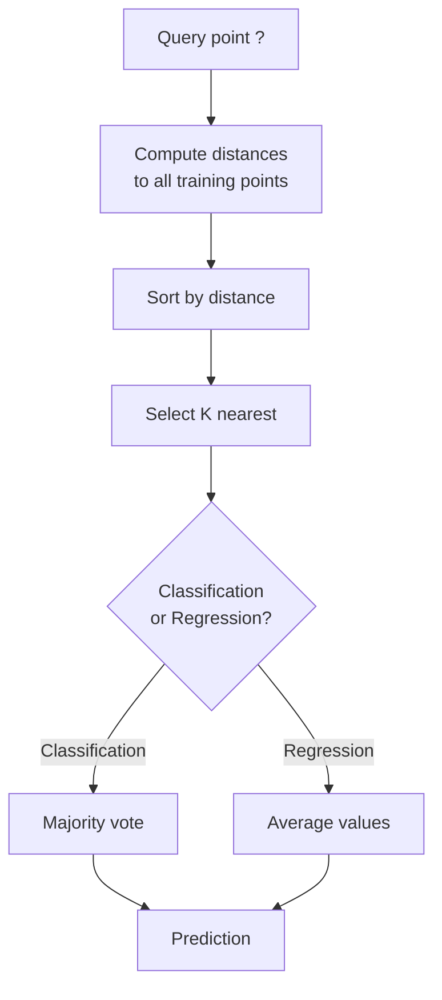
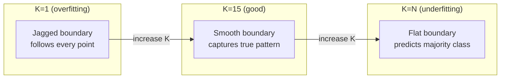
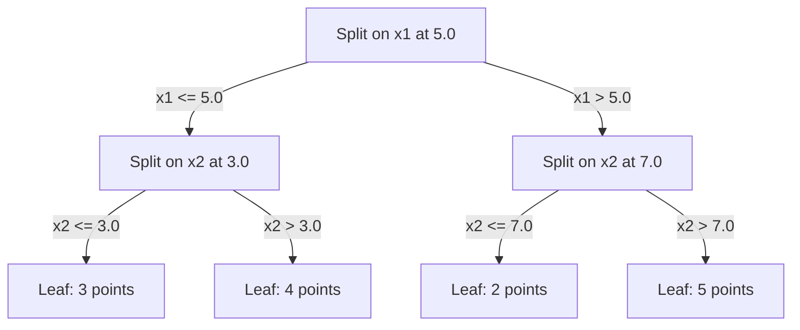

# K 近邻与距离

> 把所有东西都存下来。预测时看看邻居。最简单但真的有效的算法。

**Type:** Build
**Language:** Python
**Prerequisites:** Phase 1 (Lesson 14 Norms and Distances)
**Time:** ~90 minutes

## 学习目标

- 从零实现 KNN classification 和 regression，支持可配置的 K 与 distance-weighted voting
- 比较 L1、L2、cosine 和 Minkowski distance metrics，并为给定 data type 选择合适的距离
- 解释 curse of dimensionality，并演示为什么 KNN 在 high-dimensional spaces 中会退化
- 构建 KD-tree 做高效 nearest neighbor search，并分析它何时胜过 brute-force

## 问题

你有一个 dataset。一个新的 data point 到来。你需要 classify 它，或者预测它的 value。与其从 data 中学习 parameters（像 linear regression 或 SVMs），你只需要找到离这个新点最近的 K 个 training points，让它们投票。

这就是 K-nearest neighbors。没有 training phase。没有 parameters 要学。没有 loss function 要最小化。你存下整个 training set，并在 prediction time 计算 distances。

它听起来简单到不像能工作。但 KNN 在许多问题上意外地有竞争力，尤其是 small 到 medium datasets。深入理解它会揭示几个基础概念：distance metric 的选择（连接到 Phase 1 Lesson 14）、curse of dimensionality，以及 lazy learning 和 eager learning 的区别。

KNN 也以不同名字出现在现代 AI 的各个角落。Vector databases 在 embeddings 上做 KNN search。Retrieval-augmented generation（RAG）寻找 K 个最近的 document chunks。Recommendation systems 寻找相似 users 或 items。算法是同一个。只是 scale 和 data structures 不同。

## 概念

### KNN 如何工作

给定一个有 labels 的 dataset 和一个新的 query point：

1. 计算 query 到 dataset 中每个 point 的 distance
2. 按 distance 排序
3. 取最近的 K 个 points
4. 对于 classification：让 K 个 neighbors 做 majority vote
5. 对于 regression：取 K 个 neighbors values 的 average（或 weighted average）



这就是完整算法。没有 fitting。没有 gradient descent。没有 epochs。

### 选择 K

K 是唯一的 hyperparameter。它控制 bias-variance trade-off：

| K | Behavior |
|---|----------|
| K = 1 | Decision boundary 跟随每个 point。Training error 为 zero。High variance。Overfits |
| Small K (3-5) | 对 local structure 敏感。可以捕捉 complex boundaries |
| Large K | Boundaries 更平滑。对 noise 更稳健。可能 underfit |
| K = N | 对每个 point 都预测 majority class。Maximum bias |

常见起点是 K = sqrt(N)，其中 N 是 dataset 中 points 的数量。Binary classification 中使用 odd K，避免 ties。



### Distance metrics

Distance function 定义了什么叫“near”。不同 metrics 会产生不同 neighbors，也会产生不同 predictions。

**L2（Euclidean）** 是默认选择。它是 straight-line distance。

```text
d(a, b) = sqrt(sum((a_i - b_i)^2))
```

它对 feature scale 敏感。使用 L2 和 KNN 前，一定要 standardize features。

**L1（Manhattan）** 累加 absolute differences。它比 L2 更抗 outliers，因为它不会平方 differences。

```text
d(a, b) = sum(|a_i - b_i|)
```

**Cosine distance** 衡量 vectors 之间的 angle，忽略 magnitude。它对 text 和 embedding data 非常重要。

```text
d(a, b) = 1 - (a . b) / (||a|| * ||b||)
```

**Minkowski** 用 parameter p 泛化 L1 和 L2。

```text
d(a, b) = (sum(|a_i - b_i|^p))^(1/p)

p=1: Manhattan
p=2: Euclidean
p->inf: Chebyshev (max absolute difference)
```

该用哪种 metric 取决于 data：

| Data type | Best metric | Why |
|-----------|------------|-----|
| Numeric features, similar scale | L2 (Euclidean) | Default, works for spatial data |
| Numeric features, outliers | L1 (Manhattan) | Robust, does not amplify large differences |
| Text embeddings | Cosine | Magnitude is noise, direction is meaning |
| High-dimensional sparse | Cosine or L1 | L2 suffers from curse of dimensionality |
| Mixed types | Custom distance | Combine metrics per feature type |

### Weighted KNN

标准 KNN 会给所有 K 个 neighbors 相同权重。但 distance 为 0.1 的 neighbor 应该比 distance 为 5.0 的 neighbor 更重要。

**Distance-weighted KNN** 会按 distance 的倒数给每个 neighbor 加权：

```text
weight_i = 1 / (distance_i + epsilon)

For classification: weighted vote
For regression:     weighted average = sum(w_i * y_i) / sum(w_i)
```

Epsilon 用来避免 query point 与某个 training point 完全相同导致除以零。

Weighted KNN 对 K 的选择不那么敏感，因为 distant neighbors 无论如何贡献都很小。

### Curse of dimensionality

KNN performance 在 high dimensions 中会退化。这不是模糊的担忧，而是数学事实。

**问题 1：distances converge。** 随着 dimensionality 增加，maximum distance 与 minimum distance 的 ratio 会趋近 1。所有 points 都变得离 query 一样“远”。

```text
In d dimensions, for random uniform points:

d=2:    max_dist / min_dist = varies widely
d=100:  max_dist / min_dist ~ 1.01
d=1000: max_dist / min_dist ~ 1.001

When all distances are nearly equal, "nearest" is meaningless.
```

**问题 2：volume explodes。** 为了在 data 的固定比例内捕捉 K 个 neighbors，你需要把 search radius 扩展到覆盖 feature space 的更大比例。在 high dimensions 中，“neighborhood” 会包含空间的大部分。

**问题 3：corners dominate。** 在 d dimensions 的 unit hypercube 中，大部分 volume 集中在 corners 附近，而不是 center。随着 d 增长，cube 内接 sphere 包含的 volume fraction 会趋近于零。

实践后果：KNN 在大约 20-50 个 features 以内效果较好。超过这个范围，你需要在应用 KNN 前做 dimensionality reduction（PCA、UMAP、t-SNE），或者使用能利用 data intrinsic lower dimensionality 的 tree-based search structures。

### KD-trees: 快速 nearest neighbor search

Brute-force KNN 会计算 query 到每个 training point 的 distance。每次 query 是 O(n * d)。对于 large datasets，这太慢了。

KD-tree 会沿 feature axes 递归切分空间。每一层都沿一个 dimension，在 median value 处分裂。



要找 nearest neighbor，先沿 tree 走到包含 query 的 leaf，然后 backtrack。只有当 neighboring partitions 可能包含更近 points 时，才检查它们。

平均 query time：low dimensions 下是 O(log n)。但 KD-trees 在 high dimensions（d > 20）会退化到 O(n)，因为 backtracking 能剪掉的 branches 越来越少。

### Ball trees: 更适合 moderate dimensions

Ball trees 不是用 axis-aligned boxes 分区，而是把 data 划分成 nested hyperspheres。每个 node 定义一个 ball（center + radius），其中包含该 subtree 的所有 points。

相对于 KD-trees 的优势：

- 在 moderate dimensions 中效果更好（最多约 50）
- 能处理 non-axis-aligned structure
- Bounding volumes 更紧，因此 search 时能剪掉更多 branches

KD-trees 和 ball trees 都是 exact algorithms。对于真正 large-scale search（millions of points、hundreds of dimensions），会使用 approximate nearest neighbor methods（HNSW、IVF、product quantization）。这些在 Phase 1 Lesson 14 中介绍。

### Lazy learning vs eager learning

KNN 是 lazy learner：training time 不做工作，所有工作都发生在 prediction time。大多数其他 algorithms（linear regression、SVMs、neural networks）是 eager learners：它们在 training time 做大量计算来构建 compact model，然后 prediction 很快。

| Aspect | Lazy (KNN) | Eager (SVM, neural net) |
|--------|------------|------------------------|
| Training time | O(1) just store data | O(n * epochs) |
| Prediction time | O(n * d) per query | O(d) or O(parameters) |
| Memory at prediction | Store entire training set | Store model parameters only |
| Adapts to new data | Add points instantly | Retrain the model |
| Decision boundary | Implicit, computed on the fly | Explicit, fixed after training |

Lazy learning 适合：

- Dataset 经常变化（无需 retraining 就能 add/remove points）
- 只需要为很少 queries 做 predictions
- 希望 zero training time
- Dataset 足够小，brute-force search 已经够快

### KNN for regression

KNN regression 不做 majority voting，而是平均 K 个 neighbors 的 target values。

```text
prediction = (1/K) * sum(y_i for i in K nearest neighbors)

Or with distance weighting:
prediction = sum(w_i * y_i) / sum(w_i)
where w_i = 1 / distance_i
```

KNN regression 会产生 piecewise-constant predictions（如果加权，则是 piecewise-smooth）。它无法 extrapolate 到 training data 的范围之外。如果 training targets 全部在 0 到 100 之间，KNN 永远不会预测 200。

```figure
knn-smoothness
```

## Build It

### Step 1: Distance functions

实现 L1、L2、cosine 和 Minkowski distances。它们直接连接到 Phase 1 Lesson 14。

```python
import math

def l2_distance(a, b):
    return math.sqrt(sum((ai - bi) ** 2 for ai, bi in zip(a, b)))

def l1_distance(a, b):
    return sum(abs(ai - bi) for ai, bi in zip(a, b))

def cosine_distance(a, b):
    dot_val = sum(ai * bi for ai, bi in zip(a, b))
    norm_a = math.sqrt(sum(ai ** 2 for ai in a))
    norm_b = math.sqrt(sum(bi ** 2 for bi in b))
    if norm_a == 0 or norm_b == 0:
        return 1.0
    return 1.0 - dot_val / (norm_a * norm_b)

def minkowski_distance(a, b, p=2):
    if p == float('inf'):
        return max(abs(ai - bi) for ai, bi in zip(a, b))
    return sum(abs(ai - bi) ** p for ai, bi in zip(a, b)) ** (1 / p)
```

### Step 2: KNN classifier and regressor

构建完整 KNN，支持 configurable K、distance metric 和 optional distance weighting。

```python
class KNN:
    def __init__(self, k=5, distance_fn=l2_distance, weighted=False,
                 task="classification"):
        self.k = k
        self.distance_fn = distance_fn
        self.weighted = weighted
        self.task = task
        self.X_train = None
        self.y_train = None

    def fit(self, X, y):
        self.X_train = X
        self.y_train = y

    def predict(self, X):
        return [self._predict_one(x) for x in X]
```

### Step 3: KD-tree for efficient search

从零构建 KD-tree，递归地按每个 dimension 的 median 分裂。

```python
class KDTree:
    def __init__(self, X, indices=None, depth=0):
        # Recursively partition the data
        self.axis = depth % len(X[0])
        # Split on median of the current axis
        ...

    def query(self, point, k=1):
        # Traverse to leaf, then backtrack
        ...
```

完整实现、helper methods 和 demos 见 `code/knn.py`。

### Step 4: Feature scaling

KNN 要求 feature scaling，因为 distances 对 feature magnitudes 很敏感。一个范围从 0 到 1000 的 feature 会压过一个范围从 0 到 1 的 feature。

```python
def standardize(X):
    n = len(X)
    d = len(X[0])
    means = [sum(X[i][j] for i in range(n)) / n for j in range(d)]
    stds = [
        max(1e-10, (sum((X[i][j] - means[j]) ** 2 for i in range(n)) / n) ** 0.5)
        for j in range(d)
    ]
    return [[((X[i][j] - means[j]) / stds[j]) for j in range(d)] for i in range(n)], means, stds
```

## Use It

使用 scikit-learn：

```python
from sklearn.neighbors import KNeighborsClassifier
from sklearn.preprocessing import StandardScaler
from sklearn.pipeline import Pipeline

clf = Pipeline([
    ("scaler", StandardScaler()),
    ("knn", KNeighborsClassifier(n_neighbors=5, metric="euclidean")),
])
clf.fit(X_train, y_train)
print(f"Accuracy: {clf.score(X_test, y_test):.4f}")
```

当 dataset 足够大且 dimensionality 足够低时，scikit-learn 会自动使用 KD-trees 或 ball trees。对于 high-dimensional data，它会退回 brute force。你可以用 `algorithm` parameter 控制这个行为。

对于 large-scale nearest neighbor search（millions of vectors），使用 FAISS、Annoy 或 vector database：

```python
import faiss

index = faiss.IndexFlatL2(dimension)
index.add(embeddings)
distances, indices = index.search(query_vectors, k=5)
```

## 练习

1. 在一个有 3 个 classes 的 2D dataset 上实现 KNN classification。为 K=1、K=5、K=15 和 K=N 绘制 decision boundary。观察从 overfitting 到 underfitting 的转变。

2. 在 2、5、10、50、100、500 dimensions 中生成 1000 个 random points。对每个 dimensionality，计算 maximum pairwise distance 与 minimum pairwise distance 的 ratio。画出 ratio vs dimensionality，直观看到 curse of dimensionality。

3. 在 text classification problem 上比较 KNN 的 L1、L2 和 cosine distance（使用 TF-IDF vectors）。哪种 metric accuracy 最好？为什么 cosine 通常在 text 上胜出？

4. 实现 KD-tree，并在 2D、10D、50D 中，对 1k、10k、100k points 的 datasets 测量 query time，与 brute force 比较。到什么 dimensionality 时，KD-tree 不再比 brute force 更快？

5. 为 y = sin(x) + noise 构建 weighted KNN regressor。把它与 unweighted KNN 在 K=3、10、30 时比较。展示 weighting 会产生更平滑的 predictions，尤其是在 K 较大时。

## 关键术语

| Term | What it actually means |
|------|----------------------|
| K-nearest neighbors | Non-parametric algorithm，通过寻找离 query 最近的 K 个 training points 来预测 |
| Lazy learning | Training time 不做计算。所有工作发生在 prediction time。KNN 是标准例子 |
| Eager learning | Training time 做大量计算来构建 compact model。大多数 ML algorithms 都是 eager |
| Curse of dimensionality | 在 high dimensions 中，distances converge，neighborhoods 扩展到覆盖大部分空间，让 KNN 失效 |
| KD-tree | 沿 feature axes 递归划分空间的 binary tree。Low dimensions 中 query 为 O(log n) |
| Ball tree | Nested hyperspheres 组成的 tree。在 moderate dimensions（最多约 50）中通常比 KD-trees 更好 |
| Weighted KNN | Neighbors 按 distance 的倒数加权。越近的 neighbors 对 prediction 影响越大 |
| Feature scaling | 把 features normalize 到可比较范围。KNN 这类 distance-based methods 必须做 |
| Majority vote | Classification 时统计 K 个 neighbors 中最常见的 class |
| Brute force search | 计算到每个 training point 的 distance。每次 query O(n*d)。Exact 但 large n 时慢 |
| Approximate nearest neighbor | HNSW、LSH、IVF 等 algorithms，比 exact search 更快地找到近似最近点 |
| Voronoi diagram | 空间划分：每个 region 包含所有比其他 training points 更靠近某个 training point 的点。K=1 KNN 产生 Voronoi boundaries |

## 延伸阅读

- [Cover & Hart: Nearest Neighbor Pattern Classification (1967)](https://ieeexplore.ieee.org/document/1053964) - KNN foundational paper，证明其 error rate 最多是 Bayes optimal 的两倍
- [Friedman, Bentley, Finkel: An Algorithm for Finding Best Matches in Logarithmic Expected Time (1977)](https://dl.acm.org/doi/10.1145/355744.355745) - 原始 KD-tree paper
- [Beyer et al.: When Is "Nearest Neighbor" Meaningful? (1999)](https://link.springer.com/chapter/10.1007/3-540-49257-7_15) - 对 nearest neighbor 中 curse of dimensionality 的形式化分析
- [scikit-learn Nearest Neighbors documentation](https://scikit-learn.org/stable/modules/neighbors.html) - 带 algorithm selection 的实用指南
- [FAISS: A Library for Efficient Similarity Search](https://github.com/facebookresearch/faiss) - Meta 的 billion-scale approximate nearest neighbor search library
