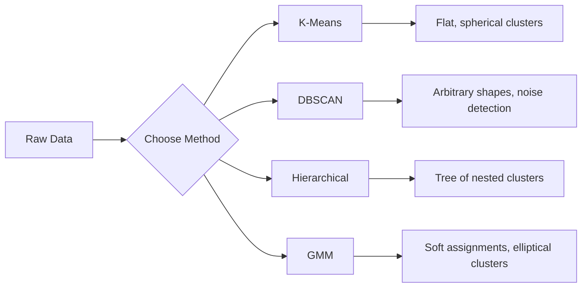

# 无监督学习

> 没有 labels，没有老师。算法自己从 data 里找结构。

**Type:** Build
**Languages:** Python
**Prerequisites:** Phase 1 (Norms & Distances, Probability & Distributions), Phase 2 Lessons 1-6
**Time:** ~90 minutes

## 学习目标

- 从零实现 K-Means、DBSCAN 和 Gaussian Mixture Models，并比较它们的 clustering behavior
- 使用 silhouette score 和 elbow method 评估 cluster quality，并选择 optimal K
- 解释 DBSCAN 何时胜过 K-Means，并识别哪种算法能处理 non-spherical clusters 和 outliers
- 使用 clustering methods 构建 anomaly detection pipeline，标记偏离 normal patterns 的 points

## 问题

到目前为止，每一节 ML 课都假设 data 带有 labels：“这是 input，这是正确 output。”但在现实世界里，labels 很贵。医院有数百万条 patient records，却没人手工给每条记录标注 disease category。电商网站有数百万条 user sessions，却没人手工标出 customer segments。安全团队有 network logs，但没人标记每一个 anomaly。

Unsupervised learning 会在没人告诉它该找什么的情况下发现 patterns。它把相似 data points 分组，发现隐藏结构，并浮现 anomalies。如果 supervised learning 像是拿着答案册读课本，unsupervised learning 就像盯着 raw data，直到 patterns 自己显现出来。

问题在于：没有 labels，你无法直接衡量“对”或“错”。你需要不同的工具来评估算法找到的结构是否有意义。

## 概念

### Clustering：把相似事物分到一起

Clustering 会把每个 data point 分配到一个 group（cluster），让同一 group 内的 points 彼此之间比与其他 groups 的 points 更相似。问题永远是：什么叫“similar”？



### K-Means：主力算法

K-Means 会把 data 分成恰好 K 个 clusters。每个 cluster 有一个 centroid（它的质心），每个 point 都属于最近的 centroid。

Lloyd's algorithm：

1. 随机选择 K 个 points 作为 initial centroids
2. 把每个 data point 分配给最近的 centroid
3. 将每个 centroid 重新计算为其 assigned points 的 mean
4. 重复步骤 2-3，直到 assignments 不再变化

Objective function（inertia）衡量每个 point 到其 assigned centroid 的 squared distance 总和。K-Means 会最小化它，但只能找到 local minimum。不同初始化可能得到不同结果。

### 选择 K

两个标准方法：

**Elbow method：** 对 K = 1, 2, 3, ..., n 运行 K-Means。绘制 inertia vs K。寻找那个“elbow”：再增加 clusters 时，inertia 的下降已经不明显。

**Silhouette score：** 对每个 point，衡量它与自己 cluster 的相似度（a），以及与最近其他 cluster 的相似度（b）。Silhouette coefficient 是 (b - a) / max(a, b)，范围从 -1（分错 cluster）到 +1（clustered well）。对所有 points 取平均得到 global score。

### DBSCAN：基于密度的 Clustering

K-Means 假设 clusters 是 spherical，并要求你提前选择 K。DBSCAN 两个假设都不需要。它会把 clusters 找成由 sparse regions 分隔开的 dense regions。

两个 parameters：
- **eps**：neighborhood 的 radius
- **min_samples**：形成 dense region 所需的 minimum number of points

三种 point types：
- **Core point**：在 eps distance 内至少有 min_samples 个 points
- **Border point**：位于某个 core point 的 eps 范围内，但自己不是 core point
- **Noise point**：既不是 core 也不是 border。这些就是 outliers。

DBSCAN 会把彼此处在 eps 范围内的 core points 连成同一个 cluster。Border points 加入附近 core point 所属的 cluster。Noise points 不属于任何 cluster。

优势：能找到任意形状的 clusters，自动确定 cluster 数量，识别 outliers。弱点：面对 densities 差异很大的 clusters 时会吃力。

### Hierarchical Clustering

构建 nested clusters 的 tree（dendrogram）。

Agglomerative（bottom-up）：
1. 从每个 point 各自作为一个 cluster 开始
2. 合并两个最近的 clusters
3. 重复，直到只剩一个 cluster
4. 在期望 level 切开 dendrogram，得到 K 个 clusters

Clusters 之间的“closeness”可以这样衡量：
- **Single linkage**：两个 clusters 中任意两点之间的 minimum distance
- **Complete linkage**：任意两点之间的 maximum distance
- **Average linkage**：所有 pairs 的 average distance
- **Ward's method**：导致 total within-cluster variance 增量最小的 merge

### Gaussian Mixture Models (GMM)

K-Means 给出 hard assignments：每个 point 恰好属于一个 cluster。GMM 给出 soft assignments：每个 point 都有属于每个 cluster 的 probability。

GMM 假设 data 是由 K 个 Gaussian distributions 的 mixture 生成的，每个 Gaussian 都有自己的 mean 和 covariance。Expectation-Maximization（EM）algorithm 在两步之间交替：

- **E-step**：计算每个 point 属于每个 Gaussian 的 probability
- **M-step**：更新每个 Gaussian 的 mean、covariance 和 mixing weight，使 data likelihood 最大化

GMM 可以建模 elliptical clusters（不只是 K-Means 那样的 spherical clusters），也能自然处理 overlapping clusters。

### 什么时候用哪种方法

| Method | Best for | Avoid when |
|--------|----------|------------|
| K-Means | Large datasets, spherical clusters, known K | Irregular shapes, outliers present |
| DBSCAN | Unknown K, arbitrary shapes, outlier detection | Varying densities, very high dimensions |
| Hierarchical | Small datasets, need dendrogram, unknown K | Large datasets (O(n^2) memory) |
| GMM | Overlapping clusters, soft assignments needed | Very large datasets, too many dimensions |

### 使用 Clustering 做 Anomaly Detection

Clustering 天然支持 anomaly detection：
- **K-Means**：离任何 centroid 都很远的 points 是 anomalies
- **DBSCAN**：noise points 按定义就是 anomalies
- **GMM**：在所有 Gaussians 下 probability 都很低的 points 是 anomalies

```figure
kmeans-step
```

## Build It

### Step 1：从零实现 K-Means

```python
import math
import random


def euclidean_distance(a, b):
    return math.sqrt(sum((ai - bi) ** 2 for ai, bi in zip(a, b)))


def kmeans(data, k, max_iterations=100, seed=42):
    random.seed(seed)
    n_features = len(data[0])

    centroids = random.sample(data, k)

    for iteration in range(max_iterations):
        clusters = [[] for _ in range(k)]
        assignments = []

        for point in data:
            distances = [euclidean_distance(point, c) for c in centroids]
            nearest = distances.index(min(distances))
            clusters[nearest].append(point)
            assignments.append(nearest)

        new_centroids = []
        for cluster in clusters:
            if len(cluster) == 0:
                new_centroids.append(random.choice(data))
                continue
            centroid = [
                sum(point[j] for point in cluster) / len(cluster)
                for j in range(n_features)
            ]
            new_centroids.append(centroid)

        if all(
            euclidean_distance(old, new) < 1e-6
            for old, new in zip(centroids, new_centroids)
        ):
            print(f"  Converged at iteration {iteration + 1}")
            break

        centroids = new_centroids

    return assignments, centroids
```

### Step 2：Elbow method 和 silhouette score

```python
def compute_inertia(data, assignments, centroids):
    total = 0.0
    for point, cluster_id in zip(data, assignments):
        total += euclidean_distance(point, centroids[cluster_id]) ** 2
    return total


def silhouette_score(data, assignments):
    n = len(data)
    if n < 2:
        return 0.0

    clusters = {}
    for i, c in enumerate(assignments):
        clusters.setdefault(c, []).append(i)

    if len(clusters) < 2:
        return 0.0

    scores = []
    for i in range(n):
        own_cluster = assignments[i]
        own_members = [j for j in clusters[own_cluster] if j != i]

        if len(own_members) == 0:
            scores.append(0.0)
            continue

        a = sum(euclidean_distance(data[i], data[j]) for j in own_members) / len(own_members)

        b = float("inf")
        for cluster_id, members in clusters.items():
            if cluster_id == own_cluster:
                continue
            avg_dist = sum(euclidean_distance(data[i], data[j]) for j in members) / len(members)
            b = min(b, avg_dist)

        if max(a, b) == 0:
            scores.append(0.0)
        else:
            scores.append((b - a) / max(a, b))

    return sum(scores) / len(scores)


def find_best_k(data, max_k=10):
    print("Elbow method:")
    inertias = []
    for k in range(1, max_k + 1):
        assignments, centroids = kmeans(data, k)
        inertia = compute_inertia(data, assignments, centroids)
        inertias.append(inertia)
        print(f"  K={k}: inertia={inertia:.2f}")

    print("\nSilhouette scores:")
    for k in range(2, max_k + 1):
        assignments, centroids = kmeans(data, k)
        score = silhouette_score(data, assignments)
        print(f"  K={k}: silhouette={score:.4f}")

    return inertias
```

### Step 3：从零实现 DBSCAN

```python
def dbscan(data, eps, min_samples):
    n = len(data)
    labels = [-1] * n
    cluster_id = 0

    def region_query(point_idx):
        neighbors = []
        for i in range(n):
            if euclidean_distance(data[point_idx], data[i]) <= eps:
                neighbors.append(i)
        return neighbors

    visited = [False] * n

    for i in range(n):
        if visited[i]:
            continue
        visited[i] = True

        neighbors = region_query(i)

        if len(neighbors) < min_samples:
            labels[i] = -1
            continue

        labels[i] = cluster_id
        seed_set = list(neighbors)
        seed_set.remove(i)

        j = 0
        while j < len(seed_set):
            q = seed_set[j]

            if not visited[q]:
                visited[q] = True
                q_neighbors = region_query(q)
                if len(q_neighbors) >= min_samples:
                    for nb in q_neighbors:
                        if nb not in seed_set:
                            seed_set.append(nb)

            if labels[q] == -1:
                labels[q] = cluster_id

            j += 1

        cluster_id += 1

    return labels
```

### Step 4：Gaussian Mixture Model（EM algorithm）

```python
def gmm(data, k, max_iterations=100, seed=42):
    random.seed(seed)
    n = len(data)
    d = len(data[0])

    indices = random.sample(range(n), k)
    means = [list(data[i]) for i in indices]
    variances = [1.0] * k
    weights = [1.0 / k] * k

    def gaussian_pdf(x, mean, variance):
        d = len(x)
        coeff = 1.0 / ((2 * math.pi * variance) ** (d / 2))
        exponent = -sum((xi - mi) ** 2 for xi, mi in zip(x, mean)) / (2 * variance)
        return coeff * math.exp(max(exponent, -500))

    for iteration in range(max_iterations):
        responsibilities = []
        for i in range(n):
            probs = []
            for j in range(k):
                probs.append(weights[j] * gaussian_pdf(data[i], means[j], variances[j]))
            total = sum(probs)
            if total == 0:
                total = 1e-300
            responsibilities.append([p / total for p in probs])

        old_means = [list(m) for m in means]

        for j in range(k):
            r_sum = sum(responsibilities[i][j] for i in range(n))
            if r_sum < 1e-10:
                continue

            weights[j] = r_sum / n

            for dim in range(d):
                means[j][dim] = sum(
                    responsibilities[i][j] * data[i][dim] for i in range(n)
                ) / r_sum

            variances[j] = sum(
                responsibilities[i][j]
                * sum((data[i][dim] - means[j][dim]) ** 2 for dim in range(d))
                for i in range(n)
            ) / (r_sum * d)
            variances[j] = max(variances[j], 1e-6)

        shift = sum(
            euclidean_distance(old_means[j], means[j]) for j in range(k)
        )
        if shift < 1e-6:
            print(f"  GMM converged at iteration {iteration + 1}")
            break

    assignments = []
    for i in range(n):
        assignments.append(responsibilities[i].index(max(responsibilities[i])))

    return assignments, means, weights, responsibilities
```

### Step 5：生成 test data 并运行全部流程

```python
def make_blobs(centers, n_per_cluster=50, spread=0.5, seed=42):
    random.seed(seed)
    data = []
    true_labels = []
    for label, (cx, cy) in enumerate(centers):
        for _ in range(n_per_cluster):
            x = cx + random.gauss(0, spread)
            y = cy + random.gauss(0, spread)
            data.append([x, y])
            true_labels.append(label)
    return data, true_labels


def make_moons(n_samples=200, noise=0.1, seed=42):
    random.seed(seed)
    data = []
    labels = []
    n_half = n_samples // 2
    for i in range(n_half):
        angle = math.pi * i / n_half
        x = math.cos(angle) + random.gauss(0, noise)
        y = math.sin(angle) + random.gauss(0, noise)
        data.append([x, y])
        labels.append(0)
    for i in range(n_half):
        angle = math.pi * i / n_half
        x = 1 - math.cos(angle) + random.gauss(0, noise)
        y = 1 - math.sin(angle) - 0.5 + random.gauss(0, noise)
        data.append([x, y])
        labels.append(1)
    return data, labels


if __name__ == "__main__":
    centers = [[2, 2], [8, 3], [5, 8]]
    data, true_labels = make_blobs(centers, n_per_cluster=50, spread=0.8)

    print("=== K-Means on 3 blobs ===")
    assignments, centroids = kmeans(data, k=3)
    print(f"  Centroids: {[[round(c, 2) for c in cent] for cent in centroids]}")
    sil = silhouette_score(data, assignments)
    print(f"  Silhouette score: {sil:.4f}")

    print("\n=== Elbow Method ===")
    find_best_k(data, max_k=6)

    print("\n=== DBSCAN on 3 blobs ===")
    db_labels = dbscan(data, eps=1.5, min_samples=5)
    n_clusters = len(set(db_labels) - {-1})
    n_noise = db_labels.count(-1)
    print(f"  Found {n_clusters} clusters, {n_noise} noise points")

    print("\n=== GMM on 3 blobs ===")
    gmm_assignments, gmm_means, gmm_weights, _ = gmm(data, k=3)
    print(f"  Means: {[[round(m, 2) for m in mean] for mean in gmm_means]}")
    print(f"  Weights: {[round(w, 3) for w in gmm_weights]}")
    gmm_sil = silhouette_score(data, gmm_assignments)
    print(f"  Silhouette score: {gmm_sil:.4f}")

    print("\n=== DBSCAN on moons (non-spherical clusters) ===")
    moon_data, moon_labels = make_moons(n_samples=200, noise=0.1)
    moon_db = dbscan(moon_data, eps=0.3, min_samples=5)
    n_moon_clusters = len(set(moon_db) - {-1})
    n_moon_noise = moon_db.count(-1)
    print(f"  Found {n_moon_clusters} clusters, {n_moon_noise} noise points")

    print("\n=== K-Means on moons (will fail to separate) ===")
    moon_km, moon_centroids = kmeans(moon_data, k=2)
    moon_sil = silhouette_score(moon_data, moon_km)
    print(f"  Silhouette score: {moon_sil:.4f}")
    print("  K-Means splits moons poorly because they are not spherical")

    print("\n=== Anomaly detection with DBSCAN ===")
    anomaly_data = list(data)
    anomaly_data.append([20.0, 20.0])
    anomaly_data.append([-5.0, -5.0])
    anomaly_data.append([15.0, 0.0])
    anomaly_labels = dbscan(anomaly_data, eps=1.5, min_samples=5)
    anomalies = [
        anomaly_data[i]
        for i in range(len(anomaly_labels))
        if anomaly_labels[i] == -1
    ]
    print(f"  Detected {len(anomalies)} anomalies")
    for a in anomalies[-3:]:
        print(f"    Point {[round(v, 2) for v in a]}")
```

## Use It

使用 scikit-learn，同样的 algorithms 都是一行：

```python
from sklearn.cluster import KMeans, DBSCAN, AgglomerativeClustering
from sklearn.mixture import GaussianMixture
from sklearn.metrics import silhouette_score as sklearn_silhouette

km = KMeans(n_clusters=3, random_state=42).fit(data)
db = DBSCAN(eps=1.5, min_samples=5).fit(data)
agg = AgglomerativeClustering(n_clusters=3).fit(data)
gmm_model = GaussianMixture(n_components=3, random_state=42).fit(data)
```

从零实现的版本会让你看清这些 libraries 到底在计算什么。K-Means 在 assignment 和 recomputing 之间迭代。DBSCAN 从 dense seeds 开始扩展 clusters。GMM 在 expectation 和 maximization 之间交替。Library versions 会加入 numerical stability、更聪明的 initialization（K-Means++）和 GPU acceleration，但 core logic 是一样的。

## Ship It

本课产出 K-Means、DBSCAN 和 GMM 的可运行从零实现。这份 clustering code 可以作为更 advanced unsupervised methods 的基础复用。

## 练习

1. 实现 K-Means++ initialization：不要随机选择 centroids，而是先随机选择第一个 centroid，之后每个 centroid 按它到最近 existing centroid 的 squared distance 成比例的 probability 来选择。比较它与 random initialization 的 convergence speed。
2. 给代码添加 hierarchical agglomerative clustering。实现 Ward's linkage，并生成 dendrogram（用 nested list of merges 表示）。在不同 levels 切开它，并与 K-Means results 比较。
3. 构建一个简单 anomaly detection pipeline：在同一份 data 上运行 DBSCAN 和 GMM，标记两种方法都认为是 outliers 的 points（DBSCAN 中的 noise，GMM 中的 low probability）。衡量 overlap，并讨论两种方法何时会不同意。

## 关键术语

| Term | What people say | What it actually means |
|------|----------------|----------------------|
| Clustering | “把相似的东西分组” | 将 data 划分为 subsets，其中 within-group similarity 高于 between-group similarity，并由特定 distance metric 衡量 |
| Centroid | “Cluster 的中心” | 分配给某个 cluster 的所有 points 的 mean；K-Means 用它作为 cluster representative |
| Inertia | “Clusters 有多紧” | 每个 point 到其 assigned centroid 的 squared distance 总和；越低表示越紧 |
| Silhouette score | “Clusters 分得有多开” | 对每个 point，(b - a) / max(a, b)，其中 a 是 mean intra-cluster distance，b 是 mean nearest-cluster distance |
| Core point | “Dense region 里的点” | DBSCAN 中，在 eps distance 内至少有 min_samples 个 neighbors 的 point |
| EM algorithm | “Soft K-Means” | Expectation-Maximization：迭代计算 membership probabilities（E-step）并更新 distribution parameters（M-step） |
| Dendrogram | “Cluster tree” | 展示 hierarchical clustering 中 clusters 被 merge 的顺序和 distance 的 tree diagram |
| Anomaly | “Outlier” | 不符合 expected pattern 的 data point，可被 DBSCAN 识别为 noise，或被 GMM 识别为 low-probability point |

## 延伸阅读

- [Stanford CS229 - Unsupervised Learning](https://cs229.stanford.edu/notes2022fall/main_notes.pdf) - Andrew Ng 关于 clustering 和 EM 的 lecture notes
- [scikit-learn Clustering Guide](https://scikit-learn.org/stable/modules/clustering.html) - 所有 clustering algorithms 的 practical comparison 和 visual examples
- [DBSCAN original paper (Ester et al., 1996)](https://www.aaai.org/Papers/KDD/1996/KDD96-037.pdf) - 提出 density-based clustering 的原始论文
