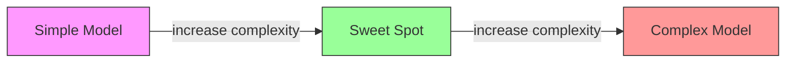
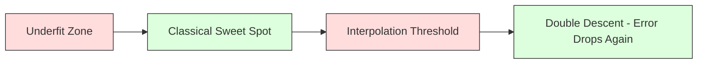
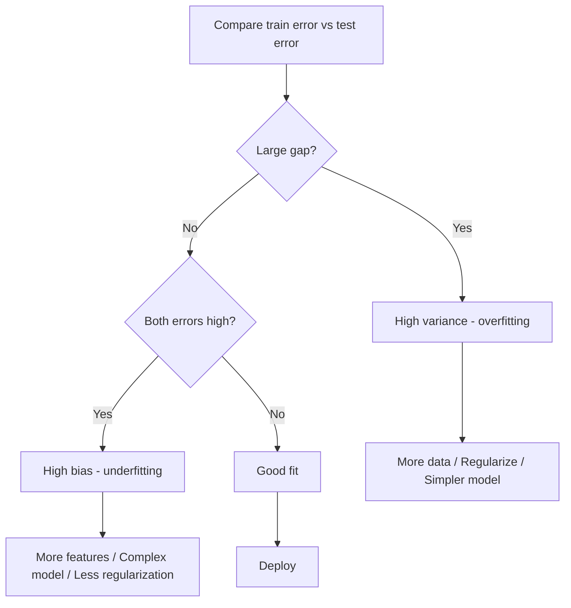
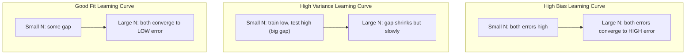
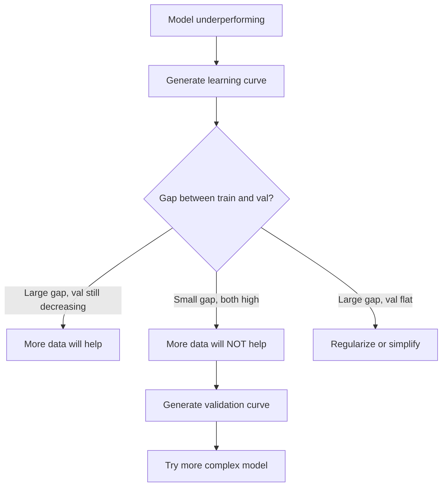

# 偏差-方差权衡

> 每一种 model error 都来自三个来源之一：bias、variance 或 noise。你只能控制前两个。

**Type:** Learn
**Language:** Python
**Prerequisites:** Phase 2, Lessons 01-09 (ML basics, regression, classification, evaluation)
**Time:** ~75 minutes

## 学习目标

- 推导 expected prediction error 的 bias-variance decomposition，并解释 irreducible noise 的角色
- 使用 training 和 test error patterns 诊断 model 是否存在 high bias 或 high variance
- 解释 regularization techniques（L1、L2、dropout、early stopping）如何用 bias 换取更低 variance
- 实现实验，可视化 model complexity 增加时的 bias-variance tradeoff

## 问题

你训练了一个 model。它在 test data 上有一些 error。这些 error 从哪里来？

如果 model 太简单（在 curved dataset 上用 linear regression），它会持续错过真实 pattern。这就是 bias。如果 model 太复杂（在 15 个 data points 上拟合 degree-20 polynomial），它会完美拟合 training data，却在 new data 上给出剧烈变化的 predictions。这就是 variance。

在固定 model capacity 下，你无法同时最小化两者。把 bias 压低，variance 就会上升。把 variance 压低，bias 就会上升。理解这个 tradeoff 是 machine learning 中最有用的诊断能力之一。它告诉你应该让 model 更复杂还是更简单，应该获取更多 data 还是工程化更好的 features，应该加强还是减弱 regularization。

## 概念

### Bias：系统性错误

Bias 衡量 model 的 average prediction 距离 true value 有多远。如果你在来自同一 distribution 的许多不同 training sets 上训练同一个 model，并对 predictions 取平均，bias 就是这个 average 与 truth 之间的 gap。

High bias 表示 model 太僵硬，无法捕捉真实 pattern。用一条 straight line 拟合 parabola，无论给多少 data，它都会错过 curve。这就是 underfitting。

```text
High bias (underfitting):
  Model always predicts roughly the same wrong thing.
  Training error: HIGH
  Test error: HIGH
  Gap between them: SMALL
```

### Variance：对 Training Data 的敏感性

Variance 衡量当你在不同 data subsets 上训练时，predictions 会变化多少。如果 training set 的小变化会导致 model 大幅变化，variance 就很高。

High variance 表示 model 拟合的是 training data 中的 noise，而不是 underlying signal。Degree-20 polynomial 会穿过每个 training point，但在 points 之间剧烈振荡。这就是 overfitting。

```text
High variance (overfitting):
  Model fits training data perfectly but fails on new data.
  Training error: LOW
  Test error: HIGH
  Gap between them: LARGE
```

### Decomposition

对于任意 point x，squared loss 下的 expected prediction error 可以精确分解：

```text
Expected Error = Bias^2 + Variance + Irreducible Noise

where:
  Bias^2   = (E[f_hat(x)] - f(x))^2
  Variance = E[(f_hat(x) - E[f_hat(x)])^2]
  Noise    = E[(y - f(x))^2]             (sigma^2)
```

- `f(x)` 是 true function
- `f_hat(x)` 是 model 的 prediction
- `E[...]` 是对不同 training sets 的 expectation
- `y` 是 observed label（true function 加 noise）

Noise term 是 irreducible。Noisy data 上没有任何 model 能做得比 sigma^2 更好。你的工作是在 bias^2 和 variance 之间找到正确平衡。

### Model Complexity vs Error



经典 U-shaped curve：

| Complexity | Bias | Variance | Total Error |
|-----------|------|----------|-------------|
| Too low | HIGH | LOW | HIGH (underfitting) |
| Just right | MODERATE | MODERATE | LOWEST |
| Too high | LOW | HIGH | HIGH (overfitting) |

### Regularization 作为 Bias-Variance Control

Regularization 会故意增加 bias，以降低 variance。它约束 model，让它不能追逐 noise。

- **L2 (Ridge)：** 将所有 weights 向 zero 收缩。保留所有 features，但降低它们的影响。
- **L1 (Lasso)：** 把某些 weights 推到恰好 zero。执行 feature selection。
- **Dropout：** 训练时随机禁用 neurons。迫使 model 学到 redundant representations。
- **Early stopping：** 在 model 完全拟合 training data 之前停止训练。

Regularization strength（lambda、dropout rate、number of epochs）直接控制你位于 bias-variance curve 的哪个位置。更多 regularization 意味着更高 bias、更低 variance。

### Double Descent：现代视角

Classical theory 说：过了 sweet spot 之后，更多 complexity 总是有害。但 2019 年以来的研究发现了出乎意料的现象。如果继续把 model capacity 增加到远超 interpolation threshold（model 有足够 parameters 完美拟合 training data 的位置），test error 可能会再次下降。



这种 “double descent” 现象解释了为什么 massively overparameterized neural networks（parameters 远多于 training examples）仍然可以 generalize well。Classical bias-variance tradeoff 没有错，但对 modern regime 来说并不完整。

关于 double descent 的关键观察：
- 它会出现在 linear models、decision trees 和 neural networks 中
- 在 interpolation region 中，更多 data 反而可能有害（sample-wise double descent）
- 更多 training epochs 也可能触发它（epoch-wise double descent）
- Regularization 会抹平 peak，但不会完全消除它

为什么会这样？在 interpolation threshold，model 刚好有足够 capacity 拟合所有 training points。它被迫进入一个非常具体的 solution，穿过每个 point，而 data 中的小扰动会导致 fit 大幅变化。这就是 variance 达到峰值的位置。超过 threshold 后，model 有许多可以完美拟合 data 的 possible solutions。Learning algorithm（例如带 implicit regularization 的 gradient descent）倾向于在其中选择最简单的一个。这种偏向 simple solutions 的 implicit bias，就是 overparameterized models 能 generalize 的原因。

| Regime | Parameters vs Samples | Behavior |
|--------|----------------------|----------|
| Underparameterized | p << n | Classical tradeoff applies |
| Interpolation threshold | p ~ n | Variance peaks, test error spikes |
| Overparameterized | p >> n | Implicit regularization kicks in, test error drops |

实践中：如果你在使用 neural networks 或 large tree ensembles，不要停在 interpolation threshold。要么带着 explicit regularization 保持在它下方，要么走到远超它的位置。最差的位置就是正好卡在 threshold。

### 诊断你的 Model



| Symptom | Diagnosis | Fix |
|---------|-----------|-----|
| High train error, high test error | Bias | More features, complex model, less regularization |
| Low train error, high test error | Variance | More data, regularization, simpler model, dropout |
| Low train error, low test error | Good fit | Ship it |
| Train error decreasing, test error increasing | Overfitting in progress | Early stopping |

### Practical Strategies

**当 bias 是问题时：**
- 添加 polynomial 或 interaction features
- 使用更 flexible model（例如 tree ensemble，而不是 linear）
- 降低 regularization strength
- 训练更久（如果尚未 converged）

**当 variance 是问题时：**
- 获取更多 training data
- 使用 bagging（random forests）
- 增加 regularization（更高 lambda、更多 dropout）
- Feature selection（移除 noisy features）
- 使用 cross-validation 及早发现它

### Ensemble Methods and Variance Reduction

Ensemble methods 是对抗 variance 最实用的工具。

**Bagging（Bootstrap Aggregating）** 会在 training data 的不同 bootstrap samples 上训练多个 models，然后平均它们的 predictions。每个 individual model 都有 high variance，但 average 的 variance 低得多。Random forests 就是把 bagging 应用到 decision trees。

它为什么在数学上有效：如果你平均 N 个 independent predictions，每个 prediction 的 variance 都是 sigma^2，那么 average 的 variance 是 sigma^2 / N。Models 并不真正 independent（它们都看到相似 data），所以 reduction 小于 1/N，但仍然很可观。

**Boosting** 通过 sequentially 构建 models 来降低 bias，每个新 model 都关注当前 ensemble 的 errors。Gradient boosting 和 AdaBoost 是主要例子。如果加入太多 models，boosting 也会 overfit，所以需要 early stopping 或 regularization。

| Method | Primary Effect | Bias Change | Variance Change |
|--------|---------------|-------------|-----------------|
| Bagging | Reduces variance | No change | Decreases |
| Boosting | Reduces bias | Decreases | Can increase |
| Stacking | Reduces both | Depends on meta-learner | Depends on base models |
| Dropout | Implicit bagging | Slight increase | Decreases |

**实践规则：** 如果 base model 有 high variance（deep trees、high-degree polynomials），用 bagging。如果 base model 有 high bias（shallow stumps、simple linear models），用 boosting。

### Learning Curves

Learning curves 会把 training 和 validation error 画成 training set size 的函数。它们是你手上最实用的诊断工具。不同于单次 train/test comparison，learning curves 会展示 model 的 trajectory，并告诉你更多 data 是否有帮助。



如何阅读它们：

| Scenario | Training Error | Validation Error | Gap | What It Means | What to Do |
|----------|---------------|-----------------|-----|---------------|------------|
| High bias | High | High | Small | Model cannot capture the pattern | More features, complex model, less regularization |
| High variance | Low | High | Large | Model memorizes training data | More data, regularization, simpler model |
| Good fit | Moderate | Moderate | Small | Model generalizes well | Ship it |
| High variance, improving | Low | Decreasing with more data | Shrinking | Variance problem that data can fix | Collect more data |
| High bias, flat | High | High and flat | Small and flat | More data will NOT help | Change model architecture |

关键洞察：如果两条 curves 都已经 plateau，gap 很小但两个 errors 都高，更多 data 没用。你需要更好的 model。如果 gap 很大且仍在缩小，更多 data 会有帮助。

### 如何生成 Learning Curves

有两种 approach：

**Approach 1：改变 training set size，固定 model。** 保持 model 和 hyperparameters 不变。用越来越大的 training data subsets 训练。在每个 size 上测量 training error 和 validation error。这是标准 learning curve。

**Approach 2：改变 model complexity，固定 data。** 保持 data 不变。扫描一个 complexity parameter（polynomial degree、tree depth、number of layers）。在每个 complexity 上测量 training error 和 validation error。这是 validation curve，它会直接展示 bias-variance tradeoff。

两种 approach 互相补充。第一种告诉你更多 data 是否有帮助。第二种告诉你换一个 model 是否有帮助。在决定下一步之前，两者都应该跑。



```figure
bias-variance
```

## Build It

`code/bias_variance.py` 中的代码会运行完整的 bias-variance decomposition experiment。下面是 step by step 的 approach。

### Step 1：从已知函数生成 Synthetic Data

我们使用带 Gaussian noise 的 `f(x) = sin(1.5x) + 0.5x`。知道 true function 让我们可以计算 exact bias 和 variance。

```python
def true_function(x):
    return np.sin(1.5 * x) + 0.5 * x

def generate_data(n_samples=30, noise_std=0.5, x_range=(-3, 3), seed=None):
    rng = np.random.RandomState(seed)
    x = rng.uniform(x_range[0], x_range[1], n_samples)
    y = true_function(x) + rng.normal(0, noise_std, n_samples)
    return x, y
```

### Step 2：Bootstrap Sampling 和 Polynomial Fitting

对每个 polynomial degree，我们抽取许多 bootstrap training sets，fit polynomial，并在固定 test grid 上记录 predictions。这会给出每个 test point 上的 prediction distribution。

```python
def fit_polynomial(x_train, y_train, degree, lam=0.0):
    X = np.column_stack([x_train ** d for d in range(degree + 1)])
    if lam > 0:
        penalty = lam * np.eye(X.shape[1])
        penalty[0, 0] = 0
        w = np.linalg.solve(X.T @ X + penalty, X.T @ y_train)
    else:
        w = np.linalg.lstsq(X, y_train, rcond=None)[0]
    return w
```

我们在 200 个不同 bootstrap samples 上 fit。每个 bootstrap sample 都来自同一个 underlying distribution，但包含不同 points。

### Step 3：计算 Bias^2、Variance Decomposition

有了每个 test point 上 200 组 predictions 后，我们可以直接按定义计算 decomposition：

```python
mean_pred = predictions.mean(axis=0)
bias_sq = np.mean((mean_pred - y_true) ** 2)
variance = np.mean(predictions.var(axis=0))
total_error = np.mean(np.mean((predictions - y_true) ** 2, axis=1))
```

- `mean_pred` 是用 bootstrap samples 估计的 E[f_hat(x)]
- `bias_sq` 是 average prediction 和 truth 之间的 squared gap
- `variance` 是 predictions 在 bootstrap samples 之间的 average spread
- `total_error` 应该约等于 bias^2 + variance + noise

### Step 4：Learning Curves

Learning curves 会在固定 model complexity 的同时扫描 training set size。它们展示 model 是 data-limited 还是 capacity-limited。

```python
def demo_learning_curves():
    sizes = [10, 15, 20, 30, 50, 75, 100, 150, 200, 300]
    degree = 5

    for n in sizes:
        train_errors = []
        test_errors = []
        for seed in range(50):
            x_train, y_train = generate_data(n_samples=n, seed=seed * 100)
            w = fit_polynomial(x_train, y_train, degree)
            train_pred = predict_polynomial(x_train, w)
            train_mse = np.mean((train_pred - y_train) ** 2)
            test_pred = predict_polynomial(x_test, w)
            test_mse = np.mean((test_pred - y_test) ** 2)
            train_errors.append(train_mse)
            test_errors.append(test_mse)
        # Average over runs gives the learning curve point
```

对于 high-variance model（degree 5 且 data 很少），你会看到：
- Training error 开始很低，并随着更多 data 让 memorization 更难而上升
- Test error 开始很高，并随着 model 获得更多 signal 而下降
- Gap 会随着更多 data 缩小

对于 high-bias model（degree 1），两个 errors 会迅速收敛到同一个高值，更多 data 没有帮助。

### Step 5：Regularization Sweep

代码还包含 `demo_regularization_sweep()`，它固定一个 high-degree polynomial（degree 15），并将 Ridge regularization strength 从 0.001 扫到 100。这会从另一个角度展示 bias-variance tradeoff：我们不改变 model complexity，而是改变 constraint strength。

```python
def demo_regularization_sweep():
    alphas = [0.001, 0.005, 0.01, 0.05, 0.1, 0.5, 1.0, 5.0, 10.0, 50.0, 100.0]
    for alpha in alphas:
        results = bias_variance_decomposition([15], lam=alpha)
        r = results[15]
        print(f"alpha={alpha:.3f}  bias={r['bias_sq']:.4f}  var={r['variance']:.4f}")
```

在 low alpha 下，degree-15 polynomial 几乎不受约束。Variance dominates，因为 model 会追逐每个 bootstrap sample 中的 noise。在 high alpha 下，penalty 强到 model 实际上变成了 near-constant function。Bias dominates。Optimal alpha 位于两个极端之间。

这和改变 polynomial degree 时看到的是同一条 U-curve，只是这次由 continuous knob 控制，而不是由 discrete knob 控制。实践中，regularization 是控制 tradeoff 的首选方式，因为它可以在不改变 feature set 的情况下提供细粒度控制。

## Use It

sklearn 提供 `learning_curve` 和 `validation_curve`，可以自动化这些 diagnostics，而不需要手写 bootstrap loops。

### Validation Curve：扫描 Model Complexity

```python
from sklearn.model_selection import validation_curve
from sklearn.pipeline import make_pipeline
from sklearn.preprocessing import PolynomialFeatures
from sklearn.linear_model import Ridge

degrees = list(range(1, 16))
train_scores_all = []
val_scores_all = []

for d in degrees:
    pipe = make_pipeline(PolynomialFeatures(d), Ridge(alpha=0.01))
    train_scores, val_scores = validation_curve(
        pipe, X, y, param_name="polynomialfeatures__degree",
        param_range=[d], cv=5, scoring="neg_mean_squared_error"
    )
    train_scores_all.append(-train_scores.mean())
    val_scores_all.append(-val_scores.mean())
```

这会直接给出 bias-variance tradeoff curve。Validation score 相对 train score 最差的地方，variance dominates。两者都差的地方，bias dominates。

### Learning Curve：扫描 Training Set Size

```python
from sklearn.model_selection import learning_curve

pipe = make_pipeline(PolynomialFeatures(5), Ridge(alpha=0.01))
train_sizes, train_scores, val_scores = learning_curve(
    pipe, X, y, train_sizes=np.linspace(0.1, 1.0, 10),
    cv=5, scoring="neg_mean_squared_error"
)
train_mse = -train_scores.mean(axis=1)
val_mse = -val_scores.mean(axis=1)
```

把 `train_mse` 和 `val_mse` 对 `train_sizes` 作图。曲线形状会告诉你关于 model 的一切。

### Cross-Validation with Regularization Sweep

```python
from sklearn.model_selection import cross_val_score

alphas = [0.001, 0.01, 0.1, 1.0, 10.0, 100.0]
for alpha in alphas:
    pipe = make_pipeline(PolynomialFeatures(10), Ridge(alpha=alpha))
    scores = cross_val_score(pipe, X, y, cv=5, scoring="neg_mean_squared_error")
    print(f"alpha={alpha:>7.3f}  MSE={-scores.mean():.4f} +/- {scores.std():.4f}")
```

这会在固定 model complexity 下扫描 regularization strength。你会看到同样的 bias-variance tradeoff：low alpha 表示 high variance，high alpha 表示 high bias。

### 合在一起：完整 Diagnostic Workflow

实践中，你会按顺序运行这些 diagnostics：

1. 训练 model。计算 train 和 test error。
2. 如果两者都高：你有 bias problem。跳到 step 4。
3. 如果 train 低但 test 高：你有 variance problem。生成 learning curve，看看更多 data 是否有帮助。如果没有，就 regularize。
4. 生成 validation curve，扫描主要 complexity parameter。找到 sweet spot。
5. 在 sweet spot 上生成 learning curve。如果 gap 仍然很大，你需要更多 data 或 regularization。
6. 用 `cross_val_score` 尝试不同 alpha values 的 Ridge/Lasso。选择 cross-validated error 最低的 alpha。

对大多数 tabular datasets 来说，这会花 10-15 分钟 compute，但能省掉数小时猜测。

## Ship It

本课产出：`outputs/prompt-model-diagnostics.md`

## 练习

1. 用 `noise_std=0`（无 noise）运行 decomposition。Irreducible error term 会发生什么？Optimal complexity 是否改变？

2. 将 training set size 从 30 增加到 300。这会如何影响 variance component？Optimal polynomial degree 是否移动？

3. 给实验添加 L2 regularization（Ridge regression）。对固定 high-degree polynomial（degree 15），将 lambda 从 0 扫到 100。绘制 bias^2 和 variance 随 lambda 变化的函数。

4. 把 true function 从 polynomial 改成 `sin(x)`。Bias-variance decomposition 会如何变化？是否仍然有清晰的 optimal degree？

5. 实现一个简单的 bootstrap aggregating（bagging）wrapper：在 bootstrap samples 上训练 10 个 models 并平均 predictions。展示它会降低 variance，而几乎不增加 bias。

## 关键术语

| Term | What people say | What it actually means |
|------|----------------|----------------------|
| Bias | “Model 太简单” | 来自错误 assumptions 的 systematic error。Average model prediction 与 truth 之间的 gap。 |
| Variance | “Model 在 overfitting” | 来自对 training data 敏感性的 error。Predictions 在不同 training sets 间变化的程度。 |
| Irreducible error | “Data 里的 noise” | 来自真实 data-generating process 随机性的 error。没有任何 model 能消除它。 |
| Underfitting | “学得不够” | Model 有 high bias。即使在 training data 上也错过真实 pattern。 |
| Overfitting | “记住 data” | Model 有 high variance。它拟合了 training data 中不能 generalize 的 noise。 |
| Regularization | “约束 model” | 添加 penalty 以降低 model complexity，用更高 bias 换取更低 variance。 |
| Double descent | “更多 parameters 可能有帮助” | 当 model capacity 远超 interpolation threshold 后，test error 会再次下降。 |
| Model complexity | “Model 有多 flexible” | Model 拟合 arbitrary patterns 的 capacity，由 architecture、features 或 regularization 控制。 |

## 延伸阅读

- [Hastie, Tibshirani, Friedman: Elements of Statistical Learning, Ch. 7](https://hastie.su.domains/ElemStatLearn/) - 关于 bias-variance decomposition 的权威论述
- [Belkin et al., Reconciling modern machine learning practice and the bias-variance trade-off (2019)](https://arxiv.org/abs/1812.11118) - double descent 论文
- [Nakkiran et al., Deep Double Descent (2019)](https://arxiv.org/abs/1912.02292) - epoch-wise 和 sample-wise double descent
- [Scott Fortmann-Roe: Understanding the Bias-Variance Tradeoff](http://scott.fortmann-roe.com/docs/BiasVariance.html) - 清晰的 visual explanation
