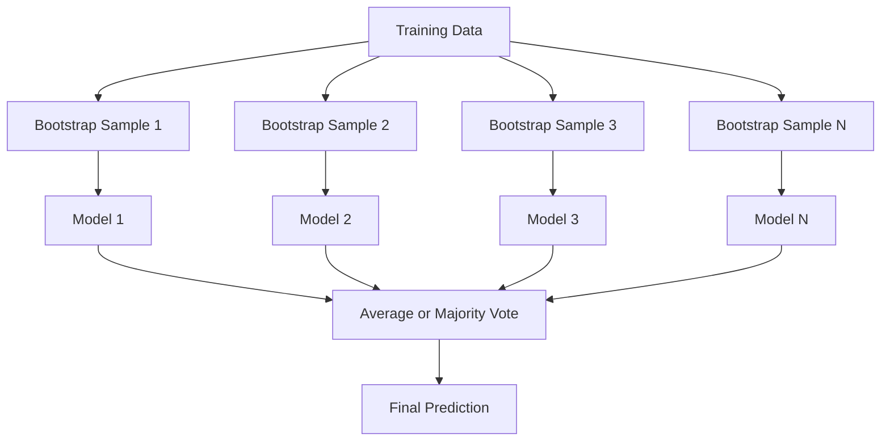
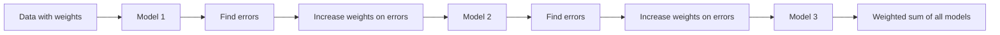
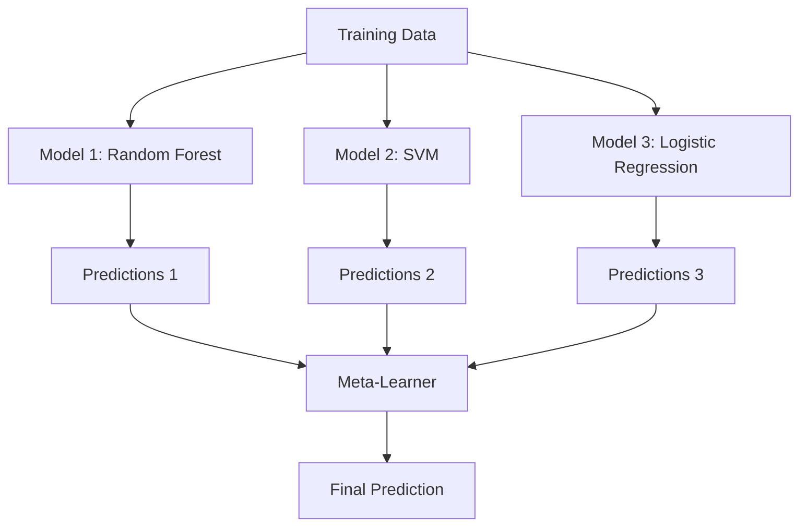

# 集成方法

> 一组 weak learners，如果组合正确，就会变成 strong learner。这不是比喻。这是 theorem。

**Type:** Build
**Language:** Python
**Prerequisites:** Phase 2, Lesson 10 (Bias-Variance Tradeoff)
**Time:** ~120 minutes

## 学习目标

- 从零实现 AdaBoost 和 gradient boosting，并解释 boosting 如何 sequentially 降低 bias
- 构建 bagging ensemble，并演示 averaging decorrelated models 如何在不增加 bias 的情况下降低 variance
- 从每种方法针对的 error component 角度，比较 bagging、boosting 和 stacking
- 评估 ensemble diversity，并解释为什么更多 independent weak learners 会提升 majority voting accuracy

## 问题

单棵 decision tree 训练快、容易解释，但会 overfit。单个 linear model 在 complex boundaries 上会 underfit。你可以花几天设计完美的 model architecture。或者，你可以组合一堆不完美的 models，得到一个比它们各自都更好的东西。

Ensemble methods 做的正是这件事。它们是 tabular data 上赢 Kaggle competitions 最可靠的技术，驱动了大多数 production ML systems，也把 bias-variance tradeoff 变成了可以亲眼看到的东西。Bagging 降低 variance。Boosting 降低 bias。Stacking 学会在不同 inputs 上该信任哪些 models。

## 概念

### 为什么 Ensembles 有效

假设你有 N 个 independent classifiers，每个 classifier 的 accuracy 都是 p > 0.5。Majority vote 的 accuracy 是：

```text
P(majority correct) = sum over k > N/2 of C(N,k) * p^k * (1-p)^(N-k)
```

对于 21 个 accuracy 为 60% 的 classifiers，majority vote accuracy 大约是 74%。如果有 101 个 classifiers，会升到 84%。当 models 犯不同错误时，errors 会彼此抵消。

关键要求是 **diversity**。如果所有 models 都犯同样的错误，组合它们没有任何帮助。Ensembles 通过以下方式产生 diverse models：

- 不同 training subsets（bagging）
- 不同 feature subsets（random forests）
- Sequential error correction（boosting）
- 不同 model families（stacking）

### Bagging（Bootstrap Aggregating）

Bagging 通过让每个 model 在不同 bootstrap sample 上训练来创造 diversity。



Bootstrap sample 是从原始 data 中有放回抽样得到的，大小与原始 data 相同。每个 bootstrap 中大约会出现 63.2% 的 unique samples。剩下的 36.8%（out-of-bag samples）提供了一个免费的 validation set。

Bagging 会降低 variance，而几乎不增加 bias。每棵 individual tree 都会 overfit 自己的 bootstrap sample，但每棵 tree 的 overfitting 不同，因此 averaging 会抵消 noise。

**Random Forests** 是带额外技巧的 bagging：每次 split 时，只考虑随机 feature subset。这会强迫 trees 之间产生更多 diversity。Candidate features 的典型数量是 classification 中的 `sqrt(n_features)`，以及 regression 中的 `n_features / 3`。

### Boosting（Sequential Error Correction）

Boosting 会 sequentially 训练 models。每个新 model 都关注前面 models 做错的 examples。



Boosting 会降低 bias。每个新 model 都修正当前 ensemble 的 systematic errors。Final prediction 是所有 models 的 weighted sum，其中更好的 models 得到更高 weights。

取舍在于：如果 boosting 运行太多 rounds，它可能 overfit，因为它会持续拟合更难的 examples，而其中一部分可能只是 noise。

### AdaBoost

AdaBoost（Adaptive Boosting）是第一个实用的 boosting algorithm。它可以配合任何 base learner，通常使用 decision stumps（depth-1 trees）。

Algorithm：

```text
1. Initialize sample weights: w_i = 1/N for all i

2. For t = 1 to T:
   a. Train weak learner h_t on weighted data
   b. Compute weighted error:
      err_t = sum(w_i * I(h_t(x_i) != y_i)) / sum(w_i)
   c. Compute model weight:
      alpha_t = 0.5 * ln((1 - err_t) / err_t)
   d. Update sample weights:
      w_i = w_i * exp(-alpha_t * y_i * h_t(x_i))
   e. Normalize weights to sum to 1

3. Final prediction: H(x) = sign(sum(alpha_t * h_t(x)))
```

Error 更低的 models 会得到更高 alpha。Misclassified samples 会得到更高 weights，让下一个 model 聚焦它们。

### Gradient Boosting

Gradient boosting 将 boosting 泛化到任意 loss functions。它不重新加权 samples，而是让每个新 model 去拟合当前 ensemble 的 residuals（loss 的 negative gradient）。

```text
1. Initialize: F_0(x) = argmin_c sum(L(y_i, c))

2. For t = 1 to T:
   a. Compute pseudo-residuals:
      r_i = -dL(y_i, F_{t-1}(x_i)) / dF_{t-1}(x_i)
   b. Fit a tree h_t to the residuals r_i
   c. Find optimal step size:
      gamma_t = argmin_gamma sum(L(y_i, F_{t-1}(x_i) + gamma * h_t(x_i)))
   d. Update:
      F_t(x) = F_{t-1}(x) + learning_rate * gamma_t * h_t(x)

3. Final prediction: F_T(x)
```

对于 squared error loss，pseudo-residuals 就是实际 residuals：`r_i = y_i - F_{t-1}(x_i)`。每棵 tree 都是在字面意义上拟合前一个 ensemble 的 errors。

Learning rate（shrinkage）控制每棵 tree 贡献多少。更小的 learning rates 需要更多 trees，但 generalize 更好。典型值：0.01 到 0.3。

### XGBoost：为什么它统治 Tabular Data

XGBoost（eXtreme Gradient Boosting）是在 gradient boosting 上加入 engineering optimizations，使其快速、准确且不容易 overfit：

- **Regularized objective：** 对 leaf weights 加 L1 和 L2 penalties，避免 individual trees 过度自信
- **Second-order approximation：** 同时使用 loss 的 first 和 second derivatives，得到更好的 split decisions
- **Sparsity-aware splits：** 原生处理 missing values，在每个 split 学习 missing data 的最佳方向
- **Column subsampling：** 像 random forests 一样，在每个 split 抽样 features 来增加 diversity
- **Weighted quantile sketch：** 在 distributed data 上高效寻找 continuous features 的 split points
- **Cache-aware block structure：** 为 CPU cache lines 优化 memory layout

对于 tabular data，XGBoost（以及它的后继 LightGBM）持续胜过 neural networks。这短期内不会改变。如果你的 data 可以放进由 rows 和 columns 组成的 table，就从 gradient boosting 开始。

### Stacking（Meta-Learning）

Stacking 会把多个 base models 的 predictions 当作 meta-learner 的 features。



Meta-learner 会学习对哪些 inputs 应该信任哪个 base model。如果 random forest 在某些 regions 更好，而 SVM 在另一些 regions 更好，meta-learner 会学会相应 routing。

为了避免 data leakage，base model predictions 必须通过 training set 上的 cross-validation 生成。永远不要在同一份 data 上训练 base models 并生成 meta-features。

### Voting

最简单的 ensemble。直接组合 predictions。

- **Hard voting：** 对 class labels 做 majority vote。
- **Soft voting：** 平均 predicted probabilities，选择 average probability 最高的 class。通常更好，因为它使用了 confidence information。

## Build It

### Step 1：Decision Stump（Base Learner）

`code/ensembles.py` 中的代码从零实现了所有内容。我们从 decision stump 开始：一棵只有 single split 的 tree。

```python
class DecisionStump:
    def __init__(self):
        self.feature_idx = None
        self.threshold = None
        self.polarity = 1
        self.alpha = None

    def fit(self, X, y, weights):
        n_samples, n_features = X.shape
        best_error = float("inf")

        for f in range(n_features):
            thresholds = np.unique(X[:, f])
            for thresh in thresholds:
                for polarity in [1, -1]:
                    pred = np.ones(n_samples)
                    pred[polarity * X[:, f] < polarity * thresh] = -1
                    error = np.sum(weights[pred != y])
                    if error < best_error:
                        best_error = error
                        self.feature_idx = f
                        self.threshold = thresh
                        self.polarity = polarity

    def predict(self, X):
        n = X.shape[0]
        pred = np.ones(n)
        idx = self.polarity * X[:, self.feature_idx] < self.polarity * self.threshold
        pred[idx] = -1
        return pred
```

### Step 2：从零实现 AdaBoost

```python
class AdaBoostScratch:
    def __init__(self, n_estimators=50):
        self.n_estimators = n_estimators
        self.stumps = []
        self.alphas = []

    def fit(self, X, y):
        n = X.shape[0]
        weights = np.full(n, 1 / n)

        for _ in range(self.n_estimators):
            stump = DecisionStump()
            stump.fit(X, y, weights)
            pred = stump.predict(X)

            err = np.sum(weights[pred != y])
            err = np.clip(err, 1e-10, 1 - 1e-10)

            alpha = 0.5 * np.log((1 - err) / err)
            weights *= np.exp(-alpha * y * pred)
            weights /= weights.sum()

            stump.alpha = alpha
            self.stumps.append(stump)
            self.alphas.append(alpha)

    def predict(self, X):
        total = sum(a * s.predict(X) for a, s in zip(self.alphas, self.stumps))
        return np.sign(total)
```

### Step 3：从零实现 Gradient Boosting

```python
class GradientBoostingScratch:
    def __init__(self, n_estimators=100, learning_rate=0.1, max_depth=3):
        self.n_estimators = n_estimators
        self.lr = learning_rate
        self.max_depth = max_depth
        self.trees = []
        self.initial_pred = None

    def fit(self, X, y):
        self.initial_pred = np.mean(y)
        current_pred = np.full(len(y), self.initial_pred)

        for _ in range(self.n_estimators):
            residuals = y - current_pred
            tree = SimpleRegressionTree(max_depth=self.max_depth)
            tree.fit(X, residuals)
            update = tree.predict(X)
            current_pred += self.lr * update
            self.trees.append(tree)

    def predict(self, X):
        pred = np.full(X.shape[0], self.initial_pred)
        for tree in self.trees:
            pred += self.lr * tree.predict(X)
        return pred
```

### Step 4：与 sklearn 比较

代码会验证我们的 from-scratch implementations 能产生与 sklearn 的 `AdaBoostClassifier` 和 `GradientBoostingClassifier` 相近的 accuracy，并把所有 methods side by side 比较。

## Use It

### 什么时候使用每种方法

| Method | Reduces | Best for | Watch out for |
|--------|---------|----------|---------------|
| Bagging / Random Forest | Variance | Noisy data, many features | Does not help with bias |
| AdaBoost | Bias | Clean data, simple base learners | Sensitive to outliers and noise |
| Gradient Boosting | Bias | Tabular data, competitions | Slow to train, easy to overfit without tuning |
| XGBoost / LightGBM | Both | Production tabular ML | Many hyperparameters |
| Stacking | Both | Getting last 1-2% accuracy | Complex, risk of overfitting meta-learner |
| Voting | Variance | Quick combination of diverse models | Only helps if models are diverse |

### Tabular Data 的 Production Stack

对于大多数 tabular prediction problems，尝试顺序如下：

1. 使用 default parameters 的 **LightGBM or XGBoost**
2. 调整 n_estimators、learning_rate、max_depth、min_child_weight
3. 如果你需要最后 0.5% 的提升，用 3-5 个 diverse models 构建 stacking ensemble
4. 全程使用 cross-validation

Neural networks 在 tabular data 上几乎总是弱于 gradient boosting，尽管相关研究一直在继续。TabNet、NODE 和类似 architectures 偶尔可以追平，但很少能击败调好的 XGBoost。

## Ship It

本课产出 `outputs/prompt-ensemble-selector.md`，一个帮助你为给定 dataset 选择合适 ensemble method 的 prompt。描述你的 data（size、feature types、noise level、class balance）和要解决的问题。这个 prompt 会走过 decision checklist，推荐 method，建议 starting hyperparameters，并提醒该 method 的 common mistakes。还会产出 `outputs/skill-ensemble-builder.md`，包含完整 selection guide。

## 练习

1. 修改 AdaBoost implementation，跟踪每一轮之后的 training accuracy。绘制 accuracy vs. number of estimators。它什么时候 converge？

2. 通过给 regression tree 添加 random feature subsampling，从零实现 random forest。使用 `max_features=sqrt(n_features)` 训练 100 棵 trees 并平均 predictions。把 variance reduction 与 single tree 比较。

3. 在 gradient boosting implementation 中添加 early stopping：跟踪每轮后的 validation loss，如果连续 10 轮没有 improvement 就停止。它实际需要多少棵 trees？

4. 构建一个 stacking ensemble，包含三个 base models（logistic regression、decision tree、k-nearest neighbors）和一个 logistic regression meta-learner。使用 5-fold cross-validation 生成 meta-features。将它与每个 base model 单独比较。

5. 用 default parameters 在同一 dataset 上运行 XGBoost。把它的 accuracy 与你的 from-scratch gradient boosting 比较。计时两者。速度差距有多大？

## 关键术语

| Term | What people say | What it actually means |
|------|----------------|----------------------|
| Bagging | “在 random subsets 上训练” | Bootstrap aggregating：在 bootstrap samples 上训练 models，并 average predictions 来降低 variance |
| Boosting | “关注困难样本” | Sequentially 训练 models，每个 model 修正当前 ensemble 的 errors，以降低 bias |
| AdaBoost | “重新加权 data” | 通过 sample weight updates 做 boosting；misclassified points 会在下一个 learner 中得到更高 weight |
| Gradient boosting | “拟合 residuals” | 通过让每个新 model 拟合 loss function 的 negative gradient 来做 boosting |
| XGBoost | “Kaggle weapon” | 带 regularization、second-order optimization 和 systems-level speed tricks 的 gradient boosting |
| Stacking | “Models 叠在 models 上” | 将 base models 的 predictions 用作 meta-learner 的 input features |
| Random forest | “很多 randomized trees” | 使用 decision trees 的 bagging，并在每次 split 时加入 random feature subsampling 来增加 diversity |
| Ensemble diversity | “犯不同错误” | Models 的 errors 必须不相关，ensemble 才能胜过 individual models |
| Out-of-bag error | “免费 validation” | 不在某次 bootstrap draw 中的 samples（约 36.8%）可作为 validation set，无需单独 holdout |

## 延伸阅读

- [Schapire & Freund: Boosting: Foundations and Algorithms](https://mitpress.mit.edu/9780262526036/) - AdaBoost 创造者写的书
- [Friedman: Greedy Function Approximation: A Gradient Boosting Machine (2001)](https://statweb.stanford.edu/~jhf/ftp/trebst.pdf) - gradient boosting 原始论文
- [Chen & Guestrin: XGBoost (2016)](https://arxiv.org/abs/1603.02754) - XGBoost 论文
- [Wolpert: Stacked Generalization (1992)](https://www.sciencedirect.com/science/article/abs/pii/S0893608005800231) - stacking 原始论文
- [scikit-learn Ensemble Methods](https://scikit-learn.org/stable/modules/ensemble.html) - practical reference
