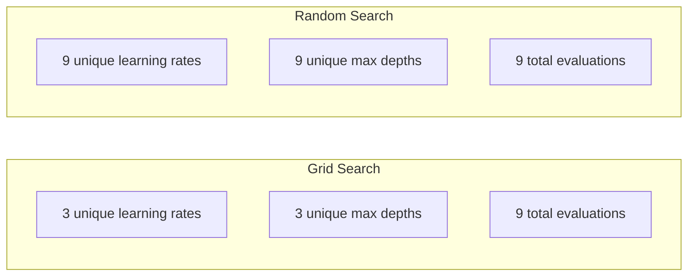
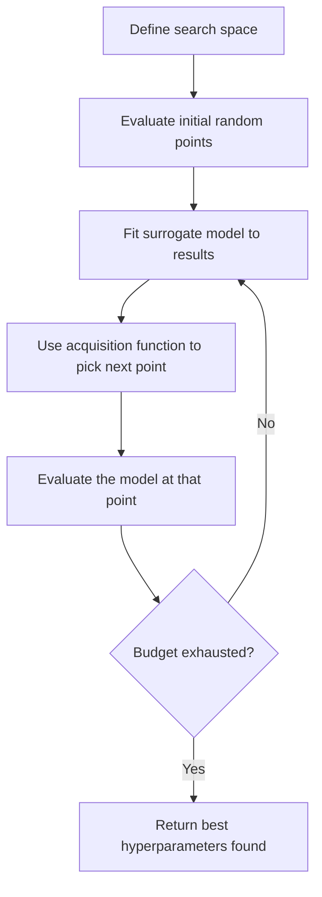
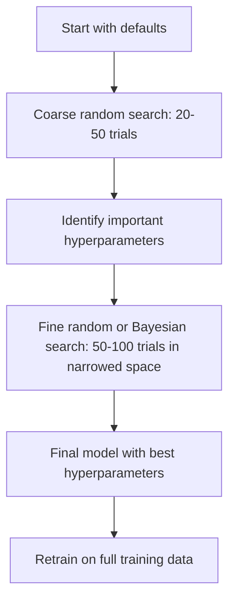
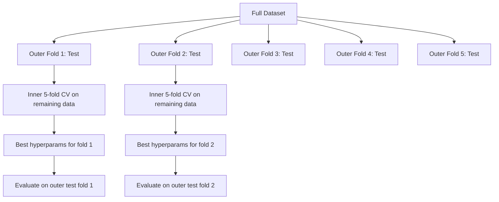

# 超参数调优

> Hyperparameters 是训练开始前你要拧的旋钮。拧得好不好，决定了 mediocre model 和 great model 的差距。

**Type:** Build
**Language:** Python
**Prerequisites:** Phase 2, Lesson 11 (Ensemble Methods)
**Time:** ~90 minutes

## 学习目标

- 从零实现 grid search、random search 和 Bayesian optimization，并比较它们的 sample efficiency
- 解释为什么当大多数 hyperparameters 的 effective dimensionality 很低时，random search 会胜过 grid search
- 使用 surrogate model 和 acquisition function 构建 Bayesian optimization loop 来指导 search
- 设计避免 overfitting validation set 的 hyperparameter tuning strategy，并正确结合 cross-validation

## 问题

你的 gradient boosting model 有 learning rate、number of trees、max depth、min samples per leaf、subsample ratio 和 column sample ratio。这是六个 hyperparameters。如果每个都有 5 个合理值，那么 grid 有 5^6 = 15,625 个 combinations。每个 training 需要 10 秒。这意味着要花 43 小时 compute 才能全部尝试。

Grid search 是最直观的方法，也是 scale 上最糟糕的方法。Random search 用更少 compute 做得更好。Bayesian optimization 会通过从 past evaluations 中学习做得更好。知道该使用哪种 strategy，以及哪些 hyperparameters 真正重要，可以节省数天浪费的 GPU 时间。

## 概念

### Parameters vs Hyperparameters

Parameters 是 training 中学到的东西（weights、biases、split thresholds）。Hyperparameters 是 training 开始前设置的值，用来控制 learning 如何发生。

| Hyperparameter | What it controls | Typical range |
|---------------|-----------------|---------------|
| Learning rate | Step size per update | 0.001 to 1.0 |
| Number of trees/epochs | How long to train | 10 to 10,000 |
| Max depth | Model complexity | 1 to 30 |
| Regularization (lambda) | Overfitting prevention | 0.0001 to 100 |
| Batch size | Gradient estimation noise | 16 to 512 |
| Dropout rate | Fraction of neurons dropped | 0.0 to 0.5 |

### Grid Search

Grid search 会评估 specified values 的每一种 combination。它 exhaustive、容易理解，但会随着 hyperparameters 数量指数级扩张。

```text
Grid for 2 hyperparameters:

  learning_rate: [0.01, 0.1, 1.0]
  max_depth:     [3, 5, 7]

  Evaluations: 3 x 3 = 9 combinations

  (0.01, 3)  (0.01, 5)  (0.01, 7)
  (0.1,  3)  (0.1,  5)  (0.1,  7)
  (1.0,  3)  (1.0,  5)  (1.0,  7)
```

Grid search 有一个根本缺陷：如果一个 hyperparameter 很重要，而另一个不重要，大多数 evaluations 都被浪费了。9 次 evaluations 只给 important parameter 提供了 3 个 unique values。

### Random Search

Random search 不从 grid 中枚举，而是从 distributions 中采样 hyperparameters。在同样 9 次 evaluations 的 budget 下，你会得到每个 hyperparameter 的 9 个 unique values。



为什么 random 胜过 grid（Bergstra & Bengio, 2012）：

- 大多数 hyperparameters 的 effective dimensionality 很低。对给定 problem 来说，6 个 hyperparameters 中通常只有 1-2 个真正重要。
- Grid search 会把 evaluations 浪费在不重要的 dimensions 上。
- 在相同 budget 下，Random search 会更密集地覆盖 important dimensions。
- 60 次 random trials 时，如果 optimum 在 search space 中存在，你有 95% 概率找到距离 optimum 5% 以内的点。

### Bayesian Optimization

Random search 会忽略结果。它不会学习 high learning rates 会导致 divergence，也不会学习 depth 3 一直比 depth 10 更好。Bayesian optimization 会使用 past evaluations 来决定下一步去哪里 search。



两个关键组件：

**Surrogate model：** 一个 cheap-to-evaluate model（通常是 Gaussian process），用来近似 expensive objective function。它会在 search space 的任意点给出 prediction 和 uncertainty estimate。

**Acquisition function：** 通过平衡 exploitation（在已知好点附近 search）和 exploration（在 uncertainty 高的地方 search）决定下一个 evaluation 点。常见选择：

- **Expected Improvement (EI)：** 在这个点上，我们期望比当前 best 改善多少？
- **Upper Confidence Bound (UCB)：** Prediction 加上 uncertainty 的倍数。UCB 高意味着要么 promising，要么 unexplored。
- **Probability of Improvement (PI)：** 这个点击败当前 best 的 probability 是多少？

Bayesian optimization 通常能用比 random search 少 2-5 倍的 evaluations 找到更好的 hyperparameters。相比实际 training model，fitting surrogate model 的 overhead 可以忽略。

### Early Stopping

并非每个 training run 都需要跑完。如果一个 configuration 在 10 epochs 后明显很差，就停止它并继续下一个。这是在 hyperparameter search 语境下的 early stopping。

Strategies：
- **Patience-based：** 如果 validation loss 连续 N 个 epochs 没有 improvement，就停止
- **Median pruning：** 如果某个 trial 在同一步的 intermediate result 比 completed trials 的 median 更差，就停止
- **Hyperband：** 给很多 configurations 分配小 budget，然后逐步增加 best configurations 的 budget

Hyperband 特别有效。它先让 81 个 configurations 各跑 1 epoch，保留 top third，给它们 3 epochs，再保留 top third，依此类推。它比让所有 configs 跑完整 budget 快 10-50 倍找到好 configurations。

### Learning Rate Schedulers

Learning rate 几乎总是最重要的 hyperparameter。与其保持固定，不如用 schedulers 在 training 中调整它。

| Scheduler | Formula | When to use |
|-----------|---------|-------------|
| Step decay | Multiply by 0.1 every N epochs | Classic CNN training |
| Cosine annealing | lr * 0.5 * (1 + cos(pi * t / T)) | Modern default |
| Warmup + decay | Linear increase then cosine decay | Transformers |
| One-cycle | Increase then decrease over one cycle | Fast convergence |
| Reduce on plateau | Reduce by factor when metric stalls | Safe default |

### Hyperparameter Importance

不是所有 hyperparameters 都同样重要。关于 random forests（Probst et al., 2019）和 gradient boosting 的研究显示了稳定模式：

**High importance：**
- Learning rate（永远优先 tune）
- Number of estimators / epochs（用 early stopping 替代 tuning）
- Regularization strength

**Medium importance：**
- Max depth / number of layers
- Min samples per leaf / weight decay
- Subsample ratio

**Low importance：**
- Max features（用于 random forests）
- 具体 activation function choice
- Batch size（在 reasonable range 内）

先 tune 重要的，其他保持 defaults。

### Practical Strategy



具体 workflow：

1. **从 library defaults 开始。** 它们由经验丰富的 practitioners 选择，通常已经走完 80% 的路。
2. **Coarse random search。** 使用 wide ranges，跑 20-50 trials。用 early stopping 快速 kill 掉 bad runs。
3. **Analyze results。** 哪些 hyperparameters 与 performance 相关？收窄 search space。
4. **Fine search。** 在 narrowed space 中使用 Bayesian optimization 或 focused random search。跑 50-100 trials。
5. **用找到的 best hyperparameters 在所有 training data 上 retrain。**

### Cross-Validation Integration

在单个 validation split 上 tuning hyperparameters 有风险。Best hyperparameters 可能 overfit 到特定 validation fold。Nested cross-validation 通过两个 loops 解决这个问题：

- **Outer loop**（evaluation）：把 data 分成 train+val 和 test。报告 unbiased performance。
- **Inner loop**（tuning）：把 train+val 分成 train 和 val。寻找 best hyperparameters。



每个 outer fold 都独立寻找自己的 best hyperparameters。Outer scores 是 generalization performance 的 unbiased estimate。

使用 sklearn：

```python
from sklearn.model_selection import cross_val_score, GridSearchCV
from sklearn.ensemble import GradientBoostingRegressor

inner_cv = GridSearchCV(
    GradientBoostingRegressor(),
    param_grid={
        "learning_rate": [0.01, 0.05, 0.1],
        "max_depth": [2, 3, 5],
        "n_estimators": [50, 100, 200],
    },
    cv=5,
    scoring="neg_mean_squared_error",
)

outer_scores = cross_val_score(
    inner_cv, X, y, cv=5, scoring="neg_mean_squared_error"
)

print(f"Nested CV MSE: {-outer_scores.mean():.4f} +/- {outer_scores.std():.4f}")
```

这很 expensive（5 outer folds x 5 inner folds x 27 grid points = 675 model fits），但会给你可信的 performance estimate。当你在论文中报告 final results，或决策 stakes 很高时使用它。

### Practical Tips

**从 learning rate 开始。** 对 gradient-based methods 来说，它永远是最重要的 hyperparameter。坏 learning rate 会让其他一切 irrelevant。先把其他 hyperparameters 固定在 defaults，只 sweep learning rate。

**对 learning rate 和 regularization 使用 log-uniform distributions。** 0.001 和 0.01 的差距，与 0.1 和 1.0 的差距一样重要。Linear search 会把 budget 浪费在 large end。

**用 early stopping 替代 tuning n_estimators。** 对 boosting 和 neural networks，把 n_estimators 或 epochs 设高，让 early stopping 决定何时停止。这会从 search 中移除一个 hyperparameter。

**Budget allocation。** 把 tuning budget 的 60% 花在最重要的 top 2 hyperparameters 上。剩余 40% 给其他所有参数。Top 2 通常解释了大部分 performance variation。

**Scale matters。** 永远不要在 log scale 上 search batch size（16、32、64 就很好）。永远在 log scale 上 search learning rate。让 search distribution 匹配 hyperparameter 影响 model 的方式。

| Model Type | Top Hyperparameters | Recommended Search | Budget |
|-----------|--------------------|--------------------|--------|
| Random Forest | n_estimators, max_depth, min_samples_leaf | Random search, 50 trials | Low (fast training) |
| Gradient Boosting | learning_rate, n_estimators, max_depth | Bayesian, 100 trials + early stopping | Medium |
| Neural Network | learning_rate, weight_decay, batch_size | Bayesian or random, 100+ trials | High (slow training) |
| SVM | C, gamma (RBF kernel) | Grid on log scale, 25-50 trials | Low (2 params) |
| Lasso/Ridge | alpha | 1D search on log scale, 20 trials | Very low |
| XGBoost | learning_rate, max_depth, subsample, colsample | Bayesian, 100-200 trials + early stopping | Medium |

**不确定时：** 使用 random search，trials 数量至少是 hyperparameters 数量的 2 倍（例如 6 个 hyperparameters 至少 12 次 trials）。你会惊讶地发现，50 次 random search 经常胜过精心设计的 grid search。

```figure
k-fold-cv
```

## Build It

### Step 1：从零实现 Grid Search

`code/tuning.py` 中的代码从零实现了 grid search、random search 和一个 simple Bayesian optimizer。

```python
def grid_search(model_fn, param_grid, X_train, y_train, X_val, y_val):
    keys = list(param_grid.keys())
    values = list(param_grid.values())
    best_score = -float("inf")
    best_params = None
    n_evals = 0

    for combo in itertools.product(*values):
        params = dict(zip(keys, combo))
        model = model_fn(**params)
        model.fit(X_train, y_train)
        score = evaluate(model, X_val, y_val)
        n_evals += 1

        if score > best_score:
            best_score = score
            best_params = params

    return best_params, best_score, n_evals
```

### Step 2：从零实现 Random Search

```python
def random_search(model_fn, param_distributions, X_train, y_train,
                  X_val, y_val, n_iter=50, seed=42):
    rng = np.random.RandomState(seed)
    best_score = -float("inf")
    best_params = None

    for _ in range(n_iter):
        params = {k: sample(v, rng) for k, v in param_distributions.items()}
        model = model_fn(**params)
        model.fit(X_train, y_train)
        score = evaluate(model, X_val, y_val)

        if score > best_score:
            best_score = score
            best_params = params

    return best_params, best_score, n_iter
```

### Step 3：Bayesian Optimization（简化版）

核心思想：对 observed（hyperparameter, score）pairs 拟合 Gaussian process，然后使用 acquisition function 决定下一步看哪里。

```python
class SimpleBayesianOptimizer:
    def __init__(self, search_space, n_initial=5):
        self.search_space = search_space
        self.n_initial = n_initial
        self.X_observed = []
        self.y_observed = []

    def _kernel(self, x1, x2, length_scale=1.0):
        dists = np.sum((x1[:, None, :] - x2[None, :, :]) ** 2, axis=2)
        return np.exp(-0.5 * dists / length_scale ** 2)

    def _fit_gp(self, X_new):
        X_obs = np.array(self.X_observed)
        y_obs = np.array(self.y_observed)
        y_mean = y_obs.mean()
        y_centered = y_obs - y_mean

        K = self._kernel(X_obs, X_obs) + 1e-4 * np.eye(len(X_obs))
        K_star = self._kernel(X_new, X_obs)

        L = np.linalg.cholesky(K)
        alpha = np.linalg.solve(L.T, np.linalg.solve(L, y_centered))
        mu = K_star @ alpha + y_mean

        v = np.linalg.solve(L, K_star.T)
        var = 1.0 - np.sum(v ** 2, axis=0)
        var = np.maximum(var, 1e-6)

        return mu, var

    def _expected_improvement(self, mu, var, best_y):
        sigma = np.sqrt(var)
        z = (mu - best_y) / (sigma + 1e-10)
        ei = sigma * (z * norm_cdf(z) + norm_pdf(z))
        return ei

    def suggest(self):
        if len(self.X_observed) < self.n_initial:
            return sample_random(self.search_space)

        candidates = [sample_random(self.search_space) for _ in range(500)]
        X_cand = np.array([to_vector(c) for c in candidates])
        mu, var = self._fit_gp(X_cand)
        ei = self._expected_improvement(mu, var, max(self.y_observed))
        return candidates[np.argmax(ei)]

    def observe(self, params, score):
        self.X_observed.append(to_vector(params))
        self.y_observed.append(score)
```

GP surrogate 会在每个 candidate point 上给出两样东西：predicted score（mu）和 uncertainty（var）。Expected Improvement 会平衡二者：它偏好 model 预测 score 高的点，也偏好 uncertainty 高的点。Early on，大多数点 uncertainty 都高，所以 optimizer 会 explore。Later，它会聚焦到最 promising region。

### Step 4：比较所有方法

在同一个 synthetic objective 上运行三种方法并比较。这个 comparison 使用一个 simplified wrapper，直接调用每个 optimizer 的 objective function（没有 model training），所以 API 与上面的 model-based implementations 不同：

```python
def synthetic_objective(params):
    lr = params["learning_rate"]
    depth = params["max_depth"]
    return -(np.log10(lr) + 2) ** 2 - (depth - 4) ** 2 + 10

param_grid = {
    "learning_rate": [0.001, 0.01, 0.1, 1.0],
    "max_depth": [2, 3, 4, 5, 6, 7, 8],
}

grid_best = None
grid_score = -float("inf")
grid_history = []
for combo in itertools.product(*param_grid.values()):
    params = dict(zip(param_grid.keys(), combo))
    score = synthetic_objective(params)
    grid_history.append((params, score))
    if score > grid_score:
        grid_score = score
        grid_best = params

param_dist = {
    "learning_rate": ("log_float", 0.001, 1.0),
    "max_depth": ("int", 2, 8),
}

rand_best = None
rand_score = -float("inf")
rand_history = []
rng = np.random.RandomState(42)
for _ in range(28):
    params = {k: sample(v, rng) for k, v in param_dist.items()}
    score = synthetic_objective(params)
    rand_history.append((params, score))
    if score > rand_score:
        rand_score = score
        rand_best = params

optimizer = SimpleBayesianOptimizer(param_dist, n_initial=5)
bayes_history = []
for _ in range(28):
    params = optimizer.suggest()
    score = synthetic_objective(params)
    optimizer.observe(params, score)
    bayes_history.append((params, score))
bayes_score = max(s for _, s in bayes_history)

print(f"{'Method':<20} {'Best Score':>12} {'Evaluations':>12}")
print("-" * 50)
print(f"{'Grid Search':<20} {grid_score:>12.4f} {len(grid_history):>12}")
print(f"{'Random Search':<20} {rand_score:>12.4f} {len(rand_history):>12}")
print(f"{'Bayesian Opt':<20} {bayes_score:>12.4f} {len(bayes_history):>12}")
```

在相同 budget 下，Bayesian optimization 通常最快找到 best score，因为它不会把 evaluations 浪费在明显不好的 regions。Random search 覆盖面比 grid search 更广。Grid search 只在 hyperparameters 很少、且你负担得起 exhaustive search 时胜出。

## Use It

### 实践中的 Optuna

Optuna 是严肃 hyperparameter tuning 推荐使用的 library。它开箱支持 pruning、distributed search 和 visualization。

```python
import optuna

def objective(trial):
    lr = trial.suggest_float("learning_rate", 1e-4, 1e-1, log=True)
    n_est = trial.suggest_int("n_estimators", 50, 500)
    max_depth = trial.suggest_int("max_depth", 2, 10)

    model = GradientBoostingRegressor(
        learning_rate=lr,
        n_estimators=n_est,
        max_depth=max_depth,
    )
    model.fit(X_train, y_train)
    return mean_squared_error(y_val, model.predict(X_val))

study = optuna.create_study(direction="minimize")
study.optimize(objective, n_trials=100)

print(f"Best params: {study.best_params}")
print(f"Best MSE: {study.best_value:.4f}")
```

Optuna 的关键 features：
- `suggest_float(..., log=True)` 用于最适合 log scale search 的 parameters（learning rate、regularization）
- `suggest_int` 用于 integer parameters
- `suggest_categorical` 用于 discrete choices
- 内建 MedianPruner，可对 bad trials 做 early stopping
- `study.trials_dataframe()` 用于 analysis

### Optuna with Pruning

Pruning 会早停没有希望的 trials，节省大量 compute。模式如下：

```python
import optuna
from sklearn.model_selection import cross_val_score

def objective(trial):
    params = {
        "learning_rate": trial.suggest_float("lr", 1e-4, 0.5, log=True),
        "max_depth": trial.suggest_int("max_depth", 2, 10),
        "n_estimators": trial.suggest_int("n_estimators", 50, 500),
        "subsample": trial.suggest_float("subsample", 0.5, 1.0),
    }

    model = GradientBoostingRegressor(**params)
    scores = cross_val_score(model, X_train, y_train, cv=3,
                             scoring="neg_mean_squared_error")
    mean_score = -scores.mean()

    trial.report(mean_score, step=0)
    if trial.should_prune():
        raise optuna.TrialPruned()

    return mean_score

pruner = optuna.pruners.MedianPruner(n_startup_trials=10, n_warmup_steps=5)
study = optuna.create_study(direction="minimize", pruner=pruner)
study.optimize(objective, n_trials=200)
```

如果某个 trial 的 intermediate value 比同一步所有 completed trials 的 median 更差，`MedianPruner` 就会停止它。Pruning 需要调用 `trial.report()` 来报告 intermediate metrics，并调用 `trial.should_prune()` 检查 trial 是否应该停止。`n_startup_trials=10` 保证至少 10 个 trials 完整运行后才开始 pruning。这通常能节省 40-60% 的 total compute。

### sklearn 内建 Tuners

对于 quick experiments，sklearn 提供 `GridSearchCV`、`RandomizedSearchCV` 和 `HalvingRandomSearchCV`：

```python
from sklearn.model_selection import RandomizedSearchCV
from scipy.stats import loguniform, randint

param_dist = {
    "learning_rate": loguniform(1e-4, 0.5),
    "max_depth": randint(2, 10),
    "n_estimators": randint(50, 500),
}

search = RandomizedSearchCV(
    GradientBoostingRegressor(),
    param_dist,
    n_iter=100,
    cv=5,
    scoring="neg_mean_squared_error",
    random_state=42,
    n_jobs=-1,
)
search.fit(X_train, y_train)
print(f"Best params: {search.best_params_}")
print(f"Best CV MSE: {-search.best_score_:.4f}")
```

对 learning rate 和 regularization 使用 scipy 的 `loguniform`。对 integer hyperparameters 使用 `randint`。`n_jobs=-1` 会在所有 CPU cores 上并行。

### Hyperparameter Tuning 中的常见错误

**Data leakage through preprocessing。** 如果在 cross-validation 前用 full dataset fit scaler，validation fold 的信息会泄漏进 training。永远把 preprocessing 放进 `Pipeline`，让它只在 training fold 上 fit。

**Overfitting to the validation set。** 跑几千个 trials 实际上是在 validation set 上训练。最终 performance estimate 应使用 nested cross-validation，或保留一个 tuning 时永远不碰的独立 test set。

**Search range 太窄。** 如果 best value 位于 search space 的 boundary，说明 search 不够宽。Optimal value 可能在你的 range 外。永远检查 best parameters 是否卡在边界。

**忽略 interaction effects。** Learning rate 和 number of estimators 在 boosting 中强烈交互。Low learning rate 需要更多 estimators。独立 tuning 它们会比一起 tuning 更差。

**Iterative models 不用 early stopping。** 对 gradient boosting 和 neural networks，把 n_estimators 或 epochs 设高并使用 early stopping。这严格优于把 iterations 数量作为 hyperparameter 来 tune。

## 练习

1. 用相同 total budget（例如 50 evaluations）运行 grid search 和 random search。比较找到的 best scores。用不同 seeds 运行 10 次。Random search 赢了多少次？

2. 从零实现 Hyperband。先让 81 个 configurations 各训练 1 epoch。每轮保留 top 1/3，并把它们的 budget 乘以 3。把 total compute（所有 configs 的 epochs 之和）与让 81 个 configs 跑完整 budget 比较。

3. 给 Lesson 11 的 gradient boosting implementation 添加 learning rate scheduler（cosine annealing）。相比 fixed learning rate，它有帮助吗？

4. 使用 Optuna 在一个 real dataset（例如 sklearn 的 breast cancer dataset）上 tune RandomForestClassifier。使用 `optuna.visualization.plot_param_importances(study)` 查看哪些 hyperparameters 最重要。它是否符合本课给出的 importance ranking？

5. 实现一个 simple acquisition function（Expected Improvement），并展示 exploration vs exploitation。绘制 surrogate model 的 mean 和 uncertainty，并展示 EI 选择下一步 evaluate 的位置。

## 关键术语

| Term | What people say | What it actually means |
|------|----------------|----------------------|
| Hyperparameter | “你选择的 setting” | Training 前设定、控制 learning process 的值，不从 data 中学习 |
| Grid search | “尝试每个 combination” | 在指定 parameter grid 上 exhaustive search。成本指数级增长。 |
| Random search | “随机采样就行” | 从 distributions 中采样 hyperparameters。比 grid search 更好地覆盖 important dimensions。 |
| Bayesian optimization | “Smart search” | 使用 objective 的 surrogate model 决定下一步 evaluate 哪里，平衡 exploration 和 exploitation |
| Surrogate model | “便宜的近似” | 一个 model（通常是 Gaussian process），根据 observed evaluations 近似 expensive objective function |
| Acquisition function | “下一步看哪里” | 通过平衡 expected improvement 和 uncertainty 给 candidate points 打分。EI 和 UCB 是常见选择。 |
| Early stopping | “别浪费时间” | 当 validation performance 停止 improving 时提前终止 training |
| Hyperband | “Configs 的 tournament bracket” | Adaptive resource allocation：先用小 budgets 跑很多 configs，保留最好的并增加它们的 budgets |
| Learning rate scheduler | “训练中改变 lr” | 在 training 过程中调整 learning rate 的 function，以获得更好的 convergence |

## 延伸阅读

- [Bergstra & Bengio: Random Search for Hyper-Parameter Optimization (2012)](https://jmlr.org/papers/v13/bergstra12a.html) - 证明 random 胜过 grid 的论文
- [Snoek et al., Practical Bayesian Optimization of Machine Learning Algorithms (2012)](https://arxiv.org/abs/1206.2944) - 面向 ML 的 Bayesian optimization
- [Li et al., Hyperband: A Novel Bandit-Based Approach (2018)](https://jmlr.org/papers/v18/16-558.html) - Hyperband 论文
- [Optuna: A Next-generation Hyperparameter Optimization Framework](https://arxiv.org/abs/1907.10902) - Optuna 论文
- [Probst et al., Tunability: Importance of Hyperparameters (2019)](https://jmlr.org/papers/v20/18-444.html) - 哪些 hyperparameters 重要
