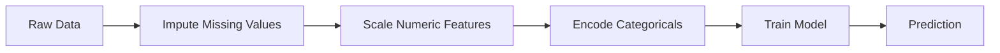
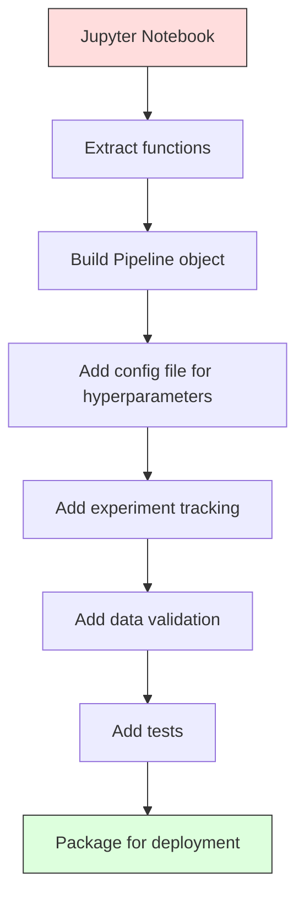

# 机器学习流水线

> 模型不是产品。Pipeline 才是。Pipeline 覆盖从 raw data 到 deployed prediction 的每一步，而且每一步都必须可复现。

**Type:** Build
**Language:** Python
**Prerequisites:** Phase 2, Lesson 12 (Hyperparameter Tuning)
**Time:** ~120 minutes

## 学习目标

- 从零构建一个 ML pipeline，把 imputation、scaling、encoding 和 model training 串成一个可复现对象
- 识别 data leakage 场景，并解释 pipeline 如何通过只在 training data 上 fit transformers 来防止泄漏
- 构建一个 ColumnTransformer，对 numeric features 和 categorical features 应用不同 preprocessing
- 实现 pipeline serialization，并演示同一个 fitted pipeline 在 training 和 production 中会产生一致结果

## 问题

你有一个 notebook：加载 data、用 median 填补 missing values、scale features、训练 model、打印 accuracy。它能跑。你把它上线了。

一个月后，有人重新训练 model，却得到了不同结果。Median 是在包含 test data 的完整 dataset 上计算的（data leakage）。Scaling parameters 没有保存，所以 inference 使用了不同的 statistics。Feature engineering code 在 training 和 serving 之间 copy-paste 过，两份代码逐渐分叉。某个 categorical column 在 production 中出现了 encoder 从没见过的新 value。

这些不是假设。它们是 ML systems 在 production 中失败的最常见原因。Pipelines 通过把每个 transformation step 打包成一个 ordered、reproducible object 来解决这些问题。

## 概念

### 什么是 Pipeline

Pipeline 是一组有序的数据 transformations，最后接一个 model。每一步都把前一步的 output 作为 input。整个 pipeline 只在 training data 上 fit 一次。在 inference 时，同一个 fitted pipeline 会 transform new data 并生成 predictions。



Pipeline 保证：
- Transformations 只在 training data 上 fit（没有 leakage）
- Inference 时应用同样的 transformations
- 整个对象可以被 serialized，并作为一个 artifact 部署
- Cross-validation 会在每个 fold 内应用 pipeline，防止 subtle leakage

### Data Leakage：沉默杀手

Data leakage 指 test set 或 future data 的信息污染了 training。Pipelines 能防止最常见的泄漏形式。

**Leaky（错误）：**

```python
X = df.drop("target", axis=1)
y = df["target"]

scaler = StandardScaler()
X_scaled = scaler.fit_transform(X)

X_train, X_test = X_scaled[:800], X_scaled[800:]
y_train, y_test = y[:800], y[800:]
```

Scaler 看到了 test data。Mean 和 standard deviation 中包含 test samples。这会抬高 accuracy estimate。

**Correct：**

```python
X_train, X_test = X[:800], X[800:]

scaler = StandardScaler()
X_train_scaled = scaler.fit_transform(X_train)
X_test_scaled = scaler.transform(X_test)
```

使用 pipeline 时，你不需要反复惦记这件事。Pipeline 会自动处理。

### sklearn Pipeline

sklearn 的 `Pipeline` 会串联 transformers 和 estimator。它暴露 `.fit()`、`.predict()` 和 `.score()`，按顺序应用所有 steps。

```python
from sklearn.pipeline import Pipeline
from sklearn.preprocessing import StandardScaler
from sklearn.linear_model import LogisticRegression

pipe = Pipeline([
    ("scaler", StandardScaler()),
    ("model", LogisticRegression()),
])

pipe.fit(X_train, y_train)
predictions = pipe.predict(X_test)
```

当你调用 `pipe.fit(X_train, y_train)`：
1. Scaler 对 X_train 调用 `fit_transform`
2. Model 对 scaled X_train 调用 `fit`

当你调用 `pipe.predict(X_test)`：
1. Scaler 对 X_test 调用 `transform`，不是 `fit_transform`
2. Model 对 scaled X_test 调用 `predict`

Scaler 在 fitting 时永远看不到 test data。这就是 pipeline 的核心目的。

### ColumnTransformer：不同列使用不同 Pipelines

真实 dataset 同时包含 numeric columns 和 categorical columns，它们需要不同 preprocessing。`ColumnTransformer` 负责处理这件事。

```python
from sklearn.compose import ColumnTransformer
from sklearn.preprocessing import StandardScaler, OneHotEncoder
from sklearn.impute import SimpleImputer

numeric_pipe = Pipeline([
    ("impute", SimpleImputer(strategy="median")),
    ("scale", StandardScaler()),
])

categorical_pipe = Pipeline([
    ("impute", SimpleImputer(strategy="most_frequent")),
    ("encode", OneHotEncoder(handle_unknown="ignore")),
])

preprocessor = ColumnTransformer([
    ("num", numeric_pipe, ["age", "income", "score"]),
    ("cat", categorical_pipe, ["city", "gender", "plan"]),
])

full_pipeline = Pipeline([
    ("preprocess", preprocessor),
    ("model", GradientBoostingClassifier()),
])
```

`OneHotEncoder` 中的 `handle_unknown="ignore"` 对 production 很关键。当出现新 category（例如 model 从未见过的城市）时，它会产生 zero vector，而不是直接 crash。

### Experiment Tracking

Pipeline 让 training 可复现，但你还需要追踪 experiments 中发生了什么：用了哪些 hyperparameters、哪个 dataset version、metrics 是多少、当时运行的是哪份 code。

**MLflow** 是最常见的 open-source solution：

```python
import mlflow

with mlflow.start_run():
    mlflow.log_param("max_depth", 5)
    mlflow.log_param("n_estimators", 100)
    mlflow.log_param("learning_rate", 0.1)

    pipe.fit(X_train, y_train)
    accuracy = pipe.score(X_test, y_test)

    mlflow.log_metric("accuracy", accuracy)
    mlflow.sklearn.log_model(pipe, "model")
```

每次 run 都会记录 parameters、metrics、artifacts 和完整 model。你可以比较 runs、复现任意 experiment，并部署任意 model version。

**Weights & Biases (wandb)** 通过 hosted dashboard 提供同样功能：

```python
import wandb

wandb.init(project="my-pipeline")
wandb.config.update({"max_depth": 5, "n_estimators": 100})

pipe.fit(X_train, y_train)
accuracy = pipe.score(X_test, y_test)

wandb.log({"accuracy": accuracy})
```

### Model Versioning

有了 experiment tracking 之后，还需要管理 model versions。哪个 model 在 production？哪个在 staging？上周用的是哪个？

MLflow 的 Model Registry 提供：
- **Version tracking：** 每个 saved model 都会得到一个 version number
- **Stage transitions：** “Staging”、“Production”、“Archived”
- **Approval workflow：** Models 必须被显式 promoted 到 production
- **Rollback：** 立刻切回 previous version

### 使用 DVC 做 Data Versioning

Code 用 git version。Data 也应该 version，但 git 处理不了 large files。DVC（Data Version Control）解决这个问题。

```bash
dvc init
dvc add data/training.csv
git add data/training.csv.dvc data/.gitignore
git commit -m "Track training data"
dvc push
```

DVC 会把真实 data 存进 remote storage（S3、GCS、Azure），并在 git 中保留一个很小的 `.dvc` file 来记录 hash。当你 checkout 某个 git commit 时，`dvc checkout` 会恢复当时使用的精确 data。

这意味着每个 git commit 都同时 pin 住 code 和 data。完整可复现。

### Reproducible Experiments

一个 reproducible experiment 需要四件事：

1. **Fixed random seeds：** 为 numpy、random 和 framework（torch、sklearn）设置 seeds
2. **Pinned dependencies：** 用 requirements.txt 或 poetry.lock 固定精确 versions
3. **Versioned data：** 使用 DVC 或类似工具
4. **Config files：** 所有 hyperparameters 放进 config，不要 hardcode

```python
import numpy as np
import random

def set_seed(seed=42):
    random.seed(seed)
    np.random.seed(seed)
    try:
        import torch
        torch.manual_seed(seed)
        torch.cuda.manual_seed_all(seed)
        torch.backends.cudnn.deterministic = True
    except ImportError:
        pass
```

### 从 Notebook 到 Production Pipeline



典型 progression：

1. **Notebook exploration：** 快速 experiments、visualizations、feature ideas
2. **Extract functions：** 把 preprocessing、feature engineering、evaluation 移到 modules
3. **Build Pipeline：** 把 transformations 串成 sklearn Pipeline 或 custom class
4. **Config management：** 把所有 hyperparameters 移入 YAML/JSON config
5. **Experiment tracking：** 添加 MLflow 或 wandb logging
6. **Data validation：** 在 training 前检查 schema、distributions 和 missing value patterns
7. **Tests：** 为 transformers 写 unit tests，为完整 pipeline 写 integration tests
8. **Deployment：** Serialize pipeline，用 API（FastAPI、Flask）包起来，再 containerize

### 常见 Pipeline 错误

| Mistake | Why it is bad | Fix |
|---------|-------------|-----|
| 在 split 前对 full data fitting | Data leakage | 使用 Pipeline 配合 cross_val_score |
| Feature engineering 放在 pipeline 外面 | Train 和 serve 的 transforms 不一致 | 把所有 transforms 放进 Pipeline |
| 不处理 unknown categories | Production 遇到新 values 时 crash | `OneHotEncoder(handle_unknown="ignore")` |
| Hardcoded column names | Schema 变化时 break | 从 config 读取 column name lists |
| 没有 data validation | Bad data 导致 silently wrong predictions | Prediction 前添加 schema checks |
| Training/serving skew | Model 在 prod 中看到不同 features | Train 和 serve 共用一个 Pipeline object |

## Build It

`code/pipeline.py` 中的代码从零构建了一个完整 ML pipeline：

### Step 1：Custom Transformer

```python
class CustomTransformer:
    def __init__(self):
        self.means = None
        self.stds = None

    def fit(self, X):
        self.means = np.mean(X, axis=0)
        self.stds = np.std(X, axis=0)
        self.stds[self.stds == 0] = 1.0
        return self

    def transform(self, X):
        return (X - self.means) / self.stds

    def fit_transform(self, X):
        return self.fit(X).transform(X)
```

### Step 2：从零实现 Pipeline

```python
class PipelineFromScratch:
    def __init__(self, steps):
        self.steps = steps

    def fit(self, X, y=None):
        X_current = X.copy()
        for name, step in self.steps[:-1]:
            X_current = step.fit_transform(X_current)
        name, model = self.steps[-1]
        model.fit(X_current, y)
        return self

    def predict(self, X):
        X_current = X.copy()
        for name, step in self.steps[:-1]:
            X_current = step.transform(X_current)
        name, model = self.steps[-1]
        return model.predict(X_current)
```

### Step 3：带 Pipeline 的 Cross-Validation

代码演示了带 pipeline 的 cross-validation 如何防止 data leakage：scaler 会在每个 fold 的 training data 上分别 fit。

### Step 4：使用 sklearn 构建完整 Production Pipeline

完整 pipeline 包含 `ColumnTransformer`、多条 preprocessing paths 和一个 model，并使用正确的 cross-validation 与 experiment logging 进行 training。

## Ship It

本课产出：
- `outputs/prompt-ml-pipeline.md`，一个用于构建和调试 ML pipelines 的 skill
- `code/pipeline.py`，从 scratch pipeline 到 sklearn pipeline 的完整实现

## 练习

1. 构建一个 pipeline，处理包含 3 个 numeric columns 和 2 个 categorical columns 的 dataset。使用 `ColumnTransformer` 对 numerics 应用 median imputation + scaling，对 categoricals 应用 most-frequent imputation + one-hot encoding。用 5-fold cross-validation 训练。

2. 故意引入 data leakage：在 split 前对 full dataset fit scaler。比较 leaky cross-validation score 和 clean pipeline cross-validation score。差异有多大？

3. 用 `joblib.dump` serialize 你的 pipeline。在另一个 script 中加载它并运行 predictions。验证 predictions 完全一致。

4. 向 pipeline 添加一个 custom transformer，为两个最重要的 numeric columns 创建 polynomial features（degree 2）。它应该放在 pipeline 的哪个位置？

5. 为 pipeline 设置 MLflow tracking。使用不同 hyperparameters 运行 5 个 experiments。通过 MLflow UI（`mlflow ui`）比较 runs 并选择 best model。

## 关键术语

| Term | What people say | What it actually means |
|------|----------------|----------------------|
| Pipeline | “Transforms + model 的链条” | 一组有序的 fitted transformers 和一个 model，作为一个整体应用，用来防止 leakage |
| Data leakage | “Test info leaked into training” | 使用 training set 之外的信息构建 model，导致 performance estimates 被抬高 |
| ColumnTransformer | “每列使用不同 preprocessing” | 对不同列子集应用不同 pipelines，并合并结果 |
| Experiment tracking | “Logging your runs” | 为每次 training run 记录 parameters、metrics、artifacts 和 code versions |
| MLflow | “Track and deploy models” | 用于 experiment tracking、model registry 和 deployment 的 open-source platform |
| DVC | “Git for data” | 面向 large data files 的 version control system，在 git 中保存 hashes，在 remote storage 中保存 data |
| Model registry | “Model version catalog” | 用 stage labels（staging、production、archived）追踪 model versions 的系统 |
| Training/serving skew | “It worked in the notebook” | Training 和 inference 中 data processing 的差异，会导致 silent errors |
| Reproducibility | “Same code, same result” | 使用相同 code、data 和 configuration 得到 identical results 的能力 |

## 延伸阅读

- [scikit-learn Pipeline docs](https://scikit-learn.org/stable/modules/compose.html)，official pipeline reference
- [MLflow documentation](https://mlflow.org/docs/latest/index.html)，experiment tracking 和 model registry
- [DVC documentation](https://dvc.org/doc)，data versioning
- [Sculley et al., Hidden Technical Debt in Machine Learning Systems (2015)](https://papers.nips.cc/paper/2015/hash/86df7dcfd896fcaf2674f757a2463eba-Abstract.html)，ML systems complexity 的 seminal paper
- [Google ML Best Practices: Rules of ML](https://developers.google.com/machine-learning/guides/rules-of-ml)，practical production ML advice
