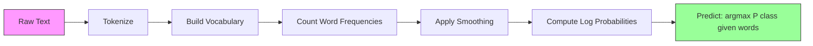

# 朴素贝叶斯

> “Naive” assumption 是错的，但它依然有效。这就是它漂亮的地方。

**Type:** Build
**Language:** Python
**Prerequisites:** Phase 2, Lessons 01-07 (classification, Bayes' theorem)
**Time:** ~75 minutes

## 学习目标

- 从零实现带 Laplace smoothing 的 Multinomial Naive Bayes，用于 text classification
- 解释为什么 naive independence assumption 在数学上是错的，却仍能在实践中给出正确的 class rankings
- 比较 Multinomial、Bernoulli 和 Gaussian Naive Bayes variants，并为给定 feature type 选择正确版本
- 在 high-dimensional sparse data 上比较 Naive Bayes 和 logistic regression，并解释其中的 bias-variance tradeoff

## 问题

你需要分类文本。把 emails 分成 spam 或 not-spam。把 customer reviews 分成 positive 或 negative。把 support tickets 分进不同 categories。你有成千上万个 features（每个 word 一个），但 training data 有限。

大多数 classifiers 会在这里卡住。Logistic regression 需要足够 samples，才能可靠估计几千个 weights。Decision trees 一次只按一个 word 分裂，而且会严重 overfit。KNN 在 10,000 维里几乎没有意义，因为每个点到其他点都差不多远。

Naive Bayes 能处理这种场景。它做了一个数学上错误的假设：在给定 class 后，每个 feature 都和其他 feature independent。即便如此，它在 text classification 上仍然经常超过更“聪明”的 models，尤其是在 training set 很小时。它只需要单次 pass 就能完成 training。它可以 scale 到 millions of features。它也会输出 probability estimates，虽然这些 probabilities 通常因为 independence assumption 而 calibration 很差。

理解为什么错误假设能带来好 predictions，会教你一个 machine learning 的基本事实：最好的 model 不是最“正确”的 model，而是对你的 data 拥有最好 bias-variance tradeoff 的 model。

## 概念

### Bayes' Theorem（快速回顾）

Bayes' theorem 会翻转 conditional probabilities：

```text
P(class | features) = P(features | class) * P(class) / P(features)
```

我们想要 `P(class | features)`，也就是在看到 document 中 words 之后，它属于某个 class 的 probability。它可以由以下部分计算：
- `P(features | class)`，在这个 class 的 documents 中看到这些 words 的 likelihood
- `P(class)`，class 的 prior probability（spam 总体有多常见？）
- `P(features)`，evidence，对所有 classes 都一样，所以比较 classes 时可以忽略

`P(class | features)` 最高的 class 获胜。

### Naive Independence Assumption

精确计算 `P(features | class)` 需要估计所有 features 的 joint probability。对于 10,000 个 words 的 vocabulary，你要估计 2^10,000 种 possible combinations 上的 distribution。不可能。

Naive assumption 是：给定 class 后，每个 feature 都 conditionally independent。

```text
P(w1, w2, ..., wn | class) = P(w1 | class) * P(w2 | class) * ... * P(wn | class)
```

于是你不再估计一个不可能的 joint distribution，而是估计 n 个简单的 per-feature distributions。每个 distribution 只需要 count。

这个假设显然是错的。任何 document 里，“machine”和“learning”都不是 independent。但 classifier 并不需要正确的 probability estimates。它需要正确的 rankings：哪个 class 的 probability 最高。Independence assumption 会引入 systematic errors，但这些 errors 对所有 classes 的影响相似，所以 ranking 仍然正确。

### 为什么它仍然有效

三个原因：

1. **Ranking over calibration。** Classification 只需要 top-ranked class 正确。即使 P(spam) = 0.99999，而真实 probability 是 0.7，classifier 依然会正确选择 spam。我们不需要正确 probabilities。我们需要正确 winner。

2. **High bias, low variance。** Independence assumption 是一个强 prior。它强力约束 model，从而防止 overfitting。在 limited training data 下，一个略微错误但稳定的 model，会胜过一个理论上正确但极不稳定的 model。这就是 bias-variance tradeoff。

3. **Feature redundancy 会相互抵消。** Correlated features 提供 redundant evidence。Classifier 会 double-count 这些 evidence，但它也会为正确 class double-count。如果 “machine” 和 “learning” 总是一起出现，它们都会为 “tech” class 提供 evidence。NB 会数两次，但它是为正确 class 数两次。

还有第四个很实际的原因：Naive Bayes 极快。Training 只是单次 pass，统计 frequencies。Prediction 是 matrix multiplication。你可以在几秒内用一百万 documents 训练。这个速度意味着你能更快 iterate，尝试更多 feature sets，运行更多 experiments，而不是被慢 model 拖住。

### 数学逐步拆解

我们走一个具体例子。假设有两个 classes：spam 和 not-spam。Vocabulary 有三个 words："free"、"money"、"meeting"。

Training data：
- Spam emails 中 "free" 出现 80 次，"money" 出现 60 次，"meeting" 出现 10 次（总共 150 words）
- Not-spam emails 中 "free" 出现 5 次，"money" 出现 10 次，"meeting" 出现 100 次（总共 115 words）
- 40% emails 是 spam，60% 是 not-spam

使用 Laplace smoothing（alpha=1）：

```text
P(free | spam)    = (80 + 1) / (150 + 3) = 81/153 = 0.529
P(money | spam)   = (60 + 1) / (150 + 3) = 61/153 = 0.399
P(meeting | spam) = (10 + 1) / (150 + 3) = 11/153 = 0.072

P(free | not-spam)    = (5 + 1) / (115 + 3) = 6/118 = 0.051
P(money | not-spam)   = (10 + 1) / (115 + 3) = 11/118 = 0.093
P(meeting | not-spam) = (100 + 1) / (115 + 3) = 101/118 = 0.856
```

新 email 包含："free"（2 次）、"money"（1 次）、"meeting"（0 次）。

```text
log P(spam | email) = log(0.4) + 2*log(0.529) + 1*log(0.399) + 0*log(0.072)
                    = -0.916 + 2*(-0.637) + (-0.919) + 0
                    = -3.109

log P(not-spam | email) = log(0.6) + 2*log(0.051) + 1*log(0.093) + 0*log(0.856)
                        = -0.511 + 2*(-2.976) + (-2.375) + 0
                        = -8.838
```

Spam 以很大 margin 获胜。Word "free" 出现两次，是 spam 的强 evidence。注意，"meeting" 没出现，对两个 log sums 的贡献都是 zero（0 * log(P)）。在 Multinomial NB 中，absent words 没有影响。显式建模 word absence 的是 Bernoulli NB。

### 三个 Variants

Naive Bayes 有三种 flavors。每一种都以不同方式建模 `P(feature | class)`。

#### Multinomial Naive Bayes

把每个 feature 建模为 count。最适合 word frequencies 或 TF-IDF values 这类 text data。

```text
P(word_i | class) = (count of word_i in class + alpha) / (total words in class + alpha * vocab_size)
```

`alpha` 是 Laplace smoothing（下面解释）。这个 variant 是 text classification 的主力。

#### Gaussian Naive Bayes

把每个 feature 建模为 normal distribution。最适合 continuous features。

```text
P(x_i | class) = (1 / sqrt(2 * pi * var)) * exp(-(x_i - mean)^2 / (2 * var))
```

每个 class 都有自己的 per-feature mean 和 variance。当 features 在每个 class 内真的近似 bell curve 时，它表现很好。

#### Bernoulli Naive Bayes

把每个 feature 建模为 binary（present 或 absent）。最适合 short text 或 binary feature vectors。

```text
P(word_i | class) = (docs in class containing word_i + alpha) / (total docs in class + 2 * alpha)
```

不同于 Multinomial，Bernoulli 会显式惩罚某个 word 的 absence。如果 "free" 通常出现在 spam 中，但这封 email 没有它，Bernoulli 会把这当作反对 spam 的 evidence。

### 什么时候使用哪个 Variant

| Variant | Feature Type | Best For | Example |
|---------|-------------|----------|---------|
| Multinomial | Counts or frequencies | Text classification, bag-of-words | Email spam, topic classification |
| Gaussian | Continuous values | Tabular data with normal-ish features | Iris classification, sensor data |
| Bernoulli | Binary (0/1) | Short text, binary feature vectors | SMS spam, presence/absence features |

### Laplace Smoothing

如果 test data 中出现某个 word，而它在 training data 的某个 class 中从未出现过，会发生什么？

没有 smoothing 时：`P(word | class) = 0/N = 0`。一个 zero 乘进整个 product，会让 `P(class | features) = 0`，无论其他 evidence 多强。一个 unseen word 就能摧毁整次 prediction。

Laplace smoothing 会给每个 feature count 加一个小 count `alpha`（通常是 1）：

```text
P(word_i | class) = (count(word_i, class) + alpha) / (total_words_in_class + alpha * vocab_size)
```

当 alpha=1，每个 word 至少有一个很小的 probability。Test email 里出现 "discombobulate" 不会再直接杀死 spam probability。Smoothing 有一个 Bayesian interpretation：它等价于在 word distributions 上放置 uniform Dirichlet prior。

更高的 alpha 表示更强 smoothing（distribution 更 uniform）。更低的 alpha 表示 model 更相信 data。Alpha 是需要 tune 的 hyperparameter。

Alpha 的效果：

| Alpha | Effect | When to use |
|-------|--------|-------------|
| 0.001 | 几乎不 smoothing，信任 data | Very large training set, no unseen features expected |
| 0.1 | Light smoothing | Large training set |
| 1.0 | Standard Laplace smoothing | Default starting point |
| 10.0 | Heavy smoothing，压平 distributions | Very small training set, many unseen features expected |

### Log-Space Computation

把几百个 probabilities（每个都小于 1）相乘，会造成 floating-point underflow。Product 在 floating point 中变成 zero，虽然真实值只是一个极小的正数。

解决方法：在 log space 中计算。不要乘 probabilities，而是加它们的 logarithms：

```text
log P(class | x1, x2, ..., xn) = log P(class) + sum_i log P(xi | class)
```

这会把 prediction 变成一个 dot product：

```text
log_scores = X @ log_feature_probs.T + log_class_priors
prediction = argmax(log_scores)
```

Matrix multiplication。这就是 Naive Bayes prediction 如此快的原因：它和 single-layer linear model 做的是同一种操作。

### Naive Bayes vs Logistic Regression

二者都是 text 的 linear classifiers。差别在于它们建模的对象。

| Aspect | Naive Bayes | Logistic Regression |
|--------|------------|-------------------|
| Type | Generative（建模 P(X\|Y)） | Discriminative（建模 P(Y\|X)） |
| Training | Count frequencies | Optimize loss function |
| Small data | Better（strong prior 有帮助） | Worse（samples 不足以估计 weights） |
| Large data | Worse（错误假设拖后腿） | Better（boundary 更灵活） |
| Features | Assumes independence | Handles correlations |
| Speed | Single pass，非常快 | Iterative optimization |
| Calibration | Poor probabilities | Better probabilities |

经验法则：从 Naive Bayes 开始。如果 data 足够多，而且 NB plateau 了，再切到 logistic regression。

### Classification Pipeline



实践中，我们在 log space 中计算，避免 floating-point underflow。不要乘很多小 probabilities，而是加它们的 logarithms：

```text
log P(class | features) = log P(class) + sum_i log P(feature_i | class)
```

```figure
naive-bayes
```

## Build It

`code/naive_bayes.py` 中的代码从零实现了 MultinomialNB 和 GaussianNB。

### MultinomialNB

From-scratch implementation：

1. **fit(X, y)**：对每个 class，统计每个 feature 的 frequency。添加 Laplace smoothing。计算 log probabilities。保存 class priors（class frequencies 的 log）。

2. **predict_log_proba(X)**：对每个 sample，为所有 classes 计算 log P(class) + sum of log P(feature_i | class)。这就是一次 matrix multiplication：X @ log_probs.T + log_priors。

3. **predict(X)**：返回 log probability 最高的 class。

```python
class MultinomialNB:
    def __init__(self, alpha=1.0):
        self.alpha = alpha

    def fit(self, X, y):
        classes = np.unique(y)
        n_classes = len(classes)
        n_features = X.shape[1]

        self.classes_ = classes
        self.class_log_prior_ = np.zeros(n_classes)
        self.feature_log_prob_ = np.zeros((n_classes, n_features))

        for i, c in enumerate(classes):
            X_c = X[y == c]
            self.class_log_prior_[i] = np.log(X_c.shape[0] / X.shape[0])
            counts = X_c.sum(axis=0) + self.alpha
            self.feature_log_prob_[i] = np.log(counts / counts.sum())

        return self
```

关键 insight：fit 之后，prediction 只是 matrix multiplication 加一个 bias。这就是 Naive Bayes 如此快的原因。

### GaussianNB

对于 continuous features，我们为每个 class、每个 feature 估计 mean 和 variance：

```python
class GaussianNB:
    def __init__(self):
        pass

    def fit(self, X, y):
        classes = np.unique(y)
        self.classes_ = classes
        self.means_ = np.zeros((len(classes), X.shape[1]))
        self.vars_ = np.zeros((len(classes), X.shape[1]))
        self.priors_ = np.zeros(len(classes))

        for i, c in enumerate(classes):
            X_c = X[y == c]
            self.means_[i] = X_c.mean(axis=0)
            self.vars_[i] = X_c.var(axis=0) + 1e-9
            self.priors_[i] = X_c.shape[0] / X.shape[0]

        return self
```

Prediction 会对每个 feature 使用 Gaussian PDF，并把它们跨 features 相乘（在 log space 中相加）。

### Demo：Text Classification

代码会生成 synthetic bag-of-words data，模拟两个 classes（tech articles vs sports articles）。每个 class 都有不同的 word frequency distribution。MultinomialNB 使用 word counts 对它们分类。

Synthetic data 的构造方式是：创建 200 个“words”（feature columns）。Words 0-39 在 tech articles 中 high frequency，在 sports 中 low frequency。Words 80-119 在 sports 中 high frequency，在 tech 中 low frequency。Words 40-79 在两类中都是 medium frequency。这会创建一个 realistic scenario：有些 words 是强 class indicators，其他则是 noise。

### Demo：Continuous Features

代码会生成 Iris-like data（3 classes、4 features、Gaussian clusters）。GaussianNB 使用 per-class mean 和 variance 分类。每个 class 都有不同 center（mean vector）和不同 spread（variance），模拟现实中 measurements 在 categories 之间系统性不同的 data。

代码还演示：
- **Smoothing comparison：** 用不同 alpha values 训练 MultinomialNB，展示 smoothing strength 对 accuracy 的影响。
- **Training size experiment：** NB accuracy 如何随着 training data 从 20 增长到 1600 samples 而提升。NB 只用很少 samples 就能达到不错 accuracy，这是它的主要优势。
- **Confusion matrix：** Per-class precision、recall 和 F1 score，用来展示 NB 在哪里犯错。

### Prediction Speed

Naive Bayes prediction 是一次 matrix multiplication。对于 n 个 samples、d 个 features、k 个 classes：
- MultinomialNB：一次 matrix multiply (n x d) @ (d x k) = O(n * d * k)
- GaussianNB：n * k 次 Gaussian PDF evaluations，每次跨 d 个 features = O(n * d * k)

二者在每个 dimension 上都是 linear。相比之下，KNN 需要计算到所有 training points 的 distance，RBF kernel 的 SVM 需要对所有 support vectors 计算 kernel。NB 的 prediction time 快几个数量级。

## Use It

在 sklearn 中，这两个 variants 都是一行就能用：

```python
from sklearn.naive_bayes import GaussianNB, MultinomialNB

gnb = GaussianNB()
gnb.fit(X_train, y_train)
print(f"GaussianNB accuracy: {gnb.score(X_test, y_test):.3f}")

mnb = MultinomialNB(alpha=1.0)
mnb.fit(X_train_counts, y_train)
print(f"MultinomialNB accuracy: {mnb.score(X_test_counts, y_test):.3f}")
```

用 sklearn 做 text classification：

```python
from sklearn.feature_extraction.text import CountVectorizer
from sklearn.naive_bayes import MultinomialNB
from sklearn.pipeline import Pipeline

text_clf = Pipeline([
    ("vectorizer", CountVectorizer()),
    ("classifier", MultinomialNB(alpha=1.0)),
])

text_clf.fit(train_texts, train_labels)
accuracy = text_clf.score(test_texts, test_labels)
```

`naive_bayes.py` 中的代码会在同一份 data 上比较 from-scratch implementations 和 sklearn，以验证 correctness。

### TF-IDF with Naive Bayes

Raw word counts 会让每次出现的 word 拥有相同 weight。但像 "the" 和 "is" 这样的 common words 在每个 class 中都频繁出现，它们没有信息量。TF-IDF（Term Frequency - Inverse Document Frequency）会 downweight common words，并 upweight rare、discriminative words。

```python
from sklearn.feature_extraction.text import TfidfVectorizer
from sklearn.naive_bayes import MultinomialNB
from sklearn.pipeline import Pipeline

text_clf = Pipeline([
    ("tfidf", TfidfVectorizer()),
    ("classifier", MultinomialNB(alpha=0.1)),
])
```

TF-IDF values 是 non-negative，所以可以配合 MultinomialNB。TF-IDF + MultinomialNB 是 text classification 最强 baselines 之一。在少于 10,000 training samples 的 datasets 上，它经常打败更复杂的 models。

### BernoulliNB for Short Text

对于 short text（tweets、SMS、chat messages），BernoulliNB 可能超过 MultinomialNB。Short texts 的 word counts 很低，所以 MultinomialNB 依赖的 frequency information 很 noisy。BernoulliNB 只关心 presence 或 absence，这在 short text 中更可靠。

```python
from sklearn.naive_bayes import BernoulliNB
from sklearn.feature_extraction.text import CountVectorizer

text_clf = Pipeline([
    ("vectorizer", CountVectorizer(binary=True)),
    ("classifier", BernoulliNB(alpha=1.0)),
])
```

`CountVectorizer` 中的 `binary=True` flag 会把所有 counts 转成 0/1。没有它，BernoulliNB 仍能运行，但它看到的是自己原本不是为之设计的 counts。

### Calibrating NB Probabilities

NB probabilities 的 calibration 很差。当 NB 说 P(spam) = 0.95，真实 probability 可能只有 0.7。如果你需要可靠的 probability estimates（例如设置 threshold，或与其他 models 组合），使用 sklearn 的 CalibratedClassifierCV：

```python
from sklearn.calibration import CalibratedClassifierCV

calibrated_nb = CalibratedClassifierCV(MultinomialNB(), cv=5, method="sigmoid")
calibrated_nb.fit(X_train, y_train)
proba = calibrated_nb.predict_proba(X_test)
```

它会使用 cross-validation，在 NB raw scores 上再 fit 一个 logistic regression。得到的 probabilities 会更接近真实 class frequencies。

### 常见坑

1. **Negative feature values。** MultinomialNB 要求 non-negative features。如果你有 negative values（例如某些设置下的 TF-IDF 或 standardized features），改用 GaussianNB，或者把 features 平移到 positive。

2. **Zero variance features。** GaussianNB 会除以 variance。如果某个 feature 在某个 class 中 variance 为 zero（所有 values 完全相同），probability computation 会坏掉。代码会给所有 variances 加一个很小的 smoothing term（1e-9）来防止这点。

3. **Class imbalance。** 如果 99% emails 都是 not-spam，那么 prior P(not-spam) = 0.99 会非常强，甚至盖过 likelihood evidence。你可以手动设置 class priors，或者使用 sklearn 中的 class_prior parameter。

4. **Feature scaling。** MultinomialNB 不需要 scaling（它处理 counts）。GaussianNB 也不需要 scaling（它估计 per-feature statistics）。这相比 logistic regression 和 SVM 是一个优势，因为后两者对 feature scales 很敏感。

## Ship It

本课产出：
- `outputs/skill-naive-bayes-chooser.md`，一个用于选择正确 NB variant 的 decision skill
- `code/naive_bayes.py`，从零实现 MultinomialNB 和 GaussianNB，并与 sklearn 对比

### When Naive Bayes Fails

当 independence assumption 导致错误 rankings（而不只是错误 probabilities）时，NB 会失败。这发生在：

1. **Strong feature interactions。** 如果 class 取决于两个 features 的组合，而不是任何单个 feature（类似 XOR patterns），NB 会完全错过。每个 feature 单独都不提供 evidence，而 NB 无法非线性组合它们。

2. **Highly correlated features with opposing evidence。** 如果 feature A 表示 “spam”，feature B 表示 “not-spam”，但 A 和 B 完全 correlated（现实中它们总是一致），NB 会看到并不存在的 conflicting evidence。

3. **Very large training sets。** 有足够 data 时，logistic regression 这样的 discriminative models 会学到真实 decision boundary，并超过 NB。小数据时帮上忙的 independence assumption，现在会拖住 model。

实践中，这些 failure modes 在 text classification 中并不常见。Text features 数量多、单个 feature 弱，而且 independence assumption 的 errors 往往会抵消。对于少量 strongly correlated features 的 tabular data，优先考虑 logistic regression 或 tree-based models。

## 练习

1. **Smoothing experiment。** 用 alpha values 0.01、0.1、1.0、10.0 和 100.0 在 text data 上训练 MultinomialNB。画出 accuracy vs alpha。Performance 在哪里 peak？为什么很高的 alpha 会伤害表现？

2. **Feature independence test。** 取一个真实 text dataset。选择两个明显 correlated 的 words（例如 “machine” 和 “learning”）。计算 P(word1 | class) * P(word2 | class)，并与 P(word1 AND word2 | class) 比较。Independence assumption 错得有多离谱？它影响 classification accuracy 吗？

3. **Bernoulli implementation。** 扩展代码，添加一个 BernoulliNB class。把 bag-of-words 转成 binary（present/absent），并在 text data 上与 MultinomialNB 比较 accuracy。什么时候 Bernoulli 会赢？

4. **NB vs Logistic Regression。** 在 text data 上训练两者。从 100 个 training samples 开始，逐步增加到 10,000。画出二者的 accuracy vs training set size。Logistic Regression 在哪个点超过 Naive Bayes？

5. **Spam filter。** 构建一个完整 spam classifier：tokenize raw email text、build vocabulary、create bag-of-words features、train MultinomialNB，并用 precision 和 recall 评估（不要只用 accuracy，为什么？）。

## 关键术语

| Term | What people say | What it actually means |
|------|----------------|----------------------|
| Naive Bayes | “Simple probabilistic classifier” | 一个使用 Bayes' theorem 的 classifier，并假设给定 class 后 features conditionally independent |
| Conditional independence | “Features don't affect each other” | P(A, B \| C) = P(A \| C) * P(B \| C)，知道 C 后，知道 B 不会告诉你关于 A 的新信息 |
| Laplace smoothing | “Add-one smoothing” | 给每个 feature 加一个小 count，防止 zero probabilities 主导 prediction |
| Prior | “What you believed before seeing data” | P(class)，观察任何 features 之前每个 class 的 probability |
| Likelihood | “How well the data fits” | P(features \| class)，如果 class 已知，观察到这些 features 的 probability |
| Posterior | “What you believe after seeing data” | P(class \| features)，观察 features 之后更新过的 class probability |
| Generative model | “Models how data is generated” | 学习 P(X \| Y) 和 P(Y)，再用 Bayes' theorem 得到 P(Y \| X) 的 model |
| Discriminative model | “Models the decision boundary” | 直接学习 P(Y \| X)，不建模 X 如何生成的 model |
| Log probability | “Avoid underflow” | 使用 log P 而不是 P，防止许多小数相乘后在 floating point 中变成 zero |

## 延伸阅读

- [scikit-learn Naive Bayes docs](https://scikit-learn.org/stable/modules/naive_bayes.html)，包含三个 variants 及数学细节
- [McCallum and Nigam, A Comparison of Event Models for Naive Bayes Text Classification (1998)](https://www.cs.cmu.edu/~knigam/papers/multinomial-aaaiws98.pdf)，text 中 Multinomial vs Bernoulli 的 classic comparison
- [Rennie et al., Tackling the Poor Assumptions of Naive Bayes Text Classifiers (2003)](https://people.csail.mit.edu/jrennie/papers/icml03-nb.pdf)，对 text NB 的改进
- [Ng and Jordan, On Discriminative vs. Generative Classifiers (2001)](https://ai.stanford.edu/~ang/papers/nips01-discriminativegenerative.pdf)，证明 NB 在数据更少时比 LR 收敛更快
