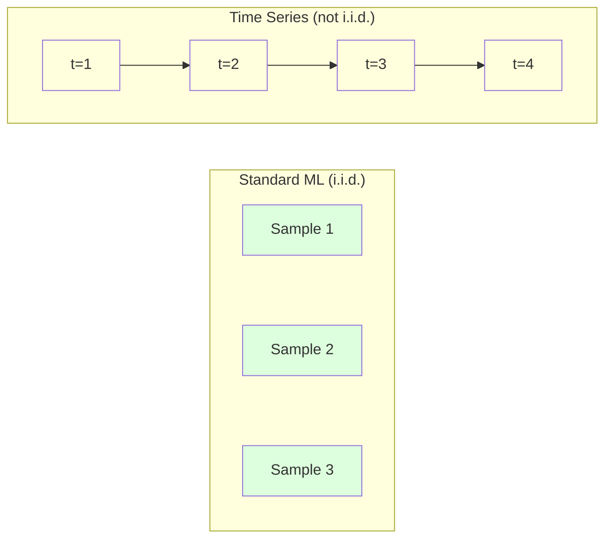
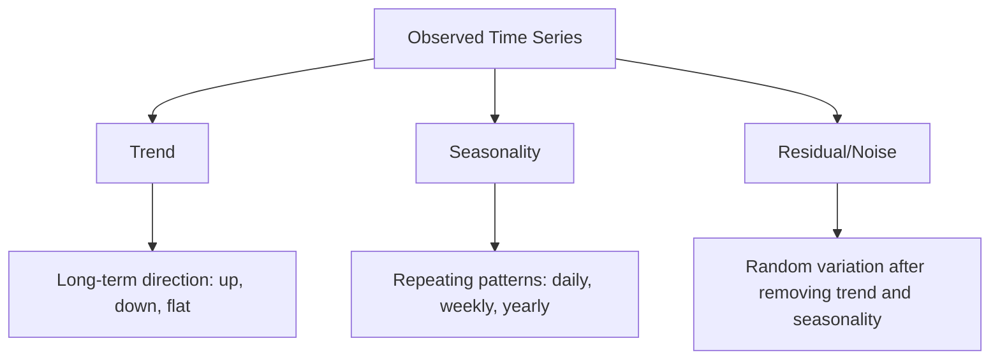
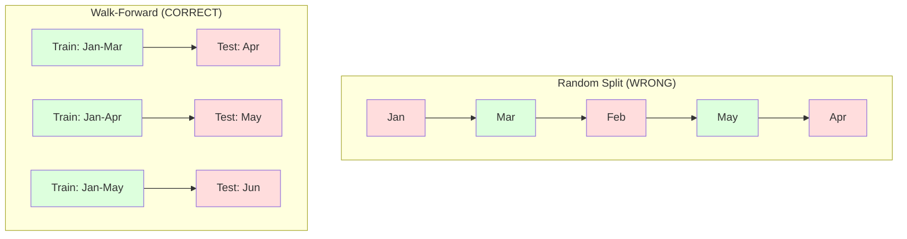

# 时间序列基础

> Past performance 确实可以预测 future results，前提是你先检查 stationarity。

**Type:** Build
**Language:** Python
**Prerequisites:** Phase 2, Lessons 01-09
**Time:** ~90 minutes

## 学习目标

- 将 time series 分解为 trend、seasonality 和 residual components，并测试 stationarity
- 实现 lag features 和 rolling statistics，把 time series 转换成 supervised learning problem
- 构建 walk-forward validation framework，防止 future data 泄漏到 training 中
- 解释为什么 random train/test splits 对 time series 无效，并演示它与正确 temporal splits 之间的 performance gap

## 问题

你有按时间排序的 data。Daily sales、hourly temperature、per-minute CPU usage、weekly stock prices。你想预测下一个 value、下一周、下一个 quarter。

你拿起标准 ML toolkit：random train/test split、cross-validation、feature matrix 输入、prediction 输出。每一步都是错的。

Time series 打破了 standard ML 依赖的 assumptions。Samples 不是 independent：今天的 temperature 依赖昨天的 temperature。Random splits 会把 future information 泄漏到 past。Backtest 中看起来很好的 features，上 production 后失败，因为它们依赖的 patterns 会随时间移动。

一个 model 用 random cross-validation 得到 95% accuracy，但用 proper time-based evaluation 可能只有 55%。这不是技术细节。它是一纸好看 model 和 production 可用 model 之间的区别。

本课覆盖 fundamentals：time data 有什么不同，如何诚实评估 models，以及如何把 time series 变成 standard ML models 能消费的 features。

## 概念

### Time Series 有什么不同

Standard ML 假设 i.i.d.，也就是 independent and identically distributed。每个 sample 都从同一个 distribution 中抽取，并且和其他 samples independent。Time series 同时违反这两点：

- **Not independent。** 今天的 stock price 依赖昨天的。This week's sales 和 last week's sales 相关。
- **Not identically distributed。** Distribution 会随时间 shifting。December 的 sales 和 March 的 sales 看起来不同。

这些 violation 不是小问题。它们会改变你构建 features、评估 models 以及选择 algorithms 的方式。



在 standard ML 中，samples 可以互换。Shuffle 它们不会改变任何东西。在 time series 中，order 就是一切。Shuffle 会摧毁 signal。

### Time Series 的 Components

每条 time series 都由以下部分组合而成：



- **Trend**：长期方向。Revenue 每年增长 10%。Global temperature 上升。
- **Seasonality**：固定间隔的 repeating patterns。Retail sales 在 December 激增。Air conditioning usage 在 July 达到 peak。
- **Residual**：去掉 trend 和 seasonality 后剩下的东西。如果 residual 看起来像 white noise，说明 decomposition 捕捉到了 signal。

### Stationarity

如果一条 time series 的 statistical properties（mean、variance、autocorrelation）不随时间变化，它就是 stationary 的。大多数 forecasting methods 都假设 stationarity。

**为什么重要：** Non-stationary series 的 mean 会 drift。用 January data 训练的 model 学到的是一个和 February 不同的 mean。它会系统性地错。

**如何检查：** 在窗口上计算 rolling mean 和 rolling standard deviation。如果它们 drift，这条 series 就是 non-stationary。

**如何修复：** Differencing。不要建模 raw values，而是建模连续 values 之间的 change：

```text
diff[t] = value[t] - value[t-1]
```

如果一次 differencing 不能让 series stationary，就再做一次（second-order differencing）。大多数 real-world series 最多需要两次。

**Example：**

Original series: [100, 102, 106, 112, 120]
First difference:  [2, 4, 6, 8] (still trending upward)
Second difference:  [2, 2, 2] (constant -- stationary)

Original series 有 quadratic trend。First differencing 把它变成 linear trend。Second differencing 让它变平。实践中，你很少需要超过两次。

**Formal test：** Augmented Dickey-Fuller (ADF) test 是 stationarity 的标准 statistical test。Null hypothesis 是“series is non-stationary”。p-value 小于 0.05 意味着你可以 reject null，并判断 series stationary。我们不会从零实现 ADF（它需要 asymptotic distribution tables），但代码中的 rolling statistics approach 提供了实用的 visual check。

### Autocorrelation

Autocorrelation 衡量 time t 的 value 和 time t-k（过去 k 步）的 value 之间有多相关。Autocorrelation function（ACF）会为每个 lag k 画出这个 correlation。

**ACF 告诉你：**
- Series 能记住多久以前的信息。如果 ACF 在 lag 5 后降到 zero，5 步以前的 values 就不重要。
- 是否存在 seasonality。如果 monthly data 在 lag 12 出现 spike，就有 yearly seasonality。
- 应该创建多少 lag features。使用 lags，直到 ACF 变得 negligible。

**PACF（Partial Autocorrelation Function）** 会去掉 indirect correlations。如果今天和 3 天前相关，只是因为二者都和昨天相关，那么 PACF 在 lag 3 会是 zero，而 ACF 在 lag 3 不会。

### Lag Features：把 Time Series 变成 Supervised Learning

Standard ML models 需要 feature matrix X 和 target y。Time series 给你的是一列 values。桥梁就是 lag features。

取 series [10, 12, 14, 13, 15]，创建 lag-1 和 lag-2 features：

| lag_2 | lag_1 | target |
|-------|-------|--------|
| 10    | 12    | 14     |
| 12    | 14    | 13     |
| 14    | 13    | 15     |

现在你有了一个 standard regression problem。任何 ML model（linear regression、random forest、gradient boosting）都可以从 lags 预测 target。

你还可以工程化这些 additional features：
- **Rolling statistics：** 最近 k 个 values 的 mean、std、min、max
- **Calendar features：** day of week、month、is_holiday、is_weekend
- **Differenced values：** 与前一步的 change
- **Expanding statistics：** cumulative mean、cumulative sum
- **Ratio features：** current value / rolling mean（离 recent average 有多远）
- **Interaction features：** lag_1 * day_of_week（weekday 对 momentum 的影响）

**需要多少 lags？** 使用 autocorrelation function。如果 ACF 到 lag 10 都 significant，就至少使用 10 个 lags。如果有 weekly seasonality，就包含 lag 7（也可能包含 14）。更多 lags 会给 model 更多 history，但也会带来更多需要 fit 的 features，提高 overfitting 风险。

**Target alignment trap。** 创建 lag features 时，target 必须是 time t 的 value，所有 features 必须使用 time t-1 或更早的 values。如果你不小心把 time t 的 value 作为 feature 放进去，你就有了一个 perfect predictor，也有了一个完全没用的 model。这是 time series feature engineering 中最常见的 bug。

### Walk-Forward Validation

这是本课最重要的概念。Standard k-fold cross-validation 会随机把 samples 分配到 train 和 test。对于 time series，这会泄漏 future information。



Walk-forward validation：
1. 在 time t 之前的数据上 train
2. 预测 time t+1（或 multi-step 时预测 t+1 到 t+k）
3. 把 window 向前滑动
4. 重复

每个 test fold 只包含所有 training data 之后的数据。没有 future leakage。这会给你一个诚实 estimate：model deployed 后会表现如何。

**Expanding window** 使用所有 historical data 进行 training（window 增长）。**Sliding window** 使用固定大小的 training window（window 滑动）。如果你认为 older data 仍然 relevant，用 expanding。如果世界在变化，old data 会伤害模型，用 sliding。

### ARIMA 直觉

ARIMA 是经典 time series model。它有三个 components：

- **AR（Autoregressive）：** 从 past values 预测。AR(p) 使用最近 p 个 values。
- **I（Integrated）：** 通过 differencing 达到 stationarity。I(d) 做 d 轮 differencing。
- **MA（Moving Average）：** 从 past forecast errors 预测。MA(q) 使用最近 q 个 errors。

ARIMA(p, d, q) 把三者组合起来。你可以基于 ACF/PACF analysis 或 automated search（auto-ARIMA）选择 p、d、q。

我们不会从零实现 ARIMA，它需要 numerical optimization，超出本课范围。关键 insight 是理解每个 component 做什么，这样你能解释 ARIMA results，也知道什么时候该用它。

### 什么时候使用什么

| Approach | Best For | Handles Seasonality | Handles External Features |
|----------|---------|-------------------|------------------------|
| Lag features + ML | Tabular with many external features | With calendar features | Yes |
| ARIMA | Single univariate series, short-term | SARIMA variant | No (ARIMAX for limited) |
| Exponential smoothing | Simple trend + seasonality | Yes (Holt-Winters) | No |
| Prophet | Business forecasting, holidays | Yes (Fourier terms) | Limited |
| Neural networks (LSTM, Transformer) | Long sequences, many series | Learned | Yes |

对于大多数 practical problems，lag features + gradient boosting 是最强 starting point。它自然支持 external features，不要求 stationarity，而且容易 debug。

### Forecasting Horizons and Strategies

Single-step forecasting 预测未来一步。Multi-step forecasting 预测多步。有三种 strategies：

**Recursive（iterated）：** 预测下一步，然后把 prediction 作为下一步的 input。简单，但 errors 会 accumulate：每个 prediction 都用 previous prediction，所以 mistakes 会 compound。

**Direct：** 为每个 horizon 训练一个单独 model。Model-1 预测 t+1，Model-5 预测 t+5。没有 error accumulation，但每个 model 的 training samples 更少，而且它们不共享信息。

**Multi-output：** 训练一个 model，同时输出所有 horizons。它会在 horizons 之间共享信息，但要求 model 支持 multiple outputs（或 custom loss function）。

对于大多数 practical problems，short horizons（1-5 steps）从 recursive 开始，longer horizons 从 direct 开始。

### Time Series 中的常见错误

| Mistake | Why it happens | How to fix |
|---------|---------------|-----------|
| Random train/test split | Standard ML 的习惯 | 使用 walk-forward 或 temporal split |
| 使用 future features | 误把 time t 的 feature 包进去 | Audit every feature for temporal alignment |
| Overfitting to seasonality | Model 记住 calendar patterns | 在 test set 中 hold out 一个完整 seasonal cycle |
| 忽略 scale changes | Revenue 翻倍，但 patterns 不变 | 建模 percentage change，而不是 absolute |
| 太多 lag features | “More history is better” | 使用 ACF 判断 relevant lags |
| Not differencing | “The model will figure it out” | Tree models 能处理 trends；linear models 需要 stationarity |

## Build It

`code/time_series.py` 中的代码从零实现了核心 building blocks。

### Lag Feature Creator

```python
def make_lag_features(series, n_lags):
    n = len(series)
    X = np.full((n, n_lags), np.nan)
    for lag in range(1, n_lags + 1):
        X[lag:, lag - 1] = series[:-lag]
    valid = ~np.isnan(X).any(axis=1)
    return X[valid], series[valid]
```

这会把 1D series 转换成 feature matrix：每一行使用最近 `n_lags` 个 values 作为 features，并把当前 value 作为 target。

### Walk-Forward Cross-Validation

```python
def walk_forward_split(n_samples, n_splits=5, min_train=50):
    assert min_train < n_samples, "min_train must be less than n_samples"
    step = max(1, (n_samples - min_train) // n_splits)
    for i in range(n_splits):
        train_end = min_train + i * step
        test_end = min(train_end + step, n_samples)
        if train_end >= n_samples:
            break
        yield slice(0, train_end), slice(train_end, test_end)
```

每个 split 都保证 training data 严格早于 test data。Training window 会随每个 fold 扩展。

### Simple Autoregressive Model

Pure AR model 本质上就是 lag features 上的 linear regression：

```python
class SimpleAR:
    def __init__(self, n_lags=5):
        self.n_lags = n_lags
        self.weights = None
        self.bias = None

    def fit(self, series):
        X, y = make_lag_features(series, self.n_lags)
        # Solve via normal equations
        X_b = np.column_stack([np.ones(len(X)), X])
        theta = np.linalg.lstsq(X_b, y, rcond=None)[0]
        self.bias = theta[0]
        self.weights = theta[1:]
        return self
```

从概念上说，它和 Lesson 02 的 linear regression 一样，只是 applied to 同一个变量的 time-lagged versions。

### Stationarity Check

代码会计算 rolling statistics，用 visual 和 numerical 的方式评估 stationarity：

```python
def check_stationarity(series, window=50):
    rolling_mean = np.array([
        series[max(0, i - window):i].mean()
        for i in range(1, len(series) + 1)
    ])
    rolling_std = np.array([
        series[max(0, i - window):i].std()
        for i in range(1, len(series) + 1)
    ])
    return rolling_mean, rolling_std
```

如果 rolling mean drift，或者 rolling std 变化，这条 series 就是 non-stationary。Apply differencing，然后再次检查。

代码也会通过比较 series 的前半段和后半段来检查 stationarity。如果 means 相差超过 half a standard deviation，或者 variance ratio 超过 2x，这条 series 会被标记为 non-stationary。

### Autocorrelation

```python
def autocorrelation(series, max_lag=20):
    n = len(series)
    mean = series.mean()
    var = series.var()
    acf = np.zeros(max_lag + 1)
    for k in range(max_lag + 1):
        cov = np.mean((series[:n-k] - mean) * (series[k:] - mean))
        acf[k] = cov / var if var > 0 else 0
    return acf
```

## Use It

在 sklearn 中，你可以直接把 lag features 交给任何 regressor：

```python
from sklearn.linear_model import Ridge
from sklearn.ensemble import GradientBoostingRegressor

X, y = make_lag_features(series, n_lags=10)

for train_idx, test_idx in walk_forward_split(len(X)):
    model = Ridge(alpha=1.0)
    model.fit(X[train_idx], y[train_idx])
    predictions = model.predict(X[test_idx])
```

使用 statsmodels 做 ARIMA：

```python
from statsmodels.tsa.arima.model import ARIMA

model = ARIMA(train_series, order=(5, 1, 2))
fitted = model.fit()
forecast = fitted.forecast(steps=30)
```

`time_series.py` 中的代码演示了两种 approaches，并使用 walk-forward validation 比较它们。

### sklearn TimeSeriesSplit

sklearn 提供 `TimeSeriesSplit`，它实现了 walk-forward validation：

```python
from sklearn.model_selection import TimeSeriesSplit

tscv = TimeSeriesSplit(n_splits=5)
for train_index, test_index in tscv.split(X):
    X_train, X_test = X[train_index], X[test_index]
    y_train, y_test = y[train_index], y[test_index]
    model.fit(X_train, y_train)
    score = model.score(X_test, y_test)
```

这等价于我们从零实现的 `walk_forward_split`，但集成进了 sklearn 的 cross-validation framework。你可以配合 `cross_val_score` 使用：

```python
from sklearn.model_selection import cross_val_score

scores = cross_val_score(model, X, y, cv=TimeSeriesSplit(n_splits=5))
print(f"Mean score: {scores.mean():.4f} +/- {scores.std():.4f}")
```

### Evaluation Metrics

Time series forecasting 使用 regression metrics，但需要 time-aware context：

- **MAE (Mean Absolute Error)：** |y_true - y_pred| 的平均值。容易用原始单位解释。“On average, predictions are off by 3.2 degrees.”
- **RMSE (Root Mean Squared Error)：** Mean squared error 的平方根。相比 MAE 更惩罚 large errors。当 big errors 比许多 small errors 更糟时使用。
- **MAPE (Mean Absolute Percentage Error)：** |error / true_value| * 100 的平均值。Scale-independent，适合跨不同 series 比较。但 true values 为 zero 时 undefined。
- **Naive baseline comparison：** 永远和 simple baselines 比较。Seasonal naive baseline 会预测上一个 period 的 value（yesterday、last week）。如果你的 model 打不过 naive，就有问题。

### Rolling Features

代码演示了如何在 lag features 上添加 rolling statistics（7 天和 14 天 windows 的 mean、std、min、max）。这些 features 会给 model 提供 recent trends 和 volatility 信息，这是 lag features alone 捕捉不到的。

例如，rolling mean 上升，暗示 upward trend。Rolling std 增大，暗示 growing volatility。这类 patterns 是 tree-based models 能学习、linear models 学不到的东西。

## Ship It

本课产出：
- `outputs/prompt-time-series-advisor.md`，一个用于 framing time series problems 的 prompt
- `code/time_series.py`，包含 lag features、walk-forward validation、AR model 和 stationarity checks

### 你必须打败的 Baselines

构建任何 model 之前，先建立 baselines：

1. **Last value（persistence）。** 预测 tomorrow 和 today 一样。对很多 series 来说，这个 baseline 出奇地难打败。
2. **Seasonal naive。** 预测 today 和上周同一天（或去年同一天）一样。如果你的 model 打不过它，就说明它没有学到 seasonality 之外的有用 pattern。
3. **Moving average。** 预测最近 k 个 values 的平均值。它能 smooth noise，但不能捕捉 sudden changes。

如果你的 fancy ML model 输给 seasonal naive baseline，你有 bug。最常见原因是：features 中有 future leakage、evaluation method 错了，或者这条 series 真的 random 且不可预测。

### Practical Tips

1. **从 plotting 开始。** 在任何 modeling 之前，画出 raw series。寻找 trends、seasonality、outliers、structural breaks（behavior 中的 sudden changes）。30 秒的 visual inspection 经常比一小时 automated analysis 更有信息量。

2. **先 difference，再 model。** 如果 series 有明显 trend，在创建 lag features 前先 difference。Tree-based models 能处理 trends，但 linear models 不能，而 differencing 通常不会伤害。

3. **至少 hold out 一个完整 seasonal cycle。** 如果有 weekly seasonality，test set 至少需要完整一周。如果是 monthly，至少完整一个月。否则你无法评估 model 是否捕捉到了 seasonal pattern。

4. **在 production 中 monitor。** Time series models 会随着世界变化而 degrade。滚动追踪 prediction errors。当 errors 开始上升时，用 recent data retrain model。

5. **小心 regime changes。** 用 pre-pandemic data 训练的 model 无法预测 post-pandemic behavior。把 known regime changes 的 indicators 加为 features，或者使用会遗忘 old data 的 sliding window。

6. **Log-transform skewed series。** Revenue、prices 和 counts 经常 right-skewed。取 log 会 stabilize variance，并把 multiplicative patterns 变成 additive patterns，让 linear models 可以处理。先在 log space forecast，再 exponentiate 回 original units。

## 练习

1. **Stationarity experiment。** 生成一个带 linear trend 的 series。用 rolling statistics 检查 stationarity。应用 first differencing。再次检查。Quadratic trend 需要几轮 differencing？

2. **Lag selection。** 在 seasonal series（period=7）上计算 ACF。哪些 lags 的 autocorrelation 最高？只用这些 lags（不要用连续 lags）创建 lag features。相比使用 lags 1 through 7，accuracy 是否提升？

3. **Walk-forward vs random split。** 在 lag features 上训练 Ridge regression。分别用 random 80/20 split 和 walk-forward validation 评估。Random split 会高估 performance 多少？

4. **Feature engineering。** 向 lag features 添加 rolling mean（window=7）、rolling std（window=7）和 day-of-week features。使用 walk-forward validation 比较添加前后的 accuracy。

5. **Multi-step forecasting。** 修改 AR model，让它预测 5 steps ahead，而不是 1 step。比较两种 strategies：(a) 预测一步，把 prediction 作为下一步 input（recursive）；(b) 为每个 horizon 训练 separate models（direct）。哪种更准确？

## 关键术语

| Term | What people say | What it actually means |
|------|----------------|----------------------|
| Stationarity | “The stats don't change over time” | Mean、variance 和 autocorrelation structure 随时间保持 constant 的 series |
| Differencing | “Subtract consecutive values” | 计算 y[t] - y[t-1] 来移除 trends 并达到 stationarity |
| Autocorrelation (ACF) | “How a series correlates with itself” | Time series 与自身 lagged copy 之间的 correlation，作为 lag 的函数 |
| Partial autocorrelation (PACF) | “Direct correlation only” | 去掉所有 shorter lags 影响后，lag k 处的 autocorrelation |
| Lag features | “Past values as inputs” | 使用 y[t-1]、y[t-2]、...、y[t-k] 作为 features 来预测 y[t] |
| Walk-forward validation | “Time-respecting cross-validation” | Training data 在时间顺序上永远早于 test data 的 evaluation |
| ARIMA | “The classic time series model” | AutoRegressive Integrated Moving Average：结合 past values（AR）、differencing（I）和 past errors（MA） |
| Seasonality | “Repeating calendar patterns” | Time series 中与 calendar periods（日、周、年）绑定的 regular、predictable cycles |
| Trend | “The long-term direction” | Series level 随时间持续上升或下降 |
| Expanding window | “Use all history” | Training set 随每个 fold 增长的 walk-forward validation |
| Sliding window | “Fixed-size history” | Training set 是固定长度 window，并向前滑动的 walk-forward validation |

## 延伸阅读

- [Hyndman and Athanasopoulos, Forecasting: Principles and Practice (3rd ed.)](https://otexts.com/fpp3/)，最好的免费 time series forecasting textbook
- [scikit-learn Time Series Split](https://scikit-learn.org/stable/modules/generated/sklearn.model_selection.TimeSeriesSplit.html)，sklearn 的 walk-forward splitter
- [statsmodels ARIMA docs](https://www.statsmodels.org/stable/generated/statsmodels.tsa.arima.model.ARIMA.html)，带 diagnostics 的 ARIMA implementation
- [Makridakis et al., The M5 Competition (2022)](https://www.sciencedirect.com/science/article/pii/S0169207021001874)，展示 ML methods vs statistical methods 的 large-scale forecasting competition
