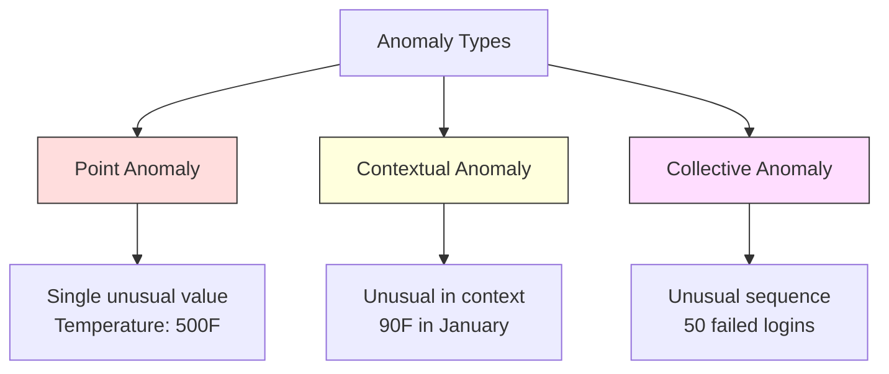
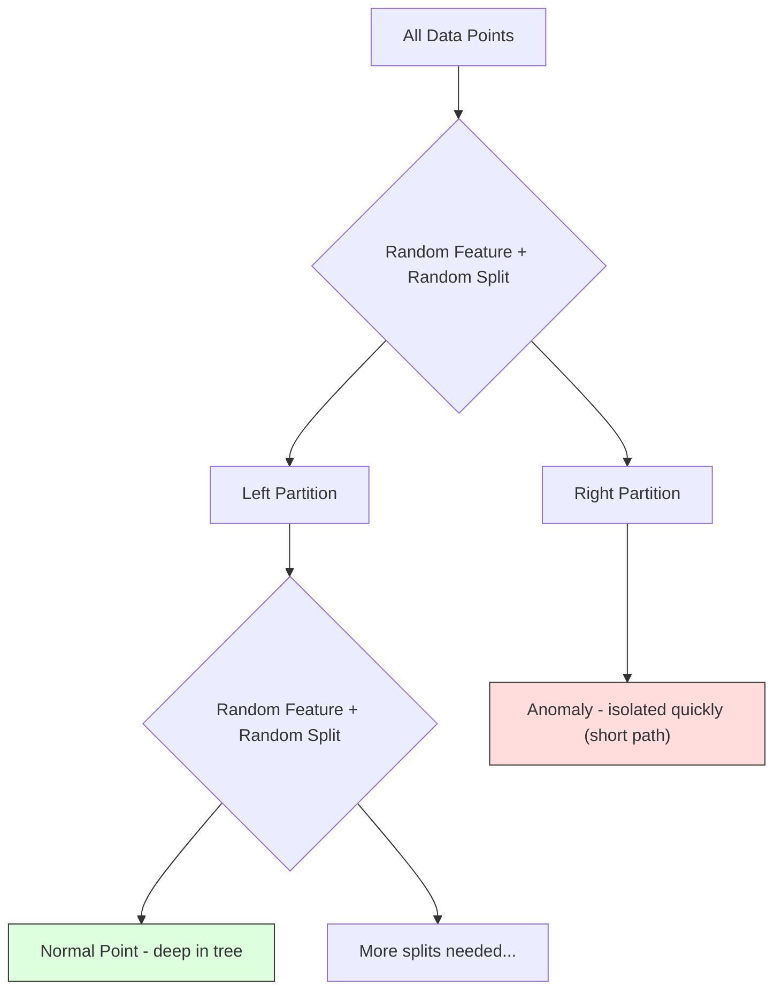
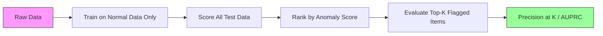

# 异常检测

> Normal 很容易定义。Abnormal 就是任何不合拍的东西。

**Type:** Build
**Language:** Python
**Prerequisites:** Phase 2, Lessons 01-09
**Time:** ~75 minutes

## 学习目标

- 从零实现 Z-score、IQR 和 Isolation Forest anomaly detection methods
- 区分 point、contextual 和 collective anomalies，并为每种 anomaly 选择合适 detection method
- 解释为什么 anomaly detection 被表述为 modeling normal data，而不是 classifying anomalies
- 比较 unsupervised anomaly detection 和 supervised classification，并评估 novel anomaly coverage 与 precision 之间的 tradeoff

## 问题

一张信用卡下午 2 点在 New York 使用，2:05 又在 Tokyo 使用。工厂 sensor 读数 150 度，而 normal range 是 80-120。某台 server 每秒发送 50,000 个 requests，而 daily average 是 200。

这些都是 anomalies。找到它们很重要。Fraud 会造成数十亿美元损失。Equipment failures 会造成 downtime。Network intrusions 会造成 data 泄漏。

挑战在于：你很少有 labeled anomaly examples。Fraud 只占 transactions 的 0.1%。Equipment failures 一年只发生几次。你无法训练 standard classifier，因为 “anomaly” class 几乎没有东西可学。即使你有一些 labels，你见过的 anomalies 也不是未来会遇到的全部类型。明天的 fraud scheme 会和今天不同。

Anomaly detection 会反转问题。不要学习什么是 abnormal，而是学习什么是 normal。任何偏离 normal 的东西都可疑。它不需要 labels，可以适应新类型 anomalies，也能 scale 到 massive datasets。

## 概念

### Anomalies 的类型

不是所有 anomalies 都一样：

- **Point anomalies。** 单个 data point 无论在什么 context 下都很异常。500 度的 temperature reading。一个通常只花 $50 的账户突然有 $50,000 transaction。
- **Contextual anomalies。** 某个 data point 在其 context 下异常。90 度在 summer 正常，在 winter 异常。同一个 value，不同 context。
- **Collective anomalies。** 一串 data points 作为整体异常，即使每个单点可能都正常。5 次 login failure 正常。连续 50 次就是 brute-force attack。

大多数 methods 检测 point anomalies。Contextual anomalies 需要 time 或 location features。Collective anomalies 需要 sequence-aware methods。



### Unsupervised Framing

在 standard classification 中，你有两个 classes 的 labels。在 anomaly detection 中，你通常处于以下三种情况之一：

1. **Fully unsupervised。** 完全没有 labels。你在所有 data 上 fit detector，并希望 anomalies 足够少，不会污染 “normal” model。
2. **Semi-supervised。** 你有一份 clean dataset，里面只有 normal data。你在这份 clean set 上 fit，再 score 其他所有数据。只要可行，这是最强 setup。
3. **Weakly supervised。** 你有少量 labeled anomalies。用它们做 evaluation，而不是 training。先 unsupervised training，再在 labeled subset 上测 precision/recall。

关键 insight：anomaly detection 从根本上不同于 classification。你在 modeling normal data 的 distribution，而不是学习两个 classes 之间的 decision boundary。

### Supervised vs Unsupervised：Tradeoff

如果你确实有 labeled anomalies，应该把它们用于 training（supervised classification），还是只用于 evaluation（unsupervised detection）？

**Supervised（当作 classification）：**
- 能捕捉你以前见过的 exact anomaly types
- 对 known anomaly types 有更高 precision
- 完全错过 novel anomaly types
- 新 anomaly types 出现时需要 retraining
- 需要足够 anomaly examples（通常太少）

**Unsupervised（model normal，flag deviations）：**
- 能捕捉任何偏离 normal 的东西，包括 novel types
- 不需要 labeled anomalies
- False positive rate 更高（不是所有 unusual 都坏）
- 对 distribution shift 更 robust

实践中，最好的 systems 会组合两者：unsupervised detection 提供 broad coverage，supervised models 处理 known high-priority anomaly types，human review 处理 ambiguous cases。

### Z-Score Method

最简单的方法。计算每个 feature 的 mean 和 standard deviation。把任何距离 mean 超过 k 个 standard deviations 的 point 标记出来。

```text
z_score = (x - mean) / std
anomaly if |z_score| > threshold
```

默认 threshold 是 3.0（对于 Gaussian distribution，99.7% normal data 都在 3 个 standard deviations 内）。

**Strengths：** 简单、快速、可解释（“这个 value 距离 normal 有 4.5 个 standard deviations”）。

**Weaknesses：** 假设 data 是 normally distributed。对 training data 中的 outliers 很敏感（outliers 会移动 mean 并拉大 std，让它们更难被检测出来）。在 multimodal distributions 上失败。

**适用场景：** Single-feature monitoring，且 data 大致 bell-shaped。Server response times、manufacturing tolerances、baseline 稳定的 sensor readings。

**失败场景：** Multi-cluster data（两个 office locations 有不同 baseline temperatures）、skewed data（transaction amounts 中 $1000 少见但不异常）、training set 里已有 outliers 的 data。

### IQR Method

比 Z-score 更 robust。它使用 interquartile range，而不是 mean 和 standard deviation。

```text
Q1 = 25th percentile
Q3 = 75th percentile
IQR = Q3 - Q1
lower_bound = Q1 - factor * IQR
upper_bound = Q3 + factor * IQR
anomaly if x < lower_bound or x > upper_bound
```

默认 factor 是 1.5。

**Strengths：** 对 outliers robust（percentiles 不受 extreme values 影响）。适用于 skewed distributions。没有 normality assumption。

**Weaknesses：** 只是一元方法（对每个 feature 独立应用）。无法检测只有把 features 合在一起看才异常的 points（某个 point 在每个 feature 上单独看都正常，但在 joint space 中异常）。

**Practical note：** IQR 中的 1.5 factor 对应 box plot 的 whiskers。Whiskers 外的 points 是 potential outliers。使用 3.0 而不是 1.5 会让 detector 更 conservative（更少 flags、更少 false positives）。正确 factor 取决于你对 false alarms 的容忍度。

### Isolation Forest

关键 insight：anomalies 少且不同。在随机划分 data 时，anomalies 更容易被 isolate，也就是只需要更少 random splits 就能和其他 points 分开。



**工作方式：**
1. 构建许多 random trees（一个 isolation forest）
2. 在每个 node，随机选择一个 feature，并在该 feature 的 min 和 max 之间随机选择 split value
3. 持续 splitting，直到每个 point 都被 isolate（进入自己的 leaf）
4. Anomalies 在所有 trees 上的 average path length 更短

**为什么有效：** Normal points 位于 dense regions。需要很多 random splits 才能把它和 neighbors 分开。Anomalies 位于 sparse regions。一两次 random splits 就足以 isolate 它们。

Anomaly score 基于所有 trees 的 average path length，并用 random binary search tree 的 expected path length 进行 normalization：

```text
score(x) = 2^(-average_path_length(x) / c(n))
```

其中 `c(n)` 是 n 个 samples 的 expected path length。Score 接近 1 表示 anomaly。Score 接近 0.5 表示 normal。Score 接近 0 表示非常 normal（位于 dense clusters 深处）。

**Strengths：** 无 distribution assumptions。适用于 high dimensions。Scale 良好（sublinear in sample size，因为每棵 tree 使用 subsample）。能处理 mixed feature types。

**Weaknesses：** 对 dense regions 中的 anomalies 较弱（masking effect）。当许多 features irrelevant 时，random splitting 效果较差。

**Key hyperparameters：**
- `n_estimators`：Trees 数量。100 通常足够。更多 trees 会给出更稳定 scores，但 computation 更慢。
- `max_samples`：每棵 tree 的 samples 数量。原论文默认 256。较小 values 会让 individual trees 不那么准确，但增加 diversity。Subsampling 正是 Isolation Forest 快的原因：每棵 tree 只看 data 的一小部分。
- `contamination`：Expected fraction of anomalies。只用于设置 threshold，不影响 scores 本身。

### Local Outlier Factor (LOF)

LOF 会比较某个 point 周围的 local density 和它 neighbors 周围的 density。一个点如果处在 sparse region，却被 dense regions 包围，就是 anomalous。

**工作方式：**
1. 对每个 point，找到它的 k nearest neighbors
2. 计算 local reachability density（neighborhood 有多 dense）
3. 比较每个 point 的 density 和其 neighbors 的 densities
4. 如果某个 point 的 density 明显低于 neighbors，它就是 outlier

**LOF score：**
- LOF 接近 1.0 表示 density 与 neighbors 相似（normal）
- LOF 大于 1.0 表示 density 低于 neighbors（potentially anomalous）
- LOF 远大于 1.0（例如 2.0+）表示 density 显著更低（likely anomaly）

“Local” 部分很关键。考虑一个有两个 clusters 的 dataset：一个 1000 points 的 dense cluster，一个 50 points 的 sparse cluster。Sparse cluster 边缘的 point 并不 globally unusual，它有 50 个 neighbors。但如果它的 immediate neighbors 比它更 dense，它就是 locally unusual。LOF 捕捉到了 global methods 会错过的 nuance。

**Strengths：** 能检测 local anomalies（那些在自己 neighborhood 中 unusual 的 points，即使它们并非 globally unusual）。适用于 densities 不同的 clusters。

**Weaknesses：** 在 large datasets 上慢（naive implementation 是 O(n^2)）。对 k 的选择敏感。在 very high dimensions 中表现不好（curse of dimensionality 会影响 distance calculations）。

### 方法比较

| Method | Assumptions | Speed | Handles High Dims | Detects Local Anomalies |
|--------|------------|-------|-------------------|------------------------|
| Z-score | Normal distribution | Very fast | Yes (per feature) | No |
| IQR | None (per feature) | Very fast | Yes (per feature) | No |
| Isolation Forest | None | Fast | Yes | Partially |
| LOF | Distance is meaningful | Slow | Poorly | Yes |

### Evaluation Challenges

评估 anomaly detectors 比评估 classifiers 更难：

- **Extreme class imbalance。** 如果 anomalies 只有 0.1%，全部预测为 “normal” 就有 99.9% accuracy。Accuracy 没用。
- **AUROC 会误导。** 在 heavy imbalance 下，AUROC 看起来可能很好，即使 model 在 practical thresholds 下漏掉大多数 anomalies。
- **更好的 metrics：** Precision@k（top k flagged items 中有多少是真 anomalies）、AUPRC（area under precision-recall curve），以及 fixed false positive rate 下的 recall。



### Anomaly Detection Pipeline

实践中，anomaly detection 遵循这个 workflow：

1. **Collect baseline data。** 理想情况下，选择一段你知道没有（或很少）anomalies 的时期。
2. **Feature engineering。** Raw features 加 derived features（rolling statistics、time features、ratios）。
3. **Train the detector。** 在 baseline data 上 fit。Model 学习 “normal” 长什么样。
4. **Score new data。** 每个 new observation 得到一个 anomaly score。
5. **Threshold selection。** 选择 score cutoff。这是 business decision：更高 threshold 意味着更少 false alarms，但更多 missed anomalies。
6. **Alert and investigate。** Flagged points 进入 human review 或 automated response。
7. **Feedback collection。** 记录 flagged items 是 true anomalies 还是 false alarms。用这些 data 持续 evaluate detector，并 tune threshold。

这个 pipeline 永远不会“一次完成”。Data distributions 会 shift，new anomaly types 会出现，thresholds 需要调整。把 anomaly detection 当作 living system，而不是 one-time model。

## Build It

`code/anomaly_detection.py` 中的代码从零实现了 Z-score、IQR 和 Isolation Forest。

### Z-Score Detector

```python
def zscore_detect(X, threshold=3.0):
    mean = X.mean(axis=0)
    std = X.std(axis=0)
    std[std == 0] = 1.0
    z = np.abs((X - mean) / std)
    return z.max(axis=1) > threshold
```

简单且 vectorized。如果任意 feature 超过 threshold，就 flag 这个 point。

### IQR Detector

```python
def iqr_detect(X, factor=1.5):
    q1 = np.percentile(X, 25, axis=0)
    q3 = np.percentile(X, 75, axis=0)
    iqr = q3 - q1
    iqr[iqr == 0] = 1.0
    lower = q1 - factor * iqr
    upper = q3 + factor * iqr
    outside = (X < lower) | (X > upper)
    return outside.any(axis=1)
```

### 从零实现 Isolation Forest

From-scratch implementation 会构建 isolation trees，随机 partition feature space：

```python
class IsolationTree:
    def __init__(self, max_depth):
        self.max_depth = max_depth

    def fit(self, X, depth=0):
        n, p = X.shape
        if depth >= self.max_depth or n <= 1:
            self.is_leaf = True
            self.size = n
            return self
        self.is_leaf = False
        self.feature = np.random.randint(p)
        x_min = X[:, self.feature].min()
        x_max = X[:, self.feature].max()
        if x_min == x_max:
            self.is_leaf = True
            self.size = n
            return self
        self.threshold = np.random.uniform(x_min, x_max)
        left_mask = X[:, self.feature] < self.threshold
        self.left = IsolationTree(self.max_depth).fit(X[left_mask], depth + 1)
        self.right = IsolationTree(self.max_depth).fit(X[~left_mask], depth + 1)
        return self
```

Isolate 一个 point 所需的 path length 决定它的 anomaly score。更短 path 表示更 anomalous。

`IsolationForest` class 会包装多棵 trees：

```python
class IsolationForest:
    def __init__(self, n_estimators=100, max_samples=256, seed=42):
        self.n_estimators = n_estimators
        self.max_samples = max_samples

    def fit(self, X):
        sample_size = min(self.max_samples, X.shape[0])
        max_depth = int(np.ceil(np.log2(sample_size)))
        for _ in range(self.n_estimators):
            idx = rng.choice(X.shape[0], size=sample_size, replace=False)
            tree = IsolationTree(max_depth=max_depth)
            tree.fit(X[idx])
            self.trees.append(tree)

    def anomaly_score(self, X):
        avg_path = average path length across all trees
        scores = 2.0 ** (-avg_path / c(max_samples))
        return scores
```

Normalization factor `c(n)` 是包含 n 个 elements 的 binary search tree 中 unsuccessful search 的 expected path length。它等于 `2 * H(n-1) - 2*(n-1)/n`，其中 `H` 是 harmonic number。这个 normalization 保证 scores 可以跨不同大小 datasets 比较。

### Demo Scenarios

代码会生成多个 test scenarios：

1. **Single cluster with outliers。** 一个 2D Gaussian cluster，并在离 center 很远的位置注入 anomalies。所有 methods 在这里都应该有效。
2. **Multimodal data。** 三个大小和 densities 不同的 clusters。Clusters 之间的 points 是 anomalous。Z-score 会吃力，因为 per-feature ranges 很宽。
3. **High-dimensional data。** 50 个 features，但 anomalies 只在其中 5 个 features 上不同。测试 methods 是否能在 feature subset 中找到 anomalies。

每个 demo 都使用 precision、recall、F1 和 Precision@k 比较所有 methods。

## Use It

使用 sklearn（library implementations，不是 from-scratch）：

```python
from sklearn.ensemble import IsolationForest
from sklearn.neighbors import LocalOutlierFactor

iso = IsolationForest(n_estimators=100, contamination=0.05, random_state=42)
iso.fit(X_train)
predictions = iso.predict(X_test)

lof = LocalOutlierFactor(n_neighbors=20, contamination=0.05, novelty=True)
lof.fit(X_train)
predictions = lof.predict(X_test)
```

注意，`contamination` 设置 expected fraction of anomalies。正确设置它很重要：太低会漏掉 anomalies，太高会制造 false alarms。

`anomaly_detection.py` 中的代码会在同一份 data 上比较 from-scratch implementations 和 sklearn。

### sklearn Contamination Parameter

sklearn 中的 `contamination` parameter 决定如何把 continuous anomaly scores 转成 binary predictions 的 threshold。它不会改变 underlying scores。

```python
iso_5 = IsolationForest(contamination=0.05)
iso_10 = IsolationForest(contamination=0.10)
```

二者产生同样的 anomaly scores。但 `iso_5` 会 flag top 5%，而 `iso_10` 会 flag top 10%。如果你不知道真实 anomaly rate（通常你不知道），把 contamination 设为 "auto"，并直接使用 raw scores。基于 false positives 和 false negatives 的 cost tradeoff 设置自己的 threshold。

### One-Class SVM

另一个值得知道的 unsupervised anomaly detector。One-Class SVM 使用 kernel trick，在 high-dimensional feature space 中围绕 normal data fit 一个 boundary。

```python
from sklearn.svm import OneClassSVM

oc_svm = OneClassSVM(kernel="rbf", gamma="auto", nu=0.05)
oc_svm.fit(X_train)
predictions = oc_svm.predict(X_test)
```

`nu` parameter 近似 anomaly fraction。One-Class SVM 在 small to medium datasets 上表现好，但无法 scale 到 very large data（kernel matrix quadratic growth）。

### Autoencoder Approach（Preview）

Autoencoders 是 neural networks，它们学习 compress 和 reconstruct data。在 normal data 上训练。Test time，anomalies 会有 high reconstruction error，因为 network 只学会 reconstruct normal patterns。

这会在 Phase 3（Deep Learning）中覆盖，但原则一样：model what is normal，flag what deviates。

### Ensemble Anomaly Detection

就像 ensemble methods 会提升 classification（Lesson 11），组合多个 anomaly detectors 也会提升 detection。最简单 approach：

1. 运行多个 detectors（Z-score、IQR、Isolation Forest、LOF）
2. 把每个 detector 的 scores normalize 到 [0, 1]
3. 平均 normalized scores
4. Flag average score 超过 threshold 的 points

这会减少 false positives，因为不同 methods 有不同 failure modes。一个被四种 methods 全部 flag 的 point 几乎肯定 anomalous。只被一种 method flag 的 point 可能只是该 method 的 quirk。

更 sophisticated ensembles 会按每个 detector 的 estimated reliability 加权（如果有 known anomalies 的 validation set，就可以测量 reliability）。

### Production Considerations

1. **Threshold drift。** 当 data distribution shift 时，fixed threshold 会过时。Monitor anomaly scores 的 distribution，并定期调整。
2. **Alert fatigue。** False alarms 太多时，operators 会停止关注。先用 high threshold（更少、更可靠 alerts），随着 trust 建立再降低。
3. **Ensemble approach。** Production 中组合多个 detectors。只有多个 methods 都认为 anomalous 时才 flag。这样可以显著减少 false positives。
4. **Feature engineering。** Raw features 很少足够。添加 rolling statistics、ratios、time-since-last-event 和 domain-specific features。好的 feature set 比 detector 选择更重要。
5. **Feedback loop。** 当 operators 调查 flagged items 并 confirm 或 dismiss 后，把结果反馈进 system。随时间积累 labeled data，用来 evaluate 和 improve detector。

## Ship It

本课产出：
- `outputs/skill-anomaly-detector.md`，一个用于选择正确 detector 的 decision skill
- `code/anomaly_detection.py`，从零实现 Z-score、IQR 和 Isolation Forest，并与 sklearn 对比

### Choosing a Threshold

Anomaly score 是 continuous 的。你需要一个 threshold 来做 binary decisions。这是 business decision，不是纯技术问题。

考虑两个场景：
- **Fraud detection。** 漏掉 fraud 代价高（chargebacks、customer trust）。False alarms 只会让 human analyst 花 5 分钟调查。把 threshold 设低，捕捉更多 fraud，接受更多 false alarms。
- **Equipment maintenance。** False alarm 意味着一次 unnecessary shutdown，损失 $50,000。Missed failure 意味着 $500,000 repair。Threshold 要平衡这些 costs。

在两种情况下，optimal threshold 都取决于 false positives 和 false negatives 的 cost ratio。画出不同 thresholds 下的 precision 和 recall，叠加 cost function，选择 minimum-cost point。

### Scaling to Production

Production 中做 real-time anomaly detection：

1. **Batch training, online scoring。** 定期（daily、weekly）用 recent normal data 训练 model。每个 new observation 到达时即时 score。
2. **Feature computation must match。** 如果 training 使用了 30 天 rolling statistics，你就需要 30 天 history 来为 new observation 计算 features。Buffer required history。
3. **Score distribution monitoring。** 追踪 anomaly scores 的 distribution。如果 median score drift upward，要么 data 在变，要么 model stale。
4. **Explainability。** 当你 flag anomaly 时，说清楚原因。Z-score：“Feature X is 4.2 standard deviations above normal。”Isolation Forest：“This point was isolated in 3.1 splits on average (normal points take 8.5).”

## 练习

1. **Threshold tuning。** 用从 1.0 到 5.0、步长 0.5 的 thresholds 运行 Z-score detector。画出每个 threshold 下的 precision 和 recall。你的 data 的 sweet spot 在哪里？

2. **Multivariate anomalies。** 创建 2D data，其中每个 feature 单独看都正常，但组合起来异常（例如远离 main cluster diagonal 的 points）。展示 per-feature Z-score 会漏掉这些点，而 Isolation Forest 能抓到。

3. **LOF from scratch。** 使用 k-nearest neighbors 实现 Local Outlier Factor。和 sklearn 的 LocalOutlierFactor 在同一份 data 上比较。使用 k=10 和 k=50，k 的选择如何影响结果？

4. **Streaming anomaly detection。** 修改 Z-score detector，让它在 streaming setting 中工作：new points 到达时更新 running mean 和 variance（Welford's online algorithm）。和同一 data 上的 batch Z-score 比较。

5. **Real-world evaluation。** 取一个带 known anomalies 的 dataset（例如 Kaggle 上的 credit card fraud）。用 precision@100、precision@500 和 AUPRC 评估四种 methods。哪种 method 最好？为什么？

## 关键术语

| Term | What people say | What it actually means |
|------|----------------|----------------------|
| Anomaly | “Outlier, unusual point” | 明显偏离 normal data expected pattern 的 data point |
| Point anomaly | “A single weird value” | 无论 context 如何都 unusual 的 individual observation |
| Contextual anomaly | “Normal value, wrong context” | 在给定 context（time、location 等）下 unusual，但在其他 context 中可能 normal 的 observation |
| Isolation Forest | “Random splits to find outliers” | 由 random trees 组成的 ensemble，用比 normal points 更少的 splits isolate anomalies |
| Local Outlier Factor | “Compare density to neighbors” | Flag 那些 local density 明显低于其 neighbors density 的 points |
| Z-score | “Standard deviations from mean” | (x - mean) / std，用 standard deviation 为单位衡量 point 离 center 多远 |
| IQR | “Interquartile range” | Q3 - Q1，衡量 data 中间 50% 的 spread，用于 robust outlier detection |
| Contamination | “Expected fraction of anomalies” | 告诉 detector 应该把多大比例 data flag 为 anomalous 的 hyperparameter |
| Precision@k | “Of the top k flags, how many are real” | 只在 k 个最可疑 points 上计算 precision，适用于 imbalanced anomaly detection |
| AUPRC | “Area under precision-recall curve” | 总结所有 thresholds 下 precision-recall performance 的 metric，对 imbalanced data 比 AUROC 更好 |

## 延伸阅读

- [Liu et al., Isolation Forest (2008)](https://cs.nju.edu.cn/zhouzh/zhouzh.files/publication/icdm08b.pdf)，original Isolation Forest paper
- [Breunig et al., LOF: Identifying Density-Based Local Outliers (2000)](https://dl.acm.org/doi/10.1145/342009.335388)，original LOF paper
- [scikit-learn Outlier Detection docs](https://scikit-learn.org/stable/modules/outlier_detection.html)，所有 sklearn anomaly detectors 的 overview
- [Chandola et al., Anomaly Detection: A Survey (2009)](https://dl.acm.org/doi/10.1145/1541880.1541882)，anomaly detection methods 的 comprehensive survey
- [Goldstein and Uchida, A Comparative Evaluation of Unsupervised Anomaly Detection Algorithms (2016)](https://journals.plos.org/plosone/article?id=10.1371/journal.pone.0152173)，10 种 methods 在 real datasets 上的 empirical comparison
