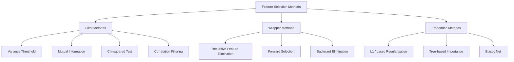
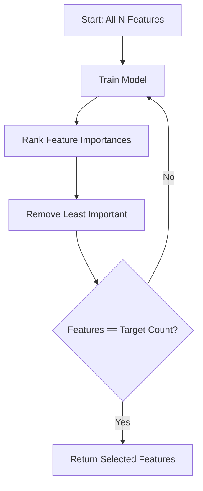
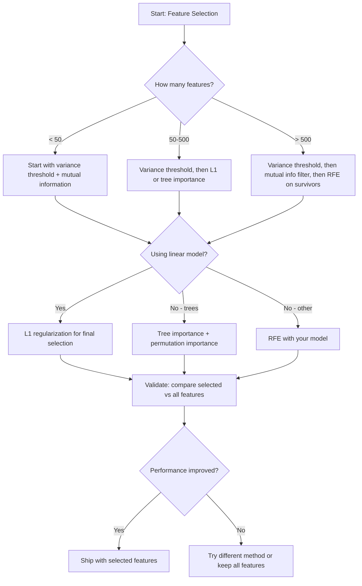

# 特征选择

> More features 并不更好。Right features 才更好。

**Type:** Build
**Language:** Python
**Prerequisites:** Phase 2, Lessons 01-09, 08 (feature engineering)
**Time:** ~75 minutes

## 学习目标

- 从零实现 filter methods（variance threshold、mutual information、chi-squared）和 wrapper methods（RFE、forward selection）
- 解释为什么 mutual information 能捕捉 correlation 会错过的 nonlinear feature-target relationships
- 比较 L1 regularization（embedded selection）和 RFE（wrapper selection），并评估它们的 computational tradeoffs
- 构建一个组合多种 methods 的 feature selection pipeline，并展示它在 held-out data 上带来的 generalization improvement

## 问题

你有 500 个 features。Model 训练很慢，不断 overfit，而且没人能解释它学到了什么。你继续添加 features，希望 performance 会改善。结果更糟。

这就是 curse of dimensionality。随着 features 数量增加，feature space 的 volume 会爆炸。Data points 变得 sparse。Points 之间的 distances 开始 converging。Model 需要指数级更多 data 才能找到真实 patterns。Noise features 淹没 signal features。Overfitting 变成默认结果。

Feature selection 是解药。剥掉 noise。移除 redundancy。保留真正携带 target 信息的 features。结果是：training 更快、generalization 更好，而且 model 可以被解释。

目标不是使用所有 available information。目标是使用正确的信息。

## 概念

### Feature Selection 的三类方法

每种 feature selection method 都属于三类之一：



**Filter methods** 使用 statistical measure 独立地给每个 feature 打分。它们不使用 model。速度快，但会错过 feature interactions。

**Wrapper methods** 训练 model 来评估 feature subsets。它们使用 model performance 作为 score。结果通常更好，但因为要反复 retrain model，所以 expensive。

**Embedded methods** 在 model training 过程中选择 features。L1 regularization 会把 weights 推到 zero。Decision trees 会在最有用的 features 上 split。Selection 发生在 fitting 期间，而不是 separate step。

### Variance Threshold

最简单的 filter。如果一个 feature 在 samples 之间几乎不变化，它几乎不携带信息。

考虑一个 feature，它在 1000 个 samples 中有 999 个都是 0.0。它的 variance 接近 zero。没有 model 能用它区分 classes。移除它。

```text
variance(x) = mean((x - mean(x))^2)
```

设置一个 threshold（例如 0.01）。Drop 掉所有 variance 低于 threshold 的 features。这个方法完全不看 target variable，就能移除 constant 或 near-constant features。

何时使用：作为其他 methods 之前的 preprocessing step。它几乎零成本地抓住显然没用的 features。

限制：一个 feature 可以有 high variance，但仍然是 pure noise。Variance threshold 是必要的，但不充分。

### Mutual Information

Mutual information 衡量知道 feature X 的值后，对 target Y 的 uncertainty 减少了多少。

```text
I(X; Y) = sum_x sum_y p(x, y) * log(p(x, y) / (p(x) * p(y)))
```

如果 X 和 Y independent，那么 p(x, y) = p(x) * p(y)，log term 为 zero，I(X; Y) = 0。X 告诉你越多关于 Y 的信息，mutual information 就越高。

相对 correlation 的关键优势：mutual information 能捕捉 nonlinear relationships。某个 feature 可能和 target 的 correlation 为 zero，但 mutual information 很高，因为关系是 quadratic 或 periodic。

对于 continuous features，先 discretize into bins（histogram-based estimation）。Bins 数量会影响 estimate：太少会丢失 information，太多会增加 noise。常见选择：sqrt(n) bins 或 Sturges' rule（1 + log2(n)）。


### Recursive Feature Elimination (RFE)

RFE 是 wrapper method。它使用 model 自己的 feature importance 进行 iterative pruning：

1. 用所有 features 训练 model
2. 按 importance 排序 features（linear models 用 coefficients，trees 用 impurity reduction）
3. 移除最不重要的 feature(s)
4. 重复，直到剩下目标数量的 features



RFE 会考虑 feature interactions，因为 model 会同时看到所有 remaining features。移除一个 feature 会改变其他 features 的 importance。这让它比 filter methods 更彻底。

代价是：你要训练 model N - target 次。500 个 features、target 为 10 时，就是 490 次 training runs。对于 expensive models，这很慢。你可以每一步移除多个 features 来加速（例如每轮移除 bottom 10%）。

### L1 (Lasso) Regularization

L1 regularization 会把 weights 的 absolute value 加到 loss function 中：

```text
loss = prediction_error + alpha * sum(|w_i|)
```

Alpha parameter 控制 pruning features 的激进程度。Alpha 越高，越多 weights 会变成 exactly zero。

为什么是 exactly zero？L1 penalty 会在 weight space 中创建 diamond-shaped constraint region。Optimal solution 往往落在这个 diamond 的 corner 上，而 corner 处一个或多个 weights 为 zero。L2 regularization（ridge）创建 circular constraint，weights 会 shrink，但很少 hit zero。

这就是 embedded feature selection：model 在 training 中学会忽略哪些 features。Zero weight 的 features 等价于被 removed。

优势：只需要一次 training run；能处理 correlated features（选一个，把其他置零）；大多数 linear model implementations 内置支持。

限制：只适用于 linear models。不能捕捉 nonlinear feature importance。

### Tree-Based Feature Importance

Decision trees 及其 ensembles（random forests、gradient boosting）天然会 rank features。每次 split 都会降低 impurity（classification 用 Gini 或 entropy，regression 用 variance）。带来更大 impurity reduction 的 features 更重要。

对于有 T 棵 trees 的 random forest：

```text
importance(feature_j) = (1/T) * sum over all trees of
    sum over all nodes splitting on feature_j of
        (n_samples * impurity_decrease)
```

这会为每个 feature 给出 normalized importance score。它自动处理 nonlinear relationships 和 feature interactions。

注意：tree-based importance 偏向 unique values 很多的 features（high cardinality）。一个 random ID column 会显得很重要，因为它可以完美 split 每个 sample。用 permutation importance 做 sanity check。

### Permutation Importance

一种 model-agnostic method：

1. Train model，并在 validation data 上记录 baseline performance
2. 对每个 feature：随机 shuffle 它的 values，测量 performance drop
3. Drop 越大，这个 feature 越重要

如果 shuffle 某个 feature 不影响 performance，说明 model 不依赖它。如果 performance collapse，说明它很关键。

Permutation importance 避免了 tree-based importance 的 cardinality bias。但它很慢：每个 feature 都需要一次 full evaluation，并且为了稳定通常要重复多次。

### Comparison Table

| Method | Type | Speed | Nonlinear | Feature Interactions |
|--------|------|-------|-----------|---------------------|
| Variance threshold | Filter | Very fast | No | No |
| Mutual information | Filter | Fast | Yes | No |
| Correlation filter | Filter | Fast | No | No |
| RFE | Wrapper | Slow | Depends on model | Yes |
| L1 / Lasso | Embedded | Fast | No (linear) | No |
| Tree importance | Embedded | Medium | Yes | Yes |
| Permutation importance | Model-agnostic | Slow | Yes | Yes |

### Decision Flowchart



## Build It

### Step 1：生成带已知 feature structure 的 synthetic data

```python
import numpy as np


def make_feature_selection_data(n_samples=500, seed=42):
    rng = np.random.RandomState(seed)

    x1 = rng.randn(n_samples)
    x2 = rng.randn(n_samples)
    x3 = rng.randn(n_samples)
    x4 = x1 + 0.1 * rng.randn(n_samples)
    x5 = x2 + 0.1 * rng.randn(n_samples)

    informative = np.column_stack([x1, x2, x3, x4, x5])

    correlated = np.column_stack([
        x1 * 0.9 + 0.1 * rng.randn(n_samples),
        x2 * 0.8 + 0.2 * rng.randn(n_samples),
        x3 * 0.7 + 0.3 * rng.randn(n_samples),
        x1 * 0.5 + x2 * 0.5 + 0.1 * rng.randn(n_samples),
        x2 * 0.6 + x3 * 0.4 + 0.1 * rng.randn(n_samples),
    ])

    noise = rng.randn(n_samples, 10) * 0.5

    X = np.hstack([informative, correlated, noise])
    y = (2 * x1 - 1.5 * x2 + x3 + 0.5 * rng.randn(n_samples) > 0).astype(int)

    feature_names = (
        [f"info_{i}" for i in range(5)]
        + [f"corr_{i}" for i in range(5)]
        + [f"noise_{i}" for i in range(10)]
    )

    return X, y, feature_names
```

我们知道 ground truth：features 0-4 是 informative（其中 3 和 4 是 0 和 1 的 correlated copies），features 5-9 和 informative features 相关，features 10-19 是 pure noise。好的 selection method 应该把 0-4 排在最高，把 10-19 排在最低。

### Step 2：Variance threshold

```python
def variance_threshold(X, threshold=0.01):
    variances = np.var(X, axis=0)
    mask = variances > threshold
    return mask, variances
```

### Step 3：Mutual information（discrete）

```python
def discretize(x, n_bins=10):
    min_val, max_val = x.min(), x.max()
    if max_val == min_val:
        return np.zeros_like(x, dtype=int)
    bin_edges = np.linspace(min_val, max_val, n_bins + 1)
    binned = np.digitize(x, bin_edges[1:-1])
    return binned


def mutual_information(X, y, n_bins=10):
    n_samples, n_features = X.shape
    mi_scores = np.zeros(n_features)

    y_vals, y_counts = np.unique(y, return_counts=True)
    p_y = y_counts / n_samples

    for f in range(n_features):
        x_binned = discretize(X[:, f], n_bins)
        x_vals, x_counts = np.unique(x_binned, return_counts=True)
        p_x = dict(zip(x_vals, x_counts / n_samples))

        mi = 0.0
        for xv in x_vals:
            for yi, yv in enumerate(y_vals):
                joint_mask = (x_binned == xv) & (y == yv)
                p_xy = np.sum(joint_mask) / n_samples
                if p_xy > 0:
                    mi += p_xy * np.log(p_xy / (p_x[xv] * p_y[yi]))
        mi_scores[f] = mi

    return mi_scores
```

### Step 4：Recursive Feature Elimination

```python
def simple_logistic_importance(X, y, lr=0.1, epochs=100):
    n_samples, n_features = X.shape
    w = np.zeros(n_features)
    b = 0.0

    for _ in range(epochs):
        z = X @ w + b
        pred = 1.0 / (1.0 + np.exp(-np.clip(z, -500, 500)))
        error = pred - y
        w -= lr * (X.T @ error) / n_samples
        b -= lr * np.mean(error)

    return w, b


def rfe(X, y, n_features_to_select=5, lr=0.1, epochs=100):
    n_total = X.shape[1]
    remaining = list(range(n_total))
    rankings = np.ones(n_total, dtype=int)
    rank = n_total

    while len(remaining) > n_features_to_select:
        X_subset = X[:, remaining]
        w, _ = simple_logistic_importance(X_subset, y, lr, epochs)
        importances = np.abs(w)

        least_idx = np.argmin(importances)
        original_idx = remaining[least_idx]
        rankings[original_idx] = rank
        rank -= 1
        remaining.pop(least_idx)

    for idx in remaining:
        rankings[idx] = 1

    selected_mask = rankings == 1
    return selected_mask, rankings
```

### Step 5：L1 feature selection

```python
def soft_threshold(w, alpha):
    return np.sign(w) * np.maximum(np.abs(w) - alpha, 0)


def l1_feature_selection(X, y, alpha=0.1, lr=0.01, epochs=500):
    n_samples, n_features = X.shape
    w = np.zeros(n_features)
    b = 0.0

    for _ in range(epochs):
        z = X @ w + b
        pred = 1.0 / (1.0 + np.exp(-np.clip(z, -500, 500)))
        error = pred - y

        gradient_w = (X.T @ error) / n_samples
        gradient_b = np.mean(error)

        w -= lr * gradient_w
        w = soft_threshold(w, lr * alpha)
        b -= lr * gradient_b

    selected_mask = np.abs(w) > 1e-6
    return selected_mask, w
```

### Step 6：Tree-based importance（simple decision tree）

```python
def gini_impurity(y):
    if len(y) == 0:
        return 0.0
    classes, counts = np.unique(y, return_counts=True)
    probs = counts / len(y)
    return 1.0 - np.sum(probs ** 2)


def best_split(X, y, feature_idx):
    values = np.unique(X[:, feature_idx])
    if len(values) <= 1:
        return None, -1.0

    best_threshold = None
    best_gain = -1.0
    parent_gini = gini_impurity(y)
    n = len(y)

    for i in range(len(values) - 1):
        threshold = (values[i] + values[i + 1]) / 2.0
        left_mask = X[:, feature_idx] <= threshold
        right_mask = ~left_mask

        n_left = np.sum(left_mask)
        n_right = np.sum(right_mask)

        if n_left == 0 or n_right == 0:
            continue

        gain = parent_gini - (n_left / n) * gini_impurity(y[left_mask]) - (n_right / n) * gini_impurity(y[right_mask])

        if gain > best_gain:
            best_gain = gain
            best_threshold = threshold

    return best_threshold, best_gain


def tree_importance(X, y, n_trees=50, max_depth=5, seed=42):
    rng = np.random.RandomState(seed)
    n_samples, n_features = X.shape
    importances = np.zeros(n_features)

    for _ in range(n_trees):
        sample_idx = rng.choice(n_samples, size=n_samples, replace=True)
        feature_subset = rng.choice(n_features, size=max(1, int(np.sqrt(n_features))), replace=False)

        X_boot = X[sample_idx]
        y_boot = y[sample_idx]

        tree_imp = _build_tree_importance(X_boot, y_boot, feature_subset, max_depth)
        importances += tree_imp

    total = importances.sum()
    if total > 0:
        importances /= total

    return importances


def _build_tree_importance(X, y, feature_subset, max_depth, depth=0):
    n_features = X.shape[1]
    importances = np.zeros(n_features)

    if depth >= max_depth or len(np.unique(y)) <= 1 or len(y) < 4:
        return importances

    best_feature = None
    best_threshold = None
    best_gain = -1.0

    for f in feature_subset:
        threshold, gain = best_split(X, y, f)
        if gain > best_gain:
            best_gain = gain
            best_feature = f
            best_threshold = threshold

    if best_feature is None or best_gain <= 0:
        return importances

    importances[best_feature] += best_gain * len(y)

    left_mask = X[:, best_feature] <= best_threshold
    right_mask = ~left_mask

    importances += _build_tree_importance(X[left_mask], y[left_mask], feature_subset, max_depth, depth + 1)
    importances += _build_tree_importance(X[right_mask], y[right_mask], feature_subset, max_depth, depth + 1)

    return importances
```

### Step 7：运行所有 methods 并比较

代码文件会在同一个 synthetic dataset 上运行全部五种 methods，并打印 comparison table，展示每种 method 选择了哪些 features。

## Use It

使用 scikit-learn 时，feature selection 可以直接放进 pipeline：

```python
from sklearn.feature_selection import (
    VarianceThreshold,
    mutual_info_classif,
    RFE,
    SelectFromModel,
)
from sklearn.linear_model import Lasso, LogisticRegression
from sklearn.ensemble import RandomForestClassifier

vt = VarianceThreshold(threshold=0.01)
X_filtered = vt.fit_transform(X)

mi_scores = mutual_info_classif(X, y)
top_k = np.argsort(mi_scores)[-10:]

rfe_selector = RFE(LogisticRegression(), n_features_to_select=10)
rfe_selector.fit(X, y)
X_rfe = rfe_selector.transform(X)

lasso_selector = SelectFromModel(Lasso(alpha=0.01))
lasso_selector.fit(X, y)
X_lasso = lasso_selector.transform(X)

rf = RandomForestClassifier(n_estimators=100)
rf.fit(X, y)
importances = rf.feature_importances_
```

From-scratch implementations 会展示每种 method 内部到底发生什么。Variance threshold 只是计算 `var(X, axis=0)` 并应用 mask。Mutual information 是在 contingency table 中统计 joint 和 marginal frequencies。RFE 是一个 train、rank、prune 的 loop。L1 是带 soft-thresholding step 的 gradient descent。Tree importance 会累积 splits 的 impurity reductions。没有魔法，只有 statistics 和 loops。

sklearn versions 增加了 robustness（例如 `mutual_info_classif` 使用 k-NN density estimation 而不是 binning）、speed（C implementations）和 pipeline integration。

## Ship It

本课产出：
- `outputs/skill-feature-selector.md`，一个用于选择正确 feature selection method 的 quick reference decision tree

## 练习

1. **Forward selection**：实现 RFE 的反向版本。从 zero features 开始。每一步添加最能提升 model performance 的 feature。当继续添加 features 不再有帮助时停止。把 selected features 和 RFE results 比较。哪个更快？哪个结果更好？

2. **Stability selection**：运行 L1 feature selection 50 次，每次使用 data 的 random 80% subsample，并使用略有不同的 alpha values。统计每个 feature 被选择的频率。被选中超过 80% runs 的 features 是 “stable”。把 stable features 和 single-run L1 selection 比较。哪个更可靠？

3. **Multicollinearity detection**：计算所有 features 的 correlation matrix。实现一个函数：给定 correlation threshold（例如 0.9），从每个 highly-correlated pair 中移除一个 feature（保留与 target 的 mutual information 更高的那个）。在 synthetic dataset 上测试，并验证它移除了 redundant correlated features。

4. **Feature selection pipeline**：把 variance threshold、mutual information filter 和 RFE 串成一个 pipeline。先移除 near-zero-variance features，再按 mutual information 保留 top 50%，然后在 survivors 上运行 RFE。把这个 pipeline 和直接在所有 features 上运行 RFE 比较。Pipeline 更快吗？Accuracy 一样好吗？

5. **Permutation importance from scratch**：实现 permutation importance。对每个 feature，把它的 values shuffle 10 次，测量 F1 score 的 average drop。把 ranking 和 tree-based importance 比较。找出它们 disagree 的 case，并解释为什么（hint：correlated features）。

## 关键术语

| Term | What people say | What it actually means |
|------|----------------|----------------------|
| Filter method | “Score features independently” | 不训练 model，而使用 statistical measure 对 features 排名的 feature selection approach；每个 feature 被孤立评估 |
| Wrapper method | “Use the model to pick features” | 通过训练 model 并使用其 performance 作为 selection criterion 来评估 feature subsets 的 approach |
| Embedded method | “The model selects features during training” | 作为 model fitting 一部分发生的 feature selection，例如 L1 regularization 把 weights 推到 zero |
| Mutual information | “How much one variable tells you about another” | 衡量知道 X 后 Y 的 uncertainty 减少了多少，能捕捉 linear 和 nonlinear dependencies |
| Recursive Feature Elimination | “Train, rank, prune, repeat” | 一种 iterative wrapper method：训练 model、移除最不重要 feature(s)，重复直到达到目标数量 |
| L1 / Lasso regularization | “Penalty that kills features” | 将 absolute weight values 的总和加入 loss function，使不重要 feature weights 变成 exactly zero |
| Variance threshold | “Remove constant features” | Drop 掉 samples 之间 variance 低于指定 threshold 的 features，过滤不携带信息的 features |
| Feature importance | “Which features matter most” | 表示每个 feature 对 model predictions 贡献多少的 score，可由 split gains（trees）或 coefficient magnitudes（linear）计算 |
| Permutation importance | “Shuffle and measure the damage” | 随机 shuffle 每个 feature 的 values，并测量 model performance drop 来评估 feature importance |
| Curse of dimensionality | “Too many features, not enough data” | 添加 features 会让 feature space volume 指数级增大，使 data sparse、distances 失去意义的现象 |

## 延伸阅读

- [An Introduction to Variable and Feature Selection (Guyon & Elisseeff, 2003)](https://jmlr.org/papers/v3/guyon03a.html)，feature selection methods 的 foundational survey，至今仍被广泛引用
- [scikit-learn Feature Selection Guide](https://scikit-learn.org/stable/modules/feature_selection.html)，filter、wrapper 和 embedded methods 的 practical reference 与 code examples
- [Stability Selection (Meinshausen & Buhlmann, 2010)](https://arxiv.org/abs/0809.2932)，结合 subsampling 与 feature selection，获得 robust、reproducible results
- [Beware Default Random Forest Importances (Strobl et al., 2007)](https://bmcbioinformatics.biomedcentral.com/articles/10.1186/1471-2105-8-25)，展示 tree-based importance 中的 cardinality bias，并提出 conditional importance 作为 alternative
