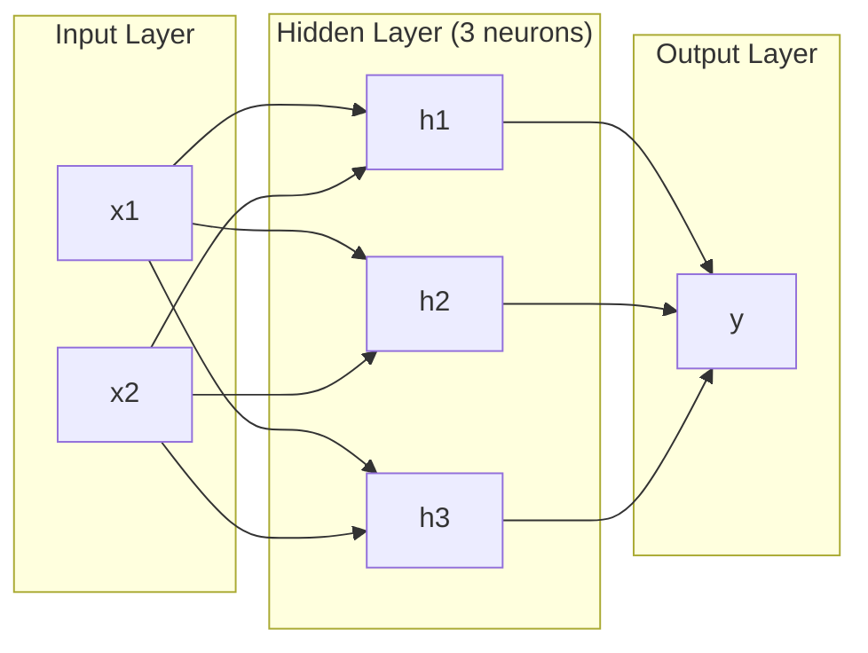
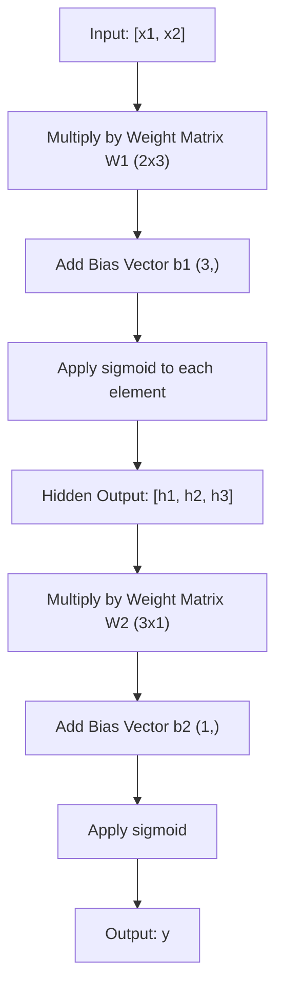
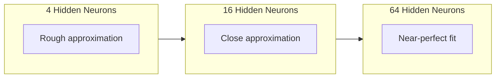

# 多层网络与前向传播

> 一个神经元只能画一条线。把它们堆起来，你就能画出任何形状。

**Type:** Build
**Languages:** Python
**Prerequisites:** Phase 01 (Math Foundations), Lesson 03.01 (The Perceptron)
**Time:** ~90 minutes

## 学习目标

- 从零构建多层网络，使用 Layer 和 Network 类完成完整的前向传播
- 追踪网络每一层的矩阵维度，并定位 shape 不匹配问题
- 解释堆叠非线性激活如何让网络学习弯曲的决策边界
- 使用 2-2-1 架构和手动调好的 sigmoid 权重解决 XOR 问题

## 问题

单个神经元就是一个画线器。仅此而已。它只能在数据中画出一条直线。AI 中的真实问题，包括图像识别、语言理解、围棋对弈，都需要曲线。把神经元堆叠成层，就是得到曲线的方法。

1969 年，Minsky 和 Papert 证明了这个限制是致命的：单层网络无法学习 XOR。不是“学起来很吃力”，而是数学上不可能。XOR 真值表把 [0,1] 和 [1,0] 放在一侧，把 [0,0] 和 [1,1] 放在另一侧。没有任何一条直线能把它们分开。

这让神经网络研究的资助沉寂了十多年。回头看，修复办法很明显：不要只用一层。把神经元堆成层。让第一层把输入空间切成新的特征，再让第二层组合这些特征，做出单条直线无法做出的决策。

这个堆叠结构就是多层网络。它是今天所有生产级深度学习模型的基础。前向传播，也就是数据从输入流经隐藏层再到输出，是你必须先构建的第一件事；没有它，后面的任何东西都无法工作。

## 概念

### 层：输入层、隐藏层、输出层

多层网络有三类层：

**输入层**：严格说不算真正的层。它保存原始数据。两个特征就意味着两个输入节点。这里不发生计算。

**隐藏层**：真正工作的地方。每个神经元接收上一层的所有输出，应用权重和偏置，然后把结果送入激活函数。叫“隐藏”，是因为你不会在训练数据中直接看到这些值。

**输出层**：最终答案。对于二分类任务，通常是一个带 sigmoid 的神经元。对于多分类任务，通常每个类别一个神经元。



这是一个 2-3-1 网络。两个输入、三个隐藏神经元、一个输出。每条连接都有一个权重。除输入层外，每个神经元都有一个偏置。

每一层都会产生一个由数字组成的向量，叫做隐藏状态。对于文本，隐藏状态通常会提高维度，比如把一个词编码成 768 个数字来捕捉语义。对于图像，隐藏状态通常会降低维度，把数百万个像素压缩成可管理的表示。隐藏状态就是学习发生的地方。

### 神经元与激活

每个神经元做三件事：

1. 把每个输入乘以对应权重
2. 把所有乘积求和，并加上偏置
3. 把这个和传入激活函数

暂时我们使用 sigmoid 作为激活函数：

```text
sigmoid(z) = 1 / (1 + e^(-z))
```

Sigmoid 会把任意数字压缩到 (0, 1) 区间。很大的正输入会推向 1，很大的负输入会推向 0，0 会映射到 0.5。这条平滑曲线让学习成为可能；不同于感知机的硬阶跃函数，sigmoid 在每个位置都有梯度。

### 前向传播：数据如何流动

前向传播会把输入数据一层一层推过网络，直到抵达输出。前向传播期间不会发生学习。它只是纯计算：乘、加、激活，然后重复。



在每一层，都会按顺序发生三步操作：

```text
z = W * input + b       (linear transformation)
a = sigmoid(z)          (activation)
```

一层的输出会变成下一层的输入。这就是整个前向传播。

### 矩阵维度

追踪维度是深度学习中最重要的调试技能。下面是 2-3-1 网络：

| 步骤 | 操作 | 维度 | 结果 shape |
|------|------|------|------------|
| 输入 | x | -- | (2,) |
| 隐藏层线性变换 | W1 * x + b1 | W1: (3, 2), b1: (3,) | (3,) |
| 隐藏层激活 | sigmoid(z1) | -- | (3,) |
| 输出层线性变换 | W2 * h + b2 | W2: (1, 3), b2: (1,) | (1,) |
| 输出层激活 | sigmoid(z2) | -- | (1,) |

规则是：第 k 层的权重矩阵 W 的形状是 (当前层神经元数, 前一层神经元数)。行对应当前层，列对应前一层。如果 shape 对不上，你就有 bug。

### 通用近似定理

1989 年，George Cybenko 证明了一个很了不起的结论：一个只有单个隐藏层、但拥有足够多神经元的神经网络，可以以任意期望精度近似任何连续函数。

这并不意味着一个隐藏层永远最好。它的意思是，这种架构在理论上有能力做到。实践中，更深的网络，也就是更多层、每层更少神经元，通常能用远少于浅而宽网络的总参数量学到同样的函数。这正是深度学习有效的原因。

直觉是：隐藏层中的每个神经元会学习一个“小隆起”或一个特征。把足够多的小隆起放在正确位置，就能近似任何平滑曲线。神经元越多，隆起越多，近似越好。



### 可组合性

神经网络是可组合的。你可以堆叠它们、串联它们、并行运行它们。Whisper 模型使用一个编码器网络处理音频，再用一个单独的解码器网络生成文本。现代 LLM 通常是仅解码器架构。BERT 是仅编码器架构。T5 是编码器-解码器架构。架构选择定义了模型能做什么。

```figure
mlp-forward
```

## Build It

纯 Python。不用 numpy。每个矩阵操作都从零写出来。

### Step 1: Sigmoid 激活

```python
import math

def sigmoid(x):
    x = max(-500.0, min(500.0, x))
    return 1.0 / (1.0 + math.exp(-x))
```

把输入 clamp 到 [-500, 500] 是为了避免溢出。`math.exp(500)` 很大，但仍然是有限值。`math.exp(1000)` 会变成无穷大。

### Step 2: Layer 类

深度学习中最重要的操作是矩阵乘法。每一层、每个注意力头、每次前向传播，本质上都离不开矩阵乘法。线性层接收一个输入向量，乘以权重矩阵，再加上偏置向量：y = Wx + b。这个方程承担了神经网络中 90% 的计算。

一层会保存一个权重矩阵和一个偏置向量。它的 forward 方法接收一个输入向量，并返回激活后的输出。

```python
class Layer:
    def __init__(self, n_inputs, n_neurons, weights=None, biases=None):
        if weights is not None:
            self.weights = weights
        else:
            import random
            self.weights = [
                [random.uniform(-1, 1) for _ in range(n_inputs)]
                for _ in range(n_neurons)
            ]
        if biases is not None:
            self.biases = biases
        else:
            self.biases = [0.0] * n_neurons

    def forward(self, inputs):
        self.last_input = inputs
        self.last_output = []
        for neuron_idx in range(len(self.weights)):
            z = sum(
                w * x for w, x in zip(self.weights[neuron_idx], inputs)
            )
            z += self.biases[neuron_idx]
            self.last_output.append(sigmoid(z))
        return self.last_output
```

权重矩阵的形状是 (n_neurons, n_inputs)。每一行都是某个神经元对应所有输入的权重。forward 方法会遍历神经元，计算加权和加偏置，应用 sigmoid，并收集结果。

### Step 3: Network 类

网络就是一组层。前向传播把它们串起来：第 k 层的输出会送入第 k+1 层。

```python
class Network:
    def __init__(self, layers):
        self.layers = layers

    def forward(self, inputs):
        current = inputs
        for layer in self.layers:
            current = layer.forward(current)
        return current
```

这就是整个前向传播。四行逻辑。数据进入网络，流过每一层，然后从另一端出来。

### Step 4: 用手动调好的权重解决 XOR

在 Lesson 01 中，我们通过组合 OR、NAND 和 AND 感知机解决了 XOR。现在用 Layer 和 Network 类做同一件事。2-2-1 架构表示：两个输入、两个隐藏神经元、一个输出。

```python
hidden = Layer(
    n_inputs=2,
    n_neurons=2,
    weights=[[20.0, 20.0], [-20.0, -20.0]],
    biases=[-10.0, 30.0],
)

output = Layer(
    n_inputs=2,
    n_neurons=1,
    weights=[[20.0, 20.0]],
    biases=[-30.0],
)

xor_net = Network([hidden, output])

xor_data = [
    ([0, 0], 0),
    ([0, 1], 1),
    ([1, 0], 1),
    ([1, 1], 0),
]

for inputs, expected in xor_data:
    result = xor_net.forward(inputs)
    predicted = 1 if result[0] >= 0.5 else 0
    print(f"  {inputs} -> {result[0]:.6f} (rounded: {predicted}, expected: {expected})")
```

大权重（20、-20）会让 sigmoid 的行为接近阶跃函数。第一个隐藏神经元近似 OR，第二个近似 NAND。输出神经元把它们组合成 AND，也就是 XOR。

### Step 5: 圆形分类

一个更难的问题：把二维点分类为位于以原点为中心、半径为 0.5 的圆内或圆外。这需要弯曲的决策边界，单个感知机不可能做到。

```python
import random
import math

random.seed(42)

data = []
for _ in range(200):
    x = random.uniform(-1, 1)
    y = random.uniform(-1, 1)
    label = 1 if (x * x + y * y) < 0.25 else 0
    data.append(([x, y], label))

circle_net = Network([
    Layer(n_inputs=2, n_neurons=8),
    Layer(n_inputs=8, n_neurons=1),
])
```

使用随机权重时，网络不会分得很好。但前向传播仍然可以运行。这就是重点：前向传播只是计算。学习正确权重属于反向传播，我们会在 Lesson 03 中实现。

```python
correct = 0
for inputs, expected in data:
    result = circle_net.forward(inputs)
    predicted = 1 if result[0] >= 0.5 else 0
    if predicted == expected:
        correct += 1

print(f"Accuracy with random weights: {correct}/{len(data)} ({100*correct/len(data):.1f}%)")
```

随机权重会给出很差的准确率，常常比总是猜多数类还差。训练之后（Lesson 03），同样这个拥有 8 个隐藏神经元的架构就能画出一条弯曲边界，把圆内和圆外分开。

## Use It

PyTorch 用四行代码完成上面的全部结构：

```python
import torch
import torch.nn as nn

model = nn.Sequential(
    nn.Linear(2, 8),
    nn.Sigmoid(),
    nn.Linear(8, 1),
    nn.Sigmoid(),
)

x = torch.tensor([[0.0, 0.0], [0.0, 1.0], [1.0, 0.0], [1.0, 1.0]])
output = model(x)
print(output)
```

`nn.Linear(2, 8)` 就是你的 Layer 类：形状为 (8, 2) 的权重矩阵，以及形状为 (8,) 的偏置向量。`nn.Sigmoid()` 就是把你的 sigmoid 函数逐元素应用到张量上。`nn.Sequential` 就是你的 Network 类：按顺序串起多层。

差别在速度和规模。PyTorch 可以在 GPU 上运行，能处理包含数百万样本的 batch，并自动计算反向传播所需的梯度。但前向传播逻辑和你刚刚从零构建的版本完全相同。

## Ship It

本课会产出一个用于设计网络架构的可复用提示词：

- `outputs/prompt-network-architect.md`

当你需要为一个具体问题决定使用多少层、每层多少神经元、以及哪些激活函数时，可以使用它。

## 练习

1. 构建一个 2-4-2-1 网络（两个隐藏层），并在 XOR 数据上用随机权重运行前向传播。打印中间隐藏层输出，观察表示如何在每一层发生变化。

2. 把圆形分类器中的隐藏层大小从 8 改成 2，再改成 32。每次都用随机权重运行前向传播。隐藏神经元数量会改变输出范围或分布吗？为什么？

3. 在 Network 类上实现一个 `count_parameters` 方法，返回可训练权重和偏置的总数。在 784-256-128-10 网络上测试它，也就是经典 MNIST 架构。它有多少参数？

4. 为一个 3-4-4-2 网络构建前向传播。输入归一化到 0-1 的 RGB 颜色值，并观察两个输出。这是一个两类简单颜色分类器的架构。

5. 把 sigmoid 换成一个“leaky step”函数：如果 z < 0，返回 0.01 * z，否则返回 1.0。用 Step 4 中同样的手动权重在 XOR 上运行前向传播。它还能工作吗？为什么平滑 sigmoid 比硬截断更受偏好？

## 关键术语

| 术语 | 常见说法 | 实际含义 |
|------|----------|----------|
| 前向传播 | “运行模型” | 把输入推过每一层：乘以权重、加上偏置、应用激活，最终产生输出 |
| 隐藏层 | “中间那部分” | 输入层和输出层之间的任何层，其数值不会在数据中被直接观测到 |
| 多层网络 | “深度神经网络” | 顺序堆叠的神经元层，每一层的输出会成为下一层的输入 |
| 激活函数 | “非线性” | 线性变换之后应用的函数，它会把曲线引入决策边界 |
| Sigmoid | “S 形曲线” | sigma(z) = 1/(1+e^(-z))，把任意实数压缩到 (0,1)，处处平滑且可微 |
| 权重矩阵 | “参数” | 形状为 (当前层神经元数, 前一层神经元数) 的矩阵 W，包含可学习的连接强度 |
| 偏置向量 | “偏移量” | 矩阵乘法之后加上的向量，让神经元即使在所有输入为零时也能激活 |
| 通用近似 | “神经网络什么都能学” | 一个拥有足够多神经元的单隐藏层网络可以近似任何连续函数，但“足够多”可能意味着数十亿 |
| 线性变换 | “矩阵乘法那一步” | z = W * x + b，激活之前的计算，会把输入映射到一个新空间 |
| 决策边界 | “分类器切换的位置” | 输入空间中的一个表面，网络输出在这里跨过分类阈值 |

## 延伸阅读

- Michael Nielsen, "Neural Networks and Deep Learning", Chapter 1-2 (http://neuralnetworksanddeeplearning.com/) - 关于前向传播和网络结构最清晰的免费解释，包含交互式可视化
- Cybenko, "Approximation by Superpositions of a Sigmoidal Function" (1989) - 通用近似定理的原始论文，意外地易读
- 3Blue1Brown, "But what is a neural network?" (https://www.youtube.com/watch?v=aircAruvnKk) - 20 分钟的可视化讲解，帮助建立关于层、权重和前向传播的直觉模型
- Goodfellow, Bengio, Courville, "Deep Learning", Chapter 6 (https://www.deeplearningbook.org/) - 多层网络的标准参考，免费在线阅读
