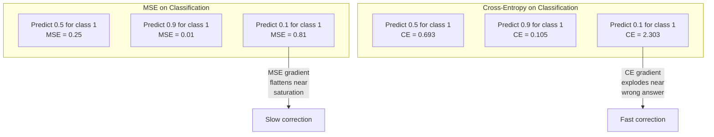
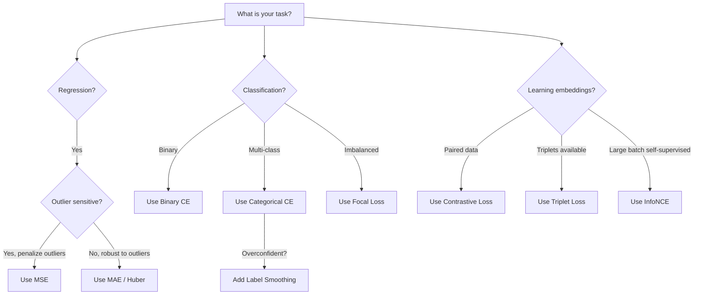
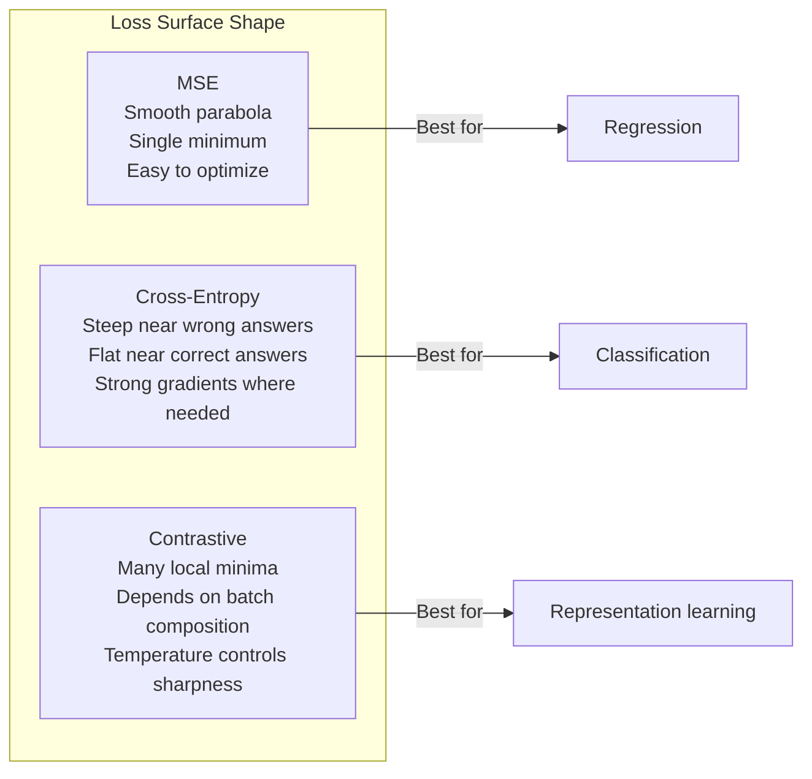

# 损失函数

> 你的网络做出一个预测。真实答案说不是这样。它到底错了多少？这个数字就是 loss。选错损失函数，模型就会完全优化错误的东西。

**Type:** Build
**Languages:** Python
**Prerequisites:** Lesson 03.04 (Activation Functions)
**Time:** ~75 minutes

## 学习目标

- 从零实现 MSE、二元交叉熵、分类交叉熵和对比损失（InfoNCE），并写出它们的梯度
- 通过演示“所有输入都预测 0.5”的失败模式，解释为什么 MSE 不适合分类
- 把 label smoothing 应用于交叉熵，并说明它如何防止过度自信预测
- 为回归、二分类、多分类和嵌入学习任务选择正确的损失函数

## 问题

一个在分类问题上最小化 MSE 的模型，会很有把握地对所有东西预测 0.5。它确实在最小化 loss。它也完全没用。

损失函数是模型真正优化的唯一东西。不是准确率，不是 F1 分数，也不是你汇报给经理的任何指标。优化器会取损失函数的梯度，并调整权重，让这个数字变小。如果损失函数没有捕捉到你真正关心的东西，模型就会找到数学上最便宜的方式来满足它，而那几乎从来不是你想要的方式。

下面是一个具体例子。你有一个二分类任务。两个类别，50/50 分布。你使用 MSE 作为 loss。模型对每个输入都预测 0.5。平均 MSE 是 0.25，这是在什么都没学到的情况下可能达到的最小值。模型没有任何区分能力，但从技术上说，它已经最小化了你的损失函数。换成交叉熵之后，同一个模型会被迫把预测推向 0 或 1，因为 -log(0.5) = 0.693 是很糟糕的 loss，而 -log(0.99) = 0.01 会奖励自信且正确的预测。损失函数的选择，就是“模型学会东西”和“模型钻指标空子”的区别。

情况还会更糟。在自监督学习中，你甚至没有标签。对比损失完全定义了学习信号：什么算相似，什么算不同，模型应该把它们推开多远。如果对比损失写错，你的嵌入会坍缩到一个点，也就是每个输入都映射到同一个向量。技术上可能是零 loss。实际上一文不值。

## 概念

### 均方误差（MSE）

回归任务的默认选择。计算预测值和目标值之间的平方差，再对所有样本取平均。

```text
MSE = (1/n) * sum((y_pred - y_true)^2)
```

平方为什么重要：它会以二次方式惩罚大错误。误差为 2 的代价是误差为 1 的 4 倍。误差为 10 的代价是 100 倍。这让 MSE 对离群点很敏感，一个极端错误的预测会主导整个 loss。

真实数字：如果你的模型预测房价，大多数房子只差 $10,000，但有一栋豪宅差了 $200,000，MSE 会非常激进地修正那栋豪宅，甚至可能伤害另外 99 套房子的表现。

MSE 相对于预测值的梯度是：

```text
dMSE/dy_pred = (2/n) * (y_pred - y_true)
```

它对误差是线性的。错误越大，梯度越大。这对回归是特性（大错误需要大修正），对分类是问题（你希望对自信但错误的答案做指数级惩罚，而不是线性惩罚）。

### 交叉熵损失

分类任务的损失函数。它根源于信息论，用来衡量预测概率分布和真实分布之间的差异。

**二元交叉熵（BCE）：**

```text
BCE = -(y * log(p) + (1 - y) * log(1 - p))
```

其中 y 是真实标签（0 或 1），p 是预测概率。

为什么 -log(p) 有效：当真实标签是 1，且你预测 p = 0.99 时，loss 是 -log(0.99) = 0.01。当你预测 p = 0.01 时，loss 是 -log(0.01) = 4.6。这个 460 倍差距就是交叉熵有效的原因。它会狠狠惩罚自信但错误的预测，同时几乎不惩罚自信且正确的预测。

梯度讲的是同一个故事：

```text
dBCE/dp = -(y/p) + (1-y)/(1-p)
```

当 y = 1 且 p 接近 0 时，梯度是 -1/p，会趋向负无穷。模型会收到一个巨大的信号去修正错误。当 p 接近 1 时，梯度很小。已经正确了，没什么需要修。

**分类交叉熵：**

用于 one-hot 目标的多分类任务。

```text
CCE = -sum(y_i * log(p_i))
```

只有真实类别会贡献 loss，因为其他所有 y_i 都是 0。如果有 10 个类别，正确类别的概率是 0.1（随机猜测），loss 是 -log(0.1) = 2.3。如果正确类别的概率是 0.9，loss 是 -log(0.9) = 0.105。模型会学会把概率质量集中到正确答案上。

### 为什么 MSE 不适合分类



当预测接近 0 或 1 时，MSE 梯度会因为 sigmoid 饱和而变平。交叉熵会补偿这一点，-log 会抵消 sigmoid 的平坦区域，在最需要强梯度的位置给出强梯度。

### Label Smoothing

标准 one-hot 标签会说：“这个样本 100% 是第 3 类，0% 是其他任何类。”这是一个很强的断言。Label smoothing 会把它软化：

```text
smooth_label = (1 - alpha) * one_hot + alpha / num_classes
```

当 alpha = 0.1 且有 10 个类别时，目标会从 [0, 0, 1, 0, ...] 变成 [0.01, 0.01, 0.91, 0.01, ...]。模型的目标是 0.91，而不是 1.0。

为什么它有效：如果一个模型想通过 softmax 输出精确的 1.0，就需要把 logits 推向无穷大。这会造成过度自信，伤害泛化，并让模型在分布漂移下变得脆弱。Label smoothing 会把目标上限限制在 0.9（alpha=0.1 时），让 logits 保持在合理范围内。GPT 和大多数现代模型都会使用 label smoothing 或等价做法。

### 对比损失

没有标签。没有类别。只有输入对和一个问题：它们相似还是不同？

**SimCLR 风格的对比损失（NT-Xent / InfoNCE）：**

取一张图片。创建它的两个增强视图（裁剪、旋转、颜色扰动）。它们是“正样本对”，应该拥有相似嵌入。batch 中的其他每张图片都会形成“负样本对”，应该拥有不同嵌入。

```text
L = -log(exp(sim(z_i, z_j) / tau) / sum(exp(sim(z_i, z_k) / tau)))
```

其中 sim() 是余弦相似度，z_i 和 z_j 是正样本对，求和遍历所有负样本，tau（temperature）控制分布有多尖锐。更低的 temperature = 更硬的负样本 = 更激进的分离。

真实数字：batch size 256 意味着每个正样本对有 255 个负样本。Temperature tau = 0.07（SimCLR 默认值）。这个 loss 看起来像对相似度做 softmax，它希望正样本对的相似度在所有 256 个选项中最高。

**Triplet Loss：**

接收三个输入：anchor、positive（同类）和 negative（不同类）。

```text
L = max(0, d(anchor, positive) - d(anchor, negative) + margin)
```

margin（通常为 0.2-1.0）会强制正样本距离和负样本距离之间至少有一个间隔。如果负样本已经足够远，loss 就是 0，没有梯度，也不会更新。这让训练更高效，但需要谨慎的 triplet mining，也就是选择靠近 anchor 的 hard negatives。

### Focal Loss

用于类别不平衡数据集。标准交叉熵会平等对待所有已经正确分类的样本。Focal loss 会降低简单样本的权重：

```text
FL = -alpha * (1 - p_t)^gamma * log(p_t)
```

其中 p_t 是真实类别的预测概率，gamma 控制聚焦强度。当 gamma = 0 时，它就是标准交叉熵。当 gamma = 2（默认值）时：

- 简单样本（p_t = 0.9）：权重 = (0.1)^2 = 0.01。基本被忽略。
- 困难样本（p_t = 0.1）：权重 = (0.9)^2 = 0.81。保留完整梯度信号。

Focal loss 由 Lin 等人引入，用于目标检测，其中 99% 的候选区域都是背景（简单负样本）。没有 focal loss 时，模型会淹没在简单背景样本中，学不会检测物体。有了它，模型会把能力集中在真正重要的困难和模糊案例上。

### 损失函数决策树



### Loss Landscape



```figure
cross-entropy-loss
```

## Build It

### Step 1: MSE 及其梯度

```python
def mse(predictions, targets):
    n = len(predictions)
    total = 0.0
    for p, t in zip(predictions, targets):
        total += (p - t) ** 2
    return total / n

def mse_gradient(predictions, targets):
    n = len(predictions)
    grads = []
    for p, t in zip(predictions, targets):
        grads.append(2.0 * (p - t) / n)
    return grads
```

### Step 2: 二元交叉熵

log(0) 问题是真实存在的。如果模型对正样本预测精确的 0，那么 log(0) = 负无穷。裁剪可以防止这一点。

```python
import math

def binary_cross_entropy(predictions, targets, eps=1e-15):
    n = len(predictions)
    total = 0.0
    for p, t in zip(predictions, targets):
        p_clipped = max(eps, min(1 - eps, p))
        total += -(t * math.log(p_clipped) + (1 - t) * math.log(1 - p_clipped))
    return total / n

def bce_gradient(predictions, targets, eps=1e-15):
    grads = []
    for p, t in zip(predictions, targets):
        p_clipped = max(eps, min(1 - eps, p))
        grads.append(-(t / p_clipped) + (1 - t) / (1 - p_clipped))
    return grads
```

### Step 3: 带 Softmax 的分类交叉熵

Softmax 会把原始 logits 转换成概率。然后我们计算它和 one-hot 目标之间的交叉熵。

```python
def softmax(logits):
    max_val = max(logits)
    exps = [math.exp(x - max_val) for x in logits]
    total = sum(exps)
    return [e / total for e in exps]

def categorical_cross_entropy(logits, target_index, eps=1e-15):
    probs = softmax(logits)
    p = max(eps, probs[target_index])
    return -math.log(p)

def cce_gradient(logits, target_index):
    probs = softmax(logits)
    grads = list(probs)
    grads[target_index] -= 1.0
    return grads
```

softmax + cross-entropy 的梯度会优雅地化简：真实类别就是（预测概率 - 1），其他类别就是（预测概率）。这个漂亮的化简不是巧合，正是 softmax 和交叉熵总是搭配使用的原因。

### Step 4: Label Smoothing

```python
def label_smoothed_cce(logits, target_index, num_classes, alpha=0.1, eps=1e-15):
    probs = softmax(logits)
    loss = 0.0
    for i in range(num_classes):
        if i == target_index:
            smooth_target = 1.0 - alpha + alpha / num_classes
        else:
            smooth_target = alpha / num_classes
        p = max(eps, probs[i])
        loss += -smooth_target * math.log(p)
    return loss
```

### Step 5: 对比损失（简化版 InfoNCE）

```python
def cosine_similarity(a, b):
    dot = sum(x * y for x, y in zip(a, b))
    norm_a = math.sqrt(sum(x * x for x in a))
    norm_b = math.sqrt(sum(x * x for x in b))
    if norm_a < 1e-10 or norm_b < 1e-10:
        return 0.0
    return dot / (norm_a * norm_b)

def contrastive_loss(anchor, positive, negatives, temperature=0.07):
    sim_pos = cosine_similarity(anchor, positive) / temperature
    sim_negs = [cosine_similarity(anchor, neg) / temperature for neg in negatives]

    max_sim = max(sim_pos, max(sim_negs)) if sim_negs else sim_pos
    exp_pos = math.exp(sim_pos - max_sim)
    exp_negs = [math.exp(s - max_sim) for s in sim_negs]
    total_exp = exp_pos + sum(exp_negs)

    return -math.log(max(1e-15, exp_pos / total_exp))
```

### Step 6: 分类任务上的 MSE vs 交叉熵

用两种损失函数训练 Lesson 04 中同一个网络（圆形数据集）。观察交叉熵如何更快收敛。

```python
import random

def sigmoid(x):
    x = max(-500, min(500, x))
    return 1.0 / (1.0 + math.exp(-x))

def make_circle_data(n=200, seed=42):
    random.seed(seed)
    data = []
    for _ in range(n):
        x = random.uniform(-2, 2)
        y = random.uniform(-2, 2)
        label = 1.0 if x * x + y * y < 1.5 else 0.0
        data.append(([x, y], label))
    return data


class LossComparisonNetwork:
    def __init__(self, loss_type="bce", hidden_size=8, lr=0.1):
        random.seed(0)
        self.loss_type = loss_type
        self.lr = lr
        self.hidden_size = hidden_size

        self.w1 = [[random.gauss(0, 0.5) for _ in range(2)] for _ in range(hidden_size)]
        self.b1 = [0.0] * hidden_size
        self.w2 = [random.gauss(0, 0.5) for _ in range(hidden_size)]
        self.b2 = 0.0

    def forward(self, x):
        self.x = x
        self.z1 = []
        self.h = []
        for i in range(self.hidden_size):
            z = self.w1[i][0] * x[0] + self.w1[i][1] * x[1] + self.b1[i]
            self.z1.append(z)
            self.h.append(max(0.0, z))

        self.z2 = sum(self.w2[i] * self.h[i] for i in range(self.hidden_size)) + self.b2
        self.out = sigmoid(self.z2)
        return self.out

    def backward(self, target):
        if self.loss_type == "mse":
            d_loss = 2.0 * (self.out - target)
        else:
            eps = 1e-15
            p = max(eps, min(1 - eps, self.out))
            d_loss = -(target / p) + (1 - target) / (1 - p)

        d_sigmoid = self.out * (1 - self.out)
        d_out = d_loss * d_sigmoid

        for i in range(self.hidden_size):
            d_relu = 1.0 if self.z1[i] > 0 else 0.0
            d_h = d_out * self.w2[i] * d_relu
            self.w2[i] -= self.lr * d_out * self.h[i]
            for j in range(2):
                self.w1[i][j] -= self.lr * d_h * self.x[j]
            self.b1[i] -= self.lr * d_h
        self.b2 -= self.lr * d_out

    def compute_loss(self, pred, target):
        if self.loss_type == "mse":
            return (pred - target) ** 2
        else:
            eps = 1e-15
            p = max(eps, min(1 - eps, pred))
            return -(target * math.log(p) + (1 - target) * math.log(1 - p))

    def train(self, data, epochs=200):
        losses = []
        for epoch in range(epochs):
            total_loss = 0.0
            correct = 0
            for x, y in data:
                pred = self.forward(x)
                self.backward(y)
                total_loss += self.compute_loss(pred, y)
                if (pred >= 0.5) == (y >= 0.5):
                    correct += 1
            avg_loss = total_loss / len(data)
            accuracy = correct / len(data) * 100
            losses.append((avg_loss, accuracy))
            if epoch % 50 == 0 or epoch == epochs - 1:
                print(f"    Epoch {epoch:3d}: loss={avg_loss:.4f}, accuracy={accuracy:.1f}%")
        return losses
```

## Use It

PyTorch 提供了所有标准损失函数，并内置了数值稳定性处理：

```python
import torch
import torch.nn as nn
import torch.nn.functional as F

predictions = torch.tensor([0.9, 0.1, 0.7], requires_grad=True)
targets = torch.tensor([1.0, 0.0, 1.0])

mse_loss = F.mse_loss(predictions, targets)
bce_loss = F.binary_cross_entropy(predictions, targets)

logits = torch.randn(4, 10)
labels = torch.tensor([3, 7, 1, 9])
ce_loss = F.cross_entropy(logits, labels)
ce_smooth = F.cross_entropy(logits, labels, label_smoothing=0.1)
```

使用 `F.cross_entropy`，不要手动 softmax 再配合 `F.nll_loss`。它会把 log-softmax 和 negative log-likelihood 合并成一个数值稳定的操作。先单独应用 softmax 再取 log 稳定性更差，因为你会在大指数的减法中损失精度。

对于对比学习，大多数团队会使用自定义实现，或使用 `lightly`、`pytorch-metric-learning` 这类库。核心循环始终相同：计算两两相似度，创建包含正样本和负样本的 softmax，再反向传播。

## Ship It

本课产出：

- `outputs/prompt-loss-function-selector.md` - 一个用于选择正确损失函数的可复用提示词
- `outputs/prompt-loss-debugger.md` - 一个诊断提示词，用于 loss 曲线看起来不对的时候

## 练习

1. 实现 Huber loss（smooth L1 loss），它在小误差时是 MSE，在大误差时是 MAE。训练一个回归网络预测 y = sin(x)，并在 5% 的训练目标中加入随机噪声（离群点），比较 MSE 和 Huber 的最终测试误差。

2. 把 focal loss 加到二分类训练循环中。创建一个不平衡数据集（90% class 0，10% class 1）。比较标准 BCE 和 focal loss（gamma=2）在 200 个 epoch 后的少数类召回率。

3. 实现带 semi-hard negative mining 的 triplet loss。为 5 个类别生成二维嵌入数据。对每个 anchor，找到仍然比 positive 更远、但最困难的 negative（semi-hard）。比较它和随机 triplet 选择的收敛情况。

4. 运行 MSE vs 交叉熵对比实验，但在训练期间追踪每一层的梯度幅度。绘制每个 epoch 的平均梯度范数。验证交叉熵会在模型最不确定的早期阶段产生更大的梯度。

5. 实现 KL divergence loss，并验证当真实分布是 one-hot 时，最小化 KL(true || predicted) 会产生和交叉熵相同的梯度。然后尝试 soft targets，比如知识蒸馏中来自教师模型 softmax 输出的“真实”分布。

## 关键术语

| 术语 | 常见说法 | 实际含义 |
|------|----------|----------|
| 损失函数 | “模型错了多少” | 一个可微函数，把预测和目标映射到优化器要最小化的标量 |
| MSE | “平均平方误差” | 预测和目标之间平方差的均值，会以二次方式惩罚大错误 |
| 交叉熵 | “分类损失” | 使用 -log(p) 衡量预测概率分布和真实分布之间的差异 |
| 二元交叉熵 | “BCE” | 两类任务的交叉熵：-(y*log(p) + (1-y)*log(1-p)) |
| Label smoothing | “软化目标” | 用软值（例如 0.1/0.9）替换硬 0/1 目标，以防止过度自信并改善泛化 |
| 对比损失 | “拉近相似，推远不同” | 通过让嵌入空间中的相似对更近、不相似对更远来学习表示的 loss |
| InfoNCE | “CLIP/SimCLR 的 loss” | 对相似度分数进行温度缩放后的归一化交叉熵，把对比学习视为分类 |
| Focal loss | “不平衡数据修复” | 用 (1-p_t)^gamma 加权交叉熵，降低简单样本权重并聚焦困难样本 |
| Triplet loss | “Anchor-positive-negative” | 在嵌入空间中，让 anchor 与 positive 的距离至少比与 negative 的距离小一个 margin |
| Temperature | “尖锐度旋钮” | 作用在 logits/相似度上的标量除数，用于控制分布有多尖锐；越低越尖锐 |

## 延伸阅读

- Lin et al., "Focal Loss for Dense Object Detection" (2017) - 引入 focal loss，用于处理目标检测中的极端类别不平衡（RetinaNet）
- Chen et al., "A Simple Framework for Contrastive Learning of Visual Representations" (SimCLR, 2020) - 用 NT-Xent loss 定义了现代对比学习流水线
- Szegedy et al., "Rethinking the Inception Architecture" (2016) - 将 label smoothing 作为正则化技术引入，现在已成为大多数大型模型的标准做法
- Hinton et al., "Distilling the Knowledge in a Neural Network" (2015) - 使用 soft targets 和 KL divergence 进行知识蒸馏，是模型压缩的基础工作
