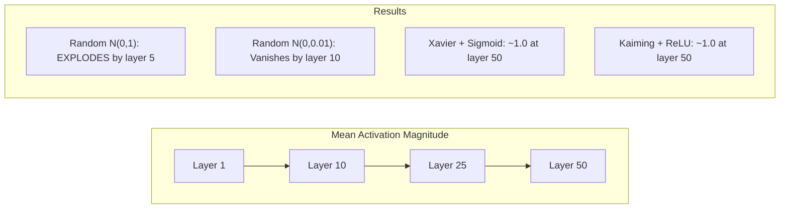
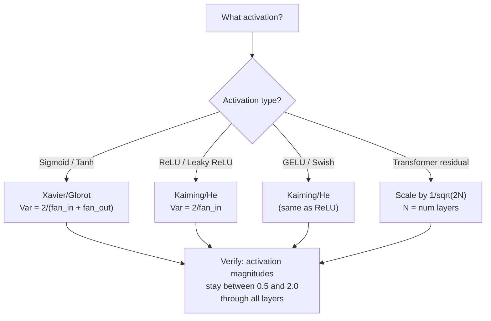

# 权重初始化与训练稳定性

> 初始化错了，训练根本开始不了。初始化对了，50 层也能像 3 层一样平滑训练。

**Type:** Build
**Languages:** Python
**Prerequisites:** Lesson 03.04 (Activation Functions), Lesson 03.07 (Regularization)
**Time:** ~90 minutes

## 学习目标

- 实现 zero、random、Xavier/Glorot 和 Kaiming/He 初始化策略，并测量它们对 50 层网络中激活幅度的影响
- 推导为什么 Xavier init 使用 Var(w) = 2/(fan_in + fan_out)，而 Kaiming 使用 Var(w) = 2/fan_in
- 演示 zero initialization 的对称性问题，并解释为什么只有随机尺度还不够
- 将正确的初始化策略匹配到激活函数：sigmoid/tanh 使用 Xavier，ReLU/GELU 使用 Kaiming

## 问题

把所有权重初始化为 0。什么也学不会。每个神经元计算同一个函数，收到同一个梯度，并以完全相同的方式更新。10,000 个 epoch 之后，你的 512 神经元隐藏层仍然只是同一个神经元的 512 份副本。你付出了 512 个参数的成本，却只得到了 1 个。

把权重初始化得太大。激活会在网络中爆炸。到第 10 层，数值达到 1e15。到第 20 层，它们溢出成 infinity。梯度会沿着反方向走同样的轨迹。

从标准正态分布中随机初始化。3 层时能用。50 层时，信号会坍缩到 0，或者爆炸到 infinity，具体取决于随机尺度是稍微太小还是稍微太大。“能训练”和“坏掉”之间的边界薄得像刀刃。

权重初始化是深度学习中最被低估的决定。架构会得到论文。优化器会得到博客文章。初始化只得到脚注。但如果它错了，其他一切都不重要，因为你的网络在训练开始前就已经死了。

## 概念

### 对称性问题

一层中的每个神经元都有相同结构：输入乘以权重，加上偏置，应用激活函数。如果所有权重都从相同值开始（0 是极端情况），每个神经元都会计算同一个输出。反向传播时，每个神经元收到同一个梯度。更新时，每个神经元改变相同的量。

你被卡住了。网络有数百个参数，但它们全部同步移动。这叫对称性，而随机初始化是打破它的直接办法。每个神经元都从权重空间中的不同位置开始，因此每个神经元会学习不同特征。

但“随机”还不够。随机性的*尺度*决定网络能不能训练。

### 方差如何穿过层传播

考虑一个有 fan_in 个输入的单层：

```text
z = w1*x1 + w2*x2 + ... + w_n*x_n
```

如果每个权重 wi 都来自方差为 Var(w) 的分布，每个输入 xi 的方差是 Var(x)，输出方差就是：

```text
Var(z) = fan_in * Var(w) * Var(x)
```

如果 Var(w) = 1 且 fan_in = 512，输出方差就是输入方差的 512 倍。10 层之后：512^10 = 1.2e27。你的信号已经爆炸。

如果 Var(w) = 0.001，输出方差每层会缩小 0.001 * 512 = 0.512 倍。10 层之后：0.512^10 = 0.00013。你的信号已经消失。

目标是：选择 Var(w)，让 Var(z) = Var(x)。这样信号幅度就能跨层保持稳定。

### Xavier/Glorot 初始化

Glorot 和 Bengio（2010）为 sigmoid 与 tanh 激活推导了解法。为了同时在前向传播和反向传播中保持方差稳定：

```text
Var(w) = 2 / (fan_in + fan_out)
```

实践中，权重会从下面的分布中采样：

```text
w ~ Uniform(-limit, limit)  where limit = sqrt(6 / (fan_in + fan_out))
```

或者：

```text
w ~ Normal(0, sqrt(2 / (fan_in + fan_out)))
```

它有效的原因是 sigmoid 和 tanh 在 0 附近近似线性，而正确初始化后的激活正好会落在这个区域。方差可以穿过几十层仍然保持稳定。

### Kaiming/He 初始化

ReLU 会杀死一半输出（所有负值都会变成 0）。有效的 fan_in 被减半，因为平均有一半输入会被置零。Xavier init 没有考虑这一点，所以它低估了需要的方差。

He 等人（2015）调整了公式：

```text
Var(w) = 2 / fan_in
```

权重从下面的分布中采样：

```text
w ~ Normal(0, sqrt(2 / fan_in))
```

这个 2 的因子补偿了 ReLU 将一半激活置零的影响。没有它，信号每层会缩小约 0.5 倍。50 层之后：0.5^50 = 8.8e-16。Kaiming init 会阻止这种坍缩。

### Transformer 初始化

GPT-2 引入了一种不同模式。Residual connections 会把每个子层的输出加回它的输入：

```text
x = x + sublayer(x)
```

每一次相加都会提高方差。经过 N 个 residual layers 后，方差会按 N 的比例增长。GPT-2 会把 residual layers 的权重按 1/sqrt(2N) 缩放，其中 N 是层数。这样可以让累积信号的幅度保持稳定。

Llama 3（405B 参数，126 层）也使用了类似方案。如果没有这种缩放，residual stream 会穿过 126 层 attention 和 feedforward blocks 后无界增长。

```mermaid
flowchart TD
    subgraph "Zero Init"
        Z1["Layer 1<br/>All weights = 0"] --> Z2["Layer 2<br/>All neurons identical"]
        Z2 --> Z3["Layer 3<br/>Still identical"]
        Z3 --> ZR["Result: 1 effective neuron<br/>regardless of width"]
    end

    subgraph "Xavier Init"
        X1["Layer 1<br/>Var = 2/(fan_in+fan_out)"] --> X2["Layer 2<br/>Signal stable"]
        X2 --> X3["Layer 50<br/>Signal stable"]
        X3 --> XR["Result: Trains with<br/>sigmoid/tanh"]
    end

    subgraph "Kaiming Init"
        K1["Layer 1<br/>Var = 2/fan_in"] --> K2["Layer 2<br/>Signal stable"]
        K2 --> K3["Layer 50<br/>Signal stable"]
        K3 --> KR["Result: Trains with<br/>ReLU/GELU"]
    end
```



### 50 层中的激活幅度



### 选择正确的初始化



```figure
weight-init-variance
```

## Build It

### Step 1：初始化策略

初始化权重矩阵的四种方式。每个函数都返回一个 list of lists（二维矩阵），其中 fan_in 是列数，fan_out 是行数。

```python
import math
import random


def zero_init(fan_in, fan_out):
    return [[0.0 for _ in range(fan_in)] for _ in range(fan_out)]


def random_init(fan_in, fan_out, scale=1.0):
    return [[random.gauss(0, scale) for _ in range(fan_in)] for _ in range(fan_out)]


def xavier_init(fan_in, fan_out):
    std = math.sqrt(2.0 / (fan_in + fan_out))
    return [[random.gauss(0, std) for _ in range(fan_in)] for _ in range(fan_out)]


def kaiming_init(fan_in, fan_out):
    std = math.sqrt(2.0 / fan_in)
    return [[random.gauss(0, std) for _ in range(fan_in)] for _ in range(fan_out)]
```

### Step 2：激活函数

我们需要 sigmoid、tanh 和 ReLU，用来测试每种初始化策略与其目标激活函数的配合效果。

```python
def sigmoid(x):
    x = max(-500, min(500, x))
    return 1.0 / (1.0 + math.exp(-x))


def tanh_act(x):
    return math.tanh(x)


def relu(x):
    return max(0.0, x)
```

### Step 3：穿过 50 层的前向传播

让随机数据穿过一个深层网络，并测量每一层的平均激活幅度。

```python
def forward_deep(init_fn, activation_fn, n_layers=50, width=64, n_samples=100):
    random.seed(42)
    layer_magnitudes = []

    inputs = [[random.gauss(0, 1) for _ in range(width)] for _ in range(n_samples)]

    for layer_idx in range(n_layers):
        weights = init_fn(width, width)
        biases = [0.0] * width

        new_inputs = []
        for sample in inputs:
            output = []
            for neuron_idx in range(width):
                z = sum(weights[neuron_idx][j] * sample[j] for j in range(width)) + biases[neuron_idx]
                output.append(activation_fn(z))
            new_inputs.append(output)
        inputs = new_inputs

        magnitudes = []
        for sample in inputs:
            magnitudes.append(sum(abs(v) for v in sample) / width)
        mean_mag = sum(magnitudes) / len(magnitudes)
        layer_magnitudes.append(mean_mag)

    return layer_magnitudes
```

### Step 4：实验

运行所有组合：zero init、random N(0,1)、random N(0,0.01)、Xavier with sigmoid、Xavier with tanh、Kaiming with ReLU。打印关键层的幅度。

```python
def run_experiment():
    configs = [
        ("Zero init + Sigmoid", lambda fi, fo: zero_init(fi, fo), sigmoid),
        ("Random N(0,1) + ReLU", lambda fi, fo: random_init(fi, fo, 1.0), relu),
        ("Random N(0,0.01) + ReLU", lambda fi, fo: random_init(fi, fo, 0.01), relu),
        ("Xavier + Sigmoid", xavier_init, sigmoid),
        ("Xavier + Tanh", xavier_init, tanh_act),
        ("Kaiming + ReLU", kaiming_init, relu),
    ]

    print(f"{'Strategy':<30} {'L1':>10} {'L5':>10} {'L10':>10} {'L25':>10} {'L50':>10}")
    print("-" * 80)

    for name, init_fn, act_fn in configs:
        mags = forward_deep(init_fn, act_fn)
        row = f"{name:<30}"
        for idx in [0, 4, 9, 24, 49]:
            val = mags[idx]
            if val > 1e6:
                row += f" {'EXPLODED':>10}"
            elif val < 1e-6:
                row += f" {'VANISHED':>10}"
            else:
                row += f" {val:>10.4f}"
        print(row)
```

### Step 5：对称性演示

展示 zero init 会产生完全相同的神经元。

```python
def symmetry_demo():
    random.seed(42)
    weights = zero_init(2, 4)
    biases = [0.0] * 4

    inputs = [0.5, -0.3]
    outputs = []
    for neuron_idx in range(4):
        z = sum(weights[neuron_idx][j] * inputs[j] for j in range(2)) + biases[neuron_idx]
        outputs.append(sigmoid(z))

    print("\nSymmetry Demo (4 neurons, zero init):")
    for i, out in enumerate(outputs):
        print(f"  Neuron {i}: output = {out:.6f}")
    all_same = all(abs(outputs[i] - outputs[0]) < 1e-10 for i in range(len(outputs)))
    print(f"  All identical: {all_same}")
    print(f"  Effective parameters: 1 (not {len(weights) * len(weights[0])})")
```

### Step 6：逐层幅度报告

打印一个可视化条形图，展示激活幅度如何穿过 50 层。

```python
def magnitude_report(name, magnitudes):
    print(f"\n{name}:")
    for i, mag in enumerate(magnitudes):
        if i % 5 == 0 or i == len(magnitudes) - 1:
            if mag > 1e6:
                bar = "X" * 50 + " EXPLODED"
            elif mag < 1e-6:
                bar = "." + " VANISHED"
            else:
                bar_len = min(50, max(1, int(mag * 10)))
                bar = "#" * bar_len
            print(f"  Layer {i+1:3d}: {bar} ({mag:.6f})")
```

## Use It

PyTorch 将这些初始化作为内置函数提供：

```python
import torch
import torch.nn as nn

layer = nn.Linear(512, 256)

nn.init.xavier_uniform_(layer.weight)
nn.init.xavier_normal_(layer.weight)

nn.init.kaiming_uniform_(layer.weight, nonlinearity='relu')
nn.init.kaiming_normal_(layer.weight, nonlinearity='relu')

nn.init.zeros_(layer.bias)
```

当你调用 `nn.Linear(512, 256)` 时，PyTorch 默认使用 Kaiming uniform initialization。这就是为什么大多数简单网络“开箱即用”：PyTorch 已经替你做出了正确选择。但当你构建自定义架构，或者网络深度超过 20 层时，你需要理解背后发生了什么，并可能覆盖默认设置。

对于 transformers，HuggingFace 模型通常会在自己的 `_init_weights` 方法中处理初始化。GPT-2 的实现会按 1/sqrt(N) 缩放 residual projections。如果你从零构建 transformer，需要自己加上这一点。

## Ship It

本课产出：

- `outputs/prompt-init-strategy.md` -- 一个诊断权重初始化问题并推荐正确策略的 prompt

## 练习

1. 添加 LeCun initialization（Var = 1/fan_in，专为 SELU activation 设计）。运行 LeCun init + tanh 的 50 层实验，并与 Xavier + tanh 比较。

2. 实现 GPT-2 residual scaling：在加回 residual stream 之前，把每一层的输出乘以 1/sqrt(2*N)。分别在有缩放和无缩放的情况下运行 50 层，测量 residual 幅度增长得有多快。

3. 创建一个“init health check”函数，接收网络的层维度和激活类型，然后推荐正确初始化，并在当前 init 会导致问题时发出警告。

4. 用 fan_in = 16 和 fan_in = 1024 分别运行实验。Xavier 和 Kaiming 会适应 fan_in，但 random init 不会。展示随着层更大，“能工作”和“会坏掉”之间的差距如何扩大。

5. 实现 orthogonal initialization（生成随机矩阵，计算它的 SVD，使用正交矩阵 U）。在 50 层 ReLU 网络中将它与 Kaiming 比较。

## 关键术语

| Term | What people say | What it actually means |
|------|----------------|----------------------|
| Weight initialization | “随机设置起始权重” | 选择初始权重值的策略，它决定网络是否能开始训练 |
| Symmetry breaking | “让神经元变得不同” | 使用随机初始化，确保神经元学习不同特征，而不是计算相同函数 |
| Fan-in | “一个神经元的输入数量” | 传入连接的数量，决定输入方差如何在加权和中累积 |
| Fan-out | “一个神经元的输出数量” | 传出连接的数量，与反向传播中维持梯度方差有关 |
| Xavier/Glorot init | “sigmoid 初始化” | Var(w) = 2/(fan_in + fan_out)，设计目标是在 sigmoid 和 tanh 激活中保持方差 |
| Kaiming/He init | “ReLU 初始化” | Var(w) = 2/fan_in，考虑了 ReLU 会将一半激活置零 |
| Variance propagation | “信号如何穿过层增长或缩小” | 分析激活方差如何基于权重尺度逐层变化的数学方法 |
| Residual scaling | “GPT-2 的初始化技巧” | 按 1/sqrt(2N) 缩放 residual connection 权重，以防止方差穿过 N 个 transformer 层时增长 |
| Dead network | “什么都训不动” | 初始化不当导致所有梯度为 0 或所有激活饱和的网络 |
| Exploding activations | “数值变成 infinity” | 权重方差过高，导致激活幅度穿过层时指数级增长 |

## 延伸阅读

- Glorot 和 Bengio，“Understanding the difficulty of training deep feedforward neural networks”（2010）-- 原始 Xavier 初始化论文，包含方差分析
- He 等人，“Delving Deep into Rectifiers”（2015）-- 为 ReLU 网络引入 Kaiming initialization
- Radford 等人，“Language Models are Unsupervised Multitask Learners”（2019）-- GPT-2 论文，包含 residual scaling initialization
- Mishkin 和 Matas，“All You Need is a Good Init”（2016）-- layer-sequential unit-variance initialization，一种有别于解析公式的经验替代方案
