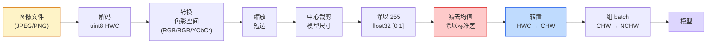
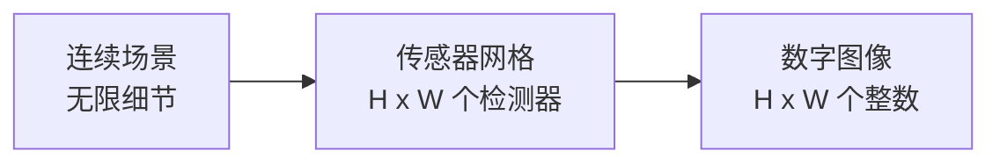
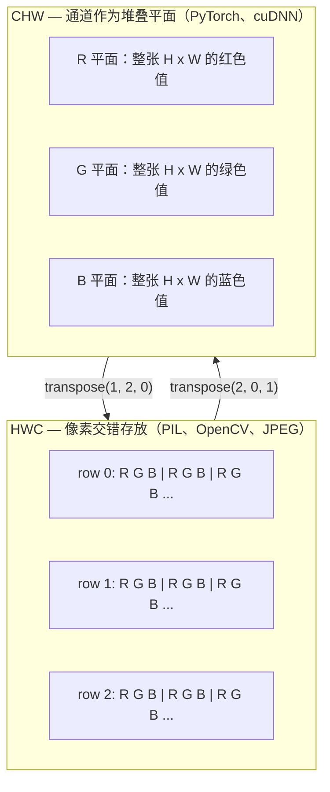

# 图像基础 — 像素、通道、色彩空间

> 图像是一组光照采样组成的张量。你以后用到的每一个视觉模型，都从这个事实开始。

**Type:** Build
**Languages:** Python
**Prerequisites:** Phase 1 Lesson 12（Tensor Operations），Phase 3 Lesson 11（Intro to PyTorch）
**Time:** ~45 minutes

## 学习目标

- 解释连续场景如何被离散化为像素，以及采样和量化为什么会决定所有下游模型的上限
- 把图像当作 NumPy 数组读取、切片、检查，并在 HWC 与 CHW 布局之间熟练切换
- 在 RGB、灰度、HSV、YCbCr 之间转换，并说明每种色彩空间存在的原因
- 按 torchvision 期望的方式，精确执行像素级预处理：归一化、标准化、缩放、通道前置

## 问题

你会读到的每篇论文、下载的每个预训练权重、调用的每个视觉 API，都默认输入采用某种特定编码。模型想要 `float32`，你却传入 `uint8` 图像，它仍然会运行，然后悄悄吐出垃圾结果。网络是在 RGB 上训练的，你喂给它 BGR，准确率可能直接掉十个百分点。模型期望 channels-first，你给了 channels-last，第一层卷积会把高度当成特征通道。它们通常不会报错，只会毁掉指标，然后你花一周去追一个其实藏在文件加载方式里的 bug。

只要知道卷积滑过的对象是什么，卷积本身并不复杂。难的是，“一张图像”在相机、JPEG 解码器、PIL、OpenCV、torchvision 和 CUDA kernel 眼里含义都不一样。每套栈都有自己的轴顺序、字节范围和通道约定。分不清这些约定的视觉工程师，很容易交付坏掉的流水线。

这一课会把基础打牢，让本阶段后面的内容都能站在上面。学完以后，你会知道像素是什么，为什么每个像素通常有三个数字而不是一个，“用 ImageNet 统计量 normalize”到底做了什么，以及如何在本阶段所有后续课程都会默认使用的两三种布局之间移动。

## 概念

### 完整预处理流水线概览

每个生产级视觉系统，本质上都是同一串可逆变换。任何一步错了，模型看到的输入都会和训练时不同。



红色和蓝色两个节点，是 80% 静默失败发生的位置：漏掉标准化，或者布局顺序错误。

### 像素是一次采样，不是一个方块

相机传感器会统计落在一组微小检测器网格上的光子。每个检测器在一小段时间内积分光照，并输出一个电压，电压大小和命中的光子数成比例。随后传感器把这个电压离散化为整数。一个检测器就变成一个像素。



这一步会发生两个选择，并且它们会锁定所有下游结果的上限：

- **空间采样**决定场景中每一度视野会落到多少个检测器上。太少，边缘会变成锯齿，也就是混叠；太多，存储和计算都会爆炸。
- **强度量化**决定电压会被分桶到多细。8 bit 给出 256 个级别，是显示领域的标准。10、12、16 bit 会得到更平滑的梯度，在医学影像、HDR 和 raw 传感器流水线中很重要。

像素不是有面积的彩色小方块。它是一次测量。当你缩放或旋转图像时，你是在对这个测量网格重新采样。

### 为什么是三个通道

一个检测器会统计整个可见光谱上的光子，这就是灰度。为了得到颜色，传感器会在网格上覆盖红、绿、蓝滤镜组成的马赛克。去马赛克之后，每个空间位置都有三个整数：附近红色滤镜、绿色滤镜、蓝色滤镜检测器的响应。这三个整数就是一个像素的 RGB 三元组。

| 表示 | 含义 |
|------|------|
| `(R, G, B) = (210, 140, 30)` | 一个偏红橙色的像素 |
| `(H, W, 3)` | 一张 RGB 图像的形状：H 行、W 列、每个像素 3 个值 |
| `[0, 255]` | `uint8` 图像中每个通道的常见取值范围 |

三个通道并不神奇。深度相机会增加一个 Z 通道。卫星图像会增加红外和紫外波段。医学扫描常常只有一个通道（X 光、CT），也可能有很多通道（高光谱）。通道数是最后一个轴；卷积层会学习如何跨通道混合。

### 两种布局约定：HWC 和 CHW

同一个张量，两种顺序。每个库都会选一种。

| 布局 | 轴顺序 | 常见位置 | 直觉 |
|------|--------|----------|------|
| HWC | height, width, channels | PIL、OpenCV、matplotlib、几乎所有磁盘图像格式 | 一行行扫描像素，每个像素里交错存放 R/G/B |
| CHW | channels, height, width | PyTorch、大多数深度学习框架、cuDNN kernel | 把每个通道看成一张完整的 2D 平面，再把平面堆叠起来 |

CHW 存在，是因为卷积核会沿着 H 和 W 滑动。把通道轴放在前面，意味着每个 kernel 都能看到每个通道上一块连续的 2D 平面，向量化更干净。磁盘格式保留 HWC，是因为它匹配传感器输出扫描线的方式。

你会输入上千次的一行转换：

```python
img_chw = img_hwc.transpose(2, 0, 1)      # NumPy
img_chw = img_hwc.permute(2, 0, 1)        # PyTorch tensor
```

内存布局可以这样理解：



### 字节范围与 dtype

三种约定最常见：

| 约定 | dtype | 范围 | 出现位置 |
|------|-------|------|----------|
| 原始值 | `uint8` | [0, 255] | 磁盘文件、PIL、OpenCV 输出 |
| 归一化 | `float32` | [0.0, 1.0] | `img.astype('float32') / 255` 之后 |
| 标准化 | `float32` | 大约 [-2, +2] | 减均值、除标准差之后 |

卷积网络是在标准化输入上训练的。ImageNet 统计量 `mean=[0.485, 0.456, 0.406]`、`std=[0.229, 0.224, 0.225]`，是在 [0, 1] 归一化像素上，对 ImageNet 完整训练集三个通道分别计算出的算术均值和标准差。把原始 `uint8` 喂给期望标准化 float 的模型，是应用视觉里最常见的静默失败。

### 色彩空间及其存在原因

RGB 是捕获格式，但它不一定总是对模型最有用的表示。

| 色彩空间 | 组成 | 为什么有用 |
|----------|------|------------|
| RGB | R red、G green、B blue | 贴近传感器输出，也是大多数现代 CNN 的输入 |
| HSV | H hue（0-360 度）、S saturation（0-1）、V value/brightness（0-1） | 把颜色和亮度分开，适合颜色阈值、UI 滑块、简单滤镜 |
| YCbCr / YUV | Y luminance（亮度）、Cb 蓝黄 chroma、Cr 红绿 chroma | 把亮度和颜色分开；JPEG 和多数视频编码会更用力压缩 chroma，因为人眼对 chroma 细节不如对 Y 敏感 |

大多数现代 CNN 使用 RGB。你会在这些地方遇到其他空间：

- **HSV**：经典 CV 代码、基于颜色的分割、白平衡。
- **YCbCr**：读取 JPEG 内部、视频流水线、只在 Y 通道上工作的超分辨率模型。
- **灰度**：OCR、文档模型，以及任何颜色是干扰变量而不是信号的场景。

RGB 转灰度不是简单平均，而是加权求和，因为人眼对绿色比对红色或蓝色更敏感：

```text
Y = 0.299 R + 0.587 G + 0.114 B       (ITU-R BT.601, classic weights)
```

### 宽高比、缩放与插值

每个模型都有固定输入尺寸：大多数 ImageNet 分类器是 224x224，现代检测器常见 384x384 或 512x512。你的图像通常不会刚好匹配。真正重要的是三个缩放选择：

- **先缩放短边，再中心裁剪**：标准 ImageNet 配方。保留宽高比，但会丢掉边缘的一条区域。
- **缩放并填充**：保留宽高比和每个像素，但会加黑边。检测和 OCR 常用。
- **直接缩放到目标尺寸**：会拉伸图像。便宜，会扭曲几何形状，但对许多分类任务也足够。

当新网格和旧网格没有对齐时，插值方法决定中间像素如何计算：

| 方法 | 特点 | 适用场景 |
|------|------|----------|
| Nearest neighbour | 最快、有块状感 | mask / label 这种包含整数类别 ID 的数据 |
| Bilinear | 快、平滑 | 大多数图像训练的默认选择 |
| Bicubic | 更慢，放大时更锐利 | 希望看起来更清晰的图像 |
| Lanczos | 最慢、质量最好 | 最终展示资产 |

经验法则：训练用 bilinear；你要肉眼查看的资产用 bicubic 或 Lanczos；任何包含整数类别 ID 的东西都用 nearest。

```figure
conv-output-size
```

## Build It

### Step 1: 加载图像并检查形状

用 Pillow 加载任意 JPEG 或 PNG，转成 NumPy，然后打印你拿到的内容。为了让示例离线且确定，这里先合成一张图像。

```python
import numpy as np
from PIL import Image

def synthetic_rgb(h=128, w=192, seed=0):
    rng = np.random.default_rng(seed)
    yy, xx = np.meshgrid(np.linspace(0, 1, h), np.linspace(0, 1, w), indexing="ij")
    r = (np.sin(xx * 6) * 0.5 + 0.5) * 255
    g = yy * 255
    b = (1 - yy) * xx * 255
    rgb = np.stack([r, g, b], axis=-1) + rng.normal(0, 6, (h, w, 3))
    return np.clip(rgb, 0, 255).astype(np.uint8)

arr = synthetic_rgb()
# Or load from disk:
# arr = np.asarray(Image.open("your_image.jpg").convert("RGB"))

print(f"type:   {type(arr).__name__}")
print(f"dtype:  {arr.dtype}")
print(f"shape:  {arr.shape}     # (H, W, C)")
print(f"min:    {arr.min()}")
print(f"max:    {arr.max()}")
print(f"pixel at (0, 0): {arr[0, 0]}")
```

期望输出：`shape: (H, W, 3)`、`dtype: uint8`、范围 `[0, 255]`。无论字节来自相机、JPEG 解码器还是合成生成器，这都是磁盘图像的规范表示。

### Step 2: 拆分通道并重排布局

分别取出 R、G、B，然后从 HWC 转成 PyTorch 使用的 CHW。

```python
R = arr[:, :, 0]
G = arr[:, :, 1]
B = arr[:, :, 2]
print(f"R shape: {R.shape}, mean: {R.mean():.1f}")
print(f"G shape: {G.shape}, mean: {G.mean():.1f}")
print(f"B shape: {B.shape}, mean: {B.mean():.1f}")

arr_chw = arr.transpose(2, 0, 1)
print(f"\nHWC shape: {arr.shape}")
print(f"CHW shape: {arr_chw.shape}")
```

这会得到三个灰度平面，每个通道一个。CHW 只是重排轴；当内存布局允许时，它并不一定需要真正复制数据。

### Step 3: 灰度与 HSV 转换

先做加权求和灰度，再手写 RGB 到 HSV 的转换。

```python
def rgb_to_grayscale(rgb):
    weights = np.array([0.299, 0.587, 0.114], dtype=np.float32)
    return (rgb.astype(np.float32) @ weights).astype(np.uint8)

def rgb_to_hsv(rgb):
    rgb_f = rgb.astype(np.float32) / 255.0
    r, g, b = rgb_f[..., 0], rgb_f[..., 1], rgb_f[..., 2]
    cmax = np.max(rgb_f, axis=-1)
    cmin = np.min(rgb_f, axis=-1)
    delta = cmax - cmin

    h = np.zeros_like(cmax)
    mask = delta > 0
    rmax = mask & (cmax == r)
    gmax = mask & (cmax == g)
    bmax = mask & (cmax == b)
    h[rmax] = ((g[rmax] - b[rmax]) / delta[rmax]) % 6
    h[gmax] = ((b[gmax] - r[gmax]) / delta[gmax]) + 2
    h[bmax] = ((r[bmax] - g[bmax]) / delta[bmax]) + 4
    h = h * 60.0

    s = np.where(cmax > 0, delta / cmax, 0)
    v = cmax
    return np.stack([h, s, v], axis=-1)

gray = rgb_to_grayscale(arr)
hsv = rgb_to_hsv(arr)
print(f"gray shape: {gray.shape}, range: [{gray.min()}, {gray.max()}]")
print(f"hsv   shape: {hsv.shape}")
print(f"hue range: [{hsv[..., 0].min():.1f}, {hsv[..., 0].max():.1f}] degrees")
print(f"sat range: [{hsv[..., 1].min():.2f}, {hsv[..., 1].max():.2f}]")
print(f"val range: [{hsv[..., 2].min():.2f}, {hsv[..., 2].max():.2f}]")
```

Hue 会以角度输出，saturation 和 value 位于 [0, 1]。这和 OpenCV 的 `hsv_full` 约定一致。

### Step 4: 归一化、标准化，并反向还原

从原始字节走到预训练 ImageNet 模型期望的精确张量，然后再还原回来。

```python
mean = np.array([0.485, 0.456, 0.406], dtype=np.float32)
std = np.array([0.229, 0.224, 0.225], dtype=np.float32)

def preprocess_imagenet(rgb_uint8):
    x = rgb_uint8.astype(np.float32) / 255.0
    x = (x - mean) / std
    x = x.transpose(2, 0, 1)
    return x

def deprocess_imagenet(chw_float32):
    x = chw_float32.transpose(1, 2, 0)
    x = x * std + mean
    x = np.clip(x * 255.0, 0, 255).astype(np.uint8)
    return x

x = preprocess_imagenet(arr)
print(f"preprocessed shape: {x.shape}     # (C, H, W)")
print(f"preprocessed dtype: {x.dtype}")
print(f"preprocessed mean per channel:  {x.mean(axis=(1, 2)).round(3)}")
print(f"preprocessed std  per channel:  {x.std(axis=(1, 2)).round(3)}")

roundtrip = deprocess_imagenet(x)
max_diff = np.abs(roundtrip.astype(int) - arr.astype(int)).max()
print(f"roundtrip max pixel diff: {max_diff}    # should be 0 or 1")
```

每个通道的均值应该接近 0，标准差应该接近 1。这个 preprocess/deprocess 对，正是每个 torchvision `transforms.Normalize` 调用在底层做的事。

### Step 5: 用三种插值方法缩放

在放大场景下比较 nearest、bilinear 和 bicubic，让差异更明显。

```python
target = (arr.shape[0] * 3, arr.shape[1] * 3)

nearest = np.asarray(Image.fromarray(arr).resize(target[::-1], Image.NEAREST))
bilinear = np.asarray(Image.fromarray(arr).resize(target[::-1], Image.BILINEAR))
bicubic = np.asarray(Image.fromarray(arr).resize(target[::-1], Image.BICUBIC))

def local_roughness(x):
    gy = np.diff(x.astype(float), axis=0)
    gx = np.diff(x.astype(float), axis=1)
    return float(np.abs(gy).mean() + np.abs(gx).mean())

for name, out in [("nearest", nearest), ("bilinear", bilinear), ("bicubic", bicubic)]:
    print(f"{name:>8}  shape={out.shape}  roughness={local_roughness(out):6.2f}")
```

Nearest 的 roughness 最高，因为它保留硬边缘。Bilinear 最平滑。Bicubic 介于两者之间，在没有阶梯状伪影的情况下保留感知上的锐度。

## Use It

`torchvision.transforms` 会把上面的所有步骤打包成一个可组合流水线。下面的代码精确复现 `preprocess_imagenet` 做的事，并额外加入 resize 和 crop。

```python
import torch
from torchvision import transforms
from PIL import Image

img = Image.fromarray(synthetic_rgb(256, 256))

pipeline = transforms.Compose([
    transforms.Resize(256),
    transforms.CenterCrop(224),
    transforms.ToTensor(),
    transforms.Normalize(mean=[0.485, 0.456, 0.406], std=[0.229, 0.224, 0.225]),
])

x = pipeline(img)
print(f"tensor type:  {type(x).__name__}")
print(f"tensor dtype: {x.dtype}")
print(f"tensor shape: {tuple(x.shape)}      # (C, H, W)")
print(f"per-channel mean: {x.mean(dim=(1, 2)).tolist()}")
print(f"per-channel std:  {x.std(dim=(1, 2)).tolist()}")

batch = x.unsqueeze(0)
print(f"\nbatched shape: {tuple(batch.shape)}   # (N, C, H, W) — ready for a model")
```

四个步骤，顺序必须如此：`Resize(256)` 把短边缩放到 256；`CenterCrop(224)` 从中心取出 224x224 patch；`ToTensor()` 除以 255，并把 HWC 换成 CHW；`Normalize` 减去 ImageNet 均值并除以标准差。反转这个顺序，会悄悄改变最终送进模型的东西。

## Ship It

这一课产出：

- `outputs/prompt-vision-preprocessing-audit.md`：一个提示词，可以把任何 model card 或 dataset card 转成团队必须遵守的精确预处理不变量清单。
- `outputs/skill-image-tensor-inspector.md`：一个技能；给定任何图像形状的 tensor 或数组，它会报告 dtype、布局、范围，以及它看起来是原始值、归一化值还是标准化值。

## 练习

1. **（Easy）** 分别用 OpenCV（`cv2.imread`）和 Pillow 加载一张 JPEG。打印两者的形状和 `(0, 0)` 像素。解释通道顺序差异，然后写一行转换，让 OpenCV 数组和 Pillow 数组一致。
2. **（Medium）** 编写 `standardize(img, mean, std)` 及其逆函数，让它们在任意 uint8 图像上通过 `roundtrip_max_diff <= 1` 测试。函数必须能用同一个调用处理 HWC 单张图像和 NCHW batch。
3. **（Hard）** 取一个 3 通道的 ImageNet 标准化张量，让它通过一个 1x1 conv，学习把 RGB 加权混合成单个灰度通道。把权重初始化为 `[0.299, 0.587, 0.114]`，冻结它们，并验证输出与手写 `rgb_to_grayscale` 在浮点误差范围内一致。还有哪些经典色彩空间转换可以写成 1x1 卷积？

## 关键术语

| 术语 | 常见说法 | 实际含义 |
|------|----------|----------|
| Pixel | “一个彩色方块” | 网格中某个位置的一次光强采样；彩色图像是三个数字，灰度图像是一个数字 |
| Channel | “颜色” | 堆叠成图像张量的平行空间网格之一；在 HWC 中是最后一个轴，在 CHW 中是第一个轴 |
| HWC / CHW | “形状” | 图像张量的轴顺序；磁盘格式和 PIL 使用 HWC，PyTorch 和 cuDNN 使用 CHW |
| Normalize | “缩放图像” | 除以 255，让像素位于 [0, 1]；必要但不充分 |
| Standardize | “零中心化” | 按通道减均值、除标准差，让输入分布匹配模型训练时看到的分布 |
| Grayscale conversion | “平均通道” | 使用 0.299/0.587/0.114 系数的加权和，用来匹配人类亮度感知 |
| Interpolation | “resize 怎么选像素” | 当新网格和旧网格不对齐时，决定输出值的规则；label 用 nearest，训练用 bilinear，展示用 bicubic |
| Aspect ratio | “宽除以高” | 区分“缩放并填充”和“缩放并拉伸”的比例 |

## 延伸阅读

- [Charles Poynton — A Guided Tour of Color Space](https://poynton.ca/PDFs/Guided_tour.pdf)：清晰解释为什么会有这么多色彩空间，以及每种空间何时重要
- [PyTorch Vision Transforms Docs](https://pytorch.org/vision/stable/transforms.html)：你在生产中真正会组合使用的完整 transforms 流水线
- [How JPEG Works (Colt McAnlis)](https://www.youtube.com/watch?v=F1kYBnY6mwg)：关于 chroma subsampling、DCT，以及 JPEG 为什么编码 YCbCr 而不是 RGB 的直观讲解
- [ImageNet Preprocessing Conventions (torchvision models)](https://pytorch.org/vision/stable/models.html)：`mean=[0.485, 0.456, 0.406]` 的来源，以及模型库中每个模型为什么都期望它的官方依据
