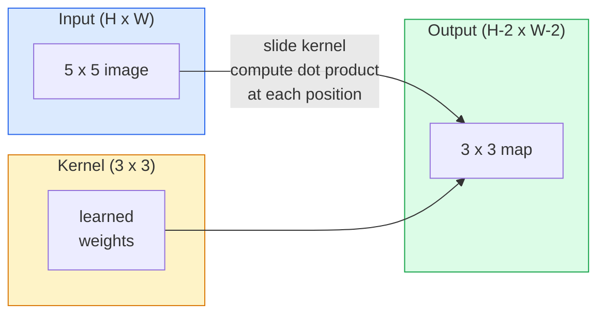
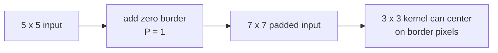
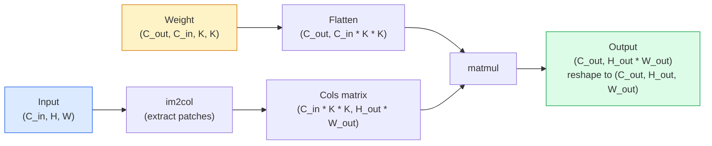

# 从零实现卷积

> 卷积就是一个很小的 dense layer，把它滑过图像，并在每个位置共享同一组权重。

**Type:** Build
**Languages:** Python
**Prerequisites:** Phase 3（Deep Learning Core），Phase 4 Lesson 01（Image Fundamentals）
**Time:** ~75 minutes

## 学习目标

- 只用 NumPy 从零实现 2D 卷积，包括嵌套循环版本和向量化的 `im2col` 版本
- 在任意输入尺寸、kernel size、padding、stride 组合下计算输出空间尺寸，并解释 `(H - K + 2P) / S + 1` 公式
- 手工设计 edge、blur、sharpen、Sobel 等 kernel，并解释每个 kernel 为什么会产生对应的激活模式
- 把卷积堆成特征提取器，并把堆叠深度和感受野大小联系起来

## 问题

如果把一张 224x224 RGB 图像喂给全连接层，每个神经元需要 224 * 224 * 3 = 150,528 个输入权重。一个只有 1,000 个单元的 hidden layer，就已经有 1.5 亿个参数了，而且这还没学到任何有用东西。更糟的是，这一层完全不知道左上角的狗和右下角的狗是同一种模式。它把每个像素位置都当成独立的东西，而这正好违背图像的性质：把一只猫平移三个像素，不应该迫使网络重新学习“猫”这个概念。

图像模型需要两个性质：**平移等变性**（input 平移时 output 也跟着平移）和 **参数共享**（同一个特征检测器在所有位置运行）。Dense layer 两个都不给你。卷积两个都免费给你。

卷积不是为了深度学习才发明的。JPEG 压缩、Photoshop 里的高斯模糊、工业视觉里的边缘检测，以及每一个音频滤波器，都在使用同一个操作。CNN 从 2012 到 2020 主导 ImageNet 的原因，是卷积正好给出了适合这类数据的先验：相邻值彼此相关，同一种模式可能出现在任何位置。

## 概念

### 一个 kernel，滑过输入

2D 卷积会拿一个叫做 kernel（或 filter）的小权重矩阵，让它在输入上滑动，并在每个位置计算逐元素乘积之和。这个和就变成一个输出像素。



在一个 5x5 输入上做 3x3 的具体例子（无 padding，stride 为 1）：

| 输入 X (5 x 5) | Kernel W (3 x 3) |
|----------------|------------------|
| `[[1, 2, 0, 1, 2], [0, 1, 3, 1, 0], [2, 1, 0, 2, 1], [1, 0, 2, 1, 3], [2, 1, 1, 0, 1]]` | `[[1, 0, -1], [2, 0, -2], [1, 0, -1]]` |

Kernel 会滑过每一个合法的 3x3 窗口。输出 Y 是 3x3：

```text
Y[0,0] = sum( W * X[0:3, 0:3] )
Y[0,1] = sum( W * X[0:3, 1:4] )
Y[0,2] = sum( W * X[0:3, 2:5] )
Y[1,0] = sum( W * X[1:4, 0:3] )
... 依此类推
```

这一条公式，也就是 **共享权重、局部性、滑动窗口**，就是卷积的全部核心。其余都是 bookkeeping。

### 输出尺寸公式

给定输入空间尺寸 `H`、kernel size `K`、padding `P`、stride `S`：

```text
H_out = floor( (H - K + 2P) / S ) + 1
```

记住它。之后你在设计架构时会计算几十次。

| 场景 | H | K | P | S | H_out |
|------|---|---|---|---|-------|
| Valid conv，无 padding | 32 | 3 | 0 | 1 | 30 |
| Same conv，保持尺寸 | 32 | 3 | 1 | 1 | 32 |
| 下采样 2 倍 | 32 | 3 | 1 | 2 | 16 |
| Pool 2x2 | 32 | 2 | 0 | 2 | 16 |
| 大感受野 | 32 | 7 | 3 | 2 | 16 |

“Same padding” 的意思是当 `S == 1` 时，选择让 `H_out == H` 的 P。对于奇数 K，就是 P = (K - 1) / 2。这就是 3x3 kernel 占主导地位的原因：它是最小的、仍然有中心点的奇数 kernel。

### Padding

没有 padding 时，每次卷积都会缩小 feature map。堆 20 层之后，你的 224x224 图像会变成 184x184，这会浪费边界上的计算，也会让需要 shape 匹配的 residual connection 变得麻烦。



Zero padding 会在边缘外补 0。这样 kernel 可以以像素 `(0, 0)` 为中心，同时仍然拥有三行三列可以相乘的值。

实践中会遇到的模式：`zero`（最常见）、`reflect`（镜像边缘，生成模型中可避免硬边界）、`replicate`（复制边缘）、`circular`（环绕，常用于环面问题）。

### Stride

Stride 是滑动时的步长。`stride=1` 是默认值。`stride=2` 会把空间尺寸减半，是 CNN 内部不使用单独 pooling layer 也能下采样的经典方式。每个现代架构（ResNet、ConvNeXt、MobileNet）都会在某些地方用 strided conv 替代 max-pool。

| 设置 | kernel 起点 | 输出尺寸 |
|------|-------------|----------|
| 5x5 输入，3x3 kernel，stride 1 | `(0,0) (0,1) (0,2)`、`(1,0) (1,1) (1,2)`、`(2,0) (2,1) (2,2)` | 3 x 3 |
| 同一输入，stride 2 | `(0,0) (0,2)`、`(2,0) (2,2)` | 2 x 2 |

### 多个输入通道

真实图像有三个通道。RGB 输入上的 3x3 卷积，实际上是一个 3x3x3 体积：每个输入通道有一个 3x3 切片。在每个空间位置，你会跨三个切片逐元素相乘并求和，再加上 bias。

| 对象 | 形状 | 例子 |
|------|------|------|
| Input | `(C_in, H, W)` | `3 x 5 x 5` |
| Kernel | `(C_in, K, K)` | `3 x 3 x 3`，一个 kernel |
| Output | `(1, H', W')` | 一个 2D map |
| Weight for layer | `(C_out, C_in, K, K)` | `64 x 3 x 3 x 3` |
| Output for layer | `(C_out, H', W')` | `64 x H' x W'` |

参数量：

```text
C_out * C_in * K * K + C_out
```

最后的 `+ C_out` 是 bias。规划模型时，你会不断计算这条公式。一个 3 通道输入上的 64-channel 3x3 conv 只有 `64 * 3 * 3 * 3 + 64 = 1,792` 个参数。很便宜。

### im2col 技巧

嵌套循环容易读，但很慢。GPU 想要的是大型矩阵乘法。技巧是：把输入的每一个 receptive-field window 展平成一个大矩阵的一列，把 kernel 展平成一行，然后整个卷积就变成一次 matmul。



每个生产级 conv 实现，都是这个思路加上一些 cache tiling 技巧的变体：direct conv、Winograd、用于大 kernel 的 FFT conv。理解 im2col，就理解了核心。

### 感受野

单个 3x3 conv 会看 9 个输入像素。堆两个 3x3 conv，第二层的一个神经元会看原始输入中的 5x5 像素。三个 3x3 conv 得到 7x7。一般来说：

```text
stride 1 下，L 层 K x K conv 堆叠后的 RF = 1 + L * (K - 1)

有 stride 时：RF 会沿着每一层的 stride 乘法式增长。
```

“一路 3x3” 能工作（VGG、ResNet、ConvNeXt）的原因在这里：两个 3x3 conv 能看到和一个 5x5 conv 相同的输入区域，但参数更少，而且中间多了一次非线性。

```figure
convolution-kernel
```

## Build It

### Step 1: 给数组加 padding

从最小原语开始：写一个函数，在 H x W 数组周围补零。

```python
import numpy as np

def pad2d(x, p):
    if p == 0:
        return x
    h, w = x.shape[-2:]
    out = np.zeros(x.shape[:-2] + (h + 2 * p, w + 2 * p), dtype=x.dtype)
    out[..., p:p + h, p:p + w] = x
    return out

x = np.arange(9).reshape(3, 3)
print(x)
print()
print(pad2d(x, 1))
```

尾部轴技巧 `x.shape[:-2]` 意味着同一个函数无需修改，就能处理 `(H, W)`、`(C, H, W)` 或 `(N, C, H, W)`。

### Step 2: 用嵌套循环实现 2D 卷积

这是 reference implementation：慢，但没有歧义。原则上，`torch.nn.functional.conv2d` 做的就是这件事。

```python
def conv2d_naive(x, w, b=None, stride=1, padding=0):
    c_in, h, w_in = x.shape
    c_out, c_in_w, kh, kw = w.shape
    assert c_in == c_in_w

    x_pad = pad2d(x, padding)
    h_out = (h + 2 * padding - kh) // stride + 1
    w_out = (w_in + 2 * padding - kw) // stride + 1

    out = np.zeros((c_out, h_out, w_out), dtype=np.float32)
    for oc in range(c_out):
        for i in range(h_out):
            for j in range(w_out):
                hs = i * stride
                ws = j * stride
                patch = x_pad[:, hs:hs + kh, ws:ws + kw]
                out[oc, i, j] = np.sum(patch * w[oc])
        if b is not None:
            out[oc] += b[oc]
    return out
```

四层嵌套循环：输出通道、行、列，以及对 `C_in, kh, kw` 的隐式求和。这是你之后检查所有更快实现时的 ground truth。

### Step 3: 用手工设计的 kernel 验证

构造一个 vertical Sobel kernel，把它应用到合成的阶跃图像上，然后观察垂直边缘被点亮。

```python
def synthetic_step_image():
    img = np.zeros((1, 16, 16), dtype=np.float32)
    img[:, :, 8:] = 1.0
    return img

sobel_x = np.array([
    [[-1, 0, 1],
     [-2, 0, 2],
     [-1, 0, 1]]
], dtype=np.float32)[None]

x = synthetic_step_image()
y = conv2d_naive(x, sobel_x, padding=1)
print(y[0].round(1))
```

你应该会在第 7 列看到较大的正值（从左到右亮度增加），其他位置接近 0。这个打印结果就是数学正确性的 sanity check。

### Step 4: im2col

把输入中每个 kernel 大小的窗口转成矩阵的一列。对于 `C_in=3, K=3`，每一列有 27 个数字。

```python
def im2col(x, kh, kw, stride=1, padding=0):
    c_in, h, w = x.shape
    x_pad = pad2d(x, padding)
    h_out = (h + 2 * padding - kh) // stride + 1
    w_out = (w + 2 * padding - kw) // stride + 1

    cols = np.zeros((c_in * kh * kw, h_out * w_out), dtype=x.dtype)
    col = 0
    for i in range(h_out):
        for j in range(w_out):
            hs = i * stride
            ws = j * stride
            patch = x_pad[:, hs:hs + kh, ws:ws + kw]
            cols[:, col] = patch.reshape(-1)
            col += 1
    return cols, h_out, w_out
```

这里仍然有 Python 循环，但最重的计算会变成一次向量化 matmul。

### Step 5: 通过 im2col + matmul 实现快速 conv

用一次矩阵乘法替代四重循环。

```python
def conv2d_im2col(x, w, b=None, stride=1, padding=0):
    c_out, c_in, kh, kw = w.shape
    cols, h_out, w_out = im2col(x, kh, kw, stride, padding)
    w_flat = w.reshape(c_out, -1)
    out = w_flat @ cols
    if b is not None:
        out += b[:, None]
    return out.reshape(c_out, h_out, w_out)
```

正确性检查：运行两个实现并比较。

```python
rng = np.random.default_rng(0)
x = rng.normal(0, 1, (3, 16, 16)).astype(np.float32)
w = rng.normal(0, 1, (8, 3, 3, 3)).astype(np.float32)
b = rng.normal(0, 1, (8,)).astype(np.float32)

y_naive = conv2d_naive(x, w, b, padding=1)
y_im2col = conv2d_im2col(x, w, b, padding=1)

print(f"max abs diff: {np.max(np.abs(y_naive - y_im2col)):.2e}")
```

`max abs diff` 应该在 `1e-5` 左右。这是浮点累加顺序不同，不是 bug。

### Step 6: 一组手工设计的 kernel

五个 filter，展示单个 conv layer 在任何训练之前就能表达什么。

```python
KERNELS = {
    "identity": np.array([[0, 0, 0], [0, 1, 0], [0, 0, 0]], dtype=np.float32),
    "blur_3x3": np.ones((3, 3), dtype=np.float32) / 9.0,
    "sharpen": np.array([[0, -1, 0], [-1, 5, -1], [0, -1, 0]], dtype=np.float32),
    "sobel_x": np.array([[-1, 0, 1], [-2, 0, 2], [-1, 0, 1]], dtype=np.float32),
    "sobel_y": np.array([[-1, -2, -1], [0, 0, 0], [1, 2, 1]], dtype=np.float32),
}

def apply_kernel(img2d, kernel):
    x = img2d[None].astype(np.float32)
    w = kernel[None, None]
    return conv2d_im2col(x, w, padding=1)[0]
```

应用到任何灰度图上，blur 会变柔和，sharpen 会让边缘更清脆，Sobel-x 会点亮垂直边缘，Sobel-y 会点亮水平边缘。这正是 AlexNet 和 VGG 第一层训练出来的模式：因为无论后续任务是什么，好的图像模型都需要 edge detector 和 blob detector。

## Use It

PyTorch 的 `nn.Conv2d` 用 autograd、CUDA kernel 和 cuDNN 优化封装了同一个操作。shape 语义完全一致。

```python
import torch
import torch.nn as nn

conv = nn.Conv2d(in_channels=3, out_channels=64, kernel_size=3, stride=1, padding=1)
print(conv)
print(f"weight shape: {tuple(conv.weight.shape)}   # (C_out, C_in, K, K)")
print(f"bias shape:   {tuple(conv.bias.shape)}")
print(f"param count:  {sum(p.numel() for p in conv.parameters())}")

x = torch.randn(8, 3, 224, 224)
y = conv(x)
print(f"\ninput  shape: {tuple(x.shape)}")
print(f"output shape: {tuple(y.shape)}")
```

把 `padding=1` 换成 `padding=0`，输出会降到 222x222。把 `stride=1` 换成 `stride=2`，输出会降到 112x112。和上面记住的是同一个公式。

## Ship It

这一课产出：

- `outputs/prompt-cnn-architect.md`：一个提示词；给定输入尺寸、参数预算和目标感受野后，它会设计一组 `Conv2d` layer，并为每一步选择正确的 K/S/P。
- `outputs/skill-conv-shape-calculator.md`：一个技能；逐层遍历网络规格，返回每个 block 的输出 shape、感受野和参数量。

## 练习

1. **（Easy）** 给定一个 128x128 灰度输入，以及 `[Conv3x3(s=1,p=1), Conv3x3(s=2,p=1), Conv3x3(s=1,p=1), Conv3x3(s=2,p=1)]` 组成的堆叠，手算每一层的输出空间尺寸和感受野。再用一个 dummy conv 组成的 PyTorch `nn.Sequential` 验证。
2. **（Medium）** 扩展 `conv2d_naive` 和 `conv2d_im2col`，让它们接受 `groups` 参数。展示 `groups=C_in=C_out` 会复现 depthwise convolution，并说明它的参数量是 `C * K * K`，而不是 `C * C * K * K`。
3. **（Hard）** 手动实现 `conv2d_im2col` 的 backward pass：给定输出梯度，计算 `x` 和 `w` 的梯度。用相同输入和权重对照 `torch.autograd.grad` 验证。关键点：im2col 的梯度是 `col2im`，并且必须累加重叠窗口。

## 关键术语

| 术语 | 常见说法 | 实际含义 |
|------|----------|----------|
| Convolution | “滑动一个 filter” | 在每个空间位置应用的可学习点积，并共享权重；数学上是 cross-correlation，但大家都叫它 convolution |
| Kernel / filter | “特征检测器” | 形状为 `(C_in, K, K)` 的小权重张量；它和输入窗口的点积会产生一个输出像素 |
| Stride | “每次跳多远” | 相邻 kernel 放置位置之间的步长；stride 2 会把每个空间维度减半 |
| Padding | “边缘补零” | 加在输入周围的额外值，让 kernel 能以边界像素为中心；`same` padding 保持输出大小等于输入大小 |
| Receptive field | “神经元看到了多少” | 某个输出激活依赖的原始输入 patch，会随着深度和 stride 增大 |
| im2col | “GEMM 技巧” | 把每个感受野窗口重排成列，让卷积变成一次大矩阵乘法；这是每个快速 conv kernel 的核心 |
| Depthwise conv | “每个通道一个 kernel” | `groups == C_in` 的卷积；每个输出通道只由匹配的输入通道计算，是 MobileNet 和 ConvNeXt 的基础 |
| Translation equivariance | “输入平移，输出也平移” | 输入平移 k 个像素时，输出也平移 k 个像素；共享权重天然带来这个性质 |

## 延伸阅读

- [A guide to convolution arithmetic for deep learning (Dumoulin & Visin, 2016)](https://arxiv.org/abs/1603.07285)：关于 padding、stride、dilation 的权威图解，几乎每门课都会借鉴
- [CS231n: Convolutional Neural Networks for Visual Recognition](https://cs231n.github.io/convolutional-networks/)：经典课程笔记，包含原始的 im2col 解释
- [The Annotated ConvNet (fast.ai)](https://nbviewer.org/github/fastai/fastbook/blob/master/13_convolutions.ipynb)：从手写卷积一路走到训练数字分类器的 notebook
- [Receptive Field Arithmetic for CNNs (Dang Ha The Hien)](https://distill.pub/2019/computing-receptive-fields/)：论文级别的交互式感受野计算讲解
