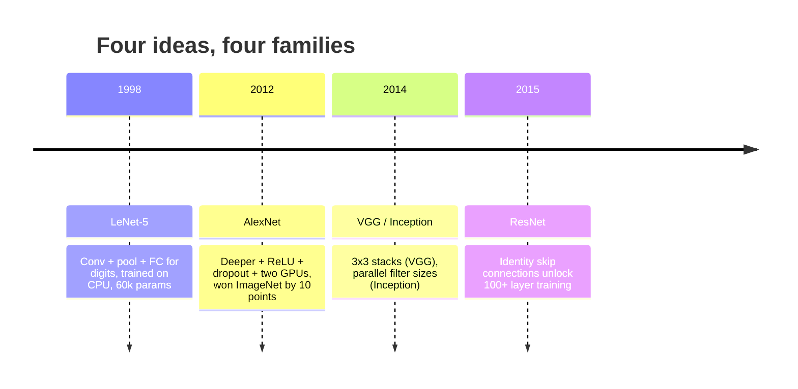
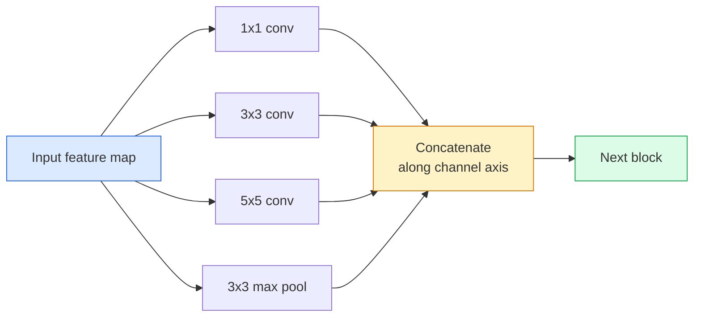
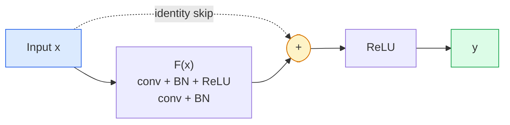

# CNN — 从 LeNet 到 ResNet

> 过去三十年的主要 CNN，基本都是 conv-nonlinearity-downsample 配方，再加上一个新想法。按顺序学这些想法。

**Type:** Learn + Build
**Languages:** Python
**Prerequisites:** Phase 3 Lesson 11（PyTorch），Phase 4 Lesson 01（Image Fundamentals），Phase 4 Lesson 02（Convolutions from Scratch）
**Time:** ~75 minutes

## 学习目标

- 追踪 LeNet-5 -> AlexNet -> VGG -> Inception -> ResNet 的架构谱系，并说出每个家族贡献的一个核心新想法
- 在 PyTorch 中分别用 40 行以内实现 LeNet-5、VGG 风格 block 和 ResNet BasicBlock
- 解释为什么 residual connection 能把一个不可训练的 1,000 层网络变成 state-of-the-art
- 阅读现代 backbone（ResNet-18、ResNet-50），并在看源码前预测它的输出 shape、感受野和参数量

## 问题

2011 年，最好的 ImageNet 分类器 top-5 accuracy 大约是 74%。2012 年，AlexNet 达到 85%。2015 年，ResNet 达到 96%。没有新数据，也没有新一代 GPU。这些提升来自架构想法。一个能工作的视觉工程师必须知道哪个想法来自哪篇论文，因为你在 2026 年交付的每个生产 backbone，都是这些部件的重新组合；而且这些想法会不断迁移：grouped conv 从 CNN 走到 transformer，residual connection 从 ResNet 走到所有 LLM，batch normalization 也活在 diffusion model 里。

按顺序学习这些网络，还有一个好处：它会帮你免疫一个常见错误，也就是在 LeNet 级别网络就能解决问题时，直接拿最大的模型。MNIST 不需要 ResNet。理解每个家族的 scaling curve，能告诉你应该坐在曲线的哪个位置。

## 概念

### 改变视觉的四个想法



经典视觉里，没有什么比这四次跃迁更重要。

### LeNet-5（1998）

Yann LeCun 的数字识别器。6 万个参数。两个 conv-pool block，两个 fully connected layer，tanh activation。它定义了每个 CNN 都继承的模板：

| 阶段 | 输出形状 |
|------|----------|
| input | `(1, 32, 32)` |
| conv 5x5 | `(6, 28, 28)` |
| avg pool 2x2 | `(6, 14, 14)` |
| conv 5x5 | `(16, 10, 10)` |
| avg pool 2x2 | `(16, 5, 5)` |
| flatten | `400` |
| dense | `120` |
| dense | `84` |
| dense | `10` |

现代世界称为 CNN 的一切，也就是交替堆叠 convolution 和 downsampling，再接一个小 classifier head，本质上都是 LeNet 加更多层、更宽通道和更好的 activation。

### AlexNet（2012）

三个改变一起击穿了 ImageNet：

1. **ReLU** 替代 tanh。梯度不再那么容易消失，训练速度提升约 6 倍。
2. **Dropout** 放进 fully connected head。正则化变成一个 layer，而不是一个技巧。
3. **深度和宽度**。五个 conv layer、三个 dense layer、6,000 万参数，在两块 GPU 上训练，并把模型拆到两块卡上。

论文 Figure 2 仍然把 GPU split 画成两条并行流。这个并行性是硬件 workaround，不是架构洞见；但上面的三个想法仍然存在于你使用的每个模型里。

### VGG（2014）

VGG 问的是：如果只用 3x3 卷积，并且不断加深，会发生什么？

| 设计 | 内容 |
|------|------|
| stack | conv 3x3 -> conv 3x3 -> pool 2x2 |
| repeat | 16 或 19 个 conv layer |

两个 3x3 conv 能看到和一个 5x5 conv 相同的输入区域，但参数更少（`2*9*C^2 = 18C^2`，而不是 `25*C^2`），而且中间多了一个 ReLU。VGG 把这个观察变成了完整架构。它的简单性，也就是一种 block 反复堆叠，让它成了后续所有模型的参考点。

代价：1.38 亿参数，训练慢，推理贵。

### Inception（2014，同一年）

Google 对“我该用什么 kernel size？”的回答是：全部并行使用。



每条分支会各自专门化：1x1 做 channel mixing，3x3 看局部纹理，5x5 看更大模式，pooling 提供 shift-invariant feature。concat 让下一层自己挑选有用的分支。Inception v1 在每条分支内部用 1x1 convolution 作为 bottleneck，让参数量保持合理。

### Degradation problem

到 2015 年，VGG-19 能工作，VGG-32 不行。深度本该有帮助，但超过约 20 层之后，training loss 和 test loss 都会变差。这不是 overfitting。这是 optimizer 找不到有用权重，因为梯度会穿过每一层乘法式缩小。

```text
Plain deep network:
  y = f_L( f_{L-1}( ... f_1(x) ... ) )

Gradient wrt early layer:
  dL/dW_1 = dL/dy * df_L/df_{L-1} * ... * df_2/df_1 * df_1/dW_1

Each multiplicative term has magnitude roughly (weight magnitude) * (activation gain).
Stack 100 of them with gains < 1 and the gradient is effectively zero.
```

VGG 能在 19 层工作，是因为同时期发表的 batch norm 能让 activation 保持良好尺度。但即使 batch norm，也救不了 30 层以上的 plain deep network。

### ResNet（2015）

He、Zhang、Ren、Sun 提出了一个改变，解决了一切：

```text
standard block:   y = F(x)
residual block:   y = F(x) + x
```

`+ x` 意味着 layer 总可以通过把 `F(x)` 推向 0 来选择什么都不做。1,000 层 ResNet 现在最差也只会像 1 层网络一样，因为每个额外 block 都有一个简单逃生通道。有了这个保证，optimizer 就愿意让每个 block 都变得*稍微*有用一点；而稍微有用，堆 100 次，就是 state-of-the-art。



两种 block 变体到处都会出现：

- **BasicBlock**（ResNet-18、ResNet-34）：两个 3x3 conv，skip 绕过两者。
- **Bottleneck**（ResNet-50、-101、-152）：1x1 降维、3x3 中间、1x1 升维，skip 绕过三者。通道数很高时更便宜。

当 skip 必须跨过 downsample（stride=2）时，identity path 会被替换成 1x1 stride=2 conv，用来匹配 shape。

### 为什么 residual 不只影响视觉

这个想法并不真正只关乎图像分类。它关乎把 deep network 从“祈祷梯度活下来”变成一种可靠、可扩展的工程工具。你下一阶段会读到的每个 transformer block，都有完全相同的 skip connection。没有 ResNet，就没有 GPT。

```figure
pooling
```

## Build It

### Step 1: LeNet-5

一个最小但忠实的 LeNet。Tanh activation，average pooling。唯一的现代化让步是下游使用 `nn.CrossEntropyLoss`，而不是原始的 Gaussian connections。

```python
import torch
import torch.nn as nn
import torch.nn.functional as F

class LeNet5(nn.Module):
    def __init__(self, num_classes=10):
        super().__init__()
        self.conv1 = nn.Conv2d(1, 6, kernel_size=5)
        self.conv2 = nn.Conv2d(6, 16, kernel_size=5)
        self.pool = nn.AvgPool2d(2)
        self.fc1 = nn.Linear(16 * 5 * 5, 120)
        self.fc2 = nn.Linear(120, 84)
        self.fc3 = nn.Linear(84, num_classes)

    def forward(self, x):
        x = self.pool(torch.tanh(self.conv1(x)))
        x = self.pool(torch.tanh(self.conv2(x)))
        x = torch.flatten(x, 1)
        x = torch.tanh(self.fc1(x))
        x = torch.tanh(self.fc2(x))
        return self.fc3(x)

net = LeNet5()
x = torch.randn(1, 1, 32, 32)
print(f"output: {net(x).shape}")
print(f"params: {sum(p.numel() for p in net.parameters()):,}")
```

期望输出：`output: torch.Size([1, 10])`，`params: 61,706`。这就是开启现代视觉的完整数字分类器。

### Step 2: VGG block

一个可复用 block：两个 3x3 conv、ReLU、batch norm、max pool。

```python
class VGGBlock(nn.Module):
    def __init__(self, in_c, out_c):
        super().__init__()
        self.conv1 = nn.Conv2d(in_c, out_c, kernel_size=3, padding=1)
        self.bn1 = nn.BatchNorm2d(out_c)
        self.conv2 = nn.Conv2d(out_c, out_c, kernel_size=3, padding=1)
        self.bn2 = nn.BatchNorm2d(out_c)
        self.pool = nn.MaxPool2d(2)

    def forward(self, x):
        x = F.relu(self.bn1(self.conv1(x)))
        x = F.relu(self.bn2(self.conv2(x)))
        return self.pool(x)

class MiniVGG(nn.Module):
    def __init__(self, num_classes=10):
        super().__init__()
        self.stack = nn.Sequential(
            VGGBlock(3, 32),
            VGGBlock(32, 64),
            VGGBlock(64, 128),
        )
        self.head = nn.Sequential(
            nn.AdaptiveAvgPool2d(1),
            nn.Flatten(),
            nn.Linear(128, num_classes),
        )

    def forward(self, x):
        return self.head(self.stack(x))

net = MiniVGG()
x = torch.randn(1, 3, 32, 32)
print(f"output: {net(x).shape}")
print(f"params: {sum(p.numel() for p in net.parameters()):,}")
```

在 CIFAR 尺寸输入上堆三个 VGG block，再接 adaptive pool 和一个 linear layer。约 29 万参数。对 CIFAR-10 已经很够用。

### Step 3: ResNet BasicBlock

ResNet-18 和 ResNet-34 的核心构件。

```python
class BasicBlock(nn.Module):
    def __init__(self, in_c, out_c, stride=1):
        super().__init__()
        self.conv1 = nn.Conv2d(in_c, out_c, kernel_size=3, stride=stride, padding=1, bias=False)
        self.bn1 = nn.BatchNorm2d(out_c)
        self.conv2 = nn.Conv2d(out_c, out_c, kernel_size=3, stride=1, padding=1, bias=False)
        self.bn2 = nn.BatchNorm2d(out_c)
        if stride != 1 or in_c != out_c:
            self.shortcut = nn.Sequential(
                nn.Conv2d(in_c, out_c, kernel_size=1, stride=stride, bias=False),
                nn.BatchNorm2d(out_c),
            )
        else:
            self.shortcut = nn.Identity()

    def forward(self, x):
        out = F.relu(self.bn1(self.conv1(x)))
        out = self.bn2(self.conv2(out))
        out = out + self.shortcut(x)
        return F.relu(out)
```

Conv layer 上的 `bias=False` 是 batch norm 惯例：BN 的 beta 参数已经处理了 bias，再保留 conv bias 是浪费。只有 stride 或通道数变化时，`shortcut` 才需要真正的 conv；否则它就是 no-op identity。

### Step 4: Tiny ResNet

堆四组 BasicBlock，得到一个适合 CIFAR 尺寸输入的可工作 ResNet。

```python
class TinyResNet(nn.Module):
    def __init__(self, num_classes=10):
        super().__init__()
        self.stem = nn.Sequential(
            nn.Conv2d(3, 32, kernel_size=3, stride=1, padding=1, bias=False),
            nn.BatchNorm2d(32),
            nn.ReLU(inplace=True),
        )
        self.layer1 = self._make_group(32, 32, num_blocks=2, stride=1)
        self.layer2 = self._make_group(32, 64, num_blocks=2, stride=2)
        self.layer3 = self._make_group(64, 128, num_blocks=2, stride=2)
        self.layer4 = self._make_group(128, 256, num_blocks=2, stride=2)
        self.head = nn.Sequential(
            nn.AdaptiveAvgPool2d(1),
            nn.Flatten(),
            nn.Linear(256, num_classes),
        )

    def _make_group(self, in_c, out_c, num_blocks, stride):
        blocks = [BasicBlock(in_c, out_c, stride=stride)]
        for _ in range(num_blocks - 1):
            blocks.append(BasicBlock(out_c, out_c, stride=1))
        return nn.Sequential(*blocks)

    def forward(self, x):
        x = self.stem(x)
        x = self.layer1(x)
        x = self.layer2(x)
        x = self.layer3(x)
        x = self.layer4(x)
        return self.head(x)

net = TinyResNet()
x = torch.randn(1, 3, 32, 32)
print(f"output: {net(x).shape}")
print(f"params: {sum(p.numel() for p in net.parameters()):,}")
```

四组，每组两个 block。第 2、3、4 组开头使用 stride 2。每次 downsample 时通道数翻倍。大约 280 万参数。这就是可以干净扩展到 ResNet-152 的标准配方。

### Step 5: 比较 parameter-to-feature efficiency

让三个网络处理同类输入，并比较参数量。

```python
def summary(name, net, x):
    y = net(x)
    params = sum(p.numel() for p in net.parameters())
    print(f"{name:12s}  input {tuple(x.shape)} -> output {tuple(y.shape)}  params {params:>10,}")

x = torch.randn(1, 3, 32, 32)
summary("LeNet5",     LeNet5(),       torch.randn(1, 1, 32, 32))
summary("MiniVGG",    MiniVGG(),      x)
summary("TinyResNet", TinyResNet(),   x)
```

三个模型，三个时代，参数量相差三个数量级。对于 CIFAR-10 accuracy，训练几个 epoch 后大致需要：LeNet 60%，MiniVGG 89%，TinyResNet 93%。

## Use It

`torchvision.models` 提供了上面这些模型的预训练版本。不同家族的调用签名一致，这正是 backbone 抽象的意义。

```python
from torchvision.models import resnet18, ResNet18_Weights, vgg16, VGG16_Weights

r18 = resnet18(weights=ResNet18_Weights.IMAGENET1K_V1)
r18.eval()

print(f"ResNet-18 params: {sum(p.numel() for p in r18.parameters()):,}")
print(r18.layer1[0])
print()

v16 = vgg16(weights=VGG16_Weights.IMAGENET1K_V1)
v16.eval()
print(f"VGG-16   params: {sum(p.numel() for p in v16.parameters()):,}")
```

ResNet-18 有 1,170 万参数。VGG-16 有 1.38 亿参数。ImageNet top-1 accuracy 接近（69.8% vs 71.6%）。Residual connection 给你带来 12 倍参数效率提升。这就是为什么 ResNet 变体从 2016 年一直主导到 ViT 在 2021 年到来，并且在算力受限的真实部署中仍然占据重要位置。

迁移学习的配方永远一样：加载 pretrained，冻结 backbone，替换 classifier head。

```python
for p in r18.parameters():
    p.requires_grad = False
r18.fc = nn.Linear(r18.fc.in_features, 10)
```

三行。你现在有了一个 10 类 CIFAR 分类器，它继承了 ImageNet 已经付费学到的表示。

## Ship It

这一课产出：

- `outputs/prompt-backbone-selector.md`：一个提示词；给定任务、数据集大小和计算预算后，选择合适的 CNN 家族（LeNet/VGG/ResNet/MobileNet/ConvNeXt）。
- `outputs/skill-residual-block-reviewer.md`：一个技能；读取 PyTorch module，并标记 skip-connection 错误（stride 变化时缺少 shortcut、shortcut activation 顺序错误、BN 相对于 addition 的位置错误）。

## 练习

1. **（Easy）** 按层手算 `TinyResNet` 的参数量。和 `sum(p.numel() for p in net.parameters())` 对比。参数预算主要花在哪里：conv、BN，还是 classifier head？
2. **（Medium）** 实现 Bottleneck block（1x1 -> 3x3 -> 1x1 with skip），并用它为 CIFAR 构建一个 ResNet-50 风格网络。和 `TinyResNet` 比较参数量。
3. **（Hard）** 从 `BasicBlock` 中移除 skip connection，在 CIFAR-10 上分别训练一个 34-block 的 “plain” network 和一个 34-block ResNet，各训练 10 个 epoch。绘制二者 training loss vs epoch。复现 He et al. Figure 1 中 plain deep network 比浅层版本收敛到更高 loss 的结果。

## 关键术语

| 术语 | 常见说法 | 实际含义 |
|------|----------|----------|
| Backbone | “模型” | 产生 feature map 并送入任务 head 的 convolutional block 堆叠 |
| Residual connection | “Skip connection” | `y = F(x) + x`；让 optimizer 可以通过把 F 设为 0 来学习 identity，从而让任意深度可训练 |
| BasicBlock | “两个 3x3 conv 加一个 skip” | ResNet-18/34 的构件：conv-BN-ReLU-conv-BN-add-ReLU |
| Bottleneck | “1x1 down、3x3、1x1 up” | ResNet-50/101/152 的 block；通道数高时便宜，因为 3x3 运行在缩窄后的宽度上 |
| Degradation problem | “越深越差” | 超过约 20 层 plain conv 后，training error 和 test error 都上升；residual connection 解决它，而不是更多数据 |
| Stem | “第一层” | 把 3 通道输入转换成基础 feature width 的初始 conv；ImageNet 通常用 7x7 stride 2，CIFAR 通常用 3x3 stride 1 |
| Head | “分类器” | final backbone block 之后的层：adaptive pool、flatten、linear(s) |
| Transfer learning | “预训练权重” | 加载在 ImageNet 上训练好的 backbone，并只在你的任务上 fine-tune head |

## 延伸阅读

- [Deep Residual Learning for Image Recognition (He et al., 2015)](https://arxiv.org/abs/1512.03385)：ResNet 论文，每一张图都值得细看
- [Very Deep Convolutional Networks (Simonyan & Zisserman, 2014)](https://arxiv.org/abs/1409.1556)：VGG 论文，仍然是理解“为什么是 3x3”的最佳参考
- [ImageNet Classification with Deep CNNs (Krizhevsky et al., 2012)](https://papers.nips.cc/paper_files/paper/2012/hash/c399862d3b9d6b76c8436e924a68c45b-Abstract.html)：AlexNet，终结手工特征时代的论文
- [Going Deeper with Convolutions (Szegedy et al., 2014)](https://arxiv.org/abs/1409.4842)：Inception v1，parallel-filter 思想今天仍会出现在 vision transformer 中
