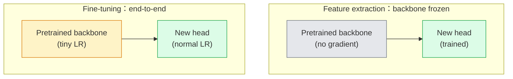

# 迁移学习与微调

> 别人已经花了大量 GPU 时间教会网络识别边缘、纹理和物体部件。在训练自己的模型之前，你应该先借用这些特征。

**Type:** Build
**Languages:** Python
**Prerequisites:** Phase 4 Lesson 03（CNNs），Phase 4 Lesson 04（Image Classification）
**Time:** ~75 minutes

## 学习目标

- 区分 feature extraction 和 fine-tuning，并根据数据集大小、领域距离和计算预算选择正确方案
- 加载 pretrained backbone，替换 classifier head，并在 20 行以内只训练 head 得到可工作的 baseline
- 用 discriminative learning rates 逐步解冻层，让早期通用特征比后期任务特定特征获得更小更新
- 诊断三种常见失败：解冻 block 上 LR 过高导致 feature drift，小数据集上 BN statistics collapse，以及 catastrophic forgetting

## 问题

在 ImageNet 上训练一个 ResNet-50，大约需要 2,000 GPU-hours。很少有团队能为每个上线任务都支付这个预算。几乎所有团队真正交付的，都是一个 pretrained backbone，再接一个用几百或几千张任务特定图像训练的新 head。

这不是偷懒。任何 ImageNet 训练出的 CNN，第一个 conv block 都会学习 edge 和类似 Gabor 的 filter。接下来几层学习 texture 和简单 motif。中间 block 学习 object part。最后的 block 学习开始接近 ImageNet 1,000 个类别的组合。这个层级结构前 90% 几乎可以不变地迁移到医学影像、工业检测、卫星数据和其他视觉任务，因为自然界的边缘和纹理词汇表是有限的。最后 10% 才是你真正需要训练的部分。

迁移学习有三个 bug 在等你：用过高 learning rate 摧毁 pretrained features，冻结太多导致模型拿不到足够信息，以及让 BatchNorm running statistics 漂移到一个很小的数据集上，而网络其他部分从未在这种分布上学习过。这一课会有意走过每一种情况。

## 概念

### Feature extraction vs fine-tuning

两种模式，取决于你有多相信 pretrained features，以及你有多少数据。



经验法则：

| Dataset size | Domain distance | Recipe |
|--------------|-----------------|--------|
| < 1k images | 接近 ImageNet | 冻结 backbone，只训练 head |
| 1k-10k | 接近 | 冻结前 2-3 个 stage，fine-tune 剩余部分 |
| 10k-100k | 任意 | 使用 discriminative LR 端到端 fine-tune |
| 100k+ | 远 | fine-tune 全部；如果领域足够远，考虑从零训练 |

“接近 ImageNet” 大致意味着自然 RGB 照片，且内容像物体。医学 CT、俯视卫星图像和显微图像属于远领域。features 仍然有帮助，但你需要允许更多层适应。

### 为什么冻结竟然有效

CNN 从 ImageNet 学到的特征，并不是只专门服务于那 1,000 个类别。它们更专门服务于自然图像统计：特定方向的边缘、纹理、对比模式、形状基元。这些统计在几乎所有人类能命名的视觉领域中都很稳定。这就是为什么一个在 ImageNet 上训练好的模型，只替换一个新的 linear head、不 fine-tune backbone，就能在 CIFAR-10 上达到 80%+ accuracy。head 学到的是：这个任务应该如何给已经学好的特征加权。

### Discriminative learning rates

一旦解冻，早期层应该比后期层训练得更慢。早期层编码你想保留的通用特征；后期层编码你需要大幅移动的任务特定结构。

```text
Typical recipe:

  stage 0 (stem + first group): lr = base_lr / 100    (mostly fixed)
  stage 1:                       lr = base_lr / 10
  stage 2:                       lr = base_lr / 3
  stage 3 (last backbone group): lr = base_lr
  head:                          lr = base_lr  (or slightly higher)
```

在 PyTorch 里，这只是传给 optimizer 的一组 parameter groups。一个模型，五个 learning rate，不需要额外代码。

### BatchNorm 问题

BN layer 持有 `running_mean` 和 `running_var` buffer，它们是在 ImageNet 上计算的。如果你的任务有不同的像素分布，比如不同光照、不同传感器、不同色彩空间，这些 buffer 就是错的。按优先级有三个选择：

1. **让 BN 保持 train mode 来 fine-tune。** 让 BN 随着其他部分一起更新 running statistics。任务数据集是中等规模（>= 5k examples）时，这是默认选择。
2. **把 BN 冻结在 eval mode。** 保留 ImageNet statistics，只训练 weights。当数据集小到 BN moving average 会很嘈杂时，这是正确选择。
3. **用 GroupNorm 替换 BN。** 完全移除 moving-average 问题。Detection 和 segmentation backbone 常用，因为每块 GPU 上的 batch size 很小。

这里做错，会悄悄损失 5-15% accuracy。

### Head 设计

Classifier head 是 1-3 个 linear layer，加可选 dropout。每个 torchvision backbone 都带一个默认 head，你需要替换它：

```python
backbone.fc = nn.Linear(backbone.fc.in_features, num_classes)          # ResNet
backbone.classifier[1] = nn.Linear(..., num_classes)                    # EfficientNet, MobileNet
backbone.heads.head = nn.Linear(..., num_classes)                       # torchvision ViT
```

对小数据集来说，单个 linear layer 通常足够。当任务分布离 backbone 的训练分布更远时，增加一个 hidden layer（Linear -> ReLU -> Dropout -> Linear）会有帮助。

### Layer-wise LR decay

这是 discriminative LR 的平滑版本，常用于现代 fine-tuning（BEiT、DINOv2、ViT-B fine-tunes）。与其把层分成 stage，不如让每一层都比上面一层有略小的 LR：

```text
lr_layer_k = base_lr * decay^(L - k)
```

当 decay = 0.75 且 L = 12 个 transformer blocks 时，第一个 block 的训练 LR 是 head LR 的 `0.75^11 ≈ 0.04x`。它对 transformer fine-tune 更重要；对 CNN 来说，按 stage 分组的 LR 通常已经够用。

### 要评估什么

迁移学习 run 需要两个从零训练时不会追踪的数字：

- **Pretrained-only accuracy**：backbone frozen 时 head 的 accuracy。这是你的 floor。
- **Fine-tuned accuracy**：同一个模型端到端训练之后的 accuracy。这是你的 ceiling。

如果 fine-tuned 低于 pretrained-only，你有 learning-rate 或 BN bug。永远打印这两个数字。

## Build It

### Step 1: 加载 pretrained backbone 并检查它

```python
import torch
import torch.nn as nn
from torchvision.models import resnet18, ResNet18_Weights

backbone = resnet18(weights=ResNet18_Weights.IMAGENET1K_V1)
print(backbone)
print()
print("classifier head:", backbone.fc)
print("feature dim:", backbone.fc.in_features)
```

`ResNet18` 有四个 stage（`layer1..layer4`），加上一个 stem 和一个 `fc` head。每个 torchvision classification backbone 都有类似结构。

### Step 2: Feature extraction：冻结全部，替换 head

```python
def make_feature_extractor(num_classes=10):
    model = resnet18(weights=ResNet18_Weights.IMAGENET1K_V1)
    for p in model.parameters():
        p.requires_grad = False
    model.fc = nn.Linear(model.fc.in_features, num_classes)
    return model

model = make_feature_extractor(num_classes=10)
trainable = sum(p.numel() for p in model.parameters() if p.requires_grad)
frozen = sum(p.numel() for p in model.parameters() if not p.requires_grad)
print(f"trainable: {trainable:>10,}")
print(f"frozen:    {frozen:>10,}")
```

只有 `model.fc` 可训练。backbone 是 frozen feature extractor。

### Step 3: Discriminative fine-tuning

构建带有 stage-specific learning rates 的 parameter groups。

```python
def discriminative_param_groups(model, base_lr=1e-3, decay=0.3):
    stages = [
        ["conv1", "bn1"],
        ["layer1"],
        ["layer2"],
        ["layer3"],
        ["layer4"],
        ["fc"],
    ]
    groups = []
    for i, names in enumerate(stages):
        lr = base_lr * (decay ** (len(stages) - 1 - i))
        params = [p for n, p in model.named_parameters()
                  if any(n.startswith(k) for k in names)]
        if params:
            groups.append({"params": params, "lr": lr, "name": "_".join(names)})
    return groups

model = resnet18(weights=ResNet18_Weights.IMAGENET1K_V1)
model.fc = nn.Linear(model.fc.in_features, 10)
for p in model.parameters():
    p.requires_grad = True

groups = discriminative_param_groups(model)
for g in groups:
    print(f"{g['name']:>10s}  lr={g['lr']:.2e}  params={sum(p.numel() for p in g['params']):>8,}")
```

`decay=0.3` 表示每个 stage 都用下一层 30% 的学习率训练。`fc` 使用 `base_lr`，`layer4` 使用 `0.3 * base_lr`，`conv1` 使用 `0.3^5 * base_lr ≈ 0.00243 * base_lr`。听起来很极端，但经验上有效。

### Step 4: BatchNorm 处理

用于冻结 BN running statistics 的 helper。这里同时停止 BN 参数更新，适合小数据集场景。

```python
def freeze_bn_stats(model):
    for m in model.modules():
        if isinstance(m, (nn.BatchNorm1d, nn.BatchNorm2d, nn.BatchNorm3d)):
            m.eval()
            for p in m.parameters():
                p.requires_grad = False
    return model
```

在每个 epoch 开始时设置 `model.train()` 之后调用它。`model.train()` 会把所有模块切到 training mode；这个函数只把 BN layer 切回去。

### Step 5: 一个最小端到端 fine-tuning loop

```python
from torch.optim import SGD
from torch.utils.data import DataLoader
from torch.optim.lr_scheduler import CosineAnnealingLR
import torch.nn.functional as F

def fine_tune(model, train_loader, val_loader, device, epochs=5, base_lr=1e-3, freeze_bn=False):
    model = model.to(device)
    groups = discriminative_param_groups(model, base_lr=base_lr)
    optimizer = SGD(groups, momentum=0.9, weight_decay=1e-4, nesterov=True)
    scheduler = CosineAnnealingLR(optimizer, T_max=epochs)

    for epoch in range(epochs):
        model.train()
        if freeze_bn:
            freeze_bn_stats(model)
        tr_loss, tr_correct, tr_total = 0.0, 0, 0
        for x, y in train_loader:
            x, y = x.to(device), y.to(device)
            logits = model(x)
            loss = F.cross_entropy(logits, y, label_smoothing=0.1)
            optimizer.zero_grad()
            loss.backward()
            optimizer.step()
            tr_loss += loss.item() * x.size(0)
            tr_total += x.size(0)
            tr_correct += (logits.argmax(-1) == y).sum().item()
        scheduler.step()

        model.eval()
        va_total, va_correct = 0, 0
        with torch.no_grad():
            for x, y in val_loader:
                x, y = x.to(device), y.to(device)
                pred = model(x).argmax(-1)
                va_total += x.size(0)
                va_correct += (pred == y).sum().item()
        print(f"epoch {epoch}  train {tr_loss/tr_total:.3f}/{tr_correct/tr_total:.3f}  "
              f"val {va_correct/va_total:.3f}")
    return model
```

在 CIFAR-10 上，使用上面的配方训练五个 epoch，可以把 `ResNet18-IMAGENET1K_V1` 从约 70% zero-shot linear-probe accuracy 提升到约 93% fine-tuned accuracy。只训练 head 而不碰 backbone，通常会在约 86% 附近 plateau。

### Step 6: Progressive unfreezing

一个从尾到头每个 epoch 解冻一个 stage 的 schedule。它能缓解 feature drift，代价是多花几个 epoch。

```python
def progressive_unfreeze_schedule(model):
    stages = ["layer4", "layer3", "layer2", "layer1"]
    yielded = set()

    def start():
        for p in model.parameters():
            p.requires_grad = False
        for p in model.fc.parameters():
            p.requires_grad = True

    def unfreeze(epoch):
        if epoch < len(stages):
            name = stages[epoch]
            yielded.add(name)
            for n, p in model.named_parameters():
                if n.startswith(name):
                    p.requires_grad = True
            return name
        return None

    return start, unfreeze
```

第一次 epoch 前调用一次 `start()`。每个 epoch 开始时调用 `unfreeze(epoch)`。只要 trainable parameters 集合发生变化，就要重建 optimizer；否则 frozen params 仍然持有 cached moments，会让它困惑。

## Use It

对多数真实任务来说，`torchvision.models` 加三行就足够。上面的重型机制，只有在遇到库默认值无法修复的问题时才重要。

```python
from torchvision.models import resnet50, ResNet50_Weights

model = resnet50(weights=ResNet50_Weights.IMAGENET1K_V2)
model.fc = nn.Linear(model.fc.in_features, num_classes)
optimizer = torch.optim.AdamW(model.parameters(), lr=1e-4, weight_decay=1e-4)
```

另外两个生产级默认选择：

- `timm` 提供约 800 个 pretrained vision backbone，并带一致 API（`timm.create_model("resnet50", pretrained=True, num_classes=10)`）。如果 fine-tune 超出 torchvision model zoo，它就是标准选择。
- 对 transformers，`transformers.AutoModelForImageClassification.from_pretrained(name, num_labels=N)` 会用和文本模型相同的加载语义，给你 ViT / BEiT / DeiT。

## Ship It

这一课产出：

- `outputs/prompt-fine-tune-planner.md`：一个提示词；根据数据集大小、领域距离和计算预算，选择 feature extraction、progressive fine-tuning 或 end-to-end fine-tuning。
- `outputs/skill-freeze-inspector.md`：一个技能；给定 PyTorch model 后，报告哪些参数可训练、哪些 BatchNorm layer 处于 eval mode，以及 optimizer 是否真的拿到了 trainable parameters。

## 练习

1. **（Easy）** 在同一个 synthetic-CIFAR 数据集上，把 `ResNet18` 分别作为 linear probe（backbone frozen）和 full fine-tune 训练。并排报告两个 accuracy。解释哪个 gap 表明 features 迁移良好，哪个 gap 表明迁移不好。
2. **（Medium）** 故意引入一个 bug：把 backbone stage 的 `base_lr` 设成 `1e-1`，而不是只给 head。展示 training loss 爆炸，然后用 `discriminative_param_groups` helper 恢复。记录每个 stage 开始发散的 LR。
3. **（Hard）** 选择一个医学影像数据集（例如 CheXpert-small、PatchCamelyon 或 HAM10000），比较三种模式：(a) ImageNet-pretrained frozen backbone + linear head；(b) ImageNet-pretrained end-to-end fine-tune；(c) scratch training。报告每种的 accuracy 和 compute cost。数据集多大时，scratch training 开始有竞争力？

## 关键术语

| 术语 | 常见说法 | 实际含义 |
|------|----------|----------|
| Feature extraction | “Freeze and train head” | Backbone 参数冻结，只有新的 classifier head 接收梯度 |
| Fine-tuning | “Retrain end-to-end” | 所有参数可训练，通常 LR 比从零训练小得多 |
| Discriminative LR | “早期层用更小 LR” | Optimizer parameter groups，其中早期 stage LR 是后期 stage LR 的一部分 |
| Layer-wise LR decay | “平滑 LR 梯度” | 每层 LR 乘以 `decay^(L - k)`；常见于 transformer fine-tune |
| Catastrophic forgetting | “模型忘了 ImageNet” | 过高 LR 在新任务信号学会之前，就覆盖了 pretrained features |
| BN statistics drift | “Running mean 错了” | BatchNorm running_mean/var 来自不同于当前任务的分布，悄悄损害 accuracy |
| Linear probe | “Frozen backbone + linear head” | 对 pretrained features 的评估，也就是 frozen representation 上最佳 linear classifier 的 accuracy |
| Catastrophic collapse | “所有东西都预测成一个类别” | 当 fine-tuning LR 高到在 head 的梯度稳定前就摧毁 features 时发生 |

## 延伸阅读

- [How transferable are features in deep neural networks? (Yosinski et al., 2014)](https://arxiv.org/abs/1411.1792)：量化不同层之间 feature transferability 的论文
- [Universal Language Model Fine-tuning (ULMFiT, Howard & Ruder, 2018)](https://arxiv.org/abs/1801.06146)：discriminative LR / progressive unfreezing 配方的原始来源；这些想法能直接迁移到视觉
- [timm documentation](https://huggingface.co/docs/timm)：现代 vision backbones 以及它们精确 fine-tune defaults 的参考
- [A Simple Framework for Linear-Probe Evaluation (Kornblith et al., 2019)](https://arxiv.org/abs/1805.08974)：为什么 linear-probe accuracy 重要，以及如何正确报告它
