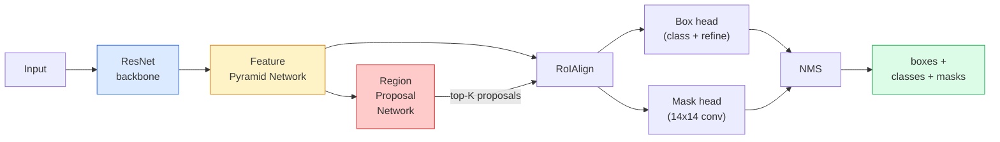

# 实例分割：Mask R-CNN

> 给 Faster R-CNN detector 加一个很小的 mask branch，你就得到了 instance segmentation。真正难的是 RoIAlign，而且它比看起来更难。

**Type:** Build + Learn
**Languages:** Python
**Prerequisites:** Phase 4 Lesson 06（YOLO），Phase 4 Lesson 07（U-Net）
**Time:** ~75 minutes

## 学习目标

- 端到端追踪 Mask R-CNN architecture：backbone、FPN、RPN、RoIAlign、box head、mask head
- 从零实现 RoIAlign，并解释为什么 RoIPool 不再被使用
- 使用 torchvision 的 `maskrcnn_resnet50_fpn_v2` pretrained model 生成 production-quality instance masks，并正确读取它的 output format
- 通过替换 box 和 mask heads、冻结 backbone，在小型 custom dataset 上 fine-tune Mask R-CNN

## 问题

Semantic segmentation 给每个 class 一个 mask。Instance segmentation 给每个 object 一个 mask，即使两个 objects 属于同一个 class。数清个体、跨帧 tracking、测量物体（墙上每块砖的 bounding box、显微镜图像中的每个细胞）都需要 instance segmentation。

Mask R-CNN（He et al., 2017）把 instance segmentation 重新表述为 detection-plus-a-mask，从而解决了这个问题。这个设计非常干净，以至于之后五年里几乎每篇 instance segmentation paper 都是 Mask R-CNN 的变体；torchvision 实现至今仍是中小型 dataset 的 production default。

真正的工程难题是 sampling：如何从一个 proposal box 中裁出固定大小的 feature region，而这个 box 的 corners 并不和 pixel boundaries 对齐？这里做错，会在所有地方损失零点几 mAP。RoIAlign 就是答案。

## 概念

### Architecture



需要理解五个部件：

1. **Backbone**：在 ImageNet 上训练的 ResNet-50 或 ResNet-101。产生 strides 为 4、8、16、32 的 feature map hierarchy。
2. **FPN（Feature Pyramid Network）**：top-down + lateral connections，让每个 level 都有 C channels 的 semantic-rich features。Detection 会查询与 object size 匹配的 FPN level。
3. **RPN（Region Proposal Network）**：一个小 conv head，在每个 anchor position 上预测“这里是否有 object？”以及“box 应该如何 refine？”。每张图产生约 1000 个 proposals。
4. **RoIAlign**：从任意 FPN level 上的任意 box 中采样固定大小（例如 7x7）的 feature patch。使用 bilinear sampling，不做 quantisation。
5. **Heads**：两层 box head，用来 refine box 并选择 class；再加一个小 conv head，为每个 proposal 输出一个 `28x28` binary mask。

### 为什么是 RoIAlign，而不是 RoIPool

原始 Fast R-CNN 使用 RoIPool：把 proposal box 划分成 grid，对每个 cell 取最大 feature，并把所有 coordinates round 成 integers。这个 rounding 会让 feature map 与 input pixel coordinates 之间产生最多一个完整 feature-map pixel 的错位；在 224x224 图像上还小，在 stride 32 的 feature map 上就是灾难。

```text
RoIPool:
  box (34.7, 51.3, 98.2, 142.9)
  round -> (34, 51, 98, 142)
  split grid -> round each cell boundary
  misalignment accumulates at every step

RoIAlign:
  box (34.7, 51.3, 98.2, 142.9)
  sample at exact float coordinates using bilinear interpolation
  no rounding anywhere
```

RoIAlign 可以免费让 COCO 上的 mask AP 提升 3-4 points。现在每个在意 localisation 的 detector 都使用它，包括 YOLOv7 seg、RT-DETR、Mask2Former。

### 一段话理解 RPN

在 feature map 的每个位置放置 K 个不同 size 和 shape 的 anchor boxes。对每个 anchor 预测 objectness score，以及把 anchor 变成更贴合 object 的 regression offset。按 score 保留 top ~1,000 boxes，在 IoU 0.7 上应用 NMS，再把剩余 proposals 交给 heads。RPN 用自己的 mini-loss 训练，结构和 Lesson 6 的 YOLO loss 相同，只是 class 变成两个（object / no object）。

### Mask head

对每个 proposal（经过 RoIAlign 之后），mask head 是一个很小的 FCN：四个 3x3 convs、一个 2x deconv、一个最终 1x1 conv，在 `28x28` resolution 上产生 `num_classes` 个 output channels。只保留与 predicted class 对应的 channel；其他 channel 会被忽略。这把 mask prediction 和 classification 解耦。

把 28x28 mask upsample 到 proposal 的原始 pixel size，就得到最终 binary mask。

### Losses

Mask R-CNN 会把这些 losses 加在一起：

```text
L = L_rpn_cls + L_rpn_box + L_box_cls + L_box_reg + L_mask
```

- `L_rpn_cls`、`L_rpn_box`：RPN proposals 的 objectness + box regression。
- `L_box_cls`：head classifier 上对 (C+1) classes（包含 background）的 cross-entropy。
- `L_box_reg`：head box refinement 上的 smooth L1。
- `L_mask`：`28x28` mask output 上的 per-pixel binary cross-entropy。

每个 loss 都有自己的默认 weight；torchvision 实现会把它们作为 constructor arguments 暴露出来。

### Output format

`torchvision.models.detection.maskrcnn_resnet50_fpn_v2` 返回一个 dict 列表，每张图一个 dict：

```text
{
    "boxes":  (N, 4) in (x1, y1, x2, y2) pixel coordinates,
    "labels": (N,) class IDs, 0 = background so indices are 1-based,
    "scores": (N,) confidence scores,
    "masks":  (N, 1, H, W) float masks in [0, 1] — threshold at 0.5 for binary,
}
```

Mask 已经是 full image resolution。`28x28` head output 已经在内部完成 upsample。

## Build It

### Step 1: 从零实现 RoIAlign

这是 Mask R-CNN 中少数用代码比用 prose 更容易理解的组件。

```python
import torch
import torch.nn.functional as F

def roi_align_single(feature, box, output_size=7, spatial_scale=1 / 16.0):
    """
    feature: (C, H, W) single-image feature map
    box: (x1, y1, x2, y2) in original image pixel coordinates
    output_size: side of the output grid (7 for box head, 14 for mask head)
    spatial_scale: reciprocal of the feature map stride
    """
    C, H, W = feature.shape
    x1, y1, x2, y2 = [c * spatial_scale - 0.5 for c in box]
    bin_w = (x2 - x1) / output_size
    bin_h = (y2 - y1) / output_size

    grid_y = torch.linspace(y1 + bin_h / 2, y2 - bin_h / 2, output_size)
    grid_x = torch.linspace(x1 + bin_w / 2, x2 - bin_w / 2, output_size)
    yy, xx = torch.meshgrid(grid_y, grid_x, indexing="ij")

    gx = 2 * (xx + 0.5) / W - 1
    gy = 2 * (yy + 0.5) / H - 1
    grid = torch.stack([gx, gy], dim=-1).unsqueeze(0)
    sampled = F.grid_sample(feature.unsqueeze(0), grid, mode="bilinear",
                            align_corners=False)
    return sampled.squeeze(0)
```

每个数字都位于 bilinearly-sampled position。没有 rounding，没有 quantisation，也没有被丢掉的 gradients。

### Step 2: 与 torchvision 的 RoIAlign 比较

```python
from torchvision.ops import roi_align

feature = torch.randn(1, 16, 50, 50)
boxes = torch.tensor([[0, 10, 20, 100, 90]], dtype=torch.float32)  # (batch_idx, x1, y1, x2, y2)

ours = roi_align_single(feature[0], boxes[0, 1:].tolist(), output_size=7, spatial_scale=1/4)
theirs = roi_align(feature, boxes, output_size=(7, 7), spatial_scale=1/4, sampling_ratio=1, aligned=True)[0]

print(f"shape ours:   {tuple(ours.shape)}")
print(f"shape theirs: {tuple(theirs.shape)}")
print(f"max|diff|:    {(ours - theirs).abs().max().item():.3e}")
```

当 `sampling_ratio=1` 且 `aligned=True` 时，两者会在 `1e-5` 以内匹配。

### Step 3: 加载 pretrained Mask R-CNN

```python
import torch
from torchvision.models.detection import maskrcnn_resnet50_fpn_v2, MaskRCNN_ResNet50_FPN_V2_Weights

model = maskrcnn_resnet50_fpn_v2(weights=MaskRCNN_ResNet50_FPN_V2_Weights.DEFAULT)
model.eval()
print(f"params: {sum(p.numel() for p in model.parameters()):,}")
print(f"classes (including background): {len(model.roi_heads.box_predictor.cls_score.out_features * [0])}")
```

46M parameters，91 classes（COCO）。第一个 class（id 0）是 background；模型真正检测的类别从 id 1 开始。

### Step 4: 运行 inference

```python
with torch.no_grad():
    x = torch.randn(3, 400, 600)
    predictions = model([x])
p = predictions[0]
print(f"boxes:  {tuple(p['boxes'].shape)}")
print(f"labels: {tuple(p['labels'].shape)}")
print(f"scores: {tuple(p['scores'].shape)}")
print(f"masks:  {tuple(p['masks'].shape)}")
```

Mask tensor 的 shape 是 `(N, 1, H, W)`。在 0.5 处 threshold，就能得到每个 object 的 binary mask：

```python
binary_masks = (p['masks'] > 0.5).squeeze(1)  # (N, H, W) boolean
```

### Step 5: 为 custom class count 替换 heads

常见 fine-tuning recipe：复用 backbone、FPN 和 RPN；替换两个 classifier heads。

```python
from torchvision.models.detection.faster_rcnn import FastRCNNPredictor
from torchvision.models.detection.mask_rcnn import MaskRCNNPredictor

def build_custom_maskrcnn(num_classes):
    model = maskrcnn_resnet50_fpn_v2(weights=MaskRCNN_ResNet50_FPN_V2_Weights.DEFAULT)
    in_features = model.roi_heads.box_predictor.cls_score.in_features
    model.roi_heads.box_predictor = FastRCNNPredictor(in_features, num_classes)
    in_features_mask = model.roi_heads.mask_predictor.conv5_mask.in_channels
    hidden_layer = 256
    model.roi_heads.mask_predictor = MaskRCNNPredictor(in_features_mask, hidden_layer, num_classes)
    return model

custom = build_custom_maskrcnn(num_classes=5)
print(f"custom cls_score.out_features: {custom.roi_heads.box_predictor.cls_score.out_features}")
```

`num_classes` 必须包含 background class，所以有 4 个 object classes 的 dataset 要使用 `num_classes=5`。

### Step 6: 冻结不需要训练的部分

在小型 dataset 上，冻结 backbone 和 FPN。只让 RPN objectness + regression 以及两个 heads 学习。

```python
def freeze_backbone_and_fpn(model):
    # torchvision Mask R-CNN packs the FPN inside `model.backbone` (as
    # `model.backbone.fpn`), so iterating `model.backbone.parameters()` covers
    # both the ResNet feature layers and the FPN lateral/output convs.
    for p in model.backbone.parameters():
        p.requires_grad = False
    return model

custom = freeze_backbone_and_fpn(custom)
trainable = sum(p.numel() for p in custom.parameters() if p.requires_grad)
print(f"trainable after freeze: {trainable:,}")
```

在 500-image dataset 上，这就是 convergence 和 overfitting 的分界线。

## Use It

torchvision 中完整的 Mask R-CNN training loop 只有 40 行，而且在不同任务之间基本不改变含义：换 dataset，然后开始训练。

```python
def train_step(model, images, targets, optimizer):
    model.train()
    loss_dict = model(images, targets)
    losses = sum(loss for loss in loss_dict.values())
    optimizer.zero_grad()
    losses.backward()
    optimizer.step()
    return {k: v.item() for k, v in loss_dict.items()}
```

`targets` list 必须包含 per-image dicts，其中有 `boxes`、`labels` 和 `masks`（形状为 `(num_instances, H, W)` 的 binary tensors）。模型在 training 时返回四个 losses 的 dict，在 eval 时返回 predictions list；这由 `model.training` 控制。

`pycocotools` evaluator 会分别为 boxes 和 masks 产生 mAP@IoU=0.5:0.95；你需要这两个数字才能判断 bottleneck 在 box head 还是 mask head。

## Ship It

这一课产出：

- `outputs/prompt-instance-vs-semantic-router.md`：一个 prompt，询问三个问题，并选择 instance vs semantic vs panoptic，以及准确的起步模型。
- `outputs/skill-mask-rcnn-head-swapper.md`：一个 skill，根据新的 `num_classes`，为任意 torchvision detection model 生成替换 heads 所需的 10 行代码。

## 练习

1. **（Easy）** 在 100 个 random boxes 上，用 `torchvision.ops.roi_align` 验证你的 RoIAlign。报告 max absolute difference。再运行 RoIPool（pre-2017 行为），展示它在靠近边界的 boxes 上会偏离约 1-2 个 feature-map pixels。
2. **（Medium）** 在 50-image custom dataset（任意两个 classes：balloons、fish、pothole、logos）上 fine-tune `maskrcnn_resnet50_fpn_v2`。冻结 backbone，训练 20 epochs，报告 mask AP@0.5。
3. **（Hard）** 把 Mask R-CNN 的 mask head 替换成预测 56x56 而不是 28x28 的版本。测量 mAP@IoU=0.75 的前后变化。解释收益（或没有收益）为什么符合 boundary-precision / memory trade-off 的预期。

## 关键术语

| Term | What people say | What it actually means |
|------|----------------|----------------------|
| Mask R-CNN | “Detection plus masks” | Faster R-CNN + 一个小 FCN head，为每个 proposal、每个 class 预测一个 28x28 mask |
| FPN | “Feature pyramid” | Top-down + lateral connections，让每个 stride level 都有 C channels 的 semantic-rich features |
| RPN | “Region proposer” | 一个小 conv head，每张图产生约 1000 个 object/no-object proposals |
| RoIAlign | “No-rounding crop” | 从任意 float-coordinate box 中 bilinearly sample 一个固定大小的 feature grid |
| RoIPool | “Pre-2017 crop” | 目的和 RoIAlign 相同，但会 round box coordinates；已过时 |
| Mask AP | “Instance mAP” | 使用 mask IoU 而不是 box IoU 计算的 average precision；COCO instance segmentation metric |
| Binary mask head | “Per-class mask” | 对每个 proposal 为每个 class 预测一个 binary mask；只保留 predicted class 的 channel |
| Background class | “Class 0” | 泛化的 “no object” class；真实 classes 的 indices 从 1 开始 |

## 进一步阅读

- [Mask R-CNN (He et al., 2017)](https://arxiv.org/abs/1703.06870)：原始 paper；关于 RoIAlign 的 section 3 是关键阅读
- [FPN: Feature Pyramid Networks (Lin et al., 2017)](https://arxiv.org/abs/1612.03144)：FPN paper；每个现代 detector 都在用它
- [torchvision Mask R-CNN tutorial](https://pytorch.org/tutorials/intermediate/torchvision_tutorial.html)：fine-tuning loop 的 reference
- [Detectron2 model zoo](https://github.com/facebookresearch/detectron2/blob/main/MODEL_ZOO.md)：production implementations，带有几乎所有 detection 和 segmentation variant 的 trained weights
