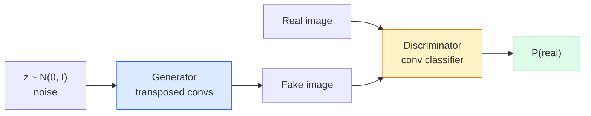
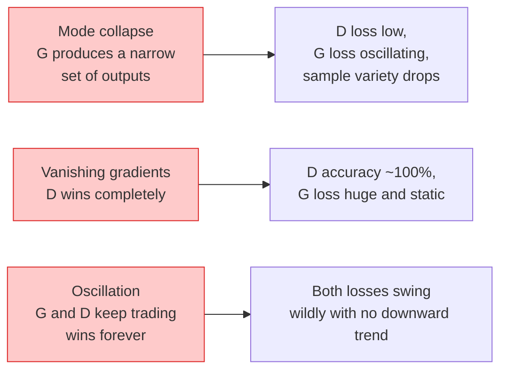

# 图像生成：GANs

> GAN 是两个神经网络进行的一场固定博弈。一个负责画图，一个负责批评。它们一起变强，直到画出来的图能骗过批评者。

**Type:** Build
**Languages:** Python
**Prerequisites:** Phase 4 Lesson 03（CNNs），Phase 3 Lesson 06（Optimizers），Phase 3 Lesson 07（Regularization）
**Time:** ~75 minutes

## 学习目标

- 解释 generator 和 discriminator 之间的 minimax game，并说明为什么 equilibrium 对应 `p_model = p_data`
- 在 PyTorch 中实现 DCGAN，并用不到 60 行代码生成 coherent 32x32 synthetic images
- 用三个标准技巧稳定 GAN training：non-saturating loss、spectral norm、TTUR（two-timescale update rule）
- 阅读 training curves，区分 healthy convergence、mode collapse、oscillation 和 discriminator-wins-completely

## 问题

分类教网络把 images 映射到 labels。生成把问题反过来：采样出看起来来自同一分布的新 images。这里没有可以直接 diff 的“正确”输出；只有一个你想模仿的 distribution。

标准 loss functions（MSE、cross-entropy）无法衡量“这个 sample 是否来自真实分布”。最小化 per-pixel error 会产生模糊平均图，而不是真实样本。突破点是学习 loss：训练第二个网络，让它负责区分 real 和 fake，再用它的判断推动 generator。

GANs（Goodfellow et al., 2014）定义了这个框架。到 2018 年，StyleGAN 已经能生成与照片难以区分的 1024x1024 人脸。Diffusion models 后来在质量和可控性上拿到王座，但让 diffusion 变得实用的许多技巧，如 normalisation choices、latent spaces、feature losses，最早都是在 GANs 上被理解清楚的。

## 概念

### 两个网络



**Generator** G 接收 noise vector `z`，输出一张 image。**Discriminator** D 接收一张 image，输出一个 scalar：这张图是真实图像的概率。

### 这场博弈

G 希望 D 判断错误。D 希望自己判断正确。形式化写作：

```text
min_G max_D  E_x[log D(x)] + E_z[log(1 - D(G(z)))]
```

从右往左读：D 正在最大化它对 real images（`log D(real)`）和 fake images（`log (1 - D(fake))`）的 accuracy。G 正在最小化 D 对 fakes 的 accuracy，也就是希望 `D(G(z))` 变高。

Goodfellow 证明了这个 minimax 存在一个 global equilibrium：`p_G = p_data`，D 在所有位置输出 0.5，generated 和 real distributions 之间的 Jensen-Shannon divergence 为 0。难点是如何抵达那里。

### Non-saturating loss

上面的形式数值不稳定。训练早期，对每个 fake 来说 `D(G(z))` 都接近 0，所以 `log(1 - D(G(z)))` 对 G 的 gradients 会消失。修复方法是翻转 G 的 loss。

```text
L_D = -E_x[log D(x)] - E_z[log(1 - D(G(z)))]
L_G = -E_z[log D(G(z))]                          # non-saturating
```

现在当 `D(G(z))` 接近 0 时，G 的 loss 很大，gradient 也有信息量。每个现代 GAN 都用这个变体训练。

### DCGAN architecture rules

Radford、Metz、Chintala（2015）把多年失败实验提炼成五条让 GAN training 稳定的规则：

1. 用 strided convs 替代 pooling（两个网络都如此）。
2. 在 generator 和 discriminator 中使用 batch norm，但 G 的 output 和 D 的 input 除外。
3. 在更深的 architectures 中移除 fully connected layers。
4. G 在所有 layers 上使用 ReLU，只有 output 使用 tanh，把输出限制在 [-1, 1]。
5. D 在所有 layers 上使用 LeakyReLU（negative_slope=0.2）。

每个现代 conv-based GAN（StyleGAN、BigGAN、GigaGAN）仍然从这些规则出发，再一次替换一个部件。

### Failure modes 及其信号



- **Mode collapse**：G 找到一张能骗过 D 的 image，然后只生成它。修复：加入 minibatch discrimination、spectral norm，或 label-conditioning。
- **Discriminator wins**：D 太快变得过强，G 的 gradients 消失。修复：缩小 D、降低 D learning rate，或对 real labels 使用 label smoothing。
- **Oscillation**：两个网络不断轮流获胜，却从不接近 equilibrium。修复：TTUR（D 的学习速度是 G 的 2-4 倍），或切换到 Wasserstein loss。

### Evaluation

GANs 没有 ground truth，所以怎么知道它们是否有效？

- **Sample inspection**：每个 epoch 结束时看 64 个 samples。不可协商。
- **FID（Fréchet Inception Distance）**：real 和 generated sets 的 Inception-v3 feature distributions 之间的距离。越低越好。社区标准。
- **Inception Score**：更老，也更脆弱；优先使用 FID。
- **Precision/Recall for generative models**：分别衡量质量（precision）和覆盖度（recall）。比只看 FID 更有信息量。

对小型 synthetic-data run 来说，sample inspection 就够了。

## Build It

### Step 1: Generator

一个小型 DCGAN generator，接收 64-dim noise，并生成 32x32 image。

```python
import torch
import torch.nn as nn

class Generator(nn.Module):
    def __init__(self, z_dim=64, img_channels=3, feat=64):
        super().__init__()
        self.net = nn.Sequential(
            nn.ConvTranspose2d(z_dim, feat * 4, kernel_size=4, stride=1, padding=0, bias=False),
            nn.BatchNorm2d(feat * 4),
            nn.ReLU(inplace=True),
            nn.ConvTranspose2d(feat * 4, feat * 2, kernel_size=4, stride=2, padding=1, bias=False),
            nn.BatchNorm2d(feat * 2),
            nn.ReLU(inplace=True),
            nn.ConvTranspose2d(feat * 2, feat, kernel_size=4, stride=2, padding=1, bias=False),
            nn.BatchNorm2d(feat),
            nn.ReLU(inplace=True),
            nn.ConvTranspose2d(feat, img_channels, kernel_size=4, stride=2, padding=1, bias=False),
            nn.Tanh(),
        )

    def forward(self, z):
        return self.net(z.view(z.size(0), -1, 1, 1))
```

四个 transposed convs，每个使用 `kernel_size=4, stride=2, padding=1`，这样 spatial size 会干净地翻倍。Output 通过 tanh 被限制在 [-1, 1]。

### Step 2: Discriminator

Generator 的镜像。LeakyReLU、strided convs，最后输出一个 scalar logit。

```python
class Discriminator(nn.Module):
    def __init__(self, img_channels=3, feat=64):
        super().__init__()
        self.net = nn.Sequential(
            nn.Conv2d(img_channels, feat, kernel_size=4, stride=2, padding=1),
            nn.LeakyReLU(0.2, inplace=True),
            nn.Conv2d(feat, feat * 2, kernel_size=4, stride=2, padding=1, bias=False),
            nn.BatchNorm2d(feat * 2),
            nn.LeakyReLU(0.2, inplace=True),
            nn.Conv2d(feat * 2, feat * 4, kernel_size=4, stride=2, padding=1, bias=False),
            nn.BatchNorm2d(feat * 4),
            nn.LeakyReLU(0.2, inplace=True),
            nn.Conv2d(feat * 4, 1, kernel_size=4, stride=1, padding=0),
        )

    def forward(self, x):
        return self.net(x).view(-1)
```

最后一个 conv 把 `4x4` feature map 降到 `1x1`。每张图输出一个 scalar；sigmoid 只在计算 loss 时应用。

### Step 3: Training step

交替执行：每个 batch 先更新一次 D，再更新一次 G。

```python
import torch.nn.functional as F

def train_step(G, D, real, z, opt_g, opt_d, device):
    real = real.to(device)
    bs = real.size(0)

    # D step
    opt_d.zero_grad()
    d_real = D(real)
    d_fake = D(G(z).detach())
    loss_d = (F.binary_cross_entropy_with_logits(d_real, torch.ones_like(d_real))
              + F.binary_cross_entropy_with_logits(d_fake, torch.zeros_like(d_fake)))
    loss_d.backward()
    opt_d.step()

    # G step
    opt_g.zero_grad()
    d_fake = D(G(z))
    loss_g = F.binary_cross_entropy_with_logits(d_fake, torch.ones_like(d_fake))
    loss_g.backward()
    opt_g.step()

    return loss_d.item(), loss_g.item()
```

D step 中的 `G(z).detach()` 很关键：更新 D 时，我们不希望 gradients 流入 G。忘记它是经典新手 bug。

### Step 4: 在 synthetic shapes 上运行完整 training loop

```python
from torch.utils.data import DataLoader, TensorDataset
import numpy as np

def synthetic_images(num=2000, size=32, seed=0):
    rng = np.random.default_rng(seed)
    imgs = np.zeros((num, 3, size, size), dtype=np.float32) - 1.0
    for i in range(num):
        r = rng.uniform(6, 12)
        cx, cy = rng.uniform(r, size - r, size=2)
        yy, xx = np.meshgrid(np.arange(size), np.arange(size), indexing="ij")
        mask = (xx - cx) ** 2 + (yy - cy) ** 2 < r ** 2
        color = rng.uniform(-0.5, 1.0, size=3)
        for c in range(3):
            imgs[i, c][mask] = color[c]
    return torch.from_numpy(imgs)

device = "cuda" if torch.cuda.is_available() else "cpu"
data = synthetic_images()
loader = DataLoader(TensorDataset(data), batch_size=64, shuffle=True)

G = Generator(z_dim=64, img_channels=3, feat=32).to(device)
D = Discriminator(img_channels=3, feat=32).to(device)
opt_g = torch.optim.Adam(G.parameters(), lr=2e-4, betas=(0.5, 0.999))
opt_d = torch.optim.Adam(D.parameters(), lr=2e-4, betas=(0.5, 0.999))

for epoch in range(10):
    for (batch,) in loader:
        z = torch.randn(batch.size(0), 64, device=device)
        ld, lg = train_step(G, D, batch, z, opt_g, opt_d, device)
    print(f"epoch {epoch}  D {ld:.3f}  G {lg:.3f}")
```

`Adam(lr=2e-4, betas=(0.5, 0.999))` 是 DCGAN default；较低的 beta1 会避免 momentum term 把 adversarial game 稳定得过头。

### Step 5: Sampling

```python
@torch.no_grad()
def sample(G, n=16, z_dim=64, device="cpu"):
    G.eval()
    z = torch.randn(n, z_dim, device=device)
    imgs = G(z)
    imgs = (imgs + 1) / 2
    return imgs.clamp(0, 1)
```

Sampling 前一定切到 eval mode。对 DCGAN 来说这很重要，因为 batch norm 会使用 running stats，而不是当前 batch 的 stats。

### Step 6: Spectral normalisation

Discriminator 中 BN 的 drop-in replacement，保证网络是 1-Lipschitz。它能修复大多数 “D wins too hard” failure。

```python
from torch.nn.utils import spectral_norm

def build_sn_discriminator(img_channels=3, feat=64):
    return nn.Sequential(
        spectral_norm(nn.Conv2d(img_channels, feat, 4, 2, 1)),
        nn.LeakyReLU(0.2, inplace=True),
        spectral_norm(nn.Conv2d(feat, feat * 2, 4, 2, 1)),
        nn.LeakyReLU(0.2, inplace=True),
        spectral_norm(nn.Conv2d(feat * 2, feat * 4, 4, 2, 1)),
        nn.LeakyReLU(0.2, inplace=True),
        spectral_norm(nn.Conv2d(feat * 4, 1, 4, 1, 0)),
    )
```

把 `Discriminator` 换成 `build_sn_discriminator()` 后，通常就不需要 TTUR trick。Spectral norm 是你能应用的最简单单项 robustness upgrade。

## Use It

做严肃 generation 时，使用 pretrained weights，或者切换到 diffusion。两个标准库：

- `torch_fidelity` 可以在你的 generator 上计算 FID / IS，不需要写自定义 eval code。
- `pytorch-gan-zoo`（legacy）和 `StudioGAN` 提供经过测试的 DCGAN、WGAN-GP、SN-GAN、StyleGAN 和 BigGAN implementations。

到 2026 年，GANs 仍然最适合：real-time image generation（latency <10 ms）、style transfer、带精确控制的 image-to-image translation（Pix2Pix、CycleGAN）。Diffusion 在 photorealism 和 text conditioning 上获胜。

## Ship It

这一课产出：

- `outputs/prompt-gan-training-triage.md`：一个 prompt，读取 training curve description，并选择 failure mode（mode collapse、D-wins、oscillation）以及单个推荐修复。
- `outputs/skill-dcgan-scaffold.md`：一个 skill，根据 `z_dim`、target `image_size` 和 `num_channels` 写出 DCGAN scaffold，包括 training loop 和 sample saver。

## 练习

1. **（Easy）** 在上面的 synthetic circle dataset 上训练 DCGAN，并在每个 epoch 结束时保存 16 个 samples 的 grid。到第几个 epoch，generated circles 开始明显呈圆形？
2. **（Medium）** 把 discriminator 的 batch norm 换成 spectral norm。并排训练两个版本。哪个收敛更快？哪个在三个 seeds 上 variance 更低？
3. **（Hard）** 实现 conditional DCGAN：把 class label 同时喂给 G 和 D（在 G 中把 one-hot concat 到 noise，在 D 中 concat 一个 class embedding channel）。在 lesson 7 的 synthetic “circles vs squares” dataset 上训练，并通过指定 labels 采样展示 class conditioning 有效。

## 关键术语

| Term | What people say | What it actually means |
|------|----------------|----------------------|
| Generator (G) | “The draws-stuff net” | 把 noise 映射成 images；训练目标是骗过 discriminator |
| Discriminator (D) | “The critic” | Binary classifier；训练目标是区分 real 和 generated images |
| Minimax | “The game” | 对 adversarial loss 做 min over G、max over D；equilibrium 是 `p_G = p_data` |
| Non-saturating loss | “The numerically sane version” | G 的 loss 用 `-log(D(G(z)))` 而不是 `log(1 - D(G(z)))`，避免训练早期 vanishing gradients |
| Mode collapse | “Generator makes one thing” | G 只生成 data distribution 的一个小子集；用 SN、minibatch discrimination 或更大 batch 修复 |
| TTUR | “Two learning rates” | D 学得比 G 快，通常快 2-4 倍；用于稳定 training |
| Spectral norm | “1-Lipschitz layer” | 一种 weight-normalisation，约束每层的 Lipschitz constant；阻止 D 变得任意陡峭 |
| FID | “Fréchet Inception Distance” | real 和 generated sets 的 Inception-v3 feature distributions 之间的距离；标准 evaluation metric |

## 进一步阅读

- [Generative Adversarial Networks (Goodfellow et al., 2014)](https://arxiv.org/abs/1406.2661)：开创这一领域的 paper
- [DCGAN (Radford, Metz, Chintala, 2015)](https://arxiv.org/abs/1511.06434)：让 GANs 可以训练起来的 architecture rules
- [Spectral Normalization for GANs (Miyato et al., 2018)](https://arxiv.org/abs/1802.05957)：最有用的单项 stabilisation trick
- [StyleGAN3 (Karras et al., 2021)](https://arxiv.org/abs/2106.12423)：SOTA GAN；读起来像过去十年所有 trick 的 greatest-hits album
