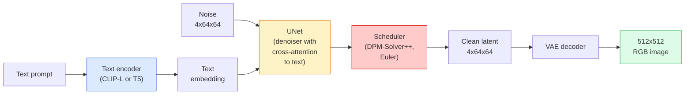

# Stable Diffusion：架构与微调

> Stable Diffusion 是一种 DDPM：它在预训练 VAE 的 latent space 中运行，通过 cross-attention 接收文本条件，用快速 deterministic ODE solver 采样，并由 classifier-free guidance 引导输出。

**Type:** Learn + Use
**Languages:** Python
**Prerequisites:** Phase 4 Lesson 10（Diffusion），Phase 7 Lesson 02（Self-Attention）
**Time:** ~75 minutes

## 学习目标

- 追踪 Stable Diffusion pipeline 的五个组成部分：VAE、text encoder、U-Net、scheduler、safety checker，并说明每个部分实际在做什么
- 解释 latent diffusion，以及为什么在 `4x64x64` latent space 中训练（而不是在 `3x512x512` image 上训练）能在不损失质量的情况下降低 48 倍计算量
- 使用 `diffusers` 生成图片，运行 image-to-image、inpainting 和 ControlNet-guided generation
- 在一个小型自定义数据集上用 LoRA 微调 Stable Diffusion，并在 inference 时加载 LoRA adapter

## 问题

直接在 `512x512` RGB images 上训练 DDPM 非常昂贵。每个 training step 都要通过一个 U-Net 反向传播，而这个 U-Net 看到的是 `3x512x512 = 786,432` 个输入值；sampling 还需要对同一个 U-Net 做 50 次以上 forward pass。在 Stable Diffusion 1.5（2022 年发布）的质量水平上，pixel-space diffusion 大约需要 256 个 GPU-months 训练，在消费级 GPU 上每张图需要 10-30 秒生成。

让 open-weight text-to-image 变得实用的技巧是 **latent diffusion**（Rombach et al., CVPR 2022）。先训练一个 VAE，把 `3x512x512` image 映射到 `4x64x64` latent tensor，并能再映射回来；然后在这个 latent space 中做 diffusion。计算量下降 `(3*512*512)/(4*64*64) = 48x`。在同一块 GPU 上，sampling 从几十秒降到两秒以内。

几乎所有现代 image-generation model，如 SDXL、SD3、FLUX、HunyuanDiT、Wan-Video，都是 latent diffusion model，只是在 autoencoder、denoiser（U-Net 或 DiT）以及 text conditioning 上有所变化。学会 Stable Diffusion，你就学会了这个模板。

## 概念

### Pipeline



- **VAE**：冻结的 autoencoder。Encoder 把 image 变成 latents（用于 img2img 和 training）。Decoder 把 latents 还原成 image。
- **Text encoder**：CLIP text encoder（SD 1.x/2.x）、CLIP-L + CLIP-G（SDXL），或 T5-XXL（SD3/FLUX）。输出一段 token embeddings。
- **U-Net**：denoiser。它包含 cross-attention layers，在每个 resolution level 上都让 latents attend 到 text embedding。
- **Scheduler**：sampling algorithm（DDIM、Euler、DPM-Solver++）。它选择 sigmas，并把 predicted noise 混回 latent。
- **Safety checker**：可选的 NSFW / illegal-content output image filter。

### Classifier-free guidance（CFG）

普通 text conditioning 会为每个 prompt `c` 学习 `epsilon_theta(x_t, t, c)`。CFG 训练同一个网络时，会在 10% 的情况下丢掉 `c`（替换为空 embedding），因此一个模型同时能预测 conditional 和 unconditional noise。Inference 时：

```text
eps = eps_uncond + w * (eps_cond - eps_uncond)
```

`w` 是 guidance scale。`w=0` 是 unconditional，`w=1` 是普通 conditional，`w>1` 会把输出推向“更受 prompt 约束”，代价是 diversity 下降。SD 默认值是 `w=7.5`。

CFG 是 text-to-image 达到 production quality 的原因。没有它，prompt 对输出的影响很弱；有了它，prompt 会占主导。

### Latent space geometry

VAE 的 4-channel latent 不只是压缩后的 image。它是一个 manifold，在其中算术操作大致对应 semantic edits（prompt engineering 和 interpolation 都发生在这里），而 diffusion U-Net 的全部 modeling budget 都训练在这个空间中。解码一个随机的 `4x64x64` latent 不会得到一张“随机风格”的图片，而会得到垃圾，因为只有特定 latent submanifold 才能 decode 成有效 images。

两个后果：

1. **Img2img** = 把 image encode 成 latent，加入部分 noise，运行 denoiser，再 decode。因为 encoding 近似可逆，image structure 会保留下来；content 会根据 prompt 改变。
2. **Inpainting** = 与 img2img 类似，但 denoiser 只更新 masked regions；unmasked regions 保持 encoded latent 不变。

### U-Net 架构

SD U-Net 是 Lesson 10 中 TinyUNet 的大型版本，并增加了三样东西：

- **Transformer blocks**：位于每个 spatial resolution，包含 self-attention + 对 text embedding 的 cross-attention。
- **Time embedding**：通过对 sinusoidal encoding 使用 MLP 得到。
- **Skip connections**：连接 encoder 和 decoder 中匹配 resolution 的层。

SD 1.5 总参数量约 860M。SDXL 约 2.6B。FLUX 约 12B。参数量的大幅增长主要发生在 attention layers。

### LoRA 微调

Stable Diffusion 的 full fine-tuning 需要 20+ GB VRAM，并更新 860M 参数。LoRA（Low-Rank Adaptation）保持 base model 冻结，只在 attention layers 中注入小型 rank-decomposition matrices。一个 SD LoRA adapter 通常只有 10-50 MB，在单张消费级 GPU 上训练 10-60 分钟，并在 inference 时作为 drop-in modification 加载。

```text
Original: W_q : (d_in, d_out)   frozen
LoRA:     W_q + alpha * (A @ B)   where A : (d_in, r), B : (r, d_out)

r is typically 4-32.
```

LoRA 是几乎所有 community fine-tune 的分发方式。CivitAI 和 Hugging Face 上托管了数百万个 LoRA。

### 常见 schedulers

- **DDIM**：deterministic，约 50 steps，简单。
- **Euler ancestral**：stochastic，30-50 steps，samples 略微更有创造性。
- **DPM-Solver++ 2M Karras**：deterministic，20-30 steps，production default。
- **LCM / TCD / Turbo**：consistency models 和 distilled variants；1-4 steps，但会牺牲一些质量。

在 `diffusers` 中替换 scheduler 只是一行代码。有时无需重新训练，只换 scheduler 就能修复 sample issues。

## Build It

这一课会端到端使用 `diffusers`，而不是从零重建 Stable Diffusion。要完整重建 Stable Diffusion，你需要的组件（VAE、text encoder、U-Net、scheduler）本身都是独立课程；这里的目标是熟悉 production API。

### Step 1: Text-to-image

```python
import torch
from diffusers import StableDiffusionPipeline

pipe = StableDiffusionPipeline.from_pretrained(
    "runwayml/stable-diffusion-v1-5",
    torch_dtype=torch.float16,
).to("cuda")

image = pipe(
    prompt="a dog riding a skateboard in tokyo, studio ghibli style",
    guidance_scale=7.5,
    num_inference_steps=25,
    generator=torch.Generator("cuda").manual_seed(42),
).images[0]
image.save("dog.png")
```

`float16` 会把 VRAM 用量减半，且没有可见质量损失。使用默认 DPM-Solver++ 时，`num_inference_steps=25` 的效果接近 DDIM 的 `num_inference_steps=50`。

### Step 2: 替换 scheduler

```python
from diffusers import DPMSolverMultistepScheduler, EulerAncestralDiscreteScheduler

pipe.scheduler = DPMSolverMultistepScheduler.from_config(pipe.scheduler.config)
pipe.scheduler = EulerAncestralDiscreteScheduler.from_config(pipe.scheduler.config)
```

Scheduler state 与 U-Net weights 解耦。你可以用 DDPM 训练，然后用任何 scheduler 采样。

### Step 3: Image-to-image

```python
from diffusers import StableDiffusionImg2ImgPipeline
from PIL import Image

img2img = StableDiffusionImg2ImgPipeline.from_pretrained(
    "runwayml/stable-diffusion-v1-5",
    torch_dtype=torch.float16,
).to("cuda")

init_image = Image.open("dog.png").convert("RGB").resize((512, 512))
out = img2img(
    prompt="a dog riding a skateboard, oil painting",
    image=init_image,
    strength=0.6,
    guidance_scale=7.5,
).images[0]
```

`strength` 表示 denoising 前要加多少 noise（`0.0` = 不变，`1.0` = 完全重新生成）。`0.5-0.7` 是 style transfer 的常用范围。

### Step 4: Inpainting

```python
from diffusers import StableDiffusionInpaintPipeline

inpaint = StableDiffusionInpaintPipeline.from_pretrained(
    "runwayml/stable-diffusion-inpainting",
    torch_dtype=torch.float16,
).to("cuda")

image = Image.open("dog.png").convert("RGB").resize((512, 512))
mask = Image.open("dog_mask.png").convert("L").resize((512, 512))

out = inpaint(
    prompt="a cat",
    image=image,
    mask_image=mask,
    guidance_scale=7.5,
).images[0]
```

Mask 中的白色 pixels 是要重新生成的区域。黑色 pixels 会被保留。

### Step 5: 加载 LoRA

```python
pipe.load_lora_weights("sayakpaul/sd-lora-ghibli")
pipe.fuse_lora(lora_scale=0.8)

image = pipe(prompt="a village square in ghibli style").images[0]
```

`lora_scale` 控制强度；`0.0` = 无效果，`1.0` = 完整效果。`fuse_lora` 会把 adapter 原地烘焙进 weights 以提升速度，但这样会阻止快速替换。加载另一个 adapter 前先调用 `pipe.unfuse_lora()`。

### Step 6: LoRA training（sketch）

真正的 LoRA training 位于 `peft` 或 `diffusers.training` 中。轮廓如下：

```python
# Pseudocode
for step, batch in enumerate(dataloader):
    images, prompts = batch
    latents = vae.encode(images).latent_dist.sample() * 0.18215

    t = torch.randint(0, num_train_timesteps, (batch_size,))
    noise = torch.randn_like(latents)
    noisy_latents = scheduler.add_noise(latents, noise, t)

    text_emb = text_encoder(tokenizer(prompts))

    pred_noise = unet(noisy_latents, t, text_emb)  # LoRA weights injected here

    loss = F.mse_loss(pred_noise, noise)
    loss.backward()
    optimizer.step()
```

只有 LoRA matrices 会收到 gradient；base U-Net、VAE 和 text encoder 都被冻结。使用 batch size 1 和 gradient checkpointing 时，这可以放进 8 GB VRAM。

## Use It

在 production 中，你真正需要做的决策是：

- **Model family**：SD 1.5 适合 open-source community fine-tunes；SDXL 适合更高 fidelity；SD3 / FLUX 适合 state of the art 和严格 licensing requirements。
- **Scheduler**：20-30 steps 使用 DPM-Solver++ 2M Karras；latency 必须低于 1 秒时使用 LCM-LoRA。
- **Precision**：4080/4090 上用 `float16`；A100 及更新架构上用 `bfloat16`；VRAM 紧张时用 `int8`（通过 `bitsandbytes` 或 `compel`）。
- **Conditioning**：plain text 可以工作；如果需要更强控制，在 base pipeline 上加 ControlNet（canny、depth、pose）。

批量生成时，`AUTO1111` / `ComfyUI` 是 community tools；production APIs 通常是 `diffusers` + `accelerate`，或使用带 TensorRT compilation 的 `optimum-nvidia`。

## Ship It

本课产出：

- `outputs/prompt-sd-pipeline-planner.md`：一个 prompt，根据 latency budget、fidelity target 和 licensing constraint 选择 SD 1.5 / SDXL / SD3 / FLUX，以及 scheduler 和 precision。
- `outputs/skill-lora-training-setup.md`：一个 skill，为自定义数据集写出完整 LoRA training config，包括 captions、rank、batch size 和 learning rate。

## 练习

1. **（Easy）** 用 `[1, 3, 5, 7.5, 10, 15]` 中的 `guidance_scale` 生成同一个 prompt。描述图片如何变化。在哪个 guidance value 开始出现 artifacts？
2. **（Medium）** 选一张真实照片，在 `strength` 为 `[0.2, 0.4, 0.6, 0.8, 1.0]` 时运行 `StableDiffusionImg2ImgPipeline`。哪个 strength 能在改变 style 的同时保留 composition？为什么 `1.0` 会完全忽略输入？
3. **（Hard）** 用单个主体的 10-20 张 images（一只宠物、一个 logo、一个角色）训练一个 LoRA，并生成包含该主体的新场景。报告能在不过拟合输入 images 的情况下最好保留 identity 的 LoRA rank 和 training steps。

## 关键术语

| Term | What people say | What it actually means |
|------|----------------|----------------------|
| Latent diffusion | “Diffuse in latents” | 在 VAE latent space（`4x64x64`）而不是 pixel space（`3x512x512`）中运行整个 DDPM；节省 48 倍计算量 |
| VAE scale factor | “0.18215” | 把 VAE raw latent 重新缩放到近似 unit variance 的常数；每个 SD pipeline 中都硬编码了它 |
| Classifier-free guidance | “CFG” | 混合 conditional 和 unconditional noise predictions；最有影响力的 inference knob |
| Scheduler | “Sampler” | 把 noise + model predictions 转换成 denoised latent trajectory 的算法 |
| LoRA | “Low-rank adapter” | 用小型 rank-decomposition matrices 微调 attention layers，而不触碰 base weights |
| Cross-attention | “Text-image attention” | 从 latent tokens 到 text tokens 的 attention；在每个 U-Net level 注入 prompt information |
| ControlNet | “Structure conditioning” | 一个单独训练的 adapter，用额外输入（canny、depth、pose、segmentation）引导 SD |
| DPM-Solver++ | “The default scheduler” | 二阶 deterministic ODE solver；在 2026 年的低 step counts（20-30）场景下质量最好 |
