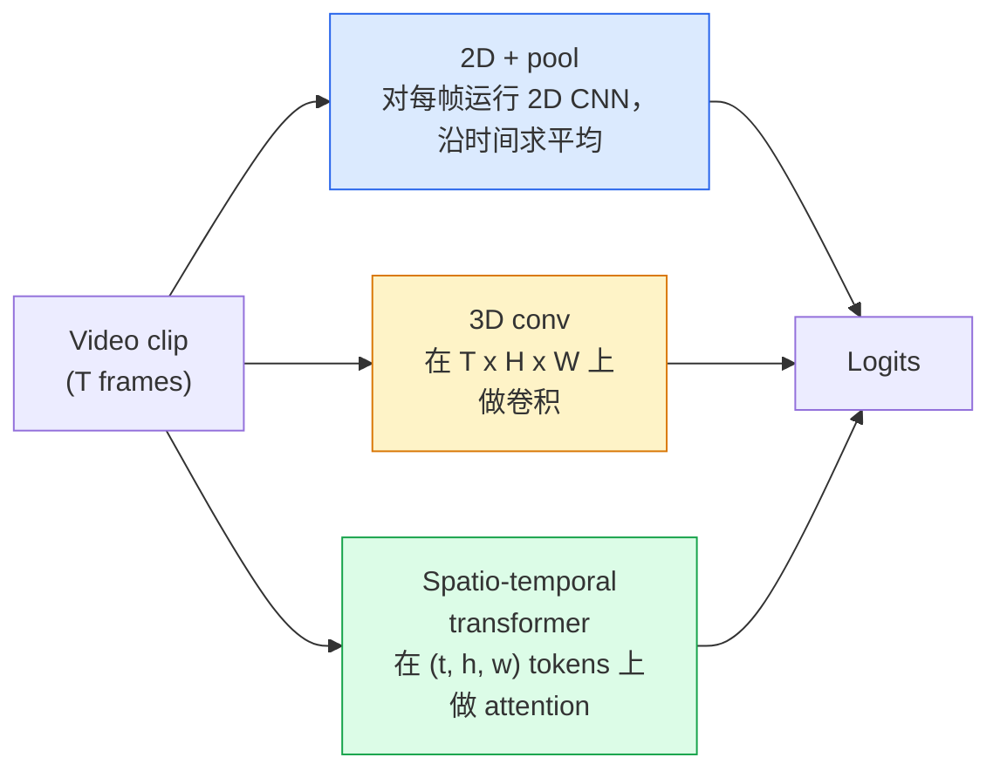

# 视频理解：Temporal Modeling

> 视频是一串图像，再加上连接这些图像的物理过程。每个视频模型要么把时间当作额外轴来处理（3D conv），要么把它当作需要 attention 的序列（transformer），要么先提取一次特征再做 pooling（2D+pool）。

**Type:** Learn + Build
**Languages:** Python
**Prerequisites:** Phase 4 Lesson 03（CNNs），Phase 4 Lesson 04（Image Classification）
**Time:** ~45 minutes

## 学习目标

- 区分三类主要的视频建模方法（2D+pool、3D conv、spatio-temporal transformer），并预测它们在成本和准确率上的取舍
- 在 PyTorch 中实现 frame sampling、temporal pooling，以及一个 2D+pool baseline classifier
- 解释 I3D 的 “inflated” 3D kernels 为什么能很好地迁移 ImageNet 权重，以及 factorised (2+1)D conv 有什么不同
- 阅读标准 action-recognition datasets 和 metrics：Kinetics-400/600、UCF101、Something-Something V2；clip level 和 video level 的 top-1 accuracy

## 问题

一个 30 秒、30 fps 的视频有 900 张图像。最朴素的视频分类，就是把图像分类运行 900 次，然后做某种 aggregation。当 action 几乎在每一帧里都可见时，这招能工作：体育、烹饪、健身视频都属于这一类。但当 action 由 motion 本身定义时，它会失败得很彻底：“把某物从左推到右” 在每一张静态帧里看起来都只是两个静止物体。

每个视频架构的核心问题都是：temporal structure 在什么时候被建模，又是如何被建模的？答案会决定所有其他事情：compute cost、pretraining strategy、是否能复用 ImageNet 权重、模型应该在哪些 datasets 上训练。

这一课故意比静态图像课程短。核心 image machinery 已经具备，video understanding 主要讲 temporal story：sampling、modelling 和 aggregating。

## 概念

### 三个架构家族



### 2D + pool

取一个 2D CNN（ResNet、EfficientNet、ViT）。在每个 sampled frame 上独立运行它。对 per-frame embeddings 求平均（也可以 max-pool 或 attention-pool）。把 pooled vector 送进 classifier。

优点：
- ImageNet pretraining 可以直接迁移。
- 实现最简单。
- 便宜：T frames 乘以 single-image inference cost。

缺点：
- 无法建模 motion。Action 只是 appearances 的 aggregate。
- Temporal pooling 对顺序不敏感；“open door” 和 “close door” 看起来一样。

适用场景：appearance-heavy tasks、小型 video datasets 上的 transfer learning、初始 baselines。

### 3D convolutions

把 2D (H, W) kernels 替换成 3D (T, H, W) kernels。网络同时在空间和时间上卷积。早期家族包括 C3D、I3D、SlowFast。

I3D trick：取一个 pretrained 2D ImageNet model，把每个 2D kernel 沿新的 time axis 复制，从而 “inflate” 它。一个 3x3 的 2D conv 会变成 3x3x3 的 3D conv。这样 3D model 获得了强 pretrained weights，而不是从零开始训练。

优点：
- 直接建模 motion。
- I3D inflation 带来几乎免费的 transfer learning。

缺点：
- 比 2D counterpart 多大约 T/8 的 FLOPs（对于 temporal kernel 为 3、堆叠 3 次的情况）。
- Temporal kernels 很小；long-range motion 需要 pyramid 或 dual-stream approach。

适用场景：motion 就是信号的 action recognition，例如 Something-Something V2，或 Kinetics 中 motion-heavy 的类别。

### Spatio-temporal transformers

把视频 tokenise 成 space-time patches 的网格，并在所有 token 之间做 attention。代表模型包括 TimeSformer、ViViT、Video Swin、VideoMAE。

重要的 attention patterns：
- **Joint**：在 (t, h, w) 上做一个大 attention。复杂度对 `T*H*W` 二次增长；昂贵。
- **Divided**：每个 block 做两次 attention：一次沿时间，一次沿空间。更接近线性 scaling。
- **Factorised**：time attention 和 space attention 在 blocks 之间交替出现。

优点：
- 在每个主流 benchmark 上都有 SOTA accuracy。
- 可以通过 patch inflation 从 image transformers（ViT）迁移。
- 通过 sparse attention 支持 long-context video。

缺点：
- 计算量很大。
- 必须认真选择 attention pattern，否则 runtime 会膨胀。

适用场景：大型 datasets、高保真 video understanding、多模态 video+text tasks。

### Frame sampling

一个 10 秒、30 fps 的 clip 有 300 frames；把全部 300 帧喂给任何模型都很浪费。标准策略：

- **Uniform sampling**：在 clip 中均匀选择 T frames。2D+pool 的默认选择。
- **Dense sampling**：随机取一个连续的 T-frame window。3D convs 常用，因为 motion 需要相邻帧。
- **Multi-clip**：从同一个 video 里采样多个 T-frame windows，分别分类，并在 test time 对 predictions 求平均。

T 通常是 8、16、32 或 64。更高的 T 意味着更多 temporal signal，也意味着更多 compute。

### Evaluation

两个层级：
- **Clip-level accuracy**：模型看到一个 T-frame clip，报告 top-k。
- **Video-level accuracy**：对同一个 video 的多个 clips 取 clip-level predictions 的平均；更高也更稳定。

两者都要报告。一个模型如果得分是 78% clip / 82% video，说明它很依赖 test-time averaging；如果是 80% / 81%，说明它的 per-clip 表现更 robust。

### 你会遇到的数据集

- **Kinetics-400 / 600 / 700**：通用 action dataset。40 万 clips；YouTube URLs（很多现在已经失效）。
- **Something-Something V2**：由 motion 定义的 actions（“moving X from left to right”）。2D+pool 无法解决。
- **UCF-101**、**HMDB-51**：更老、更小，但仍然常被报告。
- **AVA**：空间和时间上的 action *localisation*；比 classification 更难。

## Build It

### Step 1: Frame sampler

实现 uniform 和 dense samplers，让它们能作用在 frames list（或 video tensor）上。

```python
import numpy as np

def sample_uniform(num_frames_total, T):
    if num_frames_total <= T:
        return list(range(num_frames_total)) + [num_frames_total - 1] * (T - num_frames_total)
    step = num_frames_total / T
    return [int(i * step) for i in range(T)]


def sample_dense(num_frames_total, T, rng=None):
    rng = rng or np.random.default_rng()
    if num_frames_total <= T:
        return list(range(num_frames_total)) + [num_frames_total - 1] * (T - num_frames_total)
    start = int(rng.integers(0, num_frames_total - T + 1))
    return list(range(start, start + T))
```

两者都会返回 `T` 个 indices，你再用它们 slice video tensor。

### Step 2: 一个 2D+pool baseline

在每一帧上运行 2D ResNet-18，对 features 做 average-pool，然后分类。

```python
import torch
import torch.nn as nn
from torchvision.models import resnet18, ResNet18_Weights

class FramePool(nn.Module):
    def __init__(self, num_classes=400, pretrained=True):
        super().__init__()
        weights = ResNet18_Weights.IMAGENET1K_V1 if pretrained else None
        backbone = resnet18(weights=weights)
        self.features = nn.Sequential(*(list(backbone.children())[:-1]))  # global avg pool kept
        self.head = nn.Linear(512, num_classes)

    def forward(self, x):
        # x: (N, T, 3, H, W)
        N, T = x.shape[:2]
        x = x.view(N * T, *x.shape[2:])
        feats = self.features(x).view(N, T, -1)
        pooled = feats.mean(dim=1)
        return self.head(pooled)

model = FramePool(num_classes=10)
x = torch.randn(2, 8, 3, 224, 224)
print(f"output: {model(x).shape}")
print(f"params: {sum(p.numel() for p in model.parameters()):,}")
```

一千一百万参数，ImageNet pretrained，逐帧运行，求平均，再分类。在 appearance-heavy tasks 上，这个 baseline 经常只比真正的 3D models 低 5-10 个点，有时甚至更好，因为它复用了更强的 ImageNet backbone。

### Step 3: 一个 I3D-style inflated 3D conv

把单个 2D conv 变成 3D conv：沿新的 time axis 重复 weights。

```python
def inflate_2d_to_3d(conv2d, time_kernel=3):
    out_c, in_c, kh, kw = conv2d.weight.shape
    weight_3d = conv2d.weight.data.unsqueeze(2)  # (out, in, 1, kh, kw)
    weight_3d = weight_3d.repeat(1, 1, time_kernel, 1, 1) / time_kernel
    conv3d = nn.Conv3d(in_c, out_c, kernel_size=(time_kernel, kh, kw),
                        padding=(time_kernel // 2, conv2d.padding[0], conv2d.padding[1]),
                        stride=(1, conv2d.stride[0], conv2d.stride[1]),
                        bias=False)
    conv3d.weight.data = weight_3d
    return conv3d

conv2d = nn.Conv2d(3, 64, kernel_size=3, padding=1, bias=False)
conv3d = inflate_2d_to_3d(conv2d, time_kernel=3)
print(f"2D weight shape:  {tuple(conv2d.weight.shape)}")
print(f"3D weight shape:  {tuple(conv3d.weight.shape)}")
x = torch.randn(1, 3, 8, 56, 56)
print(f"3D output shape:  {tuple(conv3d(x).shape)}")
```

除以 `time_kernel` 可以让 activation magnitudes 大致保持不变。这很重要，否则第一次 forward pass 就可能破坏 batch-norm statistics。

### Step 4: Factorised (2+1)D conv

把 3D conv 拆成一个 2D（spatial）conv 和一个 1D（temporal）conv。感受野相同，参数更少，并且在一些 benchmarks 上准确率更高。

```python
class Conv2Plus1D(nn.Module):
    def __init__(self, in_c, out_c, kernel_size=3):
        super().__init__()
        mid_c = (in_c * out_c * kernel_size * kernel_size * kernel_size) \
                // (in_c * kernel_size * kernel_size + out_c * kernel_size)
        self.spatial = nn.Conv3d(in_c, mid_c, kernel_size=(1, kernel_size, kernel_size),
                                 padding=(0, kernel_size // 2, kernel_size // 2), bias=False)
        self.bn = nn.BatchNorm3d(mid_c)
        self.act = nn.ReLU(inplace=True)
        self.temporal = nn.Conv3d(mid_c, out_c, kernel_size=(kernel_size, 1, 1),
                                  padding=(kernel_size // 2, 0, 0), bias=False)

    def forward(self, x):
        return self.temporal(self.act(self.bn(self.spatial(x))))

c = Conv2Plus1D(3, 64)
x = torch.randn(1, 3, 8, 56, 56)
print(f"(2+1)D output: {tuple(c(x).shape)}")
```

完整的 R(2+1)D network 就是把 ResNet-18 中的每个 3x3 conv 都替换成 `Conv2Plus1D`。

## Use It

生产级视频工作主要由两个库覆盖：

- `torchvision.models.video`：R(2+1)D、MViT、Swin3D，带 pretrained Kinetics weights。API 和 image models 一样。
- `pytorchvideo`（Meta）：model zoo、Kinetics / SSv2 / AVA 的 data loaders、标准 transforms。

对于 Vision-Language video models（video captioning、video QA），使用 `transformers`（`VideoMAE`、`VideoLLaMA`、`InternVideo`）。

## Ship It

这一课产出：

- `outputs/prompt-video-architecture-picker.md`：一个根据 appearance-vs-motion、dataset size 和 compute budget 选择 2D+pool / I3D / (2+1)D / transformer 的 prompt。
- `outputs/skill-frame-sampler-auditor.md`：一个检查 video pipeline sampler 的 skill，用来标记常见 bug：off-by-one index、`num_frames < T` 时 sampling 不均匀、缺少 aspect-preserving crop，等等。

## Exercises

1. **（Easy）** 近似计算 T=8 时 FramePool 与 I3D-style 3D ResNet 的 FLOPs。解释为什么 2D+pool 便宜 3-5 倍。
2. **（Medium）** 生成一个 synthetic video dataset：随机小球沿随机方向移动，并按 motion direction 打标签（“left-to-right”、“right-to-left”、“diagonal-up”）。在它上面训练 FramePool。展示它接近 chance accuracy，从而证明仅靠 appearance 不足以完成 motion tasks。
3. **（Hard）** 构建一个 R(2+1)D-18：把 ResNet-18 中的每个 Conv2d 都替换为 `Conv2Plus1D`。从 ImageNet-pretrained ResNet-18 inflate 第一个 conv 的 weights。在 exercise 2 的 motion dataset 上训练，并超过 FramePool。

## Key Terms

| Term | What people say | What it actually means |
|------|----------------|----------------------|
| 2D + pool | “Per-frame classifier” | 在每个 sampled frame 上运行 2D CNN，跨时间 average-pool features，然后分类 |
| 3D convolution | “Spatio-temporal kernel” | 在 (T, H, W) 上卷积的 kernel；可以原生建模 motion |
| Inflation | “Lift 2D weights to 3D” | 沿新的 time axis 重复 2D conv weights 来初始化 3D conv weights，再除以 kernel_T 以保持 activation scale |
| (2+1)D | “Factorised conv” | 把 3D 拆成 2D spatial + 1D temporal；参数更少，并在中间多一次 non-linearity |
| Divided attention | “Time then space” | 每层有两次 attention 的 transformer block：一次在同一帧的 tokens 上，一次在同一位置的 tokens 上 |
| Clip | “T-frame window” | 采样出的 T 帧子序列；视频模型消费的基本单位 |
| Clip vs video accuracy | “Two eval settings” | Clip = 每个 video 一个 sample；video = 对多个 sampled clips 求平均 |
| Kinetics | “The ImageNet of video” | 400-700 个 action classes，30 万+ YouTube clips，标准 video pretraining corpus |

## Further Reading

- [I3D: Quo Vadis, Action Recognition（Carreira & Zisserman, 2017）](https://arxiv.org/abs/1705.07750) — 提出 inflation 和 Kinetics dataset
- [R(2+1)D: A Closer Look at Spatiotemporal Convolutions（Tran et al., 2018）](https://arxiv.org/abs/1711.11248) — factorised conv，至今仍是强 baseline
- [TimeSformer: Is Space-Time Attention All You Need?（Bertasius et al., 2021）](https://arxiv.org/abs/2102.05095) — 第一个强 video transformer
- [VideoMAE（Tong et al., 2022）](https://arxiv.org/abs/2203.12602) — video 的 masked autoencoder pretraining；当前主流 pretraining recipe
