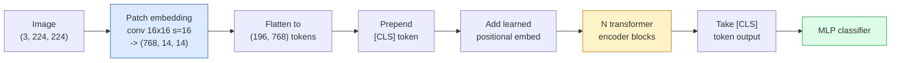

# Vision Transformers（ViT）

> 把图像切成 patch，把每个 patch 当成一个词，再跑标准 transformer。不要回头。

**Type:** Build
**Languages:** Python
**Prerequisites:** Phase 7 Lesson 02（Self-Attention），Phase 4 Lesson 04（Image Classification）
**Time:** ~45 minutes

## 学习目标

- 从零实现 patch embedding、learned positional embedding、class token 和 transformer encoder blocks，构建一个最小 ViT
- 解释为什么人们一开始认为 ViT 需要海量预训练数据，直到 DeiT 和 MAE 证明事实并非如此
- 从架构先验角度比较 ViT、Swin 和 ConvNeXt：无先验、local window attention、conv backbone
- 使用 `timm` 在小数据集上 fine-tune 预训练 ViT，并套用标准 linear-probe / fine-tune recipe

## 问题

十年来，convolution 几乎就是 computer vision 的代名词。CNN 有很强的 inductive biases：locality、translation equivariance。过去没人觉得这些东西能被替代。随后 Dosovitskiy et al.（2020）证明：把普通 transformer 直接应用在展平后的 image patches 上，不使用任何 convolutional machinery，也能在大规模设置下追平或超过最强 CNN。

问题在于“大规模”。ViT 在 ImageNet-1k 上输给 ResNet；但先在 ImageNet-21k 或 JFT-300M 上预训练，再 fine-tune 到 ImageNet-1k 后，它就能赢。最初的结论是：transformer 缺少有用的先验，但只要数据足够多，它可以自己学到。后续工作（DeiT、MAE、DINO）表明，只要 training recipe 合适，比如强 augmentation、self-supervised pretraining、distillation，ViT 在小数据上也能训练得很好。

到 2026 年，纯 CNN 在 edge devices 上仍然有竞争力（ConvNeXt 是其中最强的一类），但 transformer 主导了其他几乎所有方向：segmentation（Mask2Former、SegFormer）、detection（DETR、RT-DETR）、multimodal（CLIP、SigLIP）、video（VideoMAE、VJEPA）。ViT block structure 是必须掌握的模板。

## 概念

### Pipeline



七步：patches -> tokens -> attention -> classifier。每个变体（DeiT、Swin、ConvNeXt、MAE pretraining）都只改这七步中的一两步，其他部分保持不变。

### Patch embedding

第一个 conv 是秘密所在。Kernel size 16，stride 16，所以一张 224x224 图像会变成一个 14x14 的 16x16 patches 网格，每个 patch 被投影成 768 维 embedding。这个单独的 conv 同时完成 patchify 和 linear projection。

```text
Input:  (3, 224, 224)
Conv (3 -> 768, k=16, s=16, no padding):
Output: (768, 14, 14)
Flatten spatial: (196, 768)
```

196 个 patches = 196 个 tokens。每个 token 的 feature dimension 是 768（ViT-B）、1024（ViT-L）或 1280（ViT-H）。

### Class token

把一个 learned vector 加到序列最前面：

```text
tokens = [CLS; patch_1; patch_2; ...; patch_196]   shape (197, 768)
```

经过 N 个 transformer blocks 后，`[CLS]` 的输出就是全局 image representation。Classification head 只读取这一个 vector。

### Positional embedding

Transformer 没有内建的空间位置概念。给每个 token 加一个 learned vector：

```text
tokens = tokens + learned_pos_embedding   (also shape (197, 768))
```

这个 embedding 是模型参数；gradient-based training 会把它适配到 2D image structure。也存在 sinusoidal 2D 替代方案，但实践中很少使用。

### Transformer encoder block

标准结构。Multi-head self-attention、MLP、residual connections、pre-LayerNorm。

```text
x = x + MSA(LN(x))
x = x + MLP(LN(x))

MLP is two-layer with GELU: Linear(d -> 4d) -> GELU -> Linear(4d -> d)
```

ViT-B/16 堆叠 12 个这样的 blocks，每个 block 有 12 个 attention heads，总参数量约 86M。

### 为什么是 pre-LN

早期 transformer 使用 post-LN（`x = LN(x + sublayer(x))`），如果没有 warmup，训练超过 6-8 层时很容易不稳定。Pre-LN（`x = x + sublayer(LN(x))`）能在没有 warmup 的情况下稳定训练更深的网络。每个 ViT 和每个现代 LLM 都使用 pre-LN。

### Patch size trade-off

- 16x16 patches -> 196 tokens，标准选择。
- 32x32 patches -> 49 tokens，更快但分辨率更低。
- 8x8 patches -> 784 tokens，更细，但 O(n^2) attention cost 增长很快。

更大的 patches = 更少的 tokens = 更快，但空间细节更少。SwinV2 在 hierarchical windows 中使用 4x4 patches。

### DeiT 如何在 ImageNet-1k 上训练 ViT

原始 ViT 需要 JFT-300M 才能超过 CNN。DeiT（Touvron et al., 2020）只用 ImageNet-1k 就把 ViT-B 训练到 81.8% top-1，依靠四个变化：

1. Heavy augmentation：RandAugment、Mixup、CutMix、Random Erasing。
2. Stochastic depth：训练时随机 drop 整个 blocks。
3. Repeated augmentation：同一张 image 在每个 batch 中采样 3 次。
4. 来自 CNN teacher 的 distillation：可选，但能进一步提高 accuracy。

每个现代 ViT training recipe 都继承自 DeiT。

### Swin vs ConvNeXt

- **Swin**（Liu et al., 2021）：window-based attention。每个 block 只在 local window 内 attend；交替 blocks 会 shift window，让信息跨 window 混合。它把 CNN-like locality prior 带回来，同时保留 attention operator。
- **ConvNeXt**（Liu et al., 2022）：重新设计的 CNN，吸收了 Swin 的架构选择（depthwise convs、LayerNorm、GELU、inverted bottleneck）。它证明差距不在“attention vs convolution”，而在“modern training recipe + architecture”。

到 2026 年，ConvNeXt-V2 和 Swin-V2 都是 production-grade；正确选择取决于你的 inference stack（ConvNeXt 更容易在 edge 上编译）和 pretraining corpus。

### MAE pretraining

Masked Autoencoder（He et al., 2022）：随机 mask 75% 的 patches，训练 encoder 只处理可见的 25%，再训练一个小 decoder 从 encoder output 重建被 mask 的 patches。预训练后，丢弃 decoder，fine-tune encoder。

MAE 让 ViT 可以只用 ImageNet-1k 训练，达到 SOTA，并成为当前默认的 self-supervised recipe。

## Build It

### Step 1: Patch embedding

```python
import torch
import torch.nn as nn

class PatchEmbedding(nn.Module):
    def __init__(self, in_channels=3, patch_size=16, dim=192, image_size=64):
        super().__init__()
        assert image_size % patch_size == 0
        self.proj = nn.Conv2d(in_channels, dim, kernel_size=patch_size, stride=patch_size)
        num_patches = (image_size // patch_size) ** 2
        self.num_patches = num_patches

    def forward(self, x):
        x = self.proj(x)
        return x.flatten(2).transpose(1, 2)
```

一个 conv，一个 flatten，一个 transpose。这就是完整的 image-to-tokens step。

### Step 2: Transformer block

Pre-LN、multi-head self-attention、带 GELU 的 MLP、residual connections。

```python
class Block(nn.Module):
    def __init__(self, dim, num_heads, mlp_ratio=4, dropout=0.0):
        super().__init__()
        self.ln1 = nn.LayerNorm(dim)
        self.attn = nn.MultiheadAttention(dim, num_heads, dropout=dropout, batch_first=True)
        self.ln2 = nn.LayerNorm(dim)
        self.mlp = nn.Sequential(
            nn.Linear(dim, dim * mlp_ratio),
            nn.GELU(),
            nn.Dropout(dropout),
            nn.Linear(dim * mlp_ratio, dim),
            nn.Dropout(dropout),
        )

    def forward(self, x):
        a, _ = self.attn(self.ln1(x), self.ln1(x), self.ln1(x), need_weights=False)
        x = x + a
        x = x + self.mlp(self.ln2(x))
        return x
```

`nn.MultiheadAttention` 会处理 split into heads、scaled dot-product 和 output projection。`batch_first=True` 让 shape 变成 `(N, seq, dim)`。

### Step 3: ViT

```python
class ViT(nn.Module):
    def __init__(self, image_size=64, patch_size=16, in_channels=3,
                 num_classes=10, dim=192, depth=6, num_heads=3, mlp_ratio=4):
        super().__init__()
        self.patch = PatchEmbedding(in_channels, patch_size, dim, image_size)
        num_patches = self.patch.num_patches
        self.cls_token = nn.Parameter(torch.zeros(1, 1, dim))
        self.pos_embed = nn.Parameter(torch.zeros(1, num_patches + 1, dim))
        self.blocks = nn.ModuleList([
            Block(dim, num_heads, mlp_ratio) for _ in range(depth)
        ])
        self.ln = nn.LayerNorm(dim)
        self.head = nn.Linear(dim, num_classes)
        nn.init.trunc_normal_(self.pos_embed, std=0.02)
        nn.init.trunc_normal_(self.cls_token, std=0.02)

    def forward(self, x):
        x = self.patch(x)
        cls = self.cls_token.expand(x.size(0), -1, -1)
        x = torch.cat([cls, x], dim=1)
        x = x + self.pos_embed
        for blk in self.blocks:
            x = blk(x)
        x = self.ln(x[:, 0])
        return self.head(x)

vit = ViT(image_size=64, patch_size=16, num_classes=10, dim=192, depth=6, num_heads=3)
x = torch.randn(2, 3, 64, 64)
print(f"output: {vit(x).shape}")
print(f"params: {sum(p.numel() for p in vit.parameters()):,}")
```

约 2.8M 参数，是一个可以在 CPU 上跑的小型 ViT。真实 ViT-B 是 86M；使用同一个 class definition，把参数设为 `dim=768, depth=12, num_heads=12` 即可。

### Step 4: Sanity check，单图 inference

```python
logits = vit(torch.randn(1, 3, 64, 64))
print(f"logits: {logits}")
print(f"probs:  {logits.softmax(-1)}")
```

应该能无错误运行。Probabilities 之和为 1。

## Use It

`timm` 带有每个 ViT variant 和 ImageNet pretrained weights。一行即可：

```python
import timm

model = timm.create_model("vit_base_patch16_224", pretrained=True, num_classes=10)
```

到 2026 年，`timm` 是 vision transformers 的 production default。它用同一个 API 支持 ViT、DeiT、Swin、Swin-V2、ConvNeXt、ConvNeXt-V2、MaxViT、MViT、EfficientFormer 以及其他几十种模型。

对于 multi-modal work（image + text），`transformers` 提供 CLIP、SigLIP、BLIP-2、LLaVA。这些模型中的 image encoder 都是 ViT variant。

## Ship It

这一课产出：

- `outputs/prompt-vit-vs-cnn-picker.md`：一个 prompt，根据 dataset size、compute 和 inference stack 在 ViT、ConvNeXt、Swin 之间做选择。
- `outputs/skill-vit-patch-and-pos-embed-inspector.md`：一个 skill，用来验证 ViT 的 patch embedding 和 positional embedding shapes 是否匹配模型期望的 sequence length，捕获最常见的 porting bugs。

## 练习

1. **（Easy）** 打印 tiny ViT forward pass 中每个 intermediate tensor 的 shape。确认：input `(N, 3, 64, 64)` -> patches `(N, 16, 192)` -> with CLS `(N, 17, 192)` -> classifier input `(N, 192)` -> output `(N, num_classes)`。
2. **（Medium）** 在 Lesson 4 的 synthetic-CIFAR dataset 上 fine-tune 一个预训练 `timm` ViT-S/16。与同一数据上的 ResNet-18 fine-tuning 对比。报告 training time 和 final accuracy。
3. **（Hard）** 为 tiny ViT 实现 MAE pretraining：mask 75% patches，训练 encoder + small decoder 重建 masked patches。在 pretraining 前后评估 synthetic data 上的 linear-probe accuracy。

## 关键术语

| Term | What people say | What it actually means |
|------|----------------|----------------------|
| Patch embedding | “The first conv” | 一个 kernel size = stride = patch size 的 conv；把 image 变成 token embeddings 网格 |
| Class token | “[CLS]” | 加到 token sequence 最前面的 learned vector；它的最终输出是全局 image representation |
| Positional embedding | “Learned pos” | 加到每个 token 上的 learned vector，让 transformer 知道每个 patch 来自哪里 |
| Pre-LN | “LayerNorm before sublayer” | 稳定的 transformer variant：`x + sublayer(LN(x))`，而不是 `LN(x + sublayer(x))` |
| Multi-head attention | “Parallel attention” | 标准 transformer attention 被拆成 `num_heads` 个独立子空间，最后再拼接 |
| ViT-B/16 | “Base, patch 16” | 经典尺寸：dim=768、depth=12、heads=12、patch_size=16、image=224；约 86M 参数 |
| DeiT | “Data-efficient ViT” | 只用 ImageNet-1k 和强 augmentation 训练出的 ViT；证明大规模预训练数据并非严格必需 |
| MAE | “Masked autoencoder” | Self-supervised pretraining：mask 75% patches 并重建；当前主流 ViT pretraining recipe |

## 延伸阅读

- [An Image is Worth 16x16 Words（Dosovitskiy et al., 2020）](https://arxiv.org/abs/2010.11929)：ViT paper
- [DeiT: Data-efficient Image Transformers（Touvron et al., 2020）](https://arxiv.org/abs/2012.12877)：如何只用 ImageNet-1k 训练 ViT
- [Masked Autoencoders are Scalable Vision Learners（He et al., 2022）](https://arxiv.org/abs/2111.06377)：MAE pretraining
- [timm documentation](https://huggingface.co/docs/timm)：production 中会用到的各种 vision transformer 的参考文档
