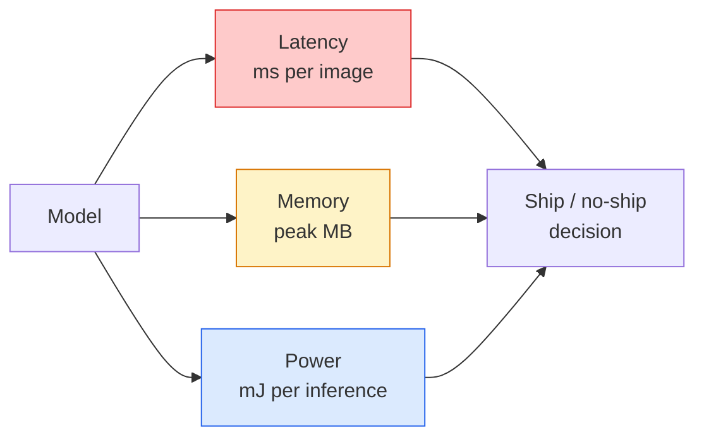

# 实时视觉：边缘部署

> Edge inference 的核心，是让一个 90% accuracy 的模型在只有 2 GB RAM 的设备上以 30 fps 运行。每一个百分点的 accuracy，都在和 latency 的毫秒数做交换。

**Type:** Learn + Build
**Languages:** Python
**Prerequisites:** Phase 4 Lesson 04（Image Classification），Phase 10 Lesson 11（Quantization）
**Time:** ~75 minutes

## 学习目标

- 测量任意 PyTorch model 的 inference latency、peak memory 和 throughput，并读懂 FLOPs / params / latency 之间的取舍
- 使用 PyTorch post-training quantisation 把 vision model 量化到 INT8，并验证 accuracy loss < 1%
- 导出到 ONNX，并用 ONNX Runtime 或 TensorRT 编译；说出三种最常见的 export failures 及其修复方式
- 解释在 edge constraint 下，什么时候该选择 MobileNetV3、EfficientNet-Lite、ConvNeXt-Tiny 或 MobileViT

## 问题

训练时的 vision model 是一个 floating-point monster：100M 参数、每次 forward pass 10 GFLOPs、2 GB VRAM。这些都无法直接放进手机、车载 infotainment unit、工业相机或无人机。交付一个 vision system，意味着要把同样的预测塞进小 100 倍的预算里。

三个 knob 完成了大部分工作：model choice（使用更小但 recipe 相同的 architecture）、quantisation（用 INT8 替代 FP32）、inference runtime（ONNX Runtime、TensorRT、Core ML、TFLite）。把它们选对，就是“只能在 workstation 上跑的 demo”和“能发货到 30 美元 camera module 的产品”之间的区别。

本课先建立 measurement discipline（无法测量，就无法优化），然后走过这三个 knob。目标不是掌握每一种 edge runtime，而是知道有哪些 lever，以及如何验证每个 lever 确实做了你以为它做的事。

## 概念

### 三个预算



- **Latency**：p50、p95、p99。只看 p50 average 会隐藏 real-time systems 中真正重要的 tail behaviour。
- **Peak memory**：设备曾经看到的最大内存，而不是 steady-state average。Embedded targets 上 OOM 是 fatal 的。
- **Power / energy**：电池设备上每次 inference 的 millijoules。常用 CPU/GPU utilisation * time 近似。

Edge decision 来自一张 `(model, latency, memory, accuracy)` 表。每个 cell 都必须在 target device 上测量，而不是在 workstation 上。

### Measurement discipline

每次 edge profile 都应该遵守三条规则：

1. **Warm up**：测量前用 5-10 次 dummy forward pass 预热模型。Cold caches 和 JIT compilation 会制造不具代表性的第一组数字。
2. **Synchronise**：GPU workloads 在 timed block 前后都要调用 `torch.cuda.synchronize()`。否则你测到的是 kernel dispatch，而不是 kernel execution。
3. **Fix input sizes**：使用 production resolution。`224x224` 上的 latency 不是 `512x512` 上的 latency。

### FLOPs 作为 proxy

FLOPs（每次 inference 的 floating-point operations）是便宜、device-independent 的 latency proxy。它适合 architecture comparison，但作为 absolute wall-clock 会误导人。一个 FLOPs 多 10% 的模型，实际可能快 2 倍，因为它使用了 hardware-friendly ops（depthwise convs 编译得很好，大型 `7x7` convs 则不一定）。

规则：architecture search 用 FLOPs，deployment decisions 用 on-device latency。

### 一段话讲 quantisation

把 FP32 weights 和 activations 替换成 INT8。Model size 降 4 倍，memory bandwidth 降 4 倍；在有 INT8 kernels 的硬件上（所有现代 mobile SoC、所有带 Tensor Cores 的 NVIDIA GPU），compute 降 2-4 倍。Vision tasks 上使用 post-training static quantisation 时，accuracy loss 通常是 0.1-1 个百分点。

类型：

- **Dynamic**：把 weights 量化到 INT8，activations 仍用 FP 计算。简单，但加速小。
- **Static（post-training）**：量化 weights，并用一个小 calibration set 校准 activation ranges。比 dynamic 快得多。
- **Quantisation-aware training（QAT）**：训练时模拟 quantisation，让模型学会绕开量化误差。Accuracy 最好，但需要 labelled data。

对于 vision，post-training static quantisation 用 5% 的 effort 拿到 95% 的收益。只有当 PTQ 的 accuracy loss 不可接受时，才使用 QAT。

### Pruning 和 distillation

- **Pruning**：移除不重要的 weights（magnitude-based）或 channels（structured）。对 overparameterised models 有效；对已经 compact 的 architectures 帮助较小。
- **Distillation**：训练一个小 student 去模仿大 teacher 的 logits。通常能恢复大部分因缩小模型而丢失的 accuracy。Production edge models 的标准做法。

### Inference runtimes

- **PyTorch eager**：慢，不用于 deployment。只适合 development。
- **TorchScript**：legacy。已被 `torch.compile` 和 ONNX export 取代。
- **ONNX Runtime**：neutral runtime。CPU、CUDA、CoreML、TensorRT、OpenVINO 都有 ONNX providers。从这里开始。
- **TensorRT**：NVIDIA compiler。在 NVIDIA GPUs（workstation 和 Jetson）上 latency 最好。可与 ONNX Runtime 集成，也可 standalone 使用。
- **Core ML**：Apple 的 iOS/macOS runtime。需要 `.mlmodel` 或 `.mlpackage`。
- **TFLite**：Google 的 Android/ARM runtime。需要 `.tflite`。
- **OpenVINO**：Intel 的 CPU/VPU runtime。需要 `.xml` + `.bin`。

实践中：PyTorch -> ONNX -> 为 target 选择 runtime。ONNX 是 lingua franca。

### Edge architecture picker

| Budget | Model | Why |
|--------|-------|-----|
| < 3M params | MobileNetV3-Small | 到处都能编译，好的 baseline |
| 3-10M | EfficientNet-Lite-B0 | TFLite 上最好的 accuracy per param |
| 10-20M | ConvNeXt-Tiny | 最好的 accuracy-per-param，CPU-friendly |
| 20-30M | MobileViT-S or EfficientViT | 具备 ImageNet accuracy 的 transformer |
| 30-80M | Swin-V2-Tiny | 如果 stack 支持 window attention |

除非有明确理由，否则这些模型全部量化到 INT8。

```figure
cnn-param-count
```

## Build It

### Step 1: 正确测量 latency

```python
import time
import torch

def measure_latency(model, input_shape, device="cpu", warmup=10, iters=50):
    model = model.to(device).eval()
    x = torch.randn(input_shape, device=device)
    with torch.no_grad():
        for _ in range(warmup):
            model(x)
        if device == "cuda":
            torch.cuda.synchronize()
        times = []
        for _ in range(iters):
            if device == "cuda":
                torch.cuda.synchronize()
            t0 = time.perf_counter()
            model(x)
            if device == "cuda":
                torch.cuda.synchronize()
            times.append((time.perf_counter() - t0) * 1000)
    times.sort()
    return {
        "p50_ms": times[len(times) // 2],
        "p95_ms": times[int(len(times) * 0.95)],
        "p99_ms": times[int(len(times) * 0.99)],
        "mean_ms": sum(times) / len(times),
    }
```

Warm up、synchronise、使用 `time.perf_counter()`。报告 percentiles，而不只是 mean。

### Step 2: 参数量和 FLOP counts

```python
def parameter_count(model):
    return sum(p.numel() for p in model.parameters())

def flops_estimate(model, input_shape):
    """
    Rough FLOP count for a conv/linear-only model. For production use `fvcore` or `ptflops`.
    """
    total = 0
    def conv_hook(m, inp, out):
        nonlocal total
        c_out, c_in, kh, kw = m.weight.shape
        h, w = out.shape[-2:]
        total += 2 * c_in * c_out * kh * kw * h * w
    def linear_hook(m, inp, out):
        nonlocal total
        total += 2 * m.in_features * m.out_features
    hooks = []
    for m in model.modules():
        if isinstance(m, torch.nn.Conv2d):
            hooks.append(m.register_forward_hook(conv_hook))
        elif isinstance(m, torch.nn.Linear):
            hooks.append(m.register_forward_hook(linear_hook))
    model.eval()
    with torch.no_grad():
        model(torch.randn(input_shape))
    for h in hooks:
        h.remove()
    return total
```

真实项目中使用 `fvcore.nn.FlopCountAnalysis` 或 `ptflops`；它们能正确处理每种 module type。

### Step 3: Post-training static quantisation

```python
def quantise_ptq(model, calibration_loader, backend="x86"):
    import torch.ao.quantization as tq
    model = model.eval().cpu()
    model.qconfig = tq.get_default_qconfig(backend)
    tq.prepare(model, inplace=True)
    with torch.no_grad():
        for x, _ in calibration_loader:
            model(x)
    tq.convert(model, inplace=True)
    return model
```

三步：configure、prepare（插入 observers）、用真实数据 calibrate、convert（fuse + quantise）。这要求模型先被 fused（`Conv -> BN -> ReLU` -> `ConvBnReLU`），可由 `torch.ao.quantization.fuse_modules` 处理。

### Step 4: 导出到 ONNX

```python
def export_onnx(model, sample_input, path="model.onnx"):
    model = model.eval()
    torch.onnx.export(
        model,
        sample_input,
        path,
        input_names=["input"],
        output_names=["output"],
        dynamic_axes={"input": {0: "batch"}, "output": {0: "batch"}},
        opset_version=17,
    )
    return path
```

`opset_version=17` 是 2026 年的安全默认值。`dynamic_axes` 允许用任意 batch size 运行 ONNX model。

### Step 5: Benchmark 并比较 regimes

```python
import torch.nn as nn
from torchvision.models import mobilenet_v3_small

def compare_regimes():
    model = mobilenet_v3_small(weights=None, num_classes=10)
    params = parameter_count(model)
    flops = flops_estimate(model, (1, 3, 224, 224))
    lat_fp32 = measure_latency(model, (1, 3, 224, 224), device="cpu")
    print(f"FP32 MobileNetV3-Small: {params:,} params  {flops/1e9:.2f} GFLOPs  "
          f"p50={lat_fp32['p50_ms']:.2f}ms  p95={lat_fp32['p95_ms']:.2f}ms")
```

对 `resnet50`、`efficientnet_v2_s` 和 `convnext_tiny` 运行同一个函数，你就得到了一张足够支撑 deployment decision 的 comparison table。

## Use It

Production stacks 通常收敛到三条路径之一：

- **Web / serverless**：PyTorch -> ONNX -> ONNX Runtime（CPU 或 CUDA provider）。最简单，对大多数场景已经够用。
- **NVIDIA edge（Jetson、GPU server）**：PyTorch -> ONNX -> TensorRT。Latency 最好，engineering effort 最大。
- **Mobile**：PyTorch -> ONNX -> Core ML（iOS）或 TFLite（Android）。Export 前先 quantise。

Measurement 方面，`torch-tb-profiler`、`nvprof` / `nsys`，以及 macOS 上的 Instruments 能给出 layer-by-layer breakdowns。`benchmark_app`（OpenVINO）和 `trtexec`（TensorRT）能给出 standalone CLI 数字。

## Ship It

本课产出：

- `outputs/prompt-edge-deployment-planner.md`：一个 prompt，根据 target device 和 latency SLA 选择 backbone、quantisation strategy 和 runtime。
- `outputs/skill-latency-profiler.md`：一个 skill，写出完整 latency-benchmarking script，包括 warmup、synchronisation、percentiles 和 memory tracking。

## 练习

1. **（Easy）** 在 CPU 上以 `224x224` 测量 `resnet18`、`mobilenet_v3_small`、`efficientnet_v2_s` 和 `convnext_tiny` 的 p50 latency。报告表格，并指出哪个 architecture 有最好的 accuracy-per-ms。
2. **（Medium）** 对 `mobilenet_v3_small` 应用 post-training static quantisation。报告 FP32 vs INT8 latency，以及在 CIFAR-10 或类似 held-out subset 上的 accuracy loss。
3. **（Hard）** 把 `convnext_tiny` 导出到 ONNX，用 `CPUExecutionProvider` 通过 `onnxruntime` 运行，并与 PyTorch eager baseline 比较 latency。找出 ONNX Runtime 开始更快的第一个 layer，并解释原因。

## 关键术语

| Term | What people say | What it actually means |
|------|----------------|----------------------|
| Latency | “How fast” | 从 input 到 output 的时间；看 p50/p95/p99 percentiles，不看 mean |
| FLOPs | “Model size” | 每次 forward pass 的 floating-point ops；compute cost 的粗略 proxy |
| INT8 quantisation | “8-bit” | 用 8-bit integers 替代 FP32 weights/activations；约小 4 倍，快 2-4 倍 |
| PTQ | “Post-training quantisation” | 不重新训练，直接量化已训练模型；简单，通常够用 |
| QAT | “Quantisation-aware training” | 训练时模拟 quantisation；accuracy 最好，需要 labelled data |
| ONNX | “The neutral format” | 每个主流 inference runtime 都支持的 model exchange format |
| TensorRT | “NVIDIA compiler” | 把 ONNX 编译成 NVIDIA GPUs 上的 optimised engine |
| Distillation | “Teacher -> student” | 训练小模型模仿大模型 logits；恢复大部分损失的 accuracy |

## Further Reading

- [EfficientNet (Tan & Le, 2019)](https://arxiv.org/abs/1905.11946) — efficient architectures 的 compound scaling
- [MobileNetV3 (Howard et al., 2019)](https://arxiv.org/abs/1905.02244) — mobile-first architecture，带 h-swish 和 squeeze-excite
- [A Practical Guide to TensorRT Optimization (NVIDIA)](https://developer.nvidia.com/blog/accelerating-model-inference-with-tensorrt-tips-and-best-practices-for-pytorch-users/) — 如何真正拿到 paper 里的 throughput 数字
- [ONNX Runtime docs](https://onnxruntime.ai/docs/) — quantisation、graph optimisation、provider selection
