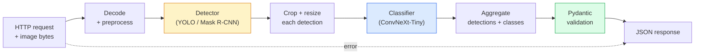

# 构建完整视觉管线：Capstone

> 生产级 vision system 是由 models 和 rules 串起来的一条链，中间靠 data contracts 缝合。本阶段的组件已经齐了；capstone 会把它们端到端接起来。

**Type:** Build
**Languages:** Python
**Prerequisites:** Phase 4 Lessons 01-15
**Time:** ~120 minutes

## 学习目标

- 设计一个生产级 vision pipeline：检测 objects、分类它们，并输出 structured JSON，同时处理每一条 failure path
- 把 detector（Mask R-CNN 或 YOLO）、classifier（ConvNeXt-Tiny）和 data contract（Pydantic）接入同一个 service
- Benchmark 端到端 pipeline，并找出第一个 bottleneck（通常先是 preprocessing，然后是 detector）
- 交付一个最小 FastAPI service：接收 image upload，运行 pipeline，并返回带 classifications 的 detections

## 问题

单个 vision model 很有用；vision products 通常是一串 models。零售货架审计是 detector 加 product classifier 加 price-OCR pipeline。自动驾驶是 2D detector 加 3D detector 加 segmenter 加 tracker 加 planner。医疗预筛是 segmenter 加 region classifier 加 clinician UI。

把这些链条接起来，才是 ML prototype 和 product 的分界线。Models 之间的每个 interface 都是新的 bug 入口。每个 coordinate transform、每次 normalisation、每次 mask resize，都是 silent failure 的候选。Pipeline 的强度取决于它最弱的 interface。

这个 capstone 搭建 minimum viable pipeline：detection + classification + structured output + serving layer。Phase 4 的其他所有内容都可以插进这个 skeleton：把 Mask R-CNN 换成 YOLOv8，加一个 OCR head，加一个 segmentation branch，加一个 tracker。Architecture 是稳定的；pieces 是可替换的。

## 概念

### Pipeline



七个 stages。两个 model stages 很昂贵；另外五个 stages 是 bug 最常出现的地方。

### 用 Pydantic 写 data contracts

每个 model boundary 都变成 typed object。这会把 silent failures 变成 loud failures。

```text
Detection(
    box: tuple[float, float, float, float],   # (x1, y1, x2, y2), absolute pixels
    score: float,                              # [0, 1]
    class_id: int,                             # from detector's label map
    mask: Optional[list[list[int]]],           # RLE-encoded if present
)

PipelineResult(
    image_id: str,
    detections: list[Detection],
    classifications: list[Classification],
    inference_ms: float,
)
```

当 detector 返回的是 `(cx, cy, w, h)` 而不是 `(x1, y1, x2, y2)` 时，Pydantic 的 validation 会在 boundary 处失败。你会立刻知道问题，而不是去调一个 downstream crop 为什么静默返回 empty regions。

### Latency 花在哪里

几乎每条 vision pipeline 都满足三个事实：

1. **Preprocessing 往往是最大的单个 block。** JPEG decoding、colour spaces 转换、resizing 都是 CPU-bound，而且很容易被忘掉。
2. **Detector 主导 GPU time。** 70-90% 的 GPU time 会花在 detection forward pass 上。
3. **Postprocessing（NMS、RLE encode/decode）在 GPU 上便宜，在 CPU 上昂贵。** 一定要用真实 target 做 profile。

知道 latency distribution，optimisation 才会变成有优先级的列表。

### Failure modes

- **Empty detections**：返回 empty list，不要 crash。记录 log。
- **Out-of-bounds boxes**：crop 前 clamp 到 image size。
- **Tiny crops**：如果 box 小于 classifier 的 minimum input，就跳过 classification。
- **Corrupt upload**：返回带具体 error code 的 400 response，而不是 500。
- **Model load failure**：在 service startup 时失败，而不是第一个 request 到来时失败。

生产级 pipeline 会明确处理每一种情况，而不是写一个泛化的 `try/except` 把 failure 藏起来。每个 failure 都有 named code 和 response。

### Batching

生产 service 会服务多个 clients。跨 requests 批量处理 detections 和 classifications，可以成倍提升 throughput。代价是：为了等 batch 凑满，会增加额外 latency。典型设置是：最多收集 20ms 的 requests，合成 batch，处理，再分发 responses。`torchserve` 和 `triton` 原生支持这个；负载可预测的小服务也可以自己写 micro-batcher。

## Build It

### Step 1: Data contracts

```python
from pydantic import BaseModel, Field
from typing import List, Optional, Tuple

class Detection(BaseModel):
    box: Tuple[float, float, float, float]
    score: float = Field(ge=0, le=1)
    class_id: int = Field(ge=0)
    mask_rle: Optional[str] = None


class Classification(BaseModel):
    detection_index: int
    class_id: int
    class_name: str
    score: float = Field(ge=0, le=1)


class PipelineResult(BaseModel):
    image_id: str
    detections: List[Detection]
    classifications: List[Classification]
    inference_ms: float
```

五秒钟的代码，能在任何严肃 pipeline 中省下一小时 debugging。

### Step 2: 一个最小 Pipeline class

```python
import time
import numpy as np
import torch
from PIL import Image

class VisionPipeline:
    def __init__(self, detector, classifier, class_names,
                 device="cpu", min_crop=32):
        self.detector = detector.to(device).eval()
        self.classifier = classifier.to(device).eval()
        self.class_names = class_names
        self.device = device
        self.min_crop = min_crop

    def preprocess(self, image):
        """
        image: PIL.Image or np.ndarray (H, W, 3) uint8
        returns: CHW float tensor on device
        """
        if isinstance(image, Image.Image):
            image = np.asarray(image.convert("RGB"))
        tensor = torch.from_numpy(image).permute(2, 0, 1).float() / 255.0
        return tensor.to(self.device)

    @torch.no_grad()
    def detect(self, image_tensor):
        return self.detector([image_tensor])[0]

    @torch.no_grad()
    def classify(self, crops):
        if len(crops) == 0:
            return []
        batch = torch.stack(crops).to(self.device)
        logits = self.classifier(batch)
        probs = logits.softmax(-1)
        scores, cls = probs.max(-1)
        return list(zip(cls.tolist(), scores.tolist()))

    def run(self, image, image_id="anonymous"):
        t0 = time.perf_counter()
        tensor = self.preprocess(image)
        det = self.detect(tensor)

        crops = []
        detections = []
        valid_indices = []
        for i, (box, score, cls) in enumerate(zip(det["boxes"], det["scores"], det["labels"])):
            x1, y1, x2, y2 = [max(0, int(b)) for b in box.tolist()]
            x2 = min(x2, tensor.shape[-1])
            y2 = min(y2, tensor.shape[-2])
            detections.append(Detection(
                box=(x1, y1, x2, y2),
                score=float(score),
                class_id=int(cls),
            ))
            if (x2 - x1) < self.min_crop or (y2 - y1) < self.min_crop:
                continue
            crop = tensor[:, y1:y2, x1:x2]
            crop = torch.nn.functional.interpolate(
                crop.unsqueeze(0),
                size=(224, 224),
                mode="bilinear",
                align_corners=False,
            )[0]
            crops.append(crop)
            valid_indices.append(i)

        class_preds = self.classify(crops)

        classifications = []
        for valid_idx, (cls_id, cls_score) in zip(valid_indices, class_preds):
            classifications.append(Classification(
                detection_index=valid_idx,
                class_id=int(cls_id),
                class_name=self.class_names[cls_id],
                score=float(cls_score),
            ))

        return PipelineResult(
            image_id=image_id,
            detections=detections,
            classifications=classifications,
            inference_ms=(time.perf_counter() - t0) * 1000,
        )
```

每个 interface 都是 typed。每条 failure path 都有明确的处理决定。

### Step 3: 接入 detector 和 classifier

```python
from torchvision.models.detection import maskrcnn_resnet50_fpn_v2
from torchvision.models import convnext_tiny

# Use ImageNet-pretrained weights for a realistic pipeline without training
detector = maskrcnn_resnet50_fpn_v2(weights="DEFAULT")
classifier = convnext_tiny(weights="DEFAULT")
class_names = [f"imagenet_class_{i}" for i in range(1000)]

pipe = VisionPipeline(detector, classifier, class_names)

# Smoke test with a synthetic image
test_image = (np.random.rand(400, 600, 3) * 255).astype(np.uint8)
result = pipe.run(test_image, image_id="demo")
print(result.model_dump_json(indent=2)[:500])
```

### Step 4: FastAPI service

```python
from fastapi import FastAPI, UploadFile, HTTPException
from io import BytesIO

app = FastAPI()
pipe = None  # initialised on startup

@app.on_event("startup")
def load():
    global pipe
    detector = maskrcnn_resnet50_fpn_v2(weights="DEFAULT").eval()
    classifier = convnext_tiny(weights="DEFAULT").eval()
    pipe = VisionPipeline(detector, classifier, class_names=[f"c{i}" for i in range(1000)])

@app.post("/detect")
async def detect_endpoint(file: UploadFile):
    if file.content_type not in {"image/jpeg", "image/png", "image/webp"}:
        raise HTTPException(status_code=400, detail="unsupported image type")
    data = await file.read()
    try:
        img = Image.open(BytesIO(data)).convert("RGB")
    except Exception:
        raise HTTPException(status_code=400, detail="cannot decode image")
    result = pipe.run(img, image_id=file.filename or "upload")
    return result.model_dump()
```

用 `uvicorn main:app --host 0.0.0.0 --port 8000` 启动。用 `curl -F 'file=@dog.jpg' http://localhost:8000/detect` 测试。

### Step 5: Benchmark pipeline

```python
import time

def benchmark(pipe, num_runs=20, image_size=(400, 600)):
    img = (np.random.rand(*image_size, 3) * 255).astype(np.uint8)
    pipe.run(img)  # warm up

    stages = {"preprocess": [], "detect": [], "classify": [], "total": []}
    for _ in range(num_runs):
        t0 = time.perf_counter()
        tensor = pipe.preprocess(img)
        t1 = time.perf_counter()
        det = pipe.detect(tensor)
        t2 = time.perf_counter()
        crops = []
        for box in det["boxes"]:
            x1, y1, x2, y2 = [max(0, int(b)) for b in box.tolist()]
            x2 = min(x2, tensor.shape[-1])
            y2 = min(y2, tensor.shape[-2])
            if (x2 - x1) >= pipe.min_crop and (y2 - y1) >= pipe.min_crop:
                crop = tensor[:, y1:y2, x1:x2]
                crop = torch.nn.functional.interpolate(
                    crop.unsqueeze(0), size=(224, 224), mode="bilinear", align_corners=False
                )[0]
                crops.append(crop)
        pipe.classify(crops)
        t3 = time.perf_counter()
        stages["preprocess"].append((t1 - t0) * 1000)
        stages["detect"].append((t2 - t1) * 1000)
        stages["classify"].append((t3 - t2) * 1000)
        stages["total"].append((t3 - t0) * 1000)

    for stage, times in stages.items():
        times.sort()
        print(f"{stage:12s}  p50={times[len(times)//2]:7.1f} ms  p95={times[int(len(times)*0.95)]:7.1f} ms")
```

CPU 上的典型输出：preprocess ~3 ms，detect 300-500 ms，classify 20-40 ms，total 350-550 ms。在 GPU 上，detect 通常是 20-40 ms，于是 preprocess + classify 在相对占比上开始变得更重要。

## Use It

Production templates 最后都会收敛到同一种结构，并额外加入：

- **Model versioning**：始终在 response 中记录 model name 和 weights hash。
- **Per-request trace IDs**：为每个 request 记录每个 stage 的 timing，这样你能把 slow responses 和具体 stages 对上。
- **Fallback path**：如果 classifier timeout，返回没有 classifications 的 detections，而不是让整个 request 失败。
- **Safety filters**：NSFW / PII filters 在 classification 后、response 离开 service 前运行。
- **Batch endpoint**：一个 `/detect_batch`，接收 image URLs 列表，用于 bulk processing。

生产 serving 可以用 `torchserve`、`Triton Inference Server` 和 `BentoML`，它们开箱处理 batching、versioning、metrics 和 health checks。直接运行 `FastAPI` 适合 prototypes 和 small-scale products。

## Ship It

这一课产出：

- `outputs/prompt-vision-service-shape-reviewer.md`：一个 prompt，用来 review vision service code 中的 contract/response shape violations，并指出第一个 breaking bug。
- `outputs/skill-pipeline-budget-planner.md`：一个 skill，给定 target latency 和 throughput 后，为每个 pipeline stage 分配 time budget，并标记哪个 stage 会最先超预算。

## Exercises

1. **（Easy）** 在任意 open dataset 中取 10 张 images 运行 pipeline。报告每个 stage 的 average time，以及每张图 detection counts 的分布。
2. **（Medium）** 给 `Detection` 加一个 mask output field，并把它编码为 RLE。验证即使是 10-object image，JSON 仍然小于 1MB。
3. **（Hard）** 在 classifier 前加一个 micro-batcher：最多收集 10 ms 的 crops，在一次 GPU call 中全部分类，并按 request 返回结果。在每秒 5 个 concurrent requests 下测量 throughput gain 和新增 latency。

## Key Terms

| Term | What people say | What it actually means |
|------|----------------|----------------------|
| Pipeline | “The system” | 一条有序链：preprocessing、inference 和 postprocessing steps，每两个阶段之间都有 typed interface |
| Data contract | “The schema” | Pydantic / dataclass definitions，规定每个 stage 的 input 和 output；在 boundary 捕获 integration bugs |
| Preprocessing | “Before the model” | Decoding、colour conversion、resizing、normalising；通常是最大的 CPU time sink |
| Postprocessing | “After the model” | NMS、mask resize、threshold、RLE encode；在 GPU 上便宜，在 CPU 上昂贵 |
| Microbatcher | “Collect then forward” | Aggregator，会等待一个固定窗口收集多个 requests，然后运行一次 batched forward pass |
| Trace ID | “Request id” | 每个 request 的 identifier，会在每个 stage 记录，用来端到端追踪 slow requests |
| Failure code | “Named error” | 每类 failure 都有具体 error code，而不是 generic 500；让 client retry logic 成为可能 |
| Health check | “Readiness probe” | 便宜的 endpoint，用来报告 service 是否可以回答请求；load balancers 依赖它 |

## Further Reading

- [Full Stack Deep Learning — Deploying Models](https://fullstackdeeplearning.com/course/2022/lecture-5-deployment/) — 生产 ML deployment 的经典 overview
- [BentoML docs](https://docs.bentoml.com) — 支持 batching、versioning 和 metrics 的 serving framework
- [torchserve docs](https://pytorch.org/serve/) — PyTorch 官方 serving library
- [NVIDIA Triton Inference Server](https://developer.nvidia.com/triton-inference-server) — 支持 batching 和 multi-model 的高 throughput serving
