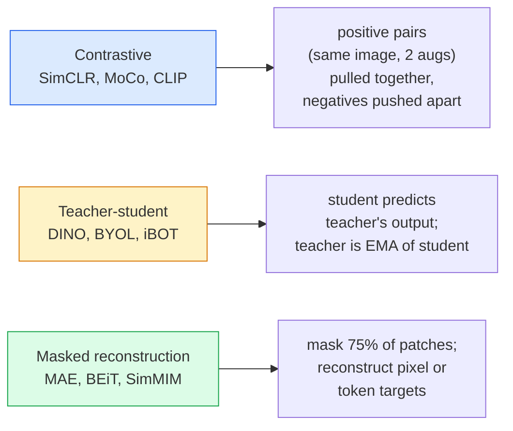

# 自监督视觉：SimCLR、DINO、MAE

> Labels 是 supervised vision 的瓶颈。Self-supervised pretraining 移除了这个瓶颈：先从 100M 张未标注图像中学习 visual features，再在 10k 张有标注图像上 fine-tune。

**Type:** Learn + Build
**Languages:** Python
**Prerequisites:** Phase 4 Lesson 04（Image Classification），Phase 4 Lesson 14（ViT）
**Time:** ~75 minutes

## 学习目标

- 跟踪三大 self-supervised families：contrastive（SimCLR）、teacher-student（DINO）、masked reconstruction（MAE），并说明每一种优化什么
- 从零实现 InfoNCE loss，并解释为什么 batch size 512 可行而 batch size 32 会失败
- 解释为什么 MAE 的 75% masking ratio 不是随意选择，以及它和 BERT 文本任务中的 15% 有什么不同
- 使用 DINOv2 或 MAE ImageNet checkpoints 做 linear probing 和 zero-shot retrieval

## 问题

Supervised ImageNet 有 1.3M 张 labelled images，据估算标注成本约为 1000 万美元。Medical 和 industrial datasets 更小，但标注成本更高。每个 vision team 都会问同一个问题：能不能先在便宜的 unlabelled data 上 pretrain，比如 YouTube frames、web crawls、webcam footage、satellite sweeps，再在小规模 labelled set 上 fine-tune？

Self-supervised learning 就是答案。一个在 LAION 或 JFT 上训练的现代 self-supervised ViT，fine-tune 后可以达到或超过 supervised ImageNet accuracy。它迁移到 downstream tasks（detection、segmentation、depth）时，也比 supervised pretraining 更强。DINOv2（Meta, 2023）和 MAE（Meta, 2022）是当前可迁移 vision features 的 production defaults。

概念上的转变在于：pretext task，也就是模型训练时执行的任务，不必等于 downstream task。重要的是它必须迫使模型学习有用的 features。预测灰度图的颜色、旋转图像并让模型分类旋转角度、mask patches 并重建它们，这些方法都有效。真正能 scale 的三条路线是 contrastive learning、teacher-student distillation 和 masked reconstruction。

## 概念

### 三大家族



### Contrastive learning（SimCLR）

取一张 image，应用两次 random augmentations，得到两个 views。把二者送入同一个 encoder 和 projection head。最小化一个 loss，含义是“这两个 embeddings 应该靠近”，同时“这个 embedding 应该远离 batch 中其他所有 image 的 embeddings”。

```text
Loss for positive pair (z_i, z_j) among 2N views per batch:

   L_ij = -log( exp(sim(z_i, z_j) / tau) / sum_k in batch \ {i} exp(sim(z_i, z_k) / tau) )

sim = cosine similarity
tau = temperature (0.1 standard)
```

这就是 InfoNCE loss。它要求每个 positive pair 周围有很多 negatives，所以 batch size 很重要：SimCLR 需要 512-8192。MoCo 引入了 past batches 的 momentum queue，把 negative count 和 batch size 解耦。

### Teacher-student（DINO）

两个网络使用相同 architecture：student 和 teacher。Teacher 是 student weights 的 exponential moving average（EMA）。二者都会看到同一张 image 的 augmented views。Student output 被训练成匹配 teacher output，不需要显式 negatives。

```text
loss = CE( student_output(view_1),  teacher_output(view_2) )
     + CE( student_output(view_2),  teacher_output(view_1) )

teacher_weights = m * teacher_weights + (1 - m) * student_weights   (m ≈ 0.996)
```

为什么它不会 collapse 成“预测一个常数”：teacher output 会被 centred（减去每个维度的均值）和 sharpened（除以较小 temperature）。Centering 防止某个维度支配输出；sharpening 防止输出塌缩成 uniform。

DINOv2 把 DINO 扩展到 142M 张 curated images。得到的 features 是当前 zero-shot visual retrieval 和 dense prediction 的 SOTA。

### Masked reconstruction（MAE）

Mask 一个 ViT input 中 75% 的 patches。只把可见的 25% 送入 encoder。一个小 decoder 接收 encoder output 和 masked positions 上的 mask tokens，并被训练去重建 masked patches 的 pixels。

```text
Encoder:  visible 25% of patches -> features
Decoder:  features + mask tokens at masked positions -> reconstructed pixels
Loss:     MSE between reconstructed and original pixels on masked patches only
```

让 MAE 有效的关键设计选择：

- **75% mask ratio**：非常高。它迫使 encoder 学习 semantic features；如果只重建 25%，任务几乎太简单（相邻 pixels 相关性太强，CNN 都能轻松完成）。
- **Asymmetric encoder/decoder**：大的 ViT encoder 只看 visible patches；小 decoder（8-layer、512-dim）负责 reconstruction。相比 naive BEiT，pretraining 快 3x。
- **Pixel-space reconstruction target**：比 BEiT 的 tokenised target 更简单，在 ViT 上效果更好。

Pretraining 结束后，丢弃 decoder。Encoder 就是 feature extractor。

### 为什么是 75%，不是 15%

BERT mask 15% 的 tokens。MAE mask 75% 的 patches。差别来自 information density。

- Natural language 每个 token 的 entropy 很高。预测 15% 的 tokens 依然很难，因为每个 masked position 都有很多合理补全。
- Image patches 的 entropy 很低：未 mask 的邻域往往几乎能完全决定 masked patch 的 pixels。为了让预测必须依赖 semantic understanding，你必须激进地 mask。

75% 足够高，简单的 spatial extrapolation 无法解决任务；encoder 必须表示 image content。

### Linear-probe evaluation

Self-supervised pretraining 之后，标准评估是 **linear probe**：冻结 encoder，在其上用 ImageNet labels 训练一个单层 linear classifier。报告 top-1 accuracy。

- SimCLR ResNet-50：~71%（2020）
- DINO ViT-S/16：~77%（2021）
- MAE ViT-L/16：~76%（2022）
- DINOv2 ViT-g/14：~86%（2023）

Linear probe 是 feature quality 的纯度量；fine-tuning 通常会再增加 2-5 个点，但也混入了 head retraining 的影响。

## Build It

### Step 1：Two-view augmentation pipeline

```python
import torch
import torchvision.transforms as T

two_view_train = lambda: T.Compose([
    T.RandomResizedCrop(96, scale=(0.2, 1.0)),
    T.RandomHorizontalFlip(),
    T.ColorJitter(0.4, 0.4, 0.4, 0.1),
    T.RandomGrayscale(p=0.2),
    T.ToTensor(),
])


class TwoViewDataset(torch.utils.data.Dataset):
    def __init__(self, base):
        self.base = base
        self.aug = two_view_train()

    def __len__(self):
        return len(self.base)

    def __getitem__(self, i):
        img, _ = self.base[i]
        v1 = self.aug(img)
        v2 = self.aug(img)
        return v1, v2
```

每次 `__getitem__` 都返回同一张 image 的两个 augmented views；不需要 labels。

### Step 2：InfoNCE loss

```python
import torch.nn.functional as F

def info_nce(z1, z2, tau=0.1):
    """
    z1, z2: (N, D) L2-normalised embeddings of paired views
    """
    N, D = z1.shape
    z = torch.cat([z1, z2], dim=0)  # (2N, D)
    sim = z @ z.T / tau              # (2N, 2N)

    mask = torch.eye(2 * N, dtype=torch.bool, device=z.device)
    sim = sim.masked_fill(mask, float("-inf"))

    targets = torch.cat([torch.arange(N, 2 * N), torch.arange(0, N)]).to(z.device)
    return F.cross_entropy(sim, targets)
```

调用前先对 embeddings 做 L2-normalise。`tau=0.1` 是 SimCLR default；更低的 tau 会让 loss 更 sharp，也需要更多 negatives。

### Step 3：Sanity check InfoNCE

```python
z1 = F.normalize(torch.randn(16, 32), dim=-1)
z2 = z1.clone()
loss_same = info_nce(z1, z2, tau=0.1).item()
z2_random = F.normalize(torch.randn(16, 32), dim=-1)
loss_random = info_nce(z1, z2_random, tau=0.1).item()
print(f"InfoNCE with identical pairs:  {loss_same:.3f}")
print(f"InfoNCE with random pairs:     {loss_random:.3f}")
```

Identical pairs 应该得到低 loss（大 batch 和低 temperature 时接近 0）。Random pairs 应该得到 `log(2N-1)`，在 16-pair batch 中约为 `log(31)`，也就是约 3.4。

### Step 4：MAE-style masking

```python
def random_mask_indices(num_patches, mask_ratio=0.75, seed=0):
    g = torch.Generator().manual_seed(seed)
    n_keep = int(num_patches * (1 - mask_ratio))
    perm = torch.randperm(num_patches, generator=g)
    visible = perm[:n_keep]
    masked = perm[n_keep:]
    return visible.sort().values, masked.sort().values


num_patches = 196
visible, masked = random_mask_indices(num_patches, mask_ratio=0.75)
print(f"visible: {len(visible)} / {num_patches}")
print(f"masked:  {len(masked)} / {num_patches}")
```

简单、快速，并且对给定 seed deterministic。真实 MAE implementations 会 batch 这个过程，并为每个 sample 保留独立 mask。

## Use It

DINOv2 是 2026 年的 production standard：

```python
import torch
from transformers import AutoImageProcessor, AutoModel

processor = AutoImageProcessor.from_pretrained("facebook/dinov2-base")
model = AutoModel.from_pretrained("facebook/dinov2-base")
model.eval()

# Per-image embeddings for zero-shot retrieval
with torch.no_grad():
    inputs = processor(images=[pil_image], return_tensors="pt")
    outputs = model(**inputs)
    embedding = outputs.last_hidden_state[:, 0]  # CLS token
```

得到的 768-dim embedding 是现代 image retrieval、dense correspondence 和 zero-shot transfer pipelines 的 backbone。对 downstream task fine-tune 时，通常只需要一个 linear head。

对于 image-text embeddings，SigLIP 或 OpenCLIP 是对应选择；对于 MAE-style fine-tuning，`timm` repo 提供所有 MAE checkpoints。

## Ship It

本课产出：

- `outputs/prompt-ssl-pretraining-picker.md`：一个 prompt，会根据 dataset size、compute 和 downstream task 选择 SimCLR / MAE / DINOv2。
- `outputs/skill-linear-probe-runner.md`：一个 skill，会为任意 frozen encoder + labelled dataset 编写 linear-probe evaluation。

## 练习

1. **（Easy）** 验证：对 aligned embeddings 降低 temperature 时，InfoNCE loss 会下降；对 random embeddings 降低 temperature 时，loss 会上升。画出 `tau in [0.05, 0.1, 0.2, 0.5]` vs loss。
2. **（Medium）** 实现一个 DINO-style centre buffer。展示如果没有 centring，student 会在几个 epochs 内 collapse 成 constant vector。
3. **（Hard）** 使用 Lesson 10 的 TinyUNet 作为 backbone，在 CIFAR-100 上训练 MAE。报告 10、50、200 epochs 时的 linear-probe accuracy。展示 MAE-pretrained linear probe 在同一个 1,000-image subset 上优于 from-scratch supervised linear probe。

## 关键术语

| Term | 大家常说 | 实际含义 |
|------|----------|----------|
| Self-supervised | “Label-free” | 使用 pretext task，从 unlabelled data 中产生有用 representations |
| Pretext task | “The fake task” | SSL 期间使用的 objective（reconstruct patches、match views）；pretraining 后丢弃 |
| Linear probe | “Frozen encoder + linear head” | 标准 SSL evaluation：只在 frozen features 上训练 linear classifier |
| InfoNCE | “Contrastive loss” | 对 cosine similarities 做 softmax；positive pair 是 target class，其余都是 negatives |
| EMA teacher | “Moving-average teacher” | 权重是 student exponential moving average 的 teacher；BYOL、MoCo、DINO 都使用 |
| Mask ratio | “% of patches hidden” | MAE 中被 mask 的 patches 比例；vision 用 75%，text 用 15% |
| Representation collapse | “Constant output” | SSL 失败模式：encoder 对所有 inputs 输出 constant vector；通过 centring、sharpening 或 negatives 避免 |
| DINOv2 | “Production SSL backbone” | Meta 2023 年的 self-supervised ViT；2026 年最强的 general-purpose image features |

## 延伸阅读

- [SimCLR（Chen et al., 2020）](https://arxiv.org/abs/2002.05709)：contrastive learning reference
- [DINO（Caron et al., 2021）](https://arxiv.org/abs/2104.14294)：带 momentum、centring、sharpening 的 teacher-student
- [MAE（He et al., 2022）](https://arxiv.org/abs/2111.06377)：用于 ViT 的 masked autoencoder pretraining
- [DINOv2（Oquab et al., 2023）](https://arxiv.org/abs/2304.07193)：把 self-supervised ViT scale 到 production features
