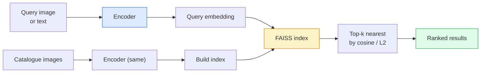

# 图像检索与 Metric Learning

> Retrieval system 会根据 embedding space 中的距离给候选项排序。Metric learning 则是塑造这个空间，让距离表达你真正想要的相似性。

**Type:** Build
**Languages:** Python
**Prerequisites:** Phase 4 Lesson 14（ViT），Phase 4 Lesson 18（CLIP）
**Time:** ~45 minutes

## 学习目标

- 解释 triplet、contrastive 和 proxy-based metric learning losses，并为给定 dataset 选择合适的 loss
- 正确实现 L2-normalisation 和 cosine similarity，并审计 “same item” retrieval 与 “same class” retrieval 的区别
- 构建 FAISS index，用 text 和 image 查询它，并为 held-out query set 报告 recall@K
- 使用 DINOv2、CLIP 和 SigLIP 作为现成 embedding backbones，并知道它们各自什么时候更强

## 问题

Retrieval 在 production vision 中无处不在：duplicate detection、reverse image search、visual search（“find similar products”）、face re-identification、监控中的 person re-ID、电商中的 instance-level matching。产品问题始终相同：“给定这张 query image，给我的 catalogue 排序。”

两个设计决策塑造整个系统。Embedding：哪个模型产生 vectors。Index：如何在规模化场景中寻找 nearest neighbours。到 2026 年，两者都已经商品化（embedding 用 DINOv2，index 用 FAISS），这也抬高了门槛：真正困难的部分是定义你的应用中 *什么才算相似*，然后塑造 embedding space，让距离与这个定义一致。

这种塑造就是 metric learning。它是一个很小但杠杆很高的领域。

## 概念

### Retrieval 一览



### 四类 loss families

| Loss | Requires | Pros | Cons |
|------|----------|------|------|
| **Contrastive** | (anchor, positive) + negatives | 简单，可用于任意 pair label | 如果 negatives 不够多，convergence 慢 |
| **Triplet** | (anchor, positive, negative) | 直观；margin control 直接 | Hard-triplet mining 昂贵 |
| **NT-Xent / InfoNCE** | Pairs + batch-mined negatives | 能扩展到大 batch | 需要大 batch 或 momentum queue |
| **Proxy-based (ProxyNCA)** | 只有 class labels | 快、稳定、不需要 mining | 小 datasets 上可能 overfit 到 proxies |

对于大多数 production use cases，从 pretrained backbone 开始。只有当 off-the-shelf embeddings 在你的 test set 上表现不足时，才加入 metric-learning fine-tune。

### Triplet loss 的形式化定义

```text
L = max(0, ||f(a) - f(p)||^2 - ||f(a) - f(n)||^2 + margin)
```

把 anchor `a` 拉近 positive `p`，推远 negative `n`，并通过 `margin` 保证二者之间有间隔。这个三图结构可以推广到任何 similarity ordering。

Mining 很重要：easy triplets（`n` 已经离 `a` 很远）贡献零 loss；只有 hard triplets 会教会网络。Semi-hard mining（`n` 比 `p` 远，但仍在 margin 内）是 2016 年 FaceNet recipe，今天依然占主导。

### Cosine similarity vs L2

两种 metrics，两套约定：

- **Cosine**：vectors 之间的角度。需要 L2-normalised embeddings。
- **L2**：Euclidean distance。可以用于 raw 或 normalised embeddings，但通常搭配 L2-normalised + squared L2。

对大多数现代网络来说，两者等价：当 `||a|| = ||b|| = 1` 时，`||a - b||^2 = 2 - 2 cos(a, b)`。选择与你的 embedding training 匹配的约定；混用会悄悄改变 “nearest” 的含义。

### Recall@K

标准 retrieval metric：

```text
recall@K = fraction of queries where at least one correct match is in the top K results
```

并排报告 recall@1、@5、@10。如果 recall@10 高于 0.95，但 recall@1 低于 0.5，说明 embedding space 的结构是对的，但 ranking 有噪声，可以尝试更长的 fine-tune 或 re-ranking step。

对 duplicate detection 来说，precision@K 更重要，因为每个 false positive 都是用户可见的错误。对 visual search 来说，recall@K 才是产品信号。

### 用一段话理解 FAISS

Facebook AI Similarity Search。Nearest-neighbour search 的事实标准库。三种 index 选择：

- `IndexFlatIP` / `IndexFlatL2`：brute force、exact、不需要 training。最多可用于约 1M vectors。
- `IndexIVFFlat`：划分成 K 个 cells，只搜索最近的几个 cells。Approximate、快，需要 training data。
- `IndexHNSW`：graph-based，对大量 queries 最快，但 index size 大。

对于 100k vectors，你大概率应该在 cosine similarity 上使用 `IndexFlatIP`。对于 10M，使用 `IndexIVFFlat`。对于 100M+，配合 product quantisation（`IndexIVFPQ`）。

### Instance-level vs category-level retrieval

两个名字相同但完全不同的问题：

- **Category-level**：“在我的 catalogue 中找 cats。”Class-conditional similarity；现成 CLIP / DINOv2 embeddings 通常表现很好。
- **Instance-level**：“在 catalogue 中找 *这个 exact product*。”需要区分同一类别下视觉上很相似的 objects；现成 embeddings 通常表现不足；用 metric learning fine-tuning 很重要。

选模型之前，永远先问清楚你在解决哪一个问题。

## Build It

### Step 1: Triplet loss

```python
import torch
import torch.nn.functional as F

def triplet_loss(anchor, positive, negative, margin=0.2):
    d_ap = F.pairwise_distance(anchor, positive, p=2)
    d_an = F.pairwise_distance(anchor, negative, p=2)
    return F.relu(d_ap - d_an + margin).mean()
```

一行。可用于 L2-normalised 或 raw embeddings。

### Step 2: Semi-hard mining

给定一批 embeddings 和 labels，为每个 anchor 找到最难的 semi-hard negative。

```python
def semi_hard_negatives(emb, labels, margin=0.2):
    dist = torch.cdist(emb, emb)
    same_class = labels[:, None] == labels[None, :]
    diff_class = ~same_class
    N = emb.size(0)

    positives = dist.clone()
    positives[~same_class] = float("-inf")
    positives.fill_diagonal_(float("-inf"))
    pos_idx = positives.argmax(dim=1)

    semi_hard = dist.clone()
    semi_hard[same_class] = float("inf")
    d_ap = dist[torch.arange(N), pos_idx].unsqueeze(1)
    semi_hard[dist <= d_ap] = float("inf")
    neg_idx = semi_hard.argmin(dim=1)

    fallback_mask = semi_hard[torch.arange(N), neg_idx] == float("inf")
    if fallback_mask.any():
        hardest = dist.clone()
        hardest[same_class] = float("inf")
        neg_idx = torch.where(fallback_mask, hardest.argmin(dim=1), neg_idx)
    return pos_idx, neg_idx
```

每个 anchor 都会得到 class 内最难的 positive，以及一个比 positive 更远、但仍在 margin 内的 semi-hard negative。

### Step 3: Recall@K

```python
def recall_at_k(query_emb, gallery_emb, query_labels, gallery_labels, k=1):
    sim = query_emb @ gallery_emb.T
    _, top_k = sim.topk(k, dim=-1)
    matches = (gallery_labels[top_k] == query_labels[:, None]).any(dim=-1)
    return matches.float().mean().item()
```

在 L2-normalised embeddings 上，按 inner product 取 top-k 等价于按 cosine 取 top-k。返回的是至少命中一个正确 neighbour 的 queries 平均比例。

### Step 4: 组合起来

```python
import torch
import torch.nn as nn
from torch.optim import Adam

class Encoder(nn.Module):
    def __init__(self, in_dim=128, emb_dim=64):
        super().__init__()
        self.net = nn.Sequential(
            nn.Linear(in_dim, 128), nn.ReLU(),
            nn.Linear(128, emb_dim),
        )

    def forward(self, x):
        return F.normalize(self.net(x), dim=-1)

torch.manual_seed(0)
num_classes = 6
protos = F.normalize(torch.randn(num_classes, 128), dim=-1)

def sample_batch(bs=32):
    labels = torch.randint(0, num_classes, (bs,))
    x = protos[labels] + 0.15 * torch.randn(bs, 128)
    return x, labels

enc = Encoder()
opt = Adam(enc.parameters(), lr=3e-3)

for step in range(200):
    x, y = sample_batch(32)
    emb = enc(x)
    pos_idx, neg_idx = semi_hard_negatives(emb, y)
    loss = triplet_loss(emb, emb[pos_idx], emb[neg_idx])
    opt.zero_grad(); loss.backward(); opt.step()
```

几百步之后，embedding clusters 会形成每个 class 一个 cluster 的结构。

## Use It

2026 年的 production stacks：

- **DINOv2 + FAISS**：通用 visual retrieval。开箱即用。
- **CLIP + FAISS**：当 queries 是 text 时使用。
- **Fine-tuned DINOv2 + FAISS**：instance-level retrieval、face re-ID、fashion、电商。
- **Milvus / Weaviate / Qdrant**：托管式 vector DB，底层通常包装 FAISS 或 HNSW。

SOTA instance retrieval 的 recipe 是：DINOv2 backbone，添加 embedding head，在 instance-labelled pairs 上用 triplet 或 InfoNCE loss fine-tune，然后放进 FAISS 建索引。

## Ship It

这一课产出：

- `outputs/prompt-retrieval-loss-picker.md`：一个 prompt，为给定 retrieval problem 选择 triplet / InfoNCE / ProxyNCA。
- `outputs/skill-recall-at-k-runner.md`：一个 skill，用清晰的数据契约为 recall@K 写 evaluation harness，包含 train/val/gallery splits。

## 练习

1. **（Easy）** 运行上面的 toy example。用 PCA 在训练前后绘制 embeddings，观察六个 clusters 如何形成。
2. **（Medium）** 添加 ProxyNCA loss 实现：每个 class 一个 learned “proxy”，在 cosine similarity 上做标准 cross-entropy。比较 toy data 上它与 triplet loss 的 convergence speed。
3. **（Hard）** 取 1,000 张 ImageNet validation images，用 HuggingFace 的 DINOv2 生成 embeddings，构建 FAISS flat index，并在同一批 images 作为 queries 时报告 recall@{1, 5, 10}（应该是 1.0），再用 ImageNet labels 作为 ground truth 在 held-out split 上报告指标。

## 关键术语

| Term | What people say | What it actually means |
|------|----------------|----------------------|
| Metric learning | “Shape the space” | 训练 encoder，使它输出空间中的距离反映目标相似性 |
| Triplet loss | “Pull and push” | `L = max(0, d(a, p) - d(a, n) + margin)`；经典 metric-learning loss |
| Semi-hard mining | “Useful negatives” | 比 positive 离 anchor 更远、但仍在 margin 内的 negatives；经验上信息量最高 |
| Proxy-based loss | “Class prototypes” | 每个 class 一个 learned proxy；对 similarity-to-proxies 做 cross-entropy；不需要 pair mining |
| Recall@K | “Top-K hit rate” | Top K 中至少有一个正确结果的 queries 占比 |
| Instance retrieval | “Find this exact thing” | 细粒度匹配；现成 features 通常表现不足 |
| FAISS | “The NN library” | Facebook 的 nearest-neighbour library；支持 exact 和 approximate indexes |
| HNSW | “Graph index” | Hierarchical navigable small world；内存开销较小、速度很快的 approximate NN |

## 延伸阅读

- [FaceNet: A Unified Embedding for Face Recognition（Schroff et al., 2015）](https://arxiv.org/abs/1503.03832)：triplet loss / semi-hard mining paper
- [In Defense of the Triplet Loss for Person Re-Identification（Hermans et al., 2017）](https://arxiv.org/abs/1703.07737)：triplet fine-tuning 实践指南
- [FAISS documentation](https://github.com/facebookresearch/faiss/wiki)：所有 index 与 trade-off
- [SMoT: Metric Learning Taxonomy（Kim et al., 2021）](https://arxiv.org/abs/2010.06927)：现代 losses 及其联系的综述
