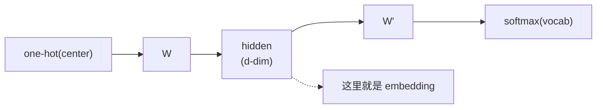

# 词嵌入 — 从零实现 Word2Vec

> 一个词的含义，取决于它周围的词。用这个想法训练一个浅层网络，几何结构就会浮现。

**Type:** Build
**Languages:** Python
**Prerequisites:** Phase 5 · 02（BoW + TF-IDF），Phase 3 · 03（Backpropagation from Scratch）
**Time:** ~75 minutes

## 问题

TF-IDF 知道 `dog` 和 `puppy` 是不同的词。它不知道它们的含义几乎相同。一个在 `dog` 上学到信号的分类器，不能自然泛化到关于 `puppy` 的评论。你可以用同义词列表把这个洞补上，但遇到低频词、领域黑话，以及任何你没预料到的语言时，这个办法都会失效。

你想要一种表示，让 `dog` 和 `puppy` 在空间里靠得很近。让 `king - man + woman` 落在 `queen` 附近。让一个在 `dog` 上训练过的模型，免费把部分信号迁移到 `puppy`。

Word2Vec 给了我们这样的空间。两层神经网络，万亿 token 级训练，2013 年发表。它的架构简单到近乎令人不好意思。它的结果却重塑了 NLP 十年。

## 概念

**分布假说**（Firth，1957）："You shall know a word by the company it keeps." 你可以通过一个词周围出现的词来认识它。如果两个词出现在相似上下文里，它们的含义很可能也相似。

Word2Vec 有两种形式，都在利用这个想法。

- **Skip-gram。** 给定中心词，预测周围词。窗口大小为 2 时，`cat -> (the, sat, on)`。
- **CBOW（continuous bag of words）。** 给定周围词，预测中心词。`(the, sat, on) -> cat`。

Skip-gram 训练更慢，但更擅长处理低频词。它后来成了默认选择。

这个网络只有一个隐藏层，而且没有非线性。输入是词表上的 one-hot 向量。输出是词表上的 softmax。训练完成后，你丢掉输出层。隐藏层权重就是词嵌入。



真正的技巧在这里：对 10 万个词做 softmax 太贵了。Word2Vec 使用**负采样**，把问题变成一个二分类任务。预测“这个上下文词是否真的出现在这个中心词附近，是或否”。每个训练样本只采几个负样本（没有共同出现的词），而不是对整个词表计算 softmax。

```figure
word-vector-arithmetic
```

## Build It

### 第 1 步：从语料生成训练词对

```python
def skipgram_pairs(docs, window=2):
    pairs = []
    for doc in docs:
        for i, center in enumerate(doc):
            for j in range(max(0, i - window), min(len(doc), i + window + 1)):
                if i == j:
                    continue
                pairs.append((center, doc[j]))
    return pairs
```

```python
>>> skipgram_pairs([["the", "cat", "sat", "on", "mat"]], window=2)
[('the', 'cat'), ('the', 'sat'),
 ('cat', 'the'), ('cat', 'sat'), ('cat', 'on'),
 ('sat', 'the'), ('sat', 'cat'), ('sat', 'on'), ('sat', 'mat'),
 ...]
```

窗口内的每个 `(center, context)` 词对，都是一个正训练样本。

### 第 2 步：嵌入表

两张矩阵。`W` 是中心词嵌入表（你最后保留的那张）。`W'` 是上下文词表（通常丢弃，有时也会和 `W` 取平均）。

```python
import numpy as np


def init_embeddings(vocab_size, dim, seed=0):
    rng = np.random.default_rng(seed)
    W = rng.normal(0, 0.1, size=(vocab_size, dim))
    W_prime = rng.normal(0, 0.1, size=(vocab_size, dim))
    return W, W_prime
```

小随机值初始化。词表大小 10k、维度 100 是现实设置；教学时，50 个词、16 维已经足够看见几何结构。

### 第 3 步：负采样目标

对每个正样本 `(center, context)`，从词表中随机采 `k` 个词作为负样本。训练目标是让 `W[center] · W'[context]` 对正样本较高，对负样本较低。

```python
def sigmoid(x):
    return 1.0 / (1.0 + np.exp(-np.clip(x, -20, 20)))


def train_pair(W, W_prime, center_idx, context_idx, negative_indices, lr):
    v_c = W[center_idx]
    u_pos = W_prime[context_idx]
    u_negs = W_prime[negative_indices]

    pos_score = sigmoid(v_c @ u_pos)
    neg_scores = sigmoid(u_negs @ v_c)

    grad_center = (pos_score - 1) * u_pos
    for i, u in enumerate(u_negs):
        grad_center += neg_scores[i] * u

    W[context_idx] = W[context_idx]
    W_prime[context_idx] -= lr * (pos_score - 1) * v_c
    for i, neg_idx in enumerate(negative_indices):
        W_prime[neg_idx] -= lr * neg_scores[i] * v_c
    W[center_idx] -= lr * grad_center
```

核心公式是：正词对上的 logistic loss（希望 sigmoid 接近 1），加上负词对上的 logistic loss（希望 sigmoid 接近 0）。梯度会流向两张表。完整推导在原论文里；如果你想真正记住它，用纸笔走一遍会很有帮助。

### 第 4 步：在玩具语料上训练

```python
def train(docs, dim=16, window=2, k_neg=5, epochs=100, lr=0.05, seed=0):
    vocab = build_vocab(docs)
    vocab_size = len(vocab)
    rng = np.random.default_rng(seed)
    W, W_prime = init_embeddings(vocab_size, dim, seed=seed)
    pairs = skipgram_pairs(docs, window=window)

    for epoch in range(epochs):
        rng.shuffle(pairs)
        for center, context in pairs:
            c_idx = vocab[center]
            ctx_idx = vocab[context]
            negs = rng.integers(0, vocab_size, size=k_neg)
            negs = [n for n in negs if n != ctx_idx and n != c_idx]
            train_pair(W, W_prime, c_idx, ctx_idx, negs, lr)
    return vocab, W
```

在足够大的语料上训练足够多轮之后，共享上下文的词会拥有相似的中心词嵌入。在玩具语料上，你只能隐约看见这个效果。在数十亿 token 上，它会非常明显。

### 第 5 步：类比技巧

```python
def nearest(vocab, W, target_vec, topk=5, exclude=None):
    exclude = exclude or set()
    inv_vocab = {i: w for w, i in vocab.items()}
    norms = np.linalg.norm(W, axis=1, keepdims=True) + 1e-9
    W_norm = W / norms
    target = target_vec / (np.linalg.norm(target_vec) + 1e-9)
    sims = W_norm @ target
    order = np.argsort(-sims)
    out = []
    for i in order:
        if i in exclude:
            continue
        out.append((inv_vocab[i], float(sims[i])))
        if len(out) == topk:
            break
    return out


def analogy(vocab, W, a, b, c, topk=5):
    v = W[vocab[b]] - W[vocab[a]] + W[vocab[c]]
    return nearest(vocab, W, v, topk=topk, exclude={vocab[a], vocab[b], vocab[c]})
```

在预训练的 300d Google News 向量上：

```python
>>> analogy(vocab, W, "man", "king", "woman")
[('queen', 0.71), ('monarch', 0.62), ('princess', 0.59), ...]
```

`king - man + woman = queen`。不是因为模型知道什么是王室。是因为向量 `(king - man)` 捕捉到了类似“王权”的东西，把它加到 `woman` 上，就会落到“王室女性”区域附近。

## Use It

从零写 Word2Vec 是为了教学。生产级 NLP 使用 `gensim`。

```python
from gensim.models import Word2Vec

sentences = [
    ["the", "cat", "sat", "on", "the", "mat"],
    ["the", "dog", "ran", "across", "the", "room"],
]

model = Word2Vec(
    sentences,
    vector_size=100,
    window=5,
    min_count=1,
    sg=1,
    negative=5,
    workers=4,
    epochs=30,
)

print(model.wv["cat"])
print(model.wv.most_similar("cat", topn=3))
```

真实工作中，你几乎不会自己训练 Word2Vec。你会下载预训练向量。

- **GloVe** — Stanford 的共现矩阵分解方法。提供 50d、100d、200d、300d checkpoint。通用覆盖面很好。第 04 课专门讲 GloVe。
- **fastText** — Facebook 对 Word2Vec 的扩展，把字符 n-gram 也嵌入进去。它可以通过组合子词处理词表外词。第 04 课会讲。
- **Google News 上的预训练 Word2Vec** — 300d、300 万词词表，2013 年发布。今天仍然每天都有人下载。

### Word2Vec 在 2026 年仍然胜出的地方

- 轻量级领域检索。在笔记本上用一小时训练医学摘要，就能得到通用模型捕捉不到的专用向量。
- 类比式特征工程。`gender_vector = mean(man - woman pairs)`。从其他词里减掉它，可以得到一个性别中性轴。公平性研究里仍然会用到。
- 可解释性。100d 小到可以用 PCA 或 t-SNE 画出来，并且真的看见聚类形成。
- 任何需要在设备端、无 GPU 推理的地方。Word2Vec 查询只是取一行。

### Word2Vec 失败的地方

多义词之墙。`bank` 只有一个向量。`river bank` 和 `financial bank` 共用它。`table`（电子表格 vs. 家具）也共用一个向量。下游分类器无法仅凭这个向量区分不同含义。

上下文嵌入（ELMo、BERT，以及之后每个 transformer）通过根据周围上下文，为词的每一次出现生成不同向量，解决了这个问题。这就是从 Word2Vec 到 BERT 的跃迁：从静态到上下文。第 7 阶段会讲 transformer 这一半。

词表外问题是另一个失败点。如果训练数据里没有见过 `Zoomer-approved`，Word2Vec 就无法产生它的向量。没有兜底。fastText 用子词组合修复了这一点（第 04 课）。

## Ship It

保存为 `outputs/skill-embedding-probe.md`：

```markdown
---
name: embedding-probe
description: Inspect a word2vec model. Run analogies, find neighbors, diagnose quality.
version: 1.0.0
phase: 5
lesson: 03
tags: [nlp, embeddings, debugging]
---

You probe trained word embeddings to verify they are working. Given a `gensim.models.KeyedVectors` object and a vocabulary, you run:

1. Three canonical analogy tests. `king : man :: queen : woman`. `paris : france :: tokyo : japan`. `walking : walked :: swimming : ?`. Report the top-1 result and its cosine.
2. Five nearest-neighbor tests on domain-specific words the user supplies. Print top-5 neighbors with cosines.
3. One symmetry check. `similarity(a, b) == similarity(b, a)` to within float precision.
4. One degenerate check. If any embedding has a norm below 0.01 or above 100, the model has a training bug. Flag it.

Refuse to declare a model good on analogy accuracy alone. Analogy benchmarks are gameable and do not transfer to downstream tasks. Recommend intrinsic + downstream evaluation together.
```

## 练习

1. **Easy.** 在一个极小语料上运行训练循环（20 个关于猫和狗的句子）。200 个 epoch 后，确认 `nearest(vocab, W, W[vocab["cat"]])` 的前三名里有 `dog`。如果没有，增加 epoch 或词表规模。
2. **Medium.** 加入高频词 subsampling。频率高于 `10^-5` 的词，会按与词频成比例的概率从训练词对中丢弃。测量它对低频词相似度的影响。
3. **Hard.** 在 20 Newsgroups 语料上训练模型。计算两个偏见轴：`he - she` 和 `doctor - nurse`。把职业词投影到这两个轴上。报告哪些职业的偏见差距最大。这就是公平性研究者会使用的一类探针。

## 关键术语

| 术语 | 人们常说 | 实际含义 |
|------|----------|----------|
| 词嵌入 | 把词变成向量 | 一种从上下文中学习到的稠密、低维（通常 100-300 维）表示。 |
| Skip-gram | Word2Vec 技巧 | 从中心词预测上下文词。比 CBOW 慢，但更适合低频词。 |
| 负采样 | 训练捷径 | 用针对 `k` 个随机词的二分类，替代对完整词表做 softmax。 |
| 静态嵌入 | 每个词一个向量 | 不管上下文如何，都是同一个向量。会在多义词上失败。 |
| 上下文嵌入 | 对上下文敏感的向量 | 根据周围词，为每一次出现生成不同向量。Transformer 产出的就是这种表示。 |
| OOV | Out of vocabulary | 训练时没见过的词。Word2Vec 无法为这些词生成向量。 |

## 延伸阅读

- [Mikolov et al. (2013). Distributed Representations of Words and Phrases and their Compositionality](https://arxiv.org/abs/1310.4546) — 负采样论文。短，而且可读。
- [Rong, X. (2014). word2vec Parameter Learning Explained](https://arxiv.org/abs/1411.2738) — 如果原论文的数学太密，这是最清楚的梯度推导。
- [gensim Word2Vec tutorial](https://radimrehurek.com/gensim/models/word2vec.html) — 真正在生产中可用的训练设置。
