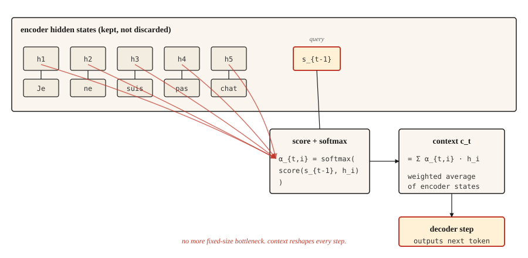

# 注意力机制 — 突破点

> Decoder 不再眯着眼看一个压缩摘要，而是开始看整个 source。此后的一切，都是 attention 加工程。

**Type:** Build
**Languages:** Python
**Prerequisites:** Phase 5 · 09 (Sequence-to-Sequence Models)
**Time:** ~45 minutes

## 问题

第 09 课以一个可测量的失败结束：在 toy copy task 上训练的 GRU encoder-decoder，长度为 5 时准确率有 89%，长度到 80 时几乎退回随机水平。原因是结构性的，不是训练 bug：encoder 得到的所有信息都必须塞进一个固定大小的 hidden state，而 decoder 再也看不到别的东西。

Bahdanau、Cho 和 Bengio 在 2014 年发表了一个三行修复。不要只把最终 encoder state 交给 decoder，而是保留每个 encoder state。在每个 decoder step，计算 encoder states 的加权平均，其中权重表示“decoder 此刻需要看 encoder 位置 `i` 的程度”。这个加权平均就是 context，而且它会在每个 decoder step 改变。

这就是全部想法。Transformers 扩展了它。Self-attention 把它应用到单个 sequence 上。Multi-head attention 并行运行它。但 2014 年的版本已经打破了瓶颈；一旦你理解它，转向 transformers 主要是工程问题，而不是概念问题。

## 概念



在每个 decoder step `t`：

1. 使用上一个 decoder hidden state `s_{t-1}` 作为 **query**。
2. 把它和每个 encoder hidden state `h_1, ..., h_T` 打分。每个 encoder 位置得到一个 scalar。
3. 对 scores 做 softmax，得到 attention weights `α_{t,1}, ..., α_{t,T}`，它们加起来为 1。
4. Context vector `c_t = Σ α_{t,i} * h_i`。也就是 encoder states 的加权平均。
5. Decoder 接收 `c_t` 和上一个 output token，生成下一个 token。

加权平均是重点。当 decoder 需要把 “Je” 翻译成 “I” 时，它会给 “Je” 上方的 encoder state 高权重，给其他位置低权重。当它需要 “not” 时，它会给 “pas” 高权重。Context vector 每一步都会重新塑形。

## Shapes（最容易咬人的地方）

每个人第一次实现 attention 时，几乎都会在这里出错。慢慢读。

| Thing | Shape | Notes |
|-------|-------|-------|
| Encoder hidden states `H` | `(T_enc, d_h)` | 如果是 BiLSTM，`d_h = 2 * d_hidden` |
| Decoder hidden state `s_{t-1}` | `(d_s,)` | 一个向量 |
| Attention score `e_{t,i}` | scalar | 每个 encoder 位置一个 |
| Attention weight `α_{t,i}` | scalar | 对所有 `i` softmax 之后 |
| Context vector `c_t` | `(d_h,)` | 和一个 encoder state 同形状 |

**Bahdanau（additive）score。** `e_{t,i} = v_α^T * tanh(W_a * s_{t-1} + U_a * h_i)`。

- `s_{t-1}` 的 shape 是 `(d_s,)`，`h_i` 的 shape 是 `(d_h,)`。
- `W_a` 的 shape 是 `(d_attn, d_s)`。`U_a` 的 shape 是 `(d_attn, d_h)`。
- 它们在 tanh 里面相加后的 shape 是 `(d_attn,)`。
- `v_α` 的 shape 是 `(d_attn,)`。和 `v_α` 做 inner product 后会压成一个 scalar。**这就是 `v_α` 的作用。** 它不是魔法。它是把 attention-dim vector 投影成 scalar score 的那一步。

**Luong（multiplicative）score。** 三个变体：

- `dot`：`e_{t,i} = s_t^T * h_i`。要求 `d_s == d_h`。这是硬约束。如果你的 encoder 是 bidirectional，就跳过它。
- `general`：`e_{t,i} = s_t^T * W * h_i`，其中 `W` 的 shape 是 `(d_s, d_h)`。它移除了 equal-dim 约束。
- `concat`：本质上是 Bahdanau 形式。因为前两个更便宜，所以现在很少用。

**一个值得点名的 Bahdanau / Luong 坑。** Bahdanau 使用 `s_{t-1}`（生成当前 word 之前的 decoder state）。Luong 使用 `s_t`（生成之后的 state）。把它们混用会产生非常隐蔽、极难 debug 的错误梯度。选一篇论文的 convention，然后坚持到底。

```figure
attention-heatmap
```

## 动手构建

### Step 1：additive（Bahdanau）attention

```python
import numpy as np


def additive_attention(decoder_state, encoder_states, W_a, U_a, v_a):
    projected_dec = W_a @ decoder_state
    projected_enc = encoder_states @ U_a.T
    combined = np.tanh(projected_enc + projected_dec)
    scores = combined @ v_a
    weights = softmax(scores)
    context = weights @ encoder_states
    return context, weights


def softmax(x):
    x = x - np.max(x)
    e = np.exp(x)
    return e / e.sum()
```

用上面的表检查你的 shapes。`encoder_states` 的 shape 是 `(T_enc, d_h)`。`projected_enc` 的 shape 是 `(T_enc, d_attn)`。`projected_dec` 的 shape 是 `(d_attn,)`，会 broadcast。`combined` 的 shape 是 `(T_enc, d_attn)`。`scores` 的 shape 是 `(T_enc,)`。`weights` 的 shape 是 `(T_enc,)`。`context` 的 shape 是 `(d_h,)`。可以交付。

### Step 2：Luong dot 和 general

```python
def dot_attention(decoder_state, encoder_states):
    scores = encoder_states @ decoder_state
    weights = softmax(scores)
    return weights @ encoder_states, weights


def general_attention(decoder_state, encoder_states, W):
    projected = W.T @ decoder_state
    scores = encoder_states @ projected
    weights = softmax(scores)
    return weights @ encoder_states, weights
```

每个都是三行。这就是 Luong 论文能落地的原因。多数任务上准确率差不多，但代码少很多。

### Step 3：一个数值例子

给定三个 encoder states（大致对应 “cat”、“sat”、“mat”）和一个最接近第一个位置的 decoder state，attention distribution 会集中在位置 0。如果 decoder state 转向更接近最后一个 encoder state，attention 就会移动到位置 2。Context vector 会跟着变。

```python
H = np.array([
    [1.0, 0.0, 0.2],
    [0.5, 0.5, 0.1],
    [0.1, 0.9, 0.3],
])

s_close_to_cat = np.array([0.9, 0.1, 0.2])
ctx, w = dot_attention(s_close_to_cat, H)
print("weights:", w.round(3))
```

```text
weights: [0.464 0.305 0.231]
```

第一行获胜。然后把 decoder state 移到更接近第三个 encoder state，再观察 weights 如何偏移。就是这样。Attention 是显式 alignment。

### Step 4：为什么这是通往 transformers 的桥

把上面的语言翻译成 Q/K/V：

- **Query** = decoder state `s_{t-1}`
- **Key** = encoder states（我们拿来打分的对象）
- **Value** = encoder states（我们加权求和的对象）

在经典 attention 中，keys 和 values 是同一个东西。Self-attention 把它们拆开：你可以让一个 sequence query 它自己，并为 K 和 V 使用不同的 learned projections。Multi-head attention 用不同的 learned projections 并行运行它。Transformers 把整套阶段堆叠很多次，并去掉 RNN。

数学是一样的。Shapes 是一样的。从 Bahdanau attention 跳到 scaled dot-product attention，教学上的跨度主要是记号变化。

## 使用它

PyTorch 和 TensorFlow 都直接提供 attention。

```python
import torch
import torch.nn as nn

mha = nn.MultiheadAttention(embed_dim=128, num_heads=8, batch_first=True)
query = torch.randn(2, 5, 128)
key = torch.randn(2, 10, 128)
value = torch.randn(2, 10, 128)

output, weights = mha(query, key, value)
print(output.shape, weights.shape)
```

```text
torch.Size([2, 5, 128]) torch.Size([2, 5, 10])
```

这就是一个 transformer attention layer。Query batch 有 5 个位置，key/value batch 有 10 个位置，每个都是 128 维，8 个 heads。`output` 是新的、带 context 的 queries。`weights` 是你可以可视化的 5x10 alignment matrix。

### 经典 attention 什么时候仍然重要

- 教学。Single-head、single-layer、RNN-based 版本能让每个概念都看得见。
- Transformers 放不下的 on-device sequence tasks。
- 2014-2017 年的任何论文。如果不知道 Bahdanau convention，你会读错。
- MT 中的细粒度 alignment analysis。即使在 transformer models 上，raw attention weights 也是一种 interpretability tool；要读懂它们，你需要知道它们是什么。

### attention-weight-as-explanation 陷阱

Attention weights 看起来很可解释。它们是跨位置求和为 1 的权重；可以画图；高值看起来表示“看了这里”。Reviewers 很喜欢它们。

但它们没有看起来那么可解释。Jain 和 Wallace（2019）展示过，在某些任务中，可以置换 attention distributions，甚至替换成任意其他分布，而模型预测不变。不要把 attention weights 当作推理证据来报告，除非你做了 ablation 或 counterfactual check。

## 交付它

保存为 `outputs/prompt-attention-shapes.md`：

```markdown
---
name: attention-shapes
description: Debug shape bugs in attention implementations.
phase: 5
lesson: 10
---

Given a broken attention implementation, you identify the shape mismatch. Output:

1. Which matrix has the wrong shape. Name the tensor.
2. What its shape should be, derived from (d_s, d_h, d_attn, T_enc, T_dec, batch_size).
3. One-line fix. Transpose, reshape, or project.
4. A test to catch regressions. Typically: assert `output.shape == (batch, T_dec, d_h)` and `weights.shape == (batch, T_dec, T_enc)` and `weights.sum(dim=-1) close to 1`.

Refuse to recommend fixes that silently broadcast. Broadcast-hiding bugs surface later as silent accuracy degradation, the worst kind of attention bug.

For Bahdanau confusion, insist the decoder input is `s_{t-1}` (pre-step state). For Luong, `s_t` (post-step state). For dot-product, flag dimension mismatch between query and key as the most common first-time error.
```

## 练习

1. **Easy.** 实现 `softmax` masking，让 encoder 中的 padding tokens 得到 attention weight zero。在包含 variable-length sequences 的 batch 上测试。
2. **Medium.** 给 Luong `general` 形式添加 multi-head attention。把 `d_h` 拆成 `n_heads` 组，每个 head 单独运行 attention，然后 concatenate。验证 single-head case 和你之前的实现一致。
3. **Hard.** 在第 09 课的 toy copy task 上训练一个带 Bahdanau attention 的 GRU encoder-decoder。画出 accuracy vs sequence length。和没有 attention 的 baseline 对比。你应该看到长度越大差距越明显，确认 attention 抬高了瓶颈。

## 关键术语

| Term | What people say | What it actually means |
|------|-----------------|-----------------------|
| Attention | 看东西 | 对 value sequence 做加权平均，权重由 query-key similarity 计算。 |
| Query, Key, Value | QKV | 三个 projection：Q 提问，K 是匹配对象，V 是返回内容。 |
| Additive attention | Bahdanau | Feed-forward score：`v^T tanh(W q + U k)`。 |
| Multiplicative attention | Luong dot / general | Score 是 `q^T k` 或 `q^T W k`。更便宜，在多数任务上准确率相近。 |
| Alignment matrix | 漂亮图 | Attention weights 组成的 `(T_dec, T_enc)` 网格。读它可以看模型 attend 到哪里。 |

## 延伸阅读

- [Bahdanau, Cho, Bengio (2014). Neural Machine Translation by Jointly Learning to Align and Translate](https://arxiv.org/abs/1409.0473) — 这篇论文。
- [Luong, Pham, Manning (2015). Effective Approaches to Attention-based Neural Machine Translation](https://arxiv.org/abs/1508.04025) — 三种 score variants 以及它们的对比。
- [Jain and Wallace (2019). Attention is not Explanation](https://arxiv.org/abs/1902.10186) — interpretability caveat。
- [Dive into Deep Learning — Bahdanau Attention](https://d2l.ai/chapter_attention-mechanisms-and-transformers/bahdanau-attention.html) — 用 PyTorch 写的可运行 walkthrough。
