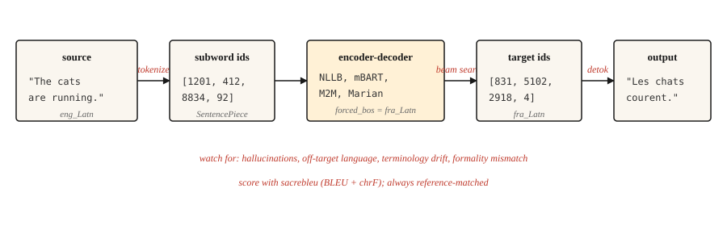

# 机器翻译

> Translation 这个任务资助了 NLP 研究三十年，而且现在仍然如此。

**Type:** Build
**Languages:** Python
**Prerequisites:** Phase 5 · 10 (Attention Mechanism), Phase 5 · 04 (GloVe, FastText, Subword)
**Time:** ~75 minutes

## 问题

模型读入一种语言的句子，并生成另一种语言的句子。长度会变化。Word order 会变化。有些 source words 会映射到多个 target words，反过来也一样。Idioms 拒绝一对一映射。"I miss you" 在法语里是 "tu me manques"，字面意思是 "you are lacking to me"。没有任何 word-level alignment 能撑过这种情况。

Machine translation 是迫使 NLP 发明 encoder-decoders、attention、transformers，并最终走向整个 LLM paradigm 的任务。每一次进步都来自同一个原因：translation quality 可测量，而且 human 和 machine 之间的差距很顽固。

本课跳过历史课，直接讲 2026 年的工作 pipeline：pretrained multilingual encoder-decoder（NLLB-200 或 mBART）、subword tokenization、beam search、BLEU 和 chrF evaluation，以及那些仍然会悄悄进入 production 的 failure modes。

## 概念



Modern MT 是在 parallel text 上训练的 transformer encoder-decoder。Encoder 按 source language 的 tokenization 读取 source。Decoder 借助 encoder output 上的 cross-attention（lesson 10），一次生成一个 target subword。Decoding 使用 beam search 来避开 greedy-decoding trap。输出会被 detokenized、detruecased，并与 reference 对比打分。

三个 operational choices 决定真实世界里的 MT quality。

- **Tokenizer.** 在 mixed-language corpus 上训练的 SentencePiece BPE。跨语言共享 vocabulary，正是 NLLB 能支持 zero-shot pairs 的原因。
- **Model size.** NLLB-200 distilled 600M 可以放在 laptop 上跑。NLLB-200 3.3B 是论文中发布的 production default。54.5B 是 research ceiling。
- **Decoding.** 通用内容使用 beam width 4-5。用 length penalty 避免输出过短。当你需要 terminology consistency 时，使用 constrained decoding。

```figure
seq2seq-alignment
```

## Build It

### Step 1: 调用 pretrained MT

```python
from transformers import AutoTokenizer, AutoModelForSeq2SeqLM

model_id = "facebook/nllb-200-distilled-600M"
tok = AutoTokenizer.from_pretrained(model_id, src_lang="eng_Latn")
model = AutoModelForSeq2SeqLM.from_pretrained(model_id)

src = "The cats are running."
inputs = tok(src, return_tensors="pt")

out = model.generate(
    **inputs,
    forced_bos_token_id=tok.convert_tokens_to_ids("fra_Latn"),
    num_beams=5,
    length_penalty=1.0,
    max_new_tokens=64,
)
print(tok.batch_decode(out, skip_special_tokens=True)[0])
```

```text
Les chats courent.
```

这里有三件事很重要。`src_lang` 告诉 tokenizer 应该使用哪种 script 和 segmentation。`forced_bos_token_id` 告诉 decoder 应该生成哪种语言。二者都是 NLLB-specific tricks；mBART 和 M2M-100 有自己的 conventions，不能互换使用。

### Step 2: BLEU 和 chrF

BLEU 衡量 output 与 reference 之间的 n-gram overlap。它使用四种 reference n-gram sizes（1-4），计算 precisions 的 geometric mean，并对过短输出施加 brevity penalty。Score 在 [0, 100] 之间。它很常用，也很难解释：30 BLEU 是 "usable"；40 是 "good"；50 是 "exceptional"；低于 1 BLEU 的差异通常是 noise。

chrF 衡量 character-level F-score。对于 morphologically rich languages，它更敏感，因为 BLEU 会低估匹配。通常和 BLEU 一起报告。

```python
import sacrebleu

hypotheses = ["Les chats courent."]
references = [["Les chats courent."]]

bleu = sacrebleu.corpus_bleu(hypotheses, references)
chrf = sacrebleu.corpus_chrf(hypotheses, references)
print(f"BLEU: {bleu.score:.1f}  chrF: {chrf.score:.1f}")
```

永远使用 `sacrebleu`。它会 normalize tokenization，让 scores 可以跨 papers 比较。自己手写 BLEU computation，正是 misleading benchmarks 的来源。

### 三层 evaluation hierarchy（2026）

Modern MT evaluation 使用三类互补的 metrics。上线时至少使用两类。

- **Heuristic**（BLEU、chrF）。快速、reference-based、可解释，但对 paraphrase 不敏感。用于 legacy comparison 和 regression detection。
- **Learned**（COMET、BLEURT、BERTScore）。基于 human judgment 训练的 neural models；比较 translation 与 source/reference 的 semantic similarity。自 2023 年以来，COMET 与 MT research 的相关性最高；在 2026 年，质量重要的 production 场景默认使用它。
- **LLM-as-judge**（reference-free）。Prompt 一个 large model，从 fluency、adequacy、tone、cultural appropriateness 等维度给 translations 打分。当 rubric 设计良好时，GPT-4-as-judge 与 human agreement 约 80%。适用于没有 reference 的 open-ended content。

实用的 2026 stack：用 `sacrebleu` 计算 BLEU 和 chrF，用 `unbabel-comet` 计算 COMET，再用 prompted LLM 得到最终 human-facing signal。在 production data 上信任任何 metric 之前，先用 50-100 个 human-labeled examples 做 calibration。

Reference-free metrics（COMET-QE、BLEURT-QE、LLM-as-judge）让你可以在没有 reference 的情况下评价 translations；这对缺少 reference translations 的 long-tail language pairs 很重要。

### Step 3: production 中会坏掉什么

上面的工作 pipeline 会在 80% 的时间里生成流畅 translation，并在剩下 20% 的时间里静默失败。具名 failure modes：

- **Hallucination.** Model 发明 source 中没有的内容。常见于不熟悉的 domain vocabulary。症状：output 很流畅，但声称了 source 没有表达的事实。Mitigation：对 domain terms 使用 constrained decoding；regulated content 加 human review；监控 output 是否比 input 长很多。
- **Off-target generation.** Model 翻译成了错误语言。NLLB 在 rare language pairs 上格外容易这样。Mitigation：验证 `forced_bos_token_id`，并且始终用 language-ID model 检查 output。
- **Terminology drift.** "Sign up" 在 doc 1 中变成 "s'inscrire"，在 doc 2 中变成 "créer un compte"。对 UI text 和 user-facing strings 来说，一致性比 raw quality 更重要。Mitigation：glossary-constrained decoding 或 post-edit dictionary。
- **Formality mismatch.** 法语里的 "tu" vs "vous"，日语里的 politeness levels。Model 会选择 training 中更常见的形式。对 customer-facing content 来说，这通常是错的。Mitigation：如果 model 支持，用带 formality token 的 prompt prefix；或者在 formal-only corpora 上 fine-tune 一个小模型。
- **Length explosion on short input.** 很短的 input sentences 经常生成过长 translations，因为 source tokens 少于约 5 个时，length penalty 会突然失效。Mitigation：设置与 source length 成比例的 hard max-length cap。

### Step 4: 为 domain fine-tune

Pretrained models 是 generalists。Legal、medical 或 game-dialog translation，会从 domain parallel data 上的 fine-tuning 中明显受益。Recipe 并不神秘：

```python
from transformers import Trainer, TrainingArguments
from datasets import Dataset

pairs = [
    {"src": "The defendant pleaded guilty.", "tgt": "L'accusé a plaidé coupable."},
]

ds = Dataset.from_list(pairs)


def preprocess(ex):
    return tok(
        ex["src"],
        text_target=ex["tgt"],
        truncation=True,
        max_length=128,
        padding="max_length",
    )


ds = ds.map(preprocess, remove_columns=["src", "tgt"])

args = TrainingArguments(output_dir="out", per_device_train_batch_size=4, num_train_epochs=3, learning_rate=3e-5)
Trainer(model=model, args=args, train_dataset=ds).train()
```

几千个高质量 parallel examples，胜过几十万个 noisy web-scraped examples。Training data 的质量，是 production 中最大的 lever。

## Use It

2026 年的 MT production stack：

| Use case | Recommended starting point |
|---------|---------------------------|
| Any-to-any, 200 languages | `facebook/nllb-200-distilled-600M` (laptop) or `nllb-200-3.3B` (production) |
| English-centric, high quality, 50 languages | `facebook/mbart-large-50-many-to-many-mmt` |
| Short runs, cheap inference, English-French/German/Spanish | Helsinki-NLP / Marian models |
| Latency-critical browser-side | ONNX-quantized Marian (~50 MB) |
| Maximum quality, willing to pay | GPT-4 / Claude / Gemini with translation prompts |

截至 2026 年，LLMs 在几个 language pairs 上已经超过 specialized MT models，尤其是在 idiomatic content 和 long context 上。Tradeoff 是 per-token cost 和 latency。当 context length、stylistic consistency 或通过 prompting 做 domain adaptation 比 throughput 更重要时，选择 LLM。

## Ship It

保存为 `outputs/skill-mt-evaluator.md`：

```markdown
---
name: mt-evaluator
description: Evaluate a machine translation output for shipping.
version: 1.0.0
phase: 5
lesson: 11
tags: [nlp, translation, evaluation]
---

Given a source text and a candidate translation, output:

1. Automatic score estimate. BLEU and chrF ranges you would expect. State whether a reference is available.
2. Five-point human-verifiable check list: (a) content preservation (no hallucinations), (b) correct language, (c) register / formality match, (d) terminology consistency with glossary if provided, (e) no truncation or length explosion.
3. One domain-specific issue to probe. E.g., for legal: named entities and statute citations. For medical: drug names and dosages. For UI: placeholder variables `{name}`.
4. Confidence flag. "Ship" / "Ship with review" / "Do not ship". Tie to the severity of issues found in step 2.

Refuse to ship a translation without a language-ID check on output. Refuse to evaluate without a reference unless the user explicitly opts in to reference-free scoring (COMET-QE, BLEURT-QE). Flag any content over 1000 tokens as likely needing chunked translation.
```

## 练习

1. **Easy.** 使用 `nllb-200-distilled-600M` 把一个 5-sentence English paragraph 翻译成 French，再翻回 English。衡量 round-trip 与 original 的接近程度。你应该看到 semantic preservation，同时看到 word-choice drift。
2. **Medium.** 使用 `fasttext lid.176` 或 `langdetect` 为 translation outputs 实现 language-ID check。把它集成进 MT call，让 off-target generations 在返回前被捕获。
3. **Hard.** 在你选择的 5,000-pair domain corpus 上 fine-tune `nllb-200-distilled-600M`。在 held-out set 上测量 fine-tuning 前后的 BLEU。报告哪些类型的 sentences 改善了，哪些退化了。

## 关键术语

| Term | 人们通常怎么说 | 它实际是什么意思 |
|------|----------------|------------------|
| BLEU | Translation score | 带 brevity penalty 的 n-gram precision。[0, 100]。 |
| chrF | Character F-score | Character-level F-score。对 morphologically rich languages 更敏感。 |
| NMT | Neural MT | 在 parallel text 上训练的 transformer encoder-decoder。2017+ 的默认方案。 |
| NLLB | No Language Left Behind | Meta 的 200-language MT model family。 |
| Constrained decoding | Controlled output | 强制特定 tokens 或 n-grams 在 output 中出现 / 不出现。 |
| Hallucination | Invented content | Model output 中出现 source 不支持的内容。 |

## 延伸阅读

- [Costa-jussà et al. (2022). No Language Left Behind: Scaling Human-Centered Machine Translation](https://arxiv.org/abs/2207.04672) — NLLB paper。
- [Post (2018). A Call for Clarity in Reporting BLEU Scores](https://aclanthology.org/W18-6319/) — 为什么 `sacrebleu` 才是报告 BLEU 的唯一正确方式。
- [Popović (2015). chrF: character n-gram F-score for automatic MT evaluation](https://aclanthology.org/W15-3049/) — chrF paper。
- [Hugging Face MT guide](https://huggingface.co/docs/transformers/tasks/translation) — 实用 fine-tuning walkthrough。
