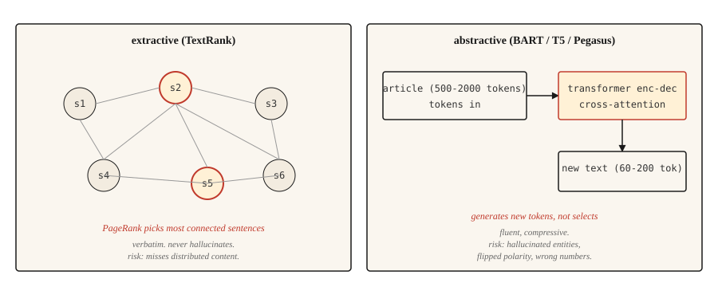

# 文本摘要

> 抽取式系统告诉你文档说了什么。生成式系统告诉你作者想表达什么。任务不同，坑也不同。

**Type:** Build
**Languages:** Python
**Prerequisites:** Phase 5 · 02 (BoW + TF-IDF), Phase 5 · 11 (Machine Translation)
**Time:** ~75 minutes

## 学习目标

- 区分抽取式摘要和生成式摘要，并说清各自的风险边界
- 从句子相似度图实现一个 TextRank 摘要器
- 使用 BART 做生成式新闻摘要，并理解何时需要换领域模型或微调
- 用 ROUGE-1、ROUGE-2 和 ROUGE-L 评估摘要，并知道 ROUGE 的局限
- 为生成式摘要设计事实性检查，识别实体替换、数字漂移和极性翻转等失败模式

## 问题

一篇 2,000 词的新闻文章进入你的 feed。你需要用 120 个词抓住它。你可以从文章里挑出最重要的三句话（抽取式），也可以用自己的话重写内容（生成式）。两者都叫摘要。但它们是完全不同的问题。

抽取式摘要是一个排序问题。给每个句子打分，返回 top-`k`。输出总是合乎语法，因为它逐字取自原文。风险是错过分布在文章多个位置的内容。

生成式摘要是一个生成问题。Transformer 在输入条件下生成新文本。输出流畅、压缩度高，但可能幻觉出源文档里没有的事实。风险是自信地编造。

本课会构建两种摘要器，并点出各自必须承担的失败模式。

## 概念



**抽取式。** 把文章看成一张图，节点是句子，边是相似度。在图上运行 PageRank（或类似算法），根据每个句子与其他句子的连接程度给它打分。得分最高的句子就是摘要。经典实现是 **TextRank**（Mihalcea and Tarau, 2004）。

**生成式。** 在文档-摘要 pair 上微调一个 Transformer encoder-decoder（BART、T5、Pegasus）。推理时，模型读取文档，并通过 cross-attention 一个 token 一个 token 地生成摘要。Pegasus 尤其使用了 gap-sentence 预训练目标，因此即使少量微调也很擅长摘要任务。

用 **ROUGE**（Recall-Oriented Understudy for Gisting Evaluation）做评估。ROUGE-1 和 ROUGE-2 评估 unigram 与 bigram 重叠。ROUGE-L 评估最长公共子序列。越高越好，但 40 ROUGE-L 已经算“好”，50 算“非常强”。每篇论文都会报告三者。使用 `rouge-score` 包。

## Build It

### Step 1：TextRank（抽取式）

```python
import math
import re
from collections import Counter


def sentence_split(text):
    return re.split(r"(?<=[.!?])\s+", text.strip())


def similarity(s1, s2):
    w1 = Counter(s1.lower().split())
    w2 = Counter(s2.lower().split())
    intersection = sum((w1 & w2).values())
    denom = math.log(len(w1) + 1) + math.log(len(w2) + 1)
    if denom == 0:
        return 0.0
    return intersection / denom


def textrank(text, top_k=3, damping=0.85, iterations=50, epsilon=1e-4):
    sentences = sentence_split(text)
    n = len(sentences)
    if n <= top_k:
        return sentences

    sim = [[0.0] * n for _ in range(n)]
    for i in range(n):
        for j in range(n):
            if i != j:
                sim[i][j] = similarity(sentences[i], sentences[j])

    scores = [1.0] * n
    for _ in range(iterations):
        new_scores = [1 - damping] * n
        for i in range(n):
            total_out = sum(sim[i]) or 1e-9
            for j in range(n):
                if sim[i][j] > 0:
                    new_scores[j] += damping * sim[i][j] / total_out * scores[i]
        if max(abs(s - ns) for s, ns in zip(scores, new_scores)) < epsilon:
            scores = new_scores
            break
        scores = new_scores

    ranked = sorted(range(n), key=lambda k: scores[k], reverse=True)[:top_k]
    ranked.sort()
    return [sentences[i] for i in ranked]
```

有两点值得点名。相似度函数使用 log-normalized word overlap，这是原始 TextRank 的一个变体。TF-IDF 向量的 cosine similarity 也能工作。阻尼系数 0.85 和迭代次数来自 PageRank 的默认设定。

### Step 2：用 BART 做生成式摘要

```python
from transformers import pipeline

summarizer = pipeline("summarization", model="facebook/bart-large-cnn")

article = """(long news article text)"""

summary = summarizer(article, max_length=120, min_length=60, do_sample=False)
print(summary[0]["summary_text"])
```

BART-large-CNN 在 CNN/DailyMail 语料上微调过。它开箱就能产出新闻风格摘要。其他领域（科学论文、对话、法律）要使用对应的 Pegasus checkpoint，或者在你的目标数据上微调。

### Step 3：ROUGE 评估

```python
from rouge_score import rouge_scorer

scorer = rouge_scorer.RougeScorer(["rouge1", "rouge2", "rougeL"], use_stemmer=True)
scores = scorer.score(reference_summary, generated_summary)
print({k: round(v.fmeasure, 3) for k, v in scores.items()})
```

始终使用 stemming。否则，"running" 和 "run" 会被算作不同词，ROUGE 会低估重叠。

### ROUGE 之外（2026 年摘要评估）

ROUGE 已经主导摘要指标二十年，但到 2026 年，单独使用它已经不够。对 NLG 论文的大规模 meta-analysis 显示：

- **BERTScore**（上下文嵌入相似度）在 2023 年前后站稳脚跟，现在大多数摘要论文都会把它和 ROUGE 一起报告。
- **BARTScore** 把评估视为生成：给定源文档，计算预训练 BART 赋予摘要的可能性。
- **MoverScore**（上下文嵌入上的 Earth Mover's Distance）在 2025 年摘要 benchmark 中拿到第一，因为它比 ROUGE 更能捕捉语义重叠。
- **FactCC** 和 **QA-based faithfulness** 在 2021-2023 年很常见，现在常被 **G-Eval** 取代；G-Eval 是一个 GPT-4 prompt chain，会用 chain-of-thought reasoning 给 coherence、consistency、fluency、relevance 打分。
- 当 rubric 设计得好时，**G-Eval** 和类似 LLM-judge 方法与人类判断的一致率约为 80%。

生产建议：报告 ROUGE-L 以便和旧系统比较，报告 BERTScore 评估语义重叠，使用 G-Eval 评估连贯性和事实性。用 50-100 条人工标注摘要做校准。

### Step 4：事实性问题

生成式摘要容易产生幻觉。抽取式摘要的幻觉风险低得多，因为输出逐字来自源文档；不过如果源句子脱离上下文、已经过时，或者引用顺序被打乱，它们仍然可能误导读者。这是生产系统在合规相关内容上仍然偏爱抽取式方法的最大原因。

需要能说出这些幻觉类型：

- **实体替换。** 源文档说 "John Smith"。摘要说 "John Brown"。
- **数字漂移。** 源文档说 "25,000"。摘要说 "25 million"。
- **极性翻转。** 源文档说 "rejected the offer"。摘要说 "accepted the offer"。
- **事实发明。** 源文档没有提到 CEO。摘要说 CEO 批准了。

有效的评估方法：

- **FactCC。** 一个二分类器，训练目标是判断源句子和摘要句子之间是否蕴含。预测 factual / not factual。
- **QA-based factuality。** 让 QA 模型回答答案能在源文档中找到的问题。如果摘要支持了不同答案，就标记。
- **Entity-level F1。** 比较源文档和摘要中的命名实体。只出现在摘要里的实体值得怀疑。

对任何事实性重要的用户可见内容（新闻、医疗、法律、金融），抽取式是更安全的默认选择。生成式摘要需要把事实性检查放进流程。

## Use It

2026 年的技术栈：

| 用例 | 推荐 |
|------|------|
| 新闻，3-5 句摘要，英文 | `facebook/bart-large-cnn` |
| 科学论文 | `google/pegasus-pubmed` 或微调过的 T5 |
| 多文档、长篇 | 任何 32k+ context 的 LLM，通过 prompt 完成 |
| 对话摘要 | `philschmid/bart-large-cnn-samsum` |
| 抽取式，结构上低幻觉风险 | TextRank 或 `sumy` 的 LSA / LexRank |

如果计算不是约束，长上下文 LLM 在 2026 年经常超过专用模型。取舍是成本和可复现性；专用模型会给出更一致的输出。

## Ship It

保存为 `outputs/skill-summary-picker.md`：

```markdown
---
name: summary-picker
description: Pick extractive or abstractive, named library, factuality check.
version: 1.0.0
phase: 5
lesson: 12
tags: [nlp, summarization]
---

Given a task (document type, compliance requirement, length, compute budget), output:

1. Approach. Extractive or abstractive. Explain in one sentence why.
2. Starting model / library. Name it. `sumy.TextRankSummarizer`, `facebook/bart-large-cnn`, `google/pegasus-pubmed`, or an LLM prompt.
3. Evaluation plan. ROUGE-1, ROUGE-2, ROUGE-L (use rouge-score with stemming). Plus factuality check if abstractive.
4. One failure mode to probe. Entity swap is the most common in abstractive news summarization; flag samples where source entities do not appear in summary.

Refuse abstractive summarization for medical, legal, financial, or regulated content without a factuality gate. Flag input over the model's context window as needing chunked map-reduce summarization (not just truncation).
```

## 练习

1. **Easy.** 在 5 篇新闻文章上运行 TextRank。把 top-3 句子和 reference summary 比较。测量 ROUGE-L。你应该会在 CNN/DailyMail 风格文章上看到 30-45 ROUGE-L。
2. **Medium.** 实现 entity-level factuality：从源文档和摘要中抽取命名实体（spaCy），计算摘要中源实体的 recall，以及摘要实体相对于源文档的 precision。高 precision、低 recall 表示安全但简短；低 precision 表示有幻觉实体。
3. **Hard.** 在 50 篇 CNN/DailyMail 文章上比较 BART-large-CNN 与一个 LLM（Claude 或 GPT-4）。报告 ROUGE-L、事实性（用 entity F1）和单条摘要成本。记录各自胜出的场景。

## 关键术语

| 术语 | 常见说法 | 实际含义 |
|------|----------|----------|
| Extractive | 挑句子 | 逐字返回源文档里的句子。不会凭空生成内容。 |
| Abstractive | 重写 | 在源文档条件下生成新文本。可能幻觉。 |
| ROUGE | 摘要指标 | 系统输出与 reference 之间的 n-gram / LCS 重叠。 |
| TextRank | 基于图的抽取式方法 | 在句子相似度图上运行 PageRank。 |
| Factuality | 是否正确 | 摘要中的 claims 是否被源文档支持。 |
| Hallucination | 编出来的内容 | 摘要中源文档不支持的内容。 |

## 延伸阅读

- [Mihalcea and Tarau (2004). TextRank: Bringing Order into Texts](https://aclanthology.org/W04-3252/) — 抽取式摘要的经典论文。
- [Lewis et al. (2019). BART: Denoising Sequence-to-Sequence Pre-training](https://arxiv.org/abs/1910.13461) — BART 论文。
- [Zhang et al. (2019). PEGASUS: Pre-training with Extracted Gap-sentences](https://arxiv.org/abs/1912.08777) — Pegasus 与 gap-sentence objective。
- [Lin (2004). ROUGE: A Package for Automatic Evaluation of Summaries](https://aclanthology.org/W04-1013/) — ROUGE 论文。
- [Maynez et al. (2020). On Faithfulness and Factuality in Abstractive Summarization](https://arxiv.org/abs/2005.00661) — 事实性问题的综述论文。
