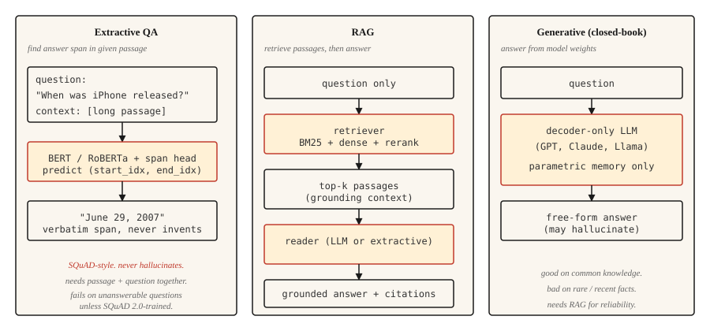

# 问答系统

> 三类系统塑造了现代 QA。抽取式系统寻找片段。检索增强系统把答案锚定到文档中。生成式系统直接产出答案。每个现代 AI 助手，都是这三者的混合体。

**Type:** Build
**Languages:** Python
**Prerequisites:** Phase 5 · 11（Machine Translation），Phase 5 · 10（Attention Mechanism）
**Time:** ~75 minutes

## 问题

用户输入 "When did the first iPhone launch?"，期待得到的是 "June 29, 2007." 不是 "Apple's history is long and varied."，也不是孤零零的 "2007"。他们想要一个直接、有依据、正确的答案。

过去十年里，三种架构主导了问答系统。

- **抽取式 QA。** 给定一个问题和一段已知包含答案的文章，在文章中找出答案片段的起始和结束下标。SQuAD 是标准 benchmark。
- **开放域 QA。** 不提供文章。先检索相关段落，再抽取或生成答案。这是今天每条 RAG 流水线的地基。
- **生成式 / 闭卷 QA。** 大语言模型从参数记忆中回答。没有检索。推理最快，但事实可靠性最低。

2026 年的趋势是混合式：检索最好的几段文本，然后提示生成式模型基于这些段落作答。这就是 RAG，第 14 课会深入讲检索这一半。本课构建 QA 这一半。

## 概念



**抽取式。** 用 transformer（BERT 家族）把问题和文章一起编码。训练两个 head，分别预测答案的起始和结束 token 下标。损失是在合法位置上的交叉熵。输出是文章中的一个 span。它不会幻觉（由构造保证），也无法处理文章中没有答案的问题（同样由构造保证）。

**检索增强（RAG）。** 两阶段。第一步，retriever 从语料库中找到 top-`k` 段落。第二步，reader（抽取式或生成式）使用这些段落产出答案。retriever-reader 拆分让两者可以独立训练和评估。现代 RAG 通常还会在两者之间加入 reranker。

**生成式。** decoder-only LLM（GPT、Claude、Llama）从已学习的权重中作答。没有检索步骤。它在常识问题上很强，在低频事实或近期事实上可能灾难性失败。幻觉率和预训练数据中的事实频率呈反相关。

## Build It

### 第 1 步：用预训练模型做抽取式 QA

```python
from transformers import pipeline

qa = pipeline("question-answering", model="deepset/roberta-base-squad2")

passage = (
    "Apple Inc. released the first iPhone on June 29, 2007. "
    "The device was announced by Steve Jobs at Macworld in January 2007."
)
question = "When was the first iPhone released?"

answer = qa(question=question, context=passage)
print(answer)
```

```python
{'score': 0.98, 'start': 57, 'end': 70, 'answer': 'June 29, 2007'}
```

`deepset/roberta-base-squad2` 在 SQuAD 2.0 上训练，数据中包含无法回答的问题。默认情况下，`question-answering` pipeline 即使在模型的 null score 获胜时，也会返回分数最高的 span，它**不会**自动返回空答案。要得到显式的“无答案”行为，需要在调用 pipeline 时传入 `handle_impossible_answer=True`：只有当 null score 超过所有 span score 时，pipeline 才会返回空答案。不管哪种方式，都要检查 `score` 字段。

### 第 2 步：检索增强流水线（草图）

```python
from sentence_transformers import SentenceTransformer
import numpy as np

encoder = SentenceTransformer("sentence-transformers/all-MiniLM-L6-v2")

corpus = [
    "Apple Inc. released the first iPhone on June 29, 2007.",
    "Macworld 2007 featured the iPhone announcement by Steve Jobs.",
    "Android launched in 2008 as Google's mobile operating system.",
    "The first iPod was released in 2001.",
]
corpus_embeddings = encoder.encode(corpus, normalize_embeddings=True)


def retrieve(question, top_k=2):
    q_emb = encoder.encode([question], normalize_embeddings=True)
    sims = (corpus_embeddings @ q_emb.T).squeeze()
    order = np.argsort(-sims)[:top_k]
    return [corpus[i] for i in order]


def answer(question):
    passages = retrieve(question, top_k=2)
    combined = " ".join(passages)
    return qa(question=question, context=combined)


print(answer("When was the first iPhone released?"))
```

这是一条两阶段流水线。稠密检索器（Sentence-BERT）通过语义相似度找到相关段落。抽取式 reader（RoBERTa-SQuAD）从合并后的 top 段落里抽出答案 span。它适合小语料库。如果是百万文档语料库，请使用 FAISS 或向量数据库。

### 第 3 步：带 RAG 的生成式 QA

```python
def rag_generate(question, llm):
    passages = retrieve(question, top_k=3)
    prompt = f"""Context:
{chr(10).join('- ' + p for p in passages)}

Question: {question}

Answer using only the context above. If the context does not contain the answer, say "I don't know."
"""
    return llm(prompt)
```

提示词模式很重要。明确告诉模型必须基于上下文作答，并在上下文不足时返回 "I don't know"，相比朴素提示，可以把幻觉率降低 40-60%。更复杂的模式会加入引用、置信度分数和结构化抽取。

### 第 4 步：反映真实世界的评估

SQuAD 使用 **Exact Match（EM）** 和 **token-level F1**。EM 是归一化后的严格匹配（小写化、去标点、去冠词）：预测要么完全匹配，要么得 0。F1 基于预测和参考答案之间的 token 重叠计算，会给部分分。两者都会低估改写表达："June 29, 2007" vs "June 29th, 2007" 通常会得到 0 EM（序数形式破坏了归一化），但因为 token 有重叠，F1 仍然会很高。

生产级 QA 需要看：

- **答案准确率**（LLM judge 或人工评估，因为指标捕捉不了语义等价）。
- **引用准确率。** 被引用段落是否真的支持答案？可以用生成引用和检索段落之间的字符串匹配做自动检查。
- **拒答校准。** 当答案不在检索段落里时，系统是否能正确说 "I don't know"？测量错误自信率。
- **检索召回率。** 在评估 reader 之前，先测 retriever 是否把正确段落放进了 top-`k`。reader 修不好缺失段落。

### RAGAS：2026 年生产级评估框架

`RAGAS` 专门为 RAG 系统设计，是 2026 年上线系统的默认选择。它不需要 gold reference，就能评估四个维度：

- **Faithfulness（忠实度）。** 答案中的每条 claim 是否来自检索上下文？用基于 NLI 的蕴含关系测量。这是你的主要幻觉指标。
- **Answer relevance（答案相关性）。** 答案是否回应了问题？通过从答案生成假想问题，再与真实问题比较来测量。
- **Context precision（上下文精确率）。** 检索出的 chunks 里，有多少比例真的相关？低精确率意味着 prompt 里有噪声。
- **Context recall（上下文召回率）。** 检索集合是否包含所有必要信息？低召回率意味着 reader 无法成功。

无参考答案评分让你可以在没有人工整理 gold answer 的情况下，用真实生产流量做评估。对于 exact-match 指标无用的开放式问题，再叠加 LLM-as-judge。

`pip install ragas`。接入你的 retriever + reader。每条 query 得到四个标量。对回归发告警。

## Use It

2026 年的技术栈。

| 使用场景 | 推荐方案 |
|---------|----------|
| 给定文章，寻找答案 span | `deepset/roberta-base-squad2` |
| 固定语料库上，不能接受闭卷回答 | RAG：稠密检索器 + LLM reader |
| 文档库上的实时 QA | RAG，使用 hybrid（BM25 + dense）retriever + reranker（第 14 课） |
| 对话式 QA（后续追问） | LLM 搭配会话历史，并在每轮执行 RAG |
| 高度事实性、受监管领域 | 在权威语料上做抽取式 QA；绝不单独使用生成式 |

抽取式 QA 在 2026 年已经不流行，因为搭配 LLM 的 RAG 能处理更多情况。但在要求逐字引用的场景里，它仍然会上线：法律研究、监管合规、审计工具。

## Ship It

保存为 `outputs/skill-qa-architect.md`：

```markdown
---
name: qa-architect
description: Choose QA architecture, retrieval strategy, and evaluation plan.
version: 1.0.0
phase: 5
lesson: 13
tags: [nlp, qa, rag]
---

Given requirements (corpus size, question type, factuality constraint, latency budget), output:

1. Architecture. Extractive, RAG with extractive reader, RAG with generative reader, or closed-book LLM. One-sentence reason.
2. Retriever. None, BM25, dense (name the encoder), or hybrid.
3. Reader. SQuAD-tuned model, LLM by name, or "domain-fine-tuned DistilBERT."
4. Evaluation. EM + F1 for extractive benchmarks; answer accuracy + citation accuracy + refusal calibration for production. Name what you are measuring and how you are measuring it.

Refuse closed-book LLM answers for regulatory or compliance-sensitive questions. Refuse any QA system without a retrieval-recall baseline (you cannot evaluate the reader without knowing the retriever surfaced the right passage). Flag questions that require multi-hop reasoning as needing specialized multi-hop retrievers like HotpotQA-trained systems.
```

## 练习

1. **Easy.** 在 10 段 Wikipedia 文章上搭建上面的 SQuAD 抽取式 pipeline。手写 10 个问题。测量答案正确的频率。如果文章和问题干净，你应该看到 7-9 个正确。
2. **Medium.** 加入拒答分类器。当最高检索分数低于某个阈值（比如 0.3 cosine）时，不调用 reader，而是返回 "I don't know"。在 held-out 集合上调这个阈值。
3. **Hard.** 在你任选的 10,000 文档语料上构建 RAG 流水线。实现 hybrid retrieval（BM25 + dense），并使用 RRF fusion（见第 14 课）。分别测量加入和不加入 hybrid 步骤时的答案准确率。记录哪类问题受益最多。

## 关键术语

| 术语 | 人们常说 | 实际含义 |
|------|----------|----------|
| 抽取式 QA | 找答案片段 | 在给定文章中预测答案的起始和结束下标。 |
| 开放域 QA | 在语料库上做 QA | 不给定文章；必须先检索再回答。 |
| RAG | 先检索再生成 | Retrieval-augmented generation。retriever + reader 流水线。 |
| SQuAD | 标准 benchmark | Stanford Question Answering Dataset。使用 EM + F1 指标。 |
| 幻觉 | 编造答案 | reader 输出了检索上下文不支持的内容。 |
| 拒答校准 | 知道何时闭嘴 | 系统在无法回答时能正确说 "I don't know"。 |

## 延伸阅读

- [Rajpurkar et al. (2016). SQuAD: 100,000+ Questions for Machine Comprehension of Text](https://arxiv.org/abs/1606.05250) — benchmark 论文。
- [Karpukhin et al. (2020). Dense Passage Retrieval for Open-Domain QA](https://arxiv.org/abs/2004.04906) — DPR，QA 中的标准稠密检索器。
- [Lewis et al. (2020). Retrieval-Augmented Generation for Knowledge-Intensive NLP Tasks](https://arxiv.org/abs/2005.11401) — 命名 RAG 的论文。
- [Gao et al. (2023). Retrieval-Augmented Generation for Large Language Models: A Survey](https://arxiv.org/abs/2312.10997) — 全面的 RAG 综述。
